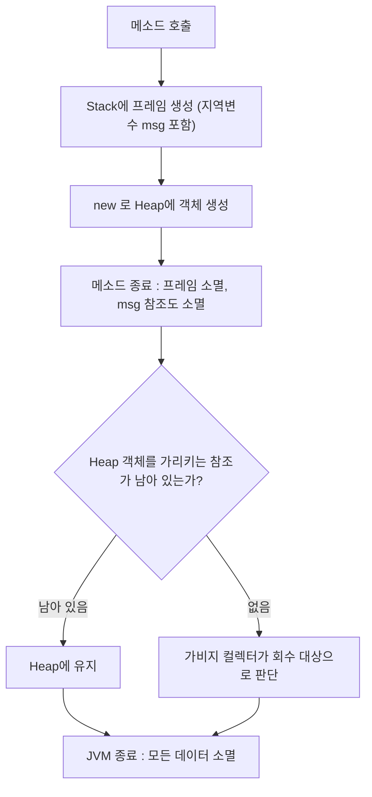
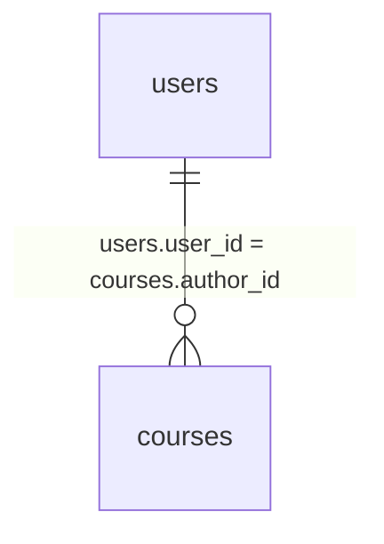
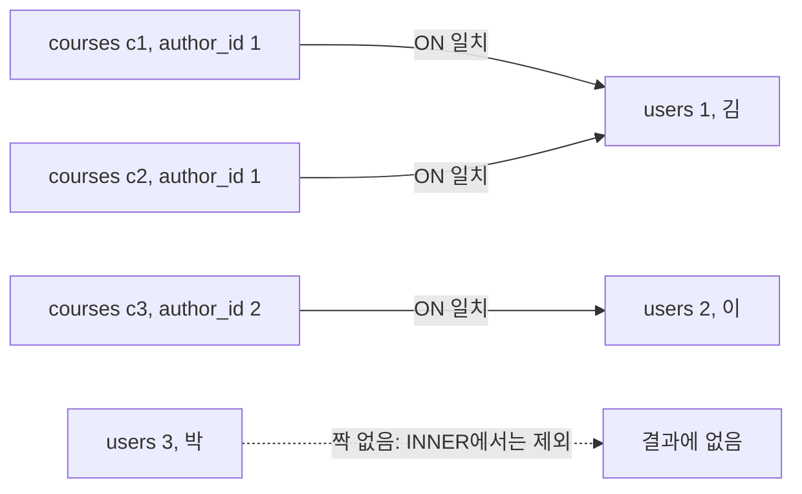
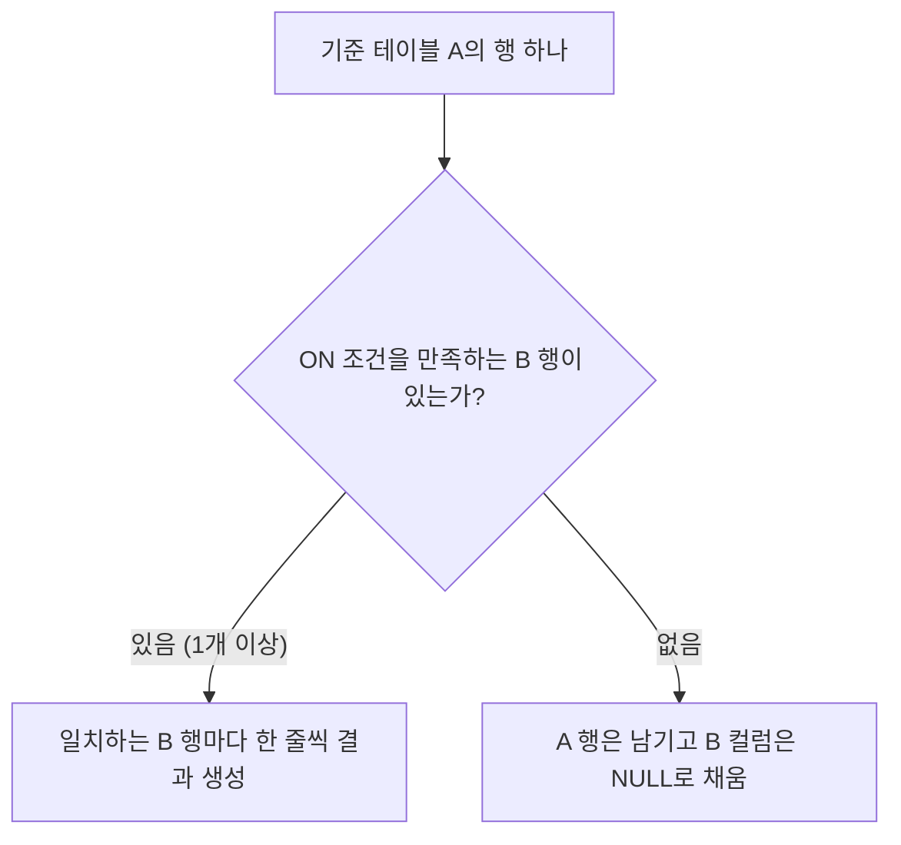
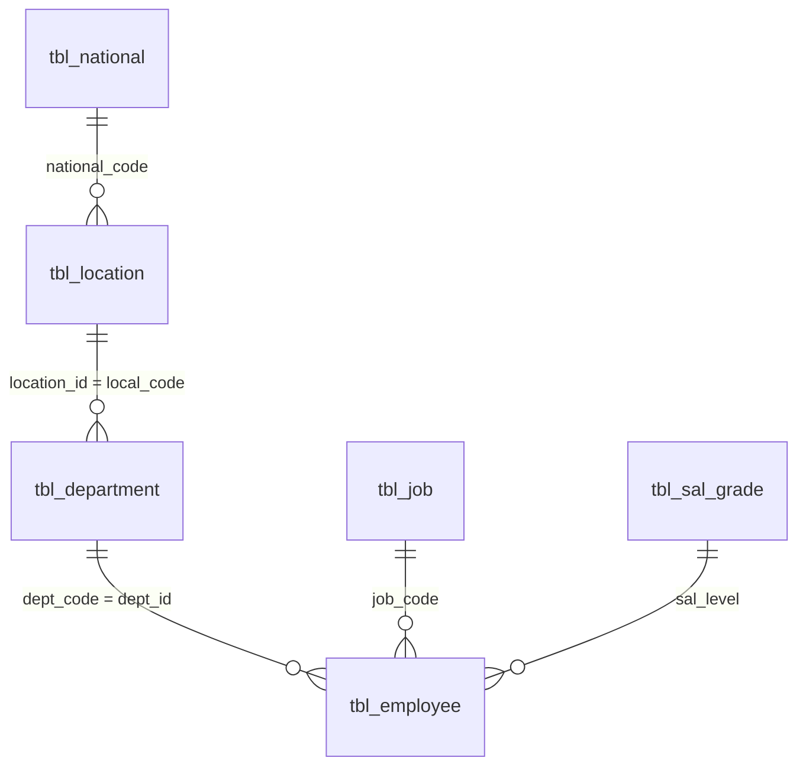

## 들어가며 (Situation)

오늘(10월 12일)부터 Java에서 **MySQL**로 넘어왔다. 수업 SQL은 `01_select`부터 `07_Join`까지 7개 파일을 다뤘고, 내 필기는 "데이터베이스를 왜 배워야 할까?"라는 질문으로 시작한다. 이 글은 그 필기를 뼈대로 삼고, 수업 SQL은 필기를 뒷받침하는 예시 코드로 썼다.

| 수업 파일 | 주제 | 이 글의 위치 |
|---|---|---|
| 01_select | SELECT, 별칭(AS), 함수 | 해결 과정 2 |
| 02_orderby | 정렬, NULL 정렬 | 해결 과정 2 |
| 03_where | 조건절, 비교 연산자, LIKE, IN, NULL | 해결 과정 3 |
| 04_distinct | 중복 제거 | 해결 과정 3 |
| 05_limit | 개수 제한, offset | 해결 과정 4 |
| 06_grouping | 집계 함수, GROUP BY, HAVING | 해결 과정 5 |
| 07_Join | INNER / LEFT / RIGHT JOIN, NULL | 해결 과정 6 (비중이 가장 큼) |

**먼저 밝혀 둘 것.** 이 글을 쓰는 환경에는 MySQL 서버가 없어서 **쿼리를 직접 실행하지 못했다.** 그래서 이 글에는 실행 결과 출력이 없다. 글 안의 표기는 세 가지로 구분한다.

- **수업 코드 / 내 연습 쿼리**: 수업 파일과 내 연습 파일에 있는 그대로 인용한 것.
- **예시 코드 / 예시 데이터**: 설명을 위해 이번에 직접 만든 것. 실행해 보지 않았다.
- **정의에 따라 도출한 값**: 예시 데이터에 JOIN 등의 정의를 적용해 손으로 계산한 결과. 실행 결과가 아니다.

## 문제 상황 (Task)

오늘 풀어야 했던 질문은 이렇다.

- Java만으로도 프로그램은 돌아가는데, **왜 굳이 DB를 배우는가?**
- 조회(SELECT)에서 `WHERE`, `ORDER BY`, `LIMIT`, `GROUP BY`, `HAVING`은 각각 어느 위치에서 무슨 일을 하는가?
- 필기의 의문들: 별칭에 큰따옴표를 써도 되나? 백틱과 작은따옴표는 뭐가 다른가? `=`와 `LIKE`는 어떻게 다른가?
- 테이블을 왜 쪼개 놓고, **쪼갠 테이블을 JOIN으로 어떻게 다시 합치는가?** (JOIN이 오래 이해되지 않았다.)
- 필기의 TODO: `HAVING`과 `WHERE`의 차이를 다시 확인하고, `HAVING`이 어느 파일에 있는지 확인한다.

제약은 둘이다. 수업 주석은 단순화된 설명이라 공식 문서와 대조가 필요했고, 서버가 없어 실행 검증은 할 수 없었다. 그래서 불확실한 것은 MySQL 8.0 공식 문서에 근거가 있을 때만 단정했다.

## 해결 과정 (Action)

### 1. 데이터베이스를 왜 배워야 할까

#### 1-1. 객체는 JVM 메모리 어디에 살고 언제 사라지는가

필기는 이렇게 정리되어 있다. 메소드가 끝나면 **Stack의 프레임이 통째로 사라지고** 그 안의 지역변수(필기의 예: `msg`)도 함께 사라진다. 하지만 객체는 **Heap**에 있어서, 그 객체를 가리키는 **참조가 모두 끊겨야** 정리 대상이 된다. 그리고 서버(JVM)가 종료되면 남는 데이터는 하나도 없다. RAM이 휘발성 메모리이기 때문이다.



필기에는 "null이라 하는 순간 힙 공간을 정리한다"고 적었는데, 이 부분은 조금 고쳐서 이해했다. 변수에 `null`을 대입하면 **참조가 끊길 뿐**이고, 실제 회수 시점은 가비지 컬렉터가 정한다. 즉 "끊기는 순간 접근 불가가 되고, 회수는 그 이후"다. JVM 명세는 Heap의 객체 저장 공간을 자동 저장소 관리 시스템(가비지 컬렉터)이 회수한다고 설명한다. ([JVMS 2.5.3 Heap](https://docs.oracle.com/javase/specs/jvms/se21/html/jvms-2.html#jvms-2.5.3), [JVMS 2.5.2 Java Virtual Machine Stacks](https://docs.oracle.com/javase/specs/jvms/se21/html/jvms-2.html#jvms-2.5.2))

결론은 필기와 같다. **메모리에만 두는 데이터는 라이프 사이클이 프로세스를 넘지 못한다.** 서버를 껐다 켜도 남아야 하는 데이터(회원, 주문 등)는 프로세스 밖, 즉 디스크에 저장되는 곳으로 내보내야 한다.

#### 1-2. 파일로 저장하면 안 될까

필기는 "파일로 처리하면 스레드가 달라 서로 소통이 안 되어 한정 수량 관리가 어렵다. DB는 lock을 걸 수 있다"고 적었다. 이 문장은 그대로 옮기지 않고 풀어 썼다. 같은 JVM 안의 스레드는 Heap을 공유하고, Java에도 파일 락(`FileLock`)이 있어서 "스레드끼리 소통이 아예 안 된다"고 쓰면 부정확할 수 있다. ([FileLock Javadoc](https://docs.oracle.com/en/java/javase/21/docs/api/java.base/java/nio/channels/FileLock.html)) 그래서 핵심을 **"동시에 바꾸는 것을 제어하는 장치를 직접 만들어야 하는가, DB가 제공하는가"** 로 바꿔 썼다.

| 상황 | 파일 저장 | DB |
|---|---|---|
| 한정 수량 재고를 동시에 주문 | 읽기-수정-쓰기 순서를 지키는 락/동기화를 직접 설계 | 락과 트랜잭션 기능을 DBMS가 제공 (InnoDB 잠금: [공식 문서](https://dev.mysql.com/doc/refman/8.0/en/innodb-locking.html)) |
| 대용량에서 조건에 맞는 것만 찾기 | 파일을 읽어서 직접 걸러야 함 | `WHERE`로 조건 지정, 인덱스 활용 가능 |
| 서버가 여러 대 | 여러 서버가 같은 파일을 안전하게 공유하는 방법을 직접 해결 | 여러 서버가 하나의 DB에 접속 |
| 중간에 실패하면 되돌리기 | 직접 구현 | 트랜잭션(롤백) |

필기의 "동시 주문, 대용량, 서버가 여러 개, 되돌려야 하는 처리"가 바로 이 표의 네 행이다. 이 표의 "DB 쪽" 설명은 일반 개념이며, 이 글에서 직접 실험한 것은 아니다. 락과 트랜잭션은 다음 수업 이후의 내용이라 여기서는 방향만 잡아 둔다.

### 2. SELECT와 ORDER BY

#### 2-1. 기본 구조

수업의 첫 파일은 SELECT를 "무엇을(컬럼) / 어디에서(테이블)"로 나눈다.

```sql
select       -- 조회해줘
    menu_name -- 무엇을? (컬럼)
from         -- 어디에서?
    tbl_menu; -- (데이터베이스 테이블)
```

필기의 첫 팁은 "SQL은 `;` 뒤에 Ctrl+Enter를 누르면 실행된다"이다. 이건 사용하는 도구의 단축키에 대한 메모라서, 공식 문서로 확인한 내용이 아니라 **수업 환경에서 내가 적어 둔 것**으로 남긴다. 필기의 또 다른 팁인 "글자가 하나씩 떨어지면 Alt와 +를 같이 눌러서 해결"도 마찬가지로 환경 메모다.

#### 2-2. 별칭(AS)과 필기의 의문 두 가지

별칭 수업 코드는 작은따옴표를 쓴다.

```sql
select
    menu_name as '메뉴이름',
    menu_price as '가격' -- ''는 제거해도 되지만 띄어쓰기를 하는 경우 ''를 작성해줘야 함
from
    tbl_menu;
```

필기 의문은 "더블 쿼테이션으로 as 해도 되나"였다. MySQL 문서는 별칭을 따옴표로 감쌀 수 있고, 문자열 따옴표(`'`, `"`)와 식별자 따옴표(백틱)를 모두 쓸 수 있다고 설명한다. 다만 `ANSI_QUOTES` SQL 모드가 켜져 있으면 큰따옴표는 식별자 따옴표로 해석된다. ([Problems with Column Aliases](https://dev.mysql.com/doc/refman/8.0/en/problems-with-alias.html), [Schema Object Names](https://dev.mysql.com/doc/refman/8.0/en/identifiers.html)) 정리하면 "기본 설정에서는 된다고 문서에 나와 있지만, 직접 실행해 본 것은 아니다."

#### 2-3. 백틱과 작은따옴표

02번 수업 코드에서 계산 결과에 이름을 붙이고, 그 이름으로 정렬한다.

```sql
select
    menu_code,
    menu_price,
    menu_code * menu_price as `연산결과`
from
    tbl_menu
order by
    `연산결과` desc; -- `(백틱)을 사용하면 적용
```

필기는 "백틱을 쓰면 하나의 컬럼/값으로서 행동한다. 작은따옴표는 문자열로만 취급해서 `ORDER BY`의 `desc`가 안 될 수도 있다"고 적었다. 문서의 구분은 이렇다.

| 표기 | 문서상의 역할 | 필기와의 관계 |
|---|---|---|
| `` `연산결과` `` (백틱) | **식별자**(컬럼, 테이블, 별칭 이름)를 감싸는 따옴표 | 컬럼/별칭 이름으로 인식, 필기와 일치 |
| `'연산결과'` (작은따옴표) | **문자열 리터럴** | 이름이 아닌 문자열 값으로 취급, 필기의 "문자열로만 취급"과 일치 |

문서에 근거한 정리는 여기까지다. "작은따옴표로 쓰면 `desc` 정렬이 어떻게 되는가"는 실행해 보지 않아서, 필기의 "안 될 수도"를 그대로 두고 **"별칭으로 정렬할 이름은 백틱으로 감싼다"** 만 규칙으로 가져간다.

#### 2-4. 함수와 NULL 정렬

`now()`와 `concat()`은 `FROM` 없이도 쓸 수 있다. 수업 주석의 `'2026-10-12 10:28:59'`가 오늘 수업 시각이다. NULL 정렬은 02번의 마지막 부분이 흥미로웠다.

```sql
order by
    ref_category_code is null asc;
-- is null 오름차순 시 null 값이 뒤로 빠지고 오름차순이 된다.
```

`ref_category_code is null`은 NULL이면 참(1), 아니면 거짓(0)이 되는 **식**이다. 이 식을 오름차순으로 정렬하면 0(NULL이 아님)이 먼저, 1(NULL)이 뒤에 온다. 같은 파일의 바로 앞 주석("오름차순 정렬 시 null 최상단")은 `is null` 없이 정렬할 때의 이야기이고, 이 줄의 주석은 그 위에 `is null`을 덧붙였을 때의 결과다. 비교 연산이 0/1을 반환한다는 것은 비교 연산자 문서에 있다. ([Comparison Operators](https://dev.mysql.com/doc/refman/8.0/en/comparison-operators.html))

### 3. WHERE와 DISTINCT

#### 3-1. 위치와 두 가지 질문

03번 수업 주석은 SELECT의 핵심을 두 가지로 정리한다. **어떤 열을 가져올 것인가(정보의 종류)** 와 **어떤 행을 가져올 것인가(정보의 범위)** 다. 필기의 "WHERE는 FROM 아래, ORDER BY 위에 작성"이 두 번째 질문의 위치다.

```sql
select menu_name, menu_price, orderable_status
from   tbl_menu
where  orderable_status = 'Y'   -- from 다음
order by menu_price;            -- where 다음 (예시 코드: 정렬 줄은 위치 설명을 위해 덧붙임)
```

#### 3-2. `=`와 `LIKE`

필기는 "`=`는 완전히 동일해야 하고, `LIKE`는 해당 부분이 있는지를 본다"고 적었다. 방향은 맞는데, 문서 기준으로 두 가지를 덧붙였다.

- `=`의 "완전히 동일"은 **문자열의 대소문자 구분이 collation(정렬 규칙)에 따라 달라진다.** 기본 collation 설정에서는 대소문자를 구분하지 않을 수도 있다. 필기를 "값이 같은 것만"으로 읽되, 대소문자까지 다르다는 의미로는 확정하지 않는다. ([Case Sensitivity in String Searching](https://dev.mysql.com/doc/refman/8.0/en/case-sensitivity.html))
- `LIKE`는 패턴 매칭이고, `%`는 0개 이상의 임의 문자, `_`는 정확히 한 글자다. ([Pattern Matching](https://dev.mysql.com/doc/refman/8.0/en/pattern-matching.html), [LIKE](https://dev.mysql.com/doc/refman/8.0/en/string-comparison-functions.html))

| 패턴 | 의미 | 예 (수업 주석 기준) |
|---|---|---|
| `'단어%'` | 단어로 **시작** | `like '생마늘%'` |
| `'%단어'` | 단어로 **끝남** | |
| `'%단어%'` | 단어를 **포함** | `like '%하%'` (연습 9번) |
| `'___9%'` | 앞 세 글자는 아무거나, 네 번째가 `9` | 연습 10번 |

**수업 주석과 코드가 어긋난 곳이 있다.** 03번에서 문제는 "메뉴 이름이 '마늘'을 **포함**하고 있는 메뉴"인데, 코드는 `like '생마늘%'`로 **'생마늘'로 시작**하는 메뉴를 찾는다. 포함을 찾으려면 `like '%마늘%'`이어야 한다. 같은 파일의 `and`/`or` 예제도 주석은 "판매상태가 Y **이거나** 카테고리 코드가 10"인데 코드는 `and`다. 이 두 줄은 내가 코드와 주석 중 어느 쪽이 의도인지 모르므로, 코드를 고치지 않고 **둘이 다르다는 사실만** 적는다.

#### 3-3. IN, BETWEEN, NULL

| 연산자 | 수업 코드 | 메모 |
|---|---|---|
| `BETWEEN a AND b` | `menu_price between 10000 and 20000` | 양 끝값을 **포함**한다 ([문서](https://dev.mysql.com/doc/refman/8.0/en/comparison-operators.html#operator_between)) |
| `NOT IN (...)` | `category_code not in (4, 5, 6)` | 목록 안의 값 중 하나와 일치하는지 부정 |
| `IS NULL` / `IS NOT NULL` | `ref_category_code is not null` | NULL 비교 전용 문법 |

NULL은 07번 마지막 주석이 가장 정확하게 말한다. "null은 값으로 들어 있는 것이 아니라 **비어 있는 공간**이라서 `= null` 비교는 불가하고 `is null`로 해야 한다." 공식 문서는 NULL을 "값이 없음(missing unknown value)"이며 일반 비교 연산자로는 테스트할 수 없고 `IS NULL`/`IS NOT NULL`을 써야 한다고 설명한다. ([Working with NULL Values](https://dev.mysql.com/doc/refman/8.0/en/working-with-null.html)) 이 사실은 뒤의 JOIN에서 결정적인 역할을 한다.

#### 3-4. DISTINCT

04번 수업 코드는 `select distinct category_code ... order by category_code`로 중복을 제거한다. 같은 파일의 두 번째 쿼리는 주석이 "중복은 제거"인데 `distinct`가 없어서, 비교용 쿼리(제거 전)로 읽었다. 둘을 나란히 두면 "DISTINCT가 있고 없고" 차이가 보인다.

### 4. LIMIT과 페이지 처리

필기: "페이지 처리할 때 offset과 limit을 많이 사용". 05번 수업 코드는 이렇다.

```sql
select * from tbl_menu
order by menu_price desc
limit 5;        -- 상위 5개

limit 1 , 5;    -- limit [offset,] row_count : 1번째(0부터 센 offset) 다음부터 5개
```

`limit offset, row_count`에서 `offset`은 **건너뛸 행의 수**(첫 행의 offset은 0)다. 그래서 `limit 1, 5`는 1행을 건너뛰고 그다음 5행(2~6번째)이다. ([SELECT 문서의 LIMIT 절](https://dev.mysql.com/doc/refman/8.0/en/select.html)) 페이지 처리로 일반화하면 아래와 같다. 이 식은 **예시 코드**다.

```sql
-- 예시 코드: 한 페이지 10개, n 페이지 조회 (offset = (n - 1) * 10)
select * from tbl_menu
order by menu_price desc
limit 20, 10;   -- 3페이지
```

수업 주석이 "정렬(order by)과 잘 맞음"이라고 한 이유는 `ORDER BY` 없이는 "어느 5개"인지가 정해지지 않기 때문이다.

필기 TODO의 "05번 파일 확인"은 정정한다. **`HAVING`은 05(limit)가 아니라 06_grouping.sql**에 있다.

### 5. 집계, GROUP BY, HAVING

#### 5-1. 집계 함수와 에러 케이스

06번 주석의 집계 함수는 `count`, `sum`, `avg`, `max`, `min`이다. 중요한 건 `count(컬럼)`이 **NULL을 제외**한다는 점이고, `count(*)`는 행 수를 센다. ([Aggregate Functions](https://dev.mysql.com/doc/refman/8.0/en/aggregate-functions.html)) 수업의 에러 케이스는 이렇다.

```sql
select
    name,
    count(*) as'총 사용자 수'
from
    users;   -- 비집계 컬럼 name + 집계 함수
```

수업 주석은 "어떤 name 값을 count(*)와 함께 묶어야 할지 모르기 때문"이라고 설명한다. 이건 MySQL 8.0 기본 SQL 모드의 `ONLY_FULL_GROUP_BY` 때문에 에러가 나는 상황으로, 문서도 **GROUP BY에 없는 비집계 컬럼을 SELECT에 쓰면 거부한다**고 설명한다. ([MySQL Handling of GROUP BY](https://dev.mysql.com/doc/refman/8.0/en/group-by-handling.html)) 이 모드를 끄면 에러가 아니라 임의의 값이 나올 수 있다는 점도 같은 문서에 있다. 수업 환경에서 이 모드가 켜져 있었는지는 직접 확인하지 못했으나, 수업 주석이 에러라고 했으니 켜진 상태로 보인다.

#### 5-2. GROUP BY

`GROUP BY`는 "컬럼 기준으로 그룹을 묶고, 그룹마다 집계 함수를 적용"한다. 수업 코드:

```sql
select
    author_id as '교육자 번호',
    count(*) as '개설 강좌 수'
from
    courses
group by
    author_id;
```

작은 **예시 데이터**로 보면 이해가 빠르다. (예시 데이터. 수업 DB의 실제 값이 아니다.)

| course_id | author_id | status |
|---|---|---|
| c1 | 1 | open |
| c2 | 1 | open |
| c3 | 2 | open |

`group by author_id`를 적용하면 `author_id`가 1인 행 2개, 2인 행 1개로 묶이고, `count(*)`는 묶음별 행 수를 센다. **정의에 따라 도출한 값**은 `(1, 2)`, `(2, 1)`이다. 수업 주석의 `ex) 1, 2`가 첫 행과 같은 모양이다.

#### 5-3. WHERE와 HAVING — 처리 순서로 이해하기

06번 주석: "`where`는 데이터를 그룹화하기 **전**에 필터링, `having`은 그룹화한 **후** 필터링". 필기 TODO("having과 where 차이를 다시 확인")의 답을 흐름으로 그리면 이렇다. 아래는 **개념 모델**이고, MySQL이 내부에서 실제로 실행하는 순서와 같다는 뜻은 아니다.


| 항목 | WHERE | HAVING |
|---|---|---|
| 걸러내는 단위 | 개별 **행** | **그룹** (집계 결과) |
| 시점 | 그룹화 전 | 그룹화 후 |
| 집계 함수 조건 | 사용할 수 없음 (그룹이 아직 없음) | 사용 가능 (`count(*) >= 3`) |
| 별칭 사용 | 표준 SQL은 허용하지 않음 | MySQL은 확장으로 허용 |

공식 문서도 HAVING이 "거의 마지막에, 클라이언트로 보내기 직전에 적용된다"고 하고, 별칭 참조는 WHERE에서 허용되지 않는다고 설명한다. ([SELECT 문서](https://dev.mysql.com/doc/refman/8.0/en/select.html), [별칭 문서](https://dev.mysql.com/doc/refman/8.0/en/problems-with-alias.html)) 수업 코드 옆의 주석("개설 강좌 수 별칭으로 `>= 3` 비교해도 같음")도 이 별칭 확장을 가리킨다. 표준 SQL 호환을 생각하면 `count(*) >= 3`이 더 안전하다는 정도로 정리한다.

WHERE와 HAVING을 **둘 다** 써야 하는 문제가 06번의 마지막이다.

```sql
select
    course_id,
    count(*) '학생 수'
from
    enrollments
where
    status = 'completed'   -- 1) 먼저 행을 거름
group by
    course_id              -- 2) 남은 행을 묶음
having
    count(*) >= 2;         -- 3) 묶음 중 2명 이상만
```

"completed 상태인 것 중에서" 2명 이상이라는 조건이 있으므로 `status` 조건은 그룹이 되기 전에 걸러야 하고(WHERE), "2명 이상"은 묶은 뒤의 숫자라서 HAVING에서 건다.

### 6. JOIN — 쪼갠 테이블을 어떻게 다시 합치는가

07번 첫 주석은 "굉장히 중요!!!!"다. 내가 가장 오래 막혔던 부분이어서 가장 길게 정리한다.

오래 이해하지 못하다가 이제 알게 된 것을 내 말로 적으면 이렇다. `inner`, `left`, `right`, `self`를 배웠고, **`self`는 같은 테이블에 `as`로 서로 다른 별칭을 주고 연결하면 된다.** 나머지 셋은 "기준이 어느 쪽이냐"의 차이다. 이해를 확인하려고 이런 작은 예를 직접 만들어 봤다. (예시 데이터, 비교 컬럼은 한 개씩이라고 가정했다.)

| 행 | A의 값 | B의 값 |
|---|---|---|
| 1행 | 1 | 1 |
| 2행 | 1 | NULL |
| 3행 | NULL | 1 |

내가 처음 손으로 적은 결과는 다음과 같았다.

| 쿼리 | 내가 적은 결과 |
|---|---|
| `from A join B` | `1, 1` |
| `from A left join B` | `1, 1` / `1, NULL` |
| `from A right join B` | `1, 1` / `NULL, 1` |

핵심 감각(**`left`는 왼쪽 테이블을 기준으로 남기고, `right`는 오른쪽을 기준으로 남긴다**)은 맞다. 다만 JOIN의 정의대로 다시 따져 보니 세 군데가 달랐다. (직접 실행한 값이 아니라 정의에 따라 도출한 값이다. A 값이 1, 1, NULL이고 B 값이 1, NULL, 1인 표를 `on A.값 = B.값`으로 합친다고 보았다. 행을 구분하려고 A의 세 행을 a1, a2, a3, B의 세 행을 b1, b2, b3이라 부른다.)

1. **JOIN은 같은 줄끼리 붙이는 게 아니라, 조건이 맞는 모든 짝을 만든다.** A의 `1`은 a1, a2 두 행이고 B의 `1`은 b1, b3 두 행이다. `on` 조건을 만족하는 짝은 (a1,b1), (a1,b3), (a2,b1), (a2,b3) 네 개이므로 INNER JOIN 결과는 `1, 1`이 **한 줄이 아니라 네 줄**이다.
2. **`NULL`은 `NULL`과도 같지 않다.** 07번 주석 그대로 `NULL`은 값이 아니라 비어 있는 공간이라 `NULL = NULL`은 참이 되지 않는다. 그래서 a3(NULL)과 b2(NULL)는 어떤 짝도 만들지 못한다. ([Working with NULL Values](https://dev.mysql.com/doc/refman/8.0/en/working-with-null.html))
3. **LEFT JOIN은 짝이 없어도 A의 행을 버리지 않는다. A의 NULL 행도 포함이다.** "A의 `NULL`을 제외하고"가 아니라 **A의 모든 행이 남는다.** a3은 짝이 없어도 남고, 그때 B 쪽 칸이 `NULL`이 된다. 반대로 a1, a2는 b1, b3과 짝이 있으므로 `1, NULL` 행은 생기지 않는다. RIGHT JOIN도 같은 원리로 B의 모든 행이 남는다.

| 쿼리 | 도출한 결과 | 행 수 |
|---|---|---|
| `from A join B` | `1, 1` × 4 | 4 |
| `from A left join B` | `1, 1` × 4, 그리고 a3 → `NULL, NULL` | 5 |
| `from A right join B` | `1, 1` × 4, 그리고 b2 → `NULL, NULL` | 5 |

이 예는 A와 B가 대칭이라 LEFT와 RIGHT 결과가 똑같이 나온다. 차이가 드러나려면 한쪽에만 있는 값이 있어야 한다. 아래 6-3과 6-5의 예처럼 한쪽에만 있는 행이 있을 때 LEFT와 RIGHT가 갈린다.

#### 6-1. 왜 테이블을 쪼개 놓는가

07번 주석의 설명은 이렇다. "실제 데이터베이스는 비슷한 의미를 가진 데이터들이 각각의 테이블에 **분리되어 저장**되어 있다. 따라서 JOIN은 각각의 테이블에 존재하는 데이터를 **공통으로 포함하는 값을 기준으로 합쳐서** 결과 집합으로 만드는 것이다."

LMS 예제로 보면, 강좌(`courses`)에 교육자 이름을 매번 적어 두는 대신 교육자의 번호(`author_id`)만 적고, 이름은 사용자 테이블(`users`)에 한 번만 적는다. 수업 주석은 이 컬럼을 이렇게 설명한다.

> `courses` 테이블에 있는 `author_id`는 `users` 테이블의 `user_id`를 가져온 값이다. 이는 **fk, 즉 외래키**라고 불리며, 지금은 간단하게 "연결되기 위한 컬럼"이라고 생각해 보자.

이렇게 나눠 두면 교육자 이름이 바뀔 때 `users`의 한 곳만 고치면 된다는 장점이 있다고 이해했다. 이것은 일반적인 정규화의 설명이며 수업에서 직접 다룬 내용은 아니다. 외래키 제약 자체는 공식 문서의 [FOREIGN KEY Constraints](https://dev.mysql.com/doc/refman/8.0/en/create-table-foreign-keys.html)가 다룬다.



수업 주석 "`desc` // 내림차순 말고 describe"도 이 단계에서 쓴다. `desc courses; desc users;`로 컬럼과 키를 눈으로 확인하고 나서 ON 조건을 정한다.

#### 6-2. INNER JOIN — 행이 어떻게 짝지어지는가

수업 코드(`join`은 `inner join`과 같다):

```sql
select
    c.title as '과정 제목',
    u.name as '교육자 이름'
from
    courses as c
join
    users as u
on c.author_id = u.user_id;
```

아래 표는 **예시 데이터**다. (수업 DB의 실제 값이 아니다.)

`users`

| user_id | name |
|---|---|
| 1 | 김 |
| 2 | 이 |
| 3 | 박 |

`courses`

| course_id | title | author_id |
|---|---|---|
| c1 | SQL | 1 |
| c2 | Java | 1 |
| c3 | Web | 2 |

`from courses ... join users on c.author_id = u.user_id`는 `courses`의 **각 행마다** `users`에서 ON 조건이 참인 행을 찾아 옆에 붙인다.



**정의에 따라 도출한 결과**(INNER JOIN):

| 과정 제목 | 교육자 이름 |
|---|---|
| SQL | 김 |
| Java | 김 |
| Web | 이 |

강좌가 3개이고 각 강좌의 교육자가 1명이라 **결과는 3행**이다. 그리고 강좌를 만든 적이 없는 `박`은 짝이 없어서 결과에 나타나지 않는다. 공식 문서는 INNER JOIN이 ON 조건에 맞는 행만 결과로 만든다고 설명한다. ([JOIN Clause](https://dev.mysql.com/doc/refman/8.0/en/join.html))

#### 6-3. LEFT JOIN — "짝이 없어도 기준 테이블 행은 남긴다"

수업 코드의 두 번째 예제는 사용자(`users`)와 소셜 로그인 제공자(`user_auth_providers`)다.

```sql
select
    u.name as '사용자 이름',
    uap.provider as '소셜 로그인 제공자'
from users as u left join user_auth_providers as uap
on u.user_id = uap.user_id;
```

수업 주석: "`from 테이블 A LEFT JOIN 테이블 B` — 테이블 A를 기준으로 데이터를 출력하며 테이블 B의 데이터가 NULL이어도 출력한다." 필기도 같은 구조를 적었다. `LEFT JOIN`에서 **`FROM` 뒤에 오는 A가 기준**이다.

`user_auth_providers`의 **예시 데이터**:

| user_id | provider |
|---|---|
| 1 | google |
| 2 | kakao |

(`3 박`은 소셜 로그인 정보가 없는 사용자라고 가정)

`users LEFT JOIN user_auth_providers` 결과를 **정의에 따라 도출**하면:

| 사용자 이름 | 소셜 로그인 제공자 |
|---|---|
| 김 | google |
| 이 | kakao |
| 박 | NULL |

`박`은 짝이 없어도 기준 테이블(`users`) 쪽이라 남고, 짝 쪽 컬럼이 **NULL**로 채워진다. 이게 3-3절에서 본 "NULL은 비어 있는 공간"과 연결된다. 짝이 없는 행은 `provider` 값이 없어서 그 자리가 비어 있는 것이다.



위 흐름에서 INNER JOIN과 LEFT JOIN의 차이는 **"없음" 분기를 버리는가(INNER), 남기는가(LEFT)** 한 곳뿐이다.

#### 6-4. 왜 `is null`이 "짝 없는 행 찾기"가 되는가

LEFT JOIN 결과에서 짝이 없는 행은 B 쪽 컬럼이 NULL이다. 그러면 B 쪽 컬럼으로 `is null`을 걸면 **짝 없는 행만 남는다.** NULL은 `= null`로 비교할 수 없으니 `is null`을 써야 한다.

```sql
-- 예시 코드: 소셜 로그인 정보가 없는 사용자 찾기
select u.name
from users as u
left join user_auth_providers as uap on u.user_id = uap.user_id
where uap.user_id is null;   -- 짝이 없으면 B 쪽 컬럼이 NULL
```

위 **예시 데이터**에 적용하면 정의에 따라 `박`만 남는다. 어느 B 컬럼으로 검사하느냐도 중요하다. 짝이 있을 때 절대 NULL이 아닌 컬럼(예: 기본키나 ON에 쓴 키)을 고르면 "짝이 없어서 NULL"과 "원래 NULL인 값"이 섞이지 않는다.

#### 6-5. RIGHT JOIN과 내가 이해한 방식

수업 코드는 같은 테이블에 `right join`도 보여 준다.

```sql
from users as u right join user_auth_providers as uap
on u.user_id = uap.user_id;
```

**RIGHT는 `JOIN` 키워드 오른쪽 테이블이 기준**이다. 위 예시 데이터에서 기준이 `user_auth_providers`이므로, 모든 제공자 행이 남고 짝이 되는 `users`가 붙는다. 도출 결과는 `(김, google)`, `(이, kakao)` 2행이다. (모든 제공자 행의 `user_id`가 `users`에 있다고 가정했다. 외래키 관계라면 보통 그렇다.) `박`은 기준 테이블 쪽에 없어서 나타나지 않는다.

필기는 이렇게 적혀 있다. 요약해서 옮기면, LEFT와 INNER JOIN이 가장 많이 쓰인다고 수업에서 들었고, `from A right join B`는 B가 기준이 되어 A에 NULL이 있어도 합쳐지는데, 그렇다면 B를 `from` 뒤에 먼저 두는 것과 다르지 않아서 애매해진다는 것이다. **나는 이것을 "A RIGHT JOIN B는 B LEFT JOIN A와 같은 결과이므로, 읽기 쉽도록 기준 테이블을 항상 왼쪽(FROM)에 두고 LEFT JOIN을 주로 쓴다"는 취지로 이해했다.** 이 해석이 작성자 의도와 맞는지는 아래 표로 확인하고, 사용 빈도("제일 많이 사용된다")는 수업에서 들은 설명 그대로 인용만 한다.

공식 문서도 RIGHT JOIN이 LEFT JOIN과 대칭으로 동작하고, 코드 이식성을 위해 LEFT JOIN을 쓰라고 권한다. ([JOIN Clause](https://dev.mysql.com/doc/refman/8.0/en/join.html))

| 쿼리 | 기준 테이블 | 결과 행 | 컬럼 순서 |
|---|---|---|---|
| `from users u left join user_auth_providers uap on ...` | users | 김, 이, 박 (3행) | users 컬럼, uap 컬럼 |
| `from user_auth_providers uap right join users u on ...` | users | 김, 이, 박 (3행) | uap 컬럼, users 컬럼 |

두 쿼리는 **정의에 따라 같은 행**을 만든다. 달라지는 것은 컬럼이 나열되는 순서(`select *`일 때)뿐이다. 그래서 필기의 "기준을 B로 해서 B를 `from` 뒤에 먼저 두는 거랑 다르지 않다"는 이해와 표가 일치한다. 연습 문제 7·8번에서는 `right join`을 직접 썼는데, 이 문제들은 "RIGHT JOIN을 사용해"라고 못 박은 문제라서 그렇게 풀었다.

#### 6-6. INNER / LEFT / RIGHT 비교

| 구분 | 어느 행이 남는가 | 짝이 없는 행 | 기준 테이블 |
|---|---|---|---|
| INNER JOIN | ON 조건이 참인 행만 | 양쪽 모두 제외 | 없음 (대칭) |
| LEFT JOIN | 왼쪽(FROM) 테이블의 모든 행 | 왼쪽 행은 남고, 오른쪽 컬럼은 NULL | 왼쪽 |
| RIGHT JOIN | 오른쪽(JOIN) 테이블의 모든 행 | 오른쪽 행은 남고, 왼쪽 컬럼은 NULL | 오른쪽 |

수업 07번 주석은 이 밖에 `self join`, `outer join`도 종류로 적어 두었다. `LEFT JOIN`은 `LEFT OUTER JOIN`으로도 쓸 수 있고 `OUTER`는 생략해도 된다고 문서에 나와 있다. (`self join`은 아래 연습 14번에서 같은 테이블을 두 번 쓰는 모양으로 나온다.)

## 연습 문제 풀어 보기

연습은 사원 DB(`tbl_employee` 등)로 `select연습`(15문항)과 `join 연습`(14문항)을 풀었다. 대부분 같은 패턴이라 중요한 것만 싣는다. **이 쿼리들도 실행하지 못했기 때문에, 아래의 "의심되는 점"은 코드를 읽고 든 의심이지 확정이 아니다.** 연습 파일의 주석으로 확인되는 테이블 관계는 다음과 같다.



### select 연습에서 고른 문제

**6번. NULL** — `bonus is null`로 "보너스를 받지 않는 사원"을 찾았다. 앞서 본 것처럼 NULL은 `= null`이 안 되고 `is null`이어야 한다.

```sql
where
    bonus is null;
```

**7번. BETWEEN** — 350만원 이상 550만원 이하이므로 양 끝을 포함하는 `between`이 맞다.

```sql
where
    salary between 3500000 and 5500000;
```

**8번, 10번. LIKE** — `emp_name like '김%'`는 김으로 시작(성이 김씨)이고, 9번의 `'%하%'`는 포함이다. 10번은 전화번호의 국번이 9로 시작하는 문제를 이렇게 풀었다.

```sql
where
    phone like '___9%';
```

앞 세 글자를 `_` 세 개로 건너뛰고 네 번째 글자가 9라는 뜻이다. 전화번호가 `01012345678`처럼 하이픈 없이 저장되어 있다면 국번이 네 번째부터 시작해서 의도와 맞는다. 하이픈이 있는 형식(`010-...`)이라면 네 번째가 `-`라서 결과가 달라질 수 있다. 데이터 형식을 확인하지 못했다.

**14번, 15번. AND/OR와 괄호** — 이 두 문제가 비교하기 좋았다.

```sql
-- 14. J2 직급이면서 급여 200만원 이상이거나, J7 직급인 직원
where
    (job_code = 'J2' and salary >= 2000000)
    or
    job_code = 'J7';

-- 15. J7 또는 J2 직급 중 급여가 200만원 이상인 직원
where
    (job_code = 'J7' or job_code = 'J2')
    and
    salary >= 2000000;
```

| 구분 | 묶는 방식 | J7이고 급여가 150만원인 사원 |
|---|---|---|
| 14번 | (J2 AND 200만원 이상) OR J7 | 포함 |
| 15번 | (J7 OR J2) AND 200만원 이상 | 제외 |

같은 조건 세 개인데 괄호 위치에 따라 의미가 갈린다. MySQL에서 `AND`가 `OR`보다 먼저 계산되므로(연산자 우선순위, [문서](https://dev.mysql.com/doc/refman/8.0/en/operator-precedence.html)), 의도가 헷갈릴 가능성이 있으면 괄호를 쓰는 편이 읽기에도 안전하다고 정리했다.

**코드를 읽고 의심되는 점 (확정 아님)**

- **5번**: 문제는 "급여가 200만원보다 **많은**"인데 코드는 `salary >= 2000000`이다. "많은"을 초과로 읽으면 `>`여야 하고, 이상으로 읽으면 맞다. 문제 의도를 확인한다.
- **10번**: 위에서 말한 전화번호 형식 가정.
- **11번**: 문제는 "국번이 4자리이면서 9로 시작"인데 코드는 `'___%9%_______'`다. `%`는 길이를 정하지 못하는 와일드카드라서 "4자리"를 보장하지 못하는 것처럼 보인다. 하이픈 없는 11자리 번호라는 가정이면 `'___9_______'`처럼 `_`만으로 길이를 고정하는 방식이 더 의도에 가까워 보인다. 이것은 **예시 코드**이며 실행하지 않았다.
- 나머지(1~4, 9, 12, 13번)는 같은 패턴이라 생략한다.

### join 연습에서 고른 문제

**1번, 4번. INNER JOIN 기본** — 1번은 사원과 부서를 `dept_code = dept_id`로 잇는다. 4번은 세 테이블을 차례로 잇고 `where`에서 조건을 건다.

```sql
from
    tbl_employee as e
join
    tbl_department as d
on e.dept_code = d.dept_id

join
    tbl_job as j
on e.job_code = j.job_code

where d.dept_title like '해외영업%' and e.salary >= 2500000;
```

INNER JOIN을 이어 붙이면 앞의 결과에 다음 테이블을 다시 짝짓는 방식이다. 이 문제는 "부서명이 해외영업으로 시작"하는 사원이어야 하므로 부서가 없는 사원은 어차피 제외되는 문제라서 INNER가 자연스럽다.

**의심되는 점(1번)**: 파일의 7~8번째 줄을 보면 탐색용 쿼리 `SELECT * FROM employeedb.tbl_sal_grade;` 다음 줄이 곧바로 `emp_name,`로 이어진다. 본 쿼리의 `select` 키워드가 빠진 것처럼 보인다. 이 상태로 실행하면 문법 오류가 날 가능성이 높다고 본다. 확인 후 수정할 항목이다.

**5번, 6번. LEFT JOIN으로 짝 없는 행 찾기**

```sql
-- 5. 부서가 없는 사원까지 포함한 모든 사원
from
    tbl_employee as e left join tbl_department as d
on e.dept_code = d.dept_id;

-- 6. 부서가 배정되지 않은 사원
from
    tbl_employee as e left join tbl_department as d
on e.dept_code = d.dept_id
join tbl_job as j
on e.job_code = j.job_code
where dept_title is null;
```

5번은 "모든 사원"이 기준이라 `tbl_employee`를 `FROM` 쪽(왼쪽)에 두고 LEFT JOIN을 썼다. 6번은 같은 LEFT JOIN 결과에서 `dept_title is null`로 짝 없는 행만 걸렀다. 6-4절과 같은 원리다. 부서가 없는 사원은 `dept_title`이 NULL이 되기 때문이다.

**의심되는 점(6번)**: LEFT JOIN 뒤에 `join tbl_job`(INNER)을 이어 붙였다. 직급 코드가 없거나 `tbl_job`에 없는 사원이 있다면 INNER 때문에 그 행이 빠질 수 있다. 직급이 모두 있는 데이터라면 영향이 없다. 또 `dept_title is null`은 "짝이 없어서 NULL"과 "부서는 있는데 부서명이 NULL"을 구분하지 못한다. 6-4절에서 말한 대로 `d.dept_id is null`처럼 키 컬럼을 검사하면 더 안전해 보인다. 이 점도 데이터를 보고 확인해야 한다.

**7번, 8번. RIGHT JOIN**

```sql
-- 7. 사원이 없는 부서까지 포함한 모든 부서
from
    tbl_employee as e right join tbl_department as d
on e.dept_code = d.dept_id
order by dept_id asc;

-- 8. 소속 사원이 한 명도 없는 부서의 부서명, 지역명, 국가명
from
    tbl_employee as e
    right join tbl_department as d on e.dept_code = d.dept_id
    join tbl_location as l on l.local_code = d.location_id
    join tbl_national as n on n.national_code = l.national_code
where  e.dept_code is null;
```

문제에서 "RIGHT JOIN을 사용해"라고 했기 때문에 부서(`tbl_department`)를 기준 테이블로 오른쪽에 두었다. 8번의 `e.dept_code is null`은 부서 기준으로 짝이 되는 사원이 없다는 뜻이다. 6-5절에서 정리한 대로, 같은 결과는 `from tbl_department d left join tbl_employee e ...`로도 만들 수 있다. (**예시 코드**의 형태일 뿐 직접 만든 쿼리는 실행하지 않았다.)

**의심되는 점(8번)**: 6번과 같이 RIGHT JOIN 뒤에 INNER JOIN(`tbl_location`, `tbl_national`)을 섞었다. 어떤 부서의 `location_id`가 NULL이거나 해당 지역이 없다면 그 부서가 결과에서 빠질 수 있다. "사원이 없는 부서는 모두 나와야 한다"는 문제 의도를 엄밀히 보장하려면 뒤쪽도 LEFT JOIN으로 이어 가는 방법이 있다. 데이터에 그런 부서가 있는지는 확인하지 못했다.

**10번. LEFT JOIN을 섞은 다중 JOIN**

```sql
from
    tbl_employee as e
    join tbl_job as j on e.job_code = j.job_code
    left join tbl_department as d on e.dept_code = d.dept_id
    left join tbl_location as l on d.location_id = l.local_code
    left join tbl_national as n on l.national_code = n.national_code
where
    j.job_name = '대리'
    or
    j.job_name = '사원'
order by
    emp_id asc;
```

"부서가 없는 직원도 포함"이라는 조건이 있어서 직급(`tbl_job`)은 INNER, 부서 쪽 사슬(부서 → 지역 → 국가)은 모두 LEFT로 이었다. 왜 부서 뒤의 지역과 국가도 LEFT여야 하는지가 포인트다. 부서가 없는 사원은 `d` 쪽이 NULL이라, 이후 `d.location_id = l.local_code`는 짝을 못 찾는다. 여기서 INNER를 쓰면 부서 없는 사원이 다시 탈락한다. 한 번 LEFT로 시작한 사슬은 **이어지는 JOIN도 LEFT로 유지**해야 한다는 것을 이 문제로 이해했다. 6번, 8번의 의심과 같은 맥락이다.

**14번. 도전 문제 (self join)**

```sql
select
    e.emp_name,
    d.dept_title,
    em.emp_name as manager
from
    tbl_employee as e
    join tbl_department as d on e.dept_code = d.dept_id
    left join tbl_employee as em on em.emp_id = e.manager_id
where
    d.dept_id in ('D5','D6','D8')
order by
    e.emp_id;
```

같은 테이블 `tbl_employee`를 `e`(사원)와 `em`(관리자)이라는 **두 개의 별칭**으로 불러서 자기 자신과 JOIN한다. 이게 07번 주석 목록의 self join이다. `e.manager_id`가 관리자 사원의 `emp_id`를 가리킨다고 가정한 쿼리인데, **`manager_id`가 `emp_id`를 가리킨다는 것은 쿼리 모양으로 추정한 것이지 테이블 정의로 확인한 것은 아니다.**

관리자가 없는 사원도 포함하라는 조건 때문에 관리자 쪽(`em`)만 LEFT JOIN으로 두었다. 관리자가 없으면 `e.manager_id`가 NULL이라 짝이 없고 `manager` 컬럼이 NULL로 남는다. 부서는 INNER지만, 이 문제의 `where`가 D5, D6, D8로 부서를 지정하므로 부서가 없는 사원은 어차피 대상이 아니어서 문제가 되지 않는다. 이 문제는 앞 문제들의 의심점을 피해 간 구조로 읽혔다.

### 생략한 문제

2번, 3번, 9번, 11번, 12번, 13번은 위에서 본 INNER/LEFT/RIGHT 패턴의 조합이라 생략한다. 다만 12번은 `tbl_department`를 INNER JOIN하는데, "대표" 같은 직급의 사원이 부서가 없을 수 있다면 그 행이 빠질 수 있다. 데이터를 보고 확인할 항목이다.

## 시행착오·수업 팁: 계정과 권한

필기에는 이렇게 적혀 있다. "권한 부여는 root 계정으로 한다. 평소에는 다른 계정을 만들어 사용한다. root는 기능이 많고 복잡해서, 잘 모르는 상태에서 잘못 건드릴까 봐." 수업 SQL 01~07번에는 `GRANT`가 나오지 않아서, 수업에서 들은 팁으로만 소개한다.

공식 문서에서 이 방향을 뒷받침하는 부분은 아래와 같다.

- MySQL 접근 제어는 계정마다 권한을 따로 부여하는 구조이고, `GRANT`로 권한을 준다. ([Access Control and Account Management](https://dev.mysql.com/doc/refman/8.0/en/access-control.html), [GRANT Statement](https://dev.mysql.com/doc/refman/8.0/en/grant.html))
- 설치 직후의 `root` 계정은 모든 권한을 가진 계정이라서 초기 보안 설정이 문서에 따로 있다. ([Securing the Initial MySQL Accounts](https://dev.mysql.com/doc/refman/8.0/en/default-privileges.html))
- 계정에 필요한 권한만 부여하라는 최소 권한 원칙도 문서에 나온다. ([Privileges Provided by MySQL](https://dev.mysql.com/doc/refman/8.0/en/privileges-provided.html))

계정을 만들고 권한을 나누는 구체적인 문법은 수업에서 아직 다루지 않아서 이 글에는 적지 않았다.

## 결과 (Result)

**정량 지표는 없다.** 이번 글은 서버가 없어 실행하지 못했고 성능 측정도 하지 않았다. 아래는 이해한 내용을 정리한 것이다.

| 질문 | 정리 |
|---|---|
| DB를 왜 배우는가 | 메모리 데이터는 프로세스를 넘지 못한다. 동시 변경 제어, 대용량 조회, 다중 서버, 되돌리기를 DBMS가 제공한다. |
| WHERE와 HAVING | WHERE는 그룹화 전 행 필터, HAVING은 그룹화 후 그룹 필터. 집계 조건은 HAVING. HAVING은 06번 파일에 있다. |
| 별칭 정렬의 따옴표 | 이름은 백틱(식별자), 작은따옴표는 문자열 리터럴. |
| JOIN | 외래키로 이어진 쪼갠 테이블을 ON 조건으로 짝지어 합친다. INNER는 짝이 있는 행만, LEFT는 왼쪽 전부, RIGHT는 오른쪽 전부. |
| 짝 없는 행 찾기 | LEFT JOIN 후 B쪽 키 컬럼 `is null` |
| RIGHT JOIN | A RIGHT JOIN B는 B LEFT JOIN A와 같은 행을 만든다. 기준 테이블을 FROM에 두고 LEFT를 주로 쓰는 것으로 이해했다. |

배운 점을 하나만 꼽으면, JOIN을 "표 두 개를 붙인다"가 아니라 **"기준 행마다 ON 조건에 맞는 짝을 찾고, 짝이 없을 때 그 행을 버릴지(INNER) 남길지(LEFT)를 정하는 규칙"** 으로 보니 INNER/LEFT/RIGHT의 차이가 한 문장으로 정리됐다. 그리고 다중 JOIN에서는 한 번 LEFT로 시작한 사슬에 INNER가 섞이면 그 행이 다시 빠질 수 있다는 점을 연습 문제를 읽으며 알게 됐다.

## 메모 (개인 할 일)

- [ ] 서버를 설치하거나 접속해서 이 글의 **예시 코드**와 연습 쿼리를 실제로 실행해 본다.
- [ ] `join 연습`의 1번(`select` 누락처럼 보임), 6번, 8번(LEFT/RIGHT 뒤 INNER 혼용)을 데이터로 확인한다.
- [ ] `select연습`의 5번(`>=` 대 `>`), 10번, 11번(LIKE 패턴)을 데이터 형식과 문제 의도로 확인한다.
- [ ] `tbl_employee.manager_id`가 `emp_id`를 가리키는지 테이블 정의(`desc`)로 확인한다.
- [ ] 03번 수업 파일의 `like '생마늘%'` 주석 불일치, `and`/`or` 주석 불일치를 선생님께 확인한다.
- [ ] JOIN에서 막혔던 지점과 이해한 계기를 6장 첫머리에 보충한다.

## 더 학습하면 좋은 개념

- **정규화와 외래키 제약(FOREIGN KEY)** — 데이터를 왜 쪼개고, 쪼갠 테이블 사이의 참조 무결성을 DB가 어떻게 지켜 주는지를 다룬다. JOIN을 "왜 필요한가" 수준에서 "어떻게 안전하게 설계하는가"로 넓혀 준다.
- **트랜잭션과 락** — 필기의 "동시 주문, 되돌려야 하는 처리"가 바로 이 개념이다. 재고 차감 같은 요구를 DB가 어떻게 보장하는지 이해하면 처음의 질문("왜 DB인가")이 완전히 풀린다.
- **인덱스와 실행 계획(EXPLAIN)** — `WHERE`와 `JOIN`이 느려지는 이유와 해결책을 다룬다. 수업 주석의 "수백만 건을 한 번에 조회하면 부하"를 실제로 줄이는 방법이라 공부해야 한다.
- **서브쿼리와 UNION** — JOIN과 같은 목적(여러 테이블의 데이터 결합)을 다른 방식으로 푼다. 어느 쪽이 더 읽기 쉽고 효율적인지 비교할 수 있게 된다.
- **SQL 모드(`ONLY_FULL_GROUP_BY`, `ANSI_QUOTES`)와 collation** — 같은 쿼리가 서버 설정에 따라 에러가 되거나 결과가 달라지는 이유다. 이번 글의 "문서로만 확인한 부분"을 직접 실험으로 확인할 수 있다.

## 참고 자료

- [MySQL 8.0 Reference Manual - SELECT Statement](https://dev.mysql.com/doc/refman/8.0/en/select.html)
- [MySQL 8.0 - JOIN Clause](https://dev.mysql.com/doc/refman/8.0/en/join.html)
- [MySQL 8.0 - MySQL Handling of GROUP BY](https://dev.mysql.com/doc/refman/8.0/en/group-by-handling.html)
- [MySQL 8.0 - Aggregate Functions](https://dev.mysql.com/doc/refman/8.0/en/aggregate-functions.html)
- [MySQL 8.0 - Problems with Column Aliases](https://dev.mysql.com/doc/refman/8.0/en/problems-with-alias.html)
- [MySQL 8.0 - Schema Object Names](https://dev.mysql.com/doc/refman/8.0/en/identifiers.html)
- [MySQL 8.0 - Comparison Operators](https://dev.mysql.com/doc/refman/8.0/en/comparison-operators.html)
- [MySQL 8.0 - Operator Precedence](https://dev.mysql.com/doc/refman/8.0/en/operator-precedence.html)
- [MySQL 8.0 - Pattern Matching](https://dev.mysql.com/doc/refman/8.0/en/pattern-matching.html)
- [MySQL 8.0 - Case Sensitivity in String Searching](https://dev.mysql.com/doc/refman/8.0/en/case-sensitivity.html)
- [MySQL 8.0 - Working with NULL Values](https://dev.mysql.com/doc/refman/8.0/en/working-with-null.html)
- [MySQL 8.0 - FOREIGN KEY Constraints](https://dev.mysql.com/doc/refman/8.0/en/create-table-foreign-keys.html)
- [MySQL 8.0 - InnoDB Locking](https://dev.mysql.com/doc/refman/8.0/en/innodb-locking.html)
- [MySQL 8.0 - Access Control and Account Management](https://dev.mysql.com/doc/refman/8.0/en/access-control.html)
- [MySQL 8.0 - Privileges Provided by MySQL](https://dev.mysql.com/doc/refman/8.0/en/privileges-provided.html)
- [MySQL 8.0 - Securing the Initial MySQL Accounts](https://dev.mysql.com/doc/refman/8.0/en/default-privileges.html)
- [MySQL 8.0 - GRANT Statement](https://dev.mysql.com/doc/refman/8.0/en/grant.html)
- [JVMS 2.5.2 Java Virtual Machine Stacks](https://docs.oracle.com/javase/specs/jvms/se21/html/jvms-2.html#jvms-2.5.2)
- [JVMS 2.5.3 Heap](https://docs.oracle.com/javase/specs/jvms/se21/html/jvms-2.html#jvms-2.5.3)
- [FileLock (Java SE 21)](https://docs.oracle.com/en/java/javase/21/docs/api/java.base/java/nio/channels/FileLock.html)
