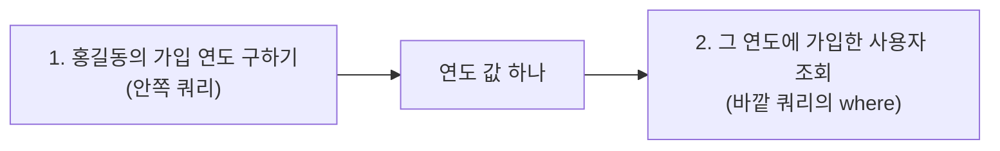
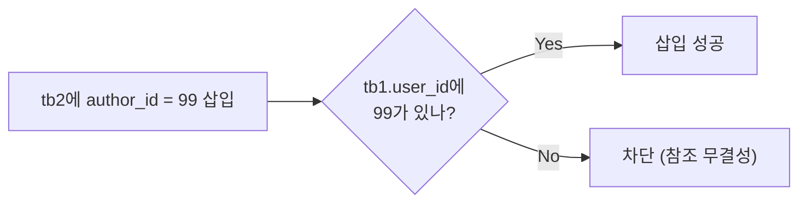
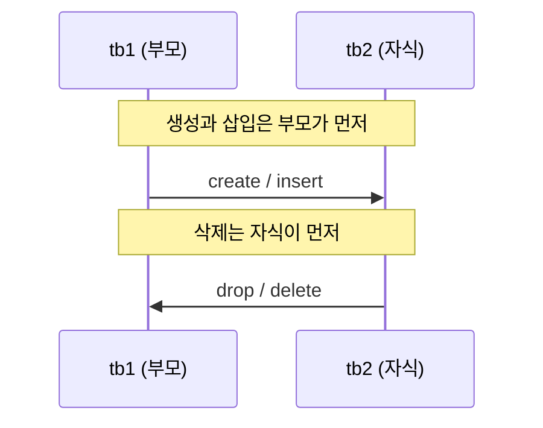
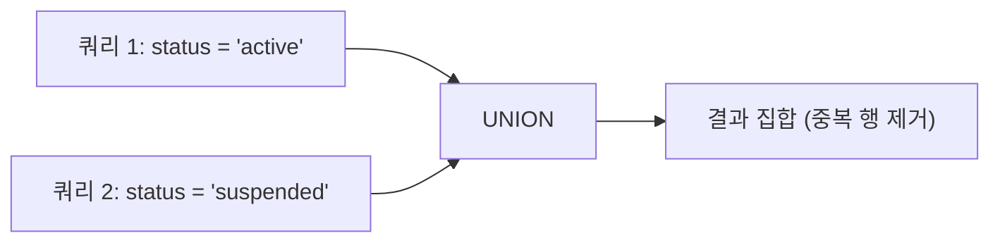
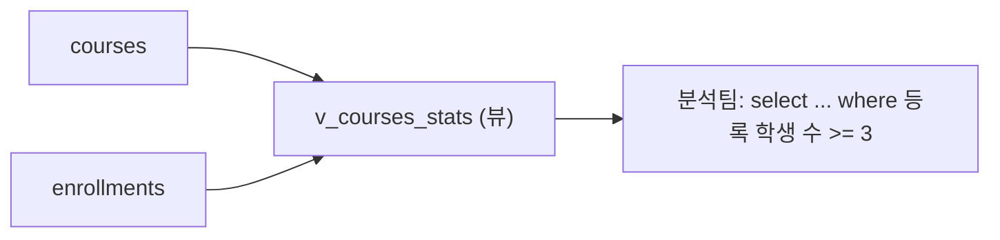
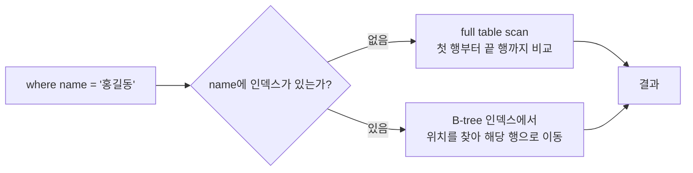
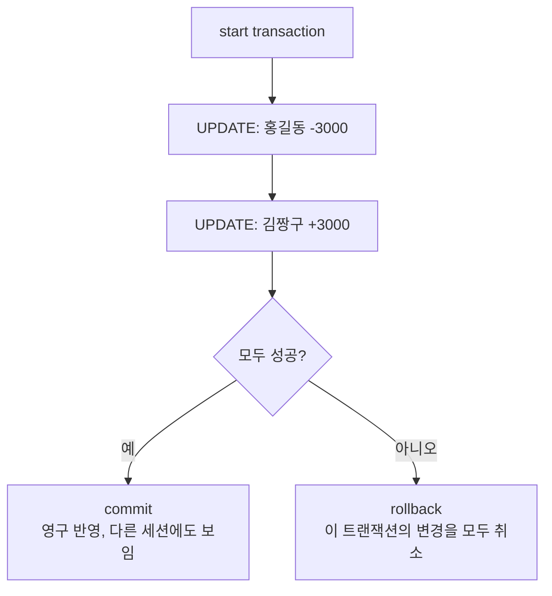

## 들어가며 (Situation)

MySQL 수업 둘째 날(10/13)은 `08_subqueries.sql`부터 `14_transcational.sql`까지 일곱 파일을 한 번에 훑었다. 서브쿼리, DDL(테이블과 제약 조건), DML, UNION, VIEW, INDEX, 트랜잭션이다. 선생님은 12~14번을 "어려운 문법이라기보다 **성능과 안전성을 개선하는 도구**"라고 소개했다. 이 글은 그날 메모를 수업 SQL 파일과 MySQL 공식 문서에 대조해 정리한 것이다.

한 가지 미리 밝혀 둔다. 이 글을 쓰는 환경에는 MySQL 서버가 없어서 **예시 코드는 직접 실행하지 못했고, 실행 결과나 수치도 지어내지 않았다.** 수업 주석에 적힌 값은 "수업 주석"이라고 표시했고, 수업 코드에 없는 코드는 **"예시 코드"**라고 적었다. 공식 문서로 확인하지 못한 부분도 본문에 그대로 적었다.

## 문제 상황 (Task)

메모에는 답을 못 찾은 질문과 확신 없는 이해가 섞여 있었다.

- "NOT NULL + UNIQUE를 하면 자동으로 PK가 된다"와 "외래키에는 NULL이 불가능하다"는 이해가 맞는가?
- 외래키를 주는 부모 테이블은 왜 `DROP`에서 에러가 나는가? 삽입·삭제 순서는 어떻게 되는가?
- PK/UNIQUE는 인덱스가 자동으로 걸리는데, 변동이 잦고 조회가 드물면 인덱스를 지워야 하지 않는가? (선생님은 "지우지 않는다"고 답했지만 이유를 이해하지 못했다.)
- 트랜잭션을 안 쓰면 롤백을 못 하는가?
- 인덱스는 면접 단골인데, 적용 근거를 어떻게 말해야 하는가?

공식 문서가 1차 출처이고, 메모가 틀렸다면 **정정하는 것**까지가 이 글의 목표다.

## 해결 과정 (Action)

### 1. 서브쿼리: 조건이 충분하지 않을 때 쿼리를 둘로 쪼갠다

`08_subqueries.sql`의 정의는 이렇다. 문제의 조건이 충분하지 않을 때 2개 이상의 쿼리문을 조합해서 1개의 쿼리문으로 만드는 것이다. 수업 문제는 "홍길동과 같은 해에 가입한 사용자의 이름과 가입일"이었다. 풀이 순서는 두 단계다.



수업 코드는 1번을 `where` 안에 넣어 한 쿼리로 합쳤다.

```sql
-- 수업 코드 (08_subqueries.sql)
select name, created_at
from users
where year(created_at) = (
    select year(created_at)
    from users
    where name = '홍길동');
```

수업 파일에는 서브쿼리를 쓰는 위치가 두 군데 나온다.

| 위치 | 수업 예시 | 안쪽 쿼리의 결과 |
|---|---|---|
| `where` 절 | 홍길동과 같은 연도 가입자 | 값 하나(연도)와 비교한다 |
| `from` 절 | 교육자별 개설 과정 수 (`group by author_id`) | 가상 테이블처럼 쓰고 `join`한다 |

`from` 절 예시는 `courses`를 `author_id`별로 `count(*)` 해 둔 결과를 `aut`라는 별칭으로 `users`와 `join`한다. 안쪽에서 먼저 집계하고, 바깥에서 이름을 붙이는 구조다.

한 가지 짚어 둔다. 수업 파일의 "2번" 단독 쿼리는 `where` 없이 `from users;`로 끝나 있다. 아직 연도를 몰라서 조건을 못 쓴 상태를 보여 주는 것으로 읽었다. 서브쿼리가 필요한 이유가 바로 그 빈칸이다.

메모에는 "서브쿼리는 실무에서 많이 안 쓴다"고 적혀 있다. 이 말은 공식 문서에서 확인할 수 있는 종류의 사실이 아니다. 문서는 서브쿼리를 쓰는 방법을 설명할 뿐 얼마나 쓰는지는 말하지 않는다. 그래서 이 글에서는 **수업에서 들은 경험담**으로만 적고, 같은 결과를 `join`으로도 쓸 수 있는지는 직접 비교해 볼 숙제로 남긴다.

### 2. 아무것도 안 붙인 JOIN은 INNER JOIN이다

메모의 "아무것도 안 붙인 `join`은 `inner join`"은 맞다. MySQL 공식 문서는 이렇게 말한다.

> In MySQL, `JOIN`, `CROSS JOIN`, and `INNER JOIN` are syntactic equivalents (they can replace each other). In standard SQL, they are not equivalent. `INNER JOIN` is used with an `ON` clause, `CROSS JOIN` is used otherwise.

다만 이것은 **MySQL에서의 이야기**다. 표준 SQL에서는 `inner join`은 `on`과 함께 쓰고 `cross join`은 그렇지 않을 때 쓴다고 구분한다. 수업의 `from 서브쿼리 as aut on ...`처럼 `on`을 쓴 `join`이라면 안쪽 일치 행만 남기는 `inner join`으로 읽으면 된다. 다른 DB로 옮길 때는 `inner`를 명시해 두는 편이 안전하다. (이 마지막 문장은 문서의 "표준 SQL은 다르다"에서 이끌어 낸 내 판단이다.)

### 3. NULL은 어떻게 잡는가

`left join`을 쓰면 짝이 없는 쪽이 `NULL`로 나온다. 그 `NULL` 행을 잡으려면 `=`가 아니라 `is null`을 써야 한다. 공식 문서는 `=`, `<`, `<>`로 `NULL`을 검사할 수 없다고 하고, 이유를 이렇게 설명한다.

> Because the result of any arithmetic comparison with `NULL` is also `NULL`, you cannot obtain any meaningful results from such comparisons.

| 목적 | 쓰는 방법 | 안 되는 방법 |
|---|---|---|
| 값이 비어 있는 행 | `where 컬럼 is null` | `where 컬럼 = null` |
| 값이 있는 행 | `where 컬럼 is not null` | `where 컬럼 <> null` |

```sql
-- 예시 코드: 소셜 로그인을 연결하지 않은 사용자만 찾기
select u.name
from users as u left join user_auth_providers as uap
on u.user_id = uap.user_id
where uap.user_id is null;
```

### 4. DDL: 테이블은 "칸 나누기"가 아니라 규칙 정의다

`09_ddl.sql`은 테이블 생성을 데이터가 지켜야 할 규칙을 정의하는 일이라고 설명한다. 그 규칙이 **데이터 타입**과 **제약 조건**이다. 수업이 정리한 제약 조건은 다음과 같다.

| 제약 조건 | 수업의 설명 |
|---|---|
| `NOT NULL` | `NULL`이 들어올 수 없다 (필수 입력) |
| `UNIQUE` | 테이블 안에서 값이 유일하다 (중복 방지) |
| `PRIMARY KEY` | `NOT NULL`과 `UNIQUE`의 특징을 모두 가진 대표 식별자 |
| `FOREIGN KEY` | 다른 테이블의 기본 키를 참조해 관계를 맺고 일관성을 보장한다 |
| `DEFAULT` | 값이 없을 때 쓸 기본값 |

#### 4-1. PRIMARY KEY가 왜 필요한가

메모는 이유를 이렇게 적었다. 컬럼이 너무 많아서 모두를 조건으로 둘 수 없으니, **비어 있지 않고 중복 없는 값 하나로 한 행을 식별**하려는 것이다. 수업 코드의 `user_id int primary key`가 그 역할이다. 공식 문서의 정의와도 맞는다.

> A unique index where all key columns must be defined as `NOT NULL`. If they are not explicitly declared as `NOT NULL`, MySQL declares them so implicitly (and silently). A table can have only one `PRIMARY KEY`.

여기서 두 가지를 알 수 있다. 첫째, PK 컬럼에 `not null`을 안 써도 MySQL이 알아서 `NOT NULL`로 만든다. 둘째, **PK는 테이블당 하나**다. (여러 컬럼을 묶은 복합 키도 "하나의 PK"로 센다. 이 부분은 문서 인용문에는 없어서 확인하지 못했다.)

#### 4-2. 정정: "NOT NULL + UNIQUE를 하면 자동으로 PK가 된다"는 오해

메모에 "`NOT NULL`과 `UNIQUE`를 하면 자동으로 PK가 된다"는 이해가 있었다. **공식 문서 기준으로는 그렇지 않다.** PK는 `primary key`로 **선언해야** 생긴다. 다만 이 오해가 생길 만한 근거는 있다. 문서에 이런 문장이 있다.

> If you do not have a `PRIMARY KEY` and an application asks for the `PRIMARY KEY` in your tables, MySQL returns the first `UNIQUE` index that has no `NULL` columns as the `PRIMARY KEY`.

이것은 **PK가 선언되지 않았을 때, 애플리케이션이 PK 정보를 요청하면 `NULL` 컬럼이 없는 첫 번째 `UNIQUE` 인덱스를 PK처럼 알려 준다**는 뜻이다. 테이블에 `primary key` 제약이 생긴다는 말이 아니다. 그래서 정리하면 이렇다.

| 메모의 이해 | 공식 문서 기준 |
|---|---|
| `NOT NULL` + `UNIQUE` = 자동으로 PK | 아니다. PK는 `primary key`로 선언한다. 선언이 없을 때 PK를 요청받으면 `NULL`이 없는 첫 `UNIQUE` 인덱스를 PK로 돌려주는 동작이 있을 뿐이다 |
| `UNIQUE`는 `NULL`도 불가 | 아니다. `NULL`을 허용하는 컬럼의 `UNIQUE` 인덱스는 `NULL`을 여러 개 허용한다 ("a `UNIQUE` index permits multiple `NULL` values for columns that can contain `NULL`") |

수업 코드의 `email varchar(30) not null unique`가 바로 그 예다. 이메일은 `not null unique`지만 PK는 `user_id`다. 한 테이블에 `unique` 컬럼이 여럿 있을 수 있고, PK는 그중 대표로 선언한 하나다.

#### 4-3. 컬럼명이 예약어와 같을 때

메모의 "백틱으로 해결되나 비권장, 접두사 권장"은 문서와 맞는다. 문서는 예약어를 식별자로 쓰려면 따옴표로 감싸야 한다고 하고, 감싸지 않으면 문법 오류가 난다고 보여 준다.

```sql
-- MySQL 공식 문서의 예 (Keywords and Reserved Words)
CREATE TABLE interval (begin INT, end INT);    -- ERROR 1064 (42000): You have an error in your SQL syntax
CREATE TABLE `interval` (begin INT, end INT);  -- 성공
```

`interval`은 예약어라 백틱이 필요하고, `begin`과 `end`는 키워드지만 예약어는 아니라서 백틱 없이 쓸 수 있다고 한다. 수업 코드에서도 `order by`에 `` `교육자 개설 과정 수` ``처럼 별칭을 백틱으로 감싼 곳이 있다. 백틱은 "예약어 회피"뿐 아니라 공백이나 한글이 든 이름을 가리킬 때도 쓰인다. 다만 비권장이라는 점은 메모의 의견이고, 문서가 금지하는 것은 아니다. 처음부터 `user_order`처럼 **접두사를 붙여 이름을 짓는** 편이 쿼리마다 백틱을 붙이는 수고를 없앤다.

#### 4-4. 정정: "FK는 NOT NULL, UNIQUE" 그리고 "외래키에 NULL 불가"

메모에는 "FK는 `not null`, `unique`"라는 이해와 "외래키에 `NULL` 불가"라는 이해가 있었다. 공식 문서 [FOREIGN KEY Constraints](https://dev.mysql.com/doc/refman/8.0/en/create-table-foreign-keys.html)로 확인한 결과는 다르다.

| 메모의 이해 | 공식 문서 기준 |
|---|---|
| FK는 `not null`이다 | 필수가 아니다. 문서는 `SET NULL` 동작을 쓰려면 "자식 테이블의 컬럼을 `NOT NULL`로 선언하지 않았는지 확인하라"고 한다. 그 예제의 자식 컬럼은 `parent_id INT`로 `NULL` 허용이다 |
| FK는 `unique`다 | 아니다. 문서는 자식 쪽 FK 컬럼에 `UNIQUE`를 요구하지 않는다. 한 부모 행이 여러 자식 행에서 참조되는 것이 일반적인 1:N 관계다 |
| 외래키에 `NULL` 불가 | 문서에 이를 금지하는 문장은 없다. `NOT NULL`로 선언하면 막히고, 선언하지 않으면 `NULL`을 둘 수 있다 |

수업 코드의 `author_id int not null`은 **`not null`을 별도로 선언했기 때문에** 필수인 것이지 FK라서 필수인 것이 아니다. 같은 문서에서 `NULL`이 든 FK 값이 참조 검사에서 어떻게 취급되는지는 이번에 읽은 범위에서 확인하지 못했다. 이 부분은 단정하지 않고 `InnoDB` FK 문서를 더 읽어 볼 일이다.

오히려 제약은 **부모 쪽**에 있다. `InnoDB`는 참조되는 컬럼들이 앞에 오는 인덱스가 부모 테이블에 있어야 한다고 한다.

> `InnoDB` permits a foreign key to reference any index column or group of columns. However, in the referenced table, there must be an index where the referenced columns are the first columns in the same order.

수업은 "다른 테이블의 PK를 참조"한다고 가르쳤고, 가장 흔한 형태가 그것이다. 문서는 `InnoDB`가 PK나 `UNIQUE`가 아닌 인덱스 컬럼도 참조할 수 있다고 하며, 이를 표준 SQL의 확장이라고 설명한다. 단 `NDB`는 명시적 `UNIQUE` 키나 PK를 요구한다. 그래서 설계할 때는 수업대로 PK를 참조하는 방식을 기본으로 삼는다.

수업이 말한 **참조 무결성**은 이렇게 동작한다. 수업 주석에 따르면 부모 테이블에 없는 `user_id`를 자식 테이블에 넣으려 하면 데이터베이스가 자동으로 차단한다.



부모 쪽의 삭제·수정에 대해서는 문서가 이렇게 정리한다. `ON DELETE`/`ON UPDATE`를 쓰지 않으면 기본 동작은 `NO ACTION`이고, `RESTRICT`는 부모 테이블의 삭제나 수정을 거부한다. 둘은 생략한 것과 같다고 한다. 이번에 확인한 범위에서는 `InnoDB`에서 두 동작이 같다는 내용까지만 읽었고, 세부 차이는 공식 문서에서 더 확인할 일이다.

#### 4-5. 부모 테이블은 DROP이 막힌다: 순서가 중요하다

수업 코드는 `tb1`(부모)을 만들고 `tb2`(자식, `author_id`가 `tb1.user_id`를 참조)를 만든 뒤, 이렇게 지운다.

```sql
-- 수업 코드 (09_ddl.sql)
-- tb1 테이블은 tb2 테이블에 user_id 라는 컬럼을 제공하고 있다.
drop table tb1;
drop table tb2;
```

메모는 "FK를 주는 부모 테이블은 DROP 에러, **자식을 먼저** 삭제"라고 정리했다. 수업 파일의 순서(`tb1` 먼저, `tb2` 나중)로는 첫 줄에서 막힐 것이라고 생각했는데, 이 글에서는 **실행해 보지 못했으므로 에러 번호나 메시지는 적지 않는다.** 공식 문서로 확인한 것은 다음 한 줄이다.

> A referenced table can only be dropped after `foreign_key_checks` is disabled.

즉 참조되는 테이블은 기본 상태에서는 지울 수 없고, `foreign_key_checks`를 끄면 지울 수 있다. (끄는 방법은 검증 없이 쓰지 않는다. 데이터 정합성을 스스로 책임지게 되므로 수업의 "자식 먼저 삭제"가 정석이다.)

삭제와 삽입의 순서를 정리하면 아래와 같다.

| 작업 | 올바른 순서 | 이유 |
|---|---|---|
| `create table` | 부모 -> 자식 | 자식의 `references`가 존재하는 부모를 가리켜야 한다 |
| `insert` | 부모 행 -> 자식 행 | 부모에 없는 값을 자식에 넣으면 차단된다 |
| `delete`/`drop` | 자식 -> 부모 | 자식이 참조 중인 부모는 지울 수 없다 |



같은 맥락에서 `truncate`도 주의할 점이 있다. 공식 문서는 다른 테이블의 FK가 참조하는 `InnoDB` 테이블에는 `TRUNCATE TABLE`이 실패한다고 한다.

> `TRUNCATE TABLE` fails for an `InnoDB` table or `NDB` table if there are any `FOREIGN KEY` constraints from other tables that reference the table.

수업의 `drop`과 `truncate` 비교(`drop`은 구조와 데이터를 모두 삭제, `truncate`는 구조를 남기고 데이터만 삭제, 둘 다 롤백 불가)는 문서와 같은 방향이다. `DROP TABLE`은 암묵적 커밋(implicit commit)을 일으키고, `TRUNCATE`도 "implicit commit, and so cannot be rolled back"라고 한다.

#### 4-6. ALTER TABLE: 컬럼 추가, 수정, 삭제

수업은 `create table courses_temp as select * from courses;`로 복제본을 만든 뒤 `alter table`로 `price` 컬럼을 추가(`add column`), 타입 변경(`modify column`, int에서 varchar로), 삭제(`drop column`)했다. 원본이 아니라 복제한 임시 테이블에서 연습하는 것이 안전한 방식이다. (이 `as select` 복제가 PK나 FK 같은 제약 조건까지 가져오는지는 이번에 확인하지 못했다.)


### 5. UNION: JOIN과 무엇이 다른가

JOIN은 두 테이블이 **공유하는 컬럼**(외래키 등)이 있어야 `on` 조건을 쓸 수 있다. 반면 `union`은 컬럼으로 테이블을 잇지 않고, **각 쿼리문의 결과를 위아래로 합친다.** 그래서 서로 연관 없는 독립된 테이블의 결과도 합칠 수 있다. 메모에는 이런 유연함이 있지만 실무에서는 거의 쓰지 않고(연결되지 않은 데이터, 즉 연관 없는 데이터를 합칠 일이 드물다), 조건이 까다롭다고 적었다.

| 구분 | JOIN | UNION |
|---|---|---|
| 합치는 방향 | 컬럼을 옆으로 붙임 | 행을 아래로 이어 붙임 |
| 합치는 기준 | 공유 컬럼(`on` 조건) | 없음. 각 쿼리의 SELECT 목록 위치가 대응 |
| 독립된 테이블 | 공유 컬럼이 없으면 어려움 | 가능 |
| 요구 조건 | 연결할 컬럼 | 컬럼 개수, 순서, 타입 호환 |



#### 수업 코드 (`11_union.sql`)

시나리오는 이렇다. `users`에서 active 사용자와 suspended 사용자 모두에게 이메일을 보내려 한다. 탈퇴한 사용자는 제외하고, 이름, 이메일, 상태를 조회한다.

```sql
select `name`, `email`, `status`
from users
where status = 'active'
union
select `name`, `email`, `status`
from users
where status = 'suspended';
```

두 `select`의 컬럼 개수와 순서가 같다. 수업 주석이 말한 조건은 세 가지다. 컬럼 **개수**가 같아야 하고, 컬럼 **순서**와 **데이터 타입**이 호환되어야 한다.

#### 공식 문서로 확인한 UNION 규칙

| 항목 | 공식 문서 내용 | 출처 |
|---|---|---|
| 컬럼 타입 | 대응하는 위치의 컬럼은 같은 타입이어야 한다. 타입이 다르면 결과 컬럼의 타입과 길이는 모든 쿼리 블록이 가져온 값을 고려해 정해진다 | Set Operations |
| 컬럼 이름 | 결과의 컬럼 이름은 **첫 번째 쿼리 블록**의 이름을 따른다 | Set Operations |
| 중복 | 기본값은 중복 행 제거. `DISTINCT`를 붙여도 같은 효과이고 명시적일 뿐이다 | Set Operations |
| `UNION ALL` | 중복 제거를 하지 않고 모든 행을 포함한다 | Set Operations |
| 혼합 | `ALL`과 `DISTINCT`를 섞으면 `DISTINCT`가 왼쪽에 있는 `ALL`을 덮어쓴다 | Set Operations |

> "By default, duplicate rows are removed from results of set operations." (MySQL 8.0 Reference Manual, Set Operations)

수업 파일 첫 줄의 "중복된 행은 제거하여 순수한 합집합을 만든다"는 설명이 이 문서와 일치한다.

확인하지 못한 점도 있다. "컬럼 **개수**가 같아야 한다"는 규칙은 수업 주석에는 있지만, 내가 읽은 공식 문서 두 페이지(UNION Clause, Set Operations)에서는 이를 직접 설명하는 문장을 찾지 못했다. 개수가 다르면 어떤 오류가 나는지는 직접 실행해 확인할 일이다. 그리고 UNION Clause 페이지의 예제 `SELECT 1, 2 UNION SELECT 'a', 'b';`는 정수와 문자열도 합쳐진다는 것을 보여 준다. "타입이 호환되어야 한다"는 조건이 어디까지 엄격한지는 이 예제만으로 단정하지 않았다.

#### UNION과 UNION ALL, 무엇을 고를까

수업의 예시는 같은 `users` 테이블을 `status` 값만 바꿔 두 번 조회한다. 두 조건(`'active'`, `'suspended'`)은 한 행이 동시에 만족할 수 없으니, 두 결과 사이에 중복 행이 생기지 않는다. 이 경우 `union all`로 바꿔도 같은 행이 나올 것으로 **추론**한다. 다만 중복 검사를 하지 않는 만큼 더 빠른지는 공식 문서에서 확인하지 못했다. 아래는 예시 코드다.

```sql
-- 예시 코드: 같은 테이블에서 조건만 나눈다면 where ... in (...) 하나로도 쓸 수 있다
select `name`, `email`, `status`
from users
where status in ('active', 'suspended');
```

같은 테이블의 조건 분리라면 `where ... in`으로 충분해 보인다. `union`이 의미를 갖는 쪽은 **서로 다른 테이블(또는 서로 다른 쿼리)의 결과를 하나로 합쳐야 할 때**다. 앞선 글에서 본 `FULL OUTER JOIN` 대용(`left join`과 `right join`의 `union`)이 그런 예다.

### 6. VIEW: 자주 쓰는 쿼리에 이름 붙이기

메모에는 12, 13, 14번 수업이 고급 문법으로 어렵다기보다 **성능 개선에 좋다**고 적혀 있다. 12번이 `12_view.sql`이다. 12_view는 메모에 내용이 없어, 아래는 수업 코드와 주석, 공식 문서만으로 정리했다.

#### 뷰란

수업 주석은 뷰를 "가상의 테이블"이라 설명한다. 공식 문서 기준으로는, 뷰는 `SELECT` 문으로 정의되고 뷰를 조회하면 그 `SELECT`가 실행되는 효과가 난다. 데이터를 따로 복사해 저장하는 테이블이 아니라 **쿼리에 붙인 이름**에 가깝다.

#### 수업의 시나리오와 사용 이유

- LMS 데이터 분석팀이 '과정별 등록 학생 수' 통계를 매일 확인한다.
- 마케팅팀에게는 사용자 전체 정보를 열지 않고, 실제로 쓸 이메일과 이름만 전달하려 한다.

수업 주석이 든 뷰의 사용 이유는 세 가지다.

| 이유 | 수업 주석의 설명 |
|---|---|
| 편의성 | 복잡한 쿼리를 뷰로 만들면 이후에는 간단한 테이블처럼 조회한다 |
| 보안성 | 원본의 민감한 컬럼을 숨기고, 허용한 컬럼으로만 구성한 뷰를 제공한다 |
| 가독성과 속도 | 자주 쓰는 컬럼만 담아 가독성이 높고, 모든 컬럼을 가져올 요소가 사라져 조회가 빨라진다 |

#### 수업 코드 (`12_view.sql`)

```sql
-- 생성: create view [뷰 이름] as [쿼리문]
create view v_courses_stats as
select
    c.course_id,
    c.title,
    count(e.enrollment_id) as '등록 학생 수'
from courses as c
left join enrollments as e on c.course_id = e.course_id
group by c.course_id, c.title;

-- 뷰를 테이블처럼 조회
select * from v_courses_stats;

-- 등록 학생 수가 3명 이상인 과정
select * from v_courses_stats
where `등록 학생 수` >= 3;

-- 삭제
drop view v_courses_stats;

-- 수정: create or replace view
create or replace view v_courses_stats as
select
    c.course_id, c.title, c.status,
    count(e.enrollment_id) as '등록 학생 수'
from courses as c
left join enrollments as e on c.course_id = e.course_id
group by c.course_id, c.title;
```

앞서 배운 `left join`과 `group by`를 묶어 만든 쿼리를 뷰 하나에 담은 셈이다. 이후에는 `where `등록 학생 수` >= 3`처럼 조건만 덧붙여 조회한다. 마케팅팀 시나리오(이메일, 이름만 공개)는 수업 파일에 해당 `create view` 코드가 없다. 아래는 예시 코드다.

```sql
-- 예시 코드: 마케팅팀에 이메일/이름만 보여 주는 뷰 (수업 코드에는 없음)
create view v_users_marketing as
select `name`, `email`
from users;
```



#### 공식 문서로 확인한 뷰의 특징

| 항목 | 공식 문서 내용 |
|---|---|
| 정의 | 뷰는 `SELECT` 문으로 정의되고, 조회하면 그 `SELECT`가 실행되는 효과가 난다 |
| `OR REPLACE` | 뷰가 이미 있으면 교체한다. 없으면 `CREATE VIEW`와 같다. 사용하려면 `DROP` 권한도 필요하다 |
| 정의의 고정 | 정의는 생성 시점에 고정(frozen)된다. 나중에 기반 테이블에 컬럼이 추가돼도 `SELECT *` 뷰에 자동으로 들어오지 않는다 |
| 보안 | `SQL SECURITY DEFINER`(기본값)는 뷰 생성자의 권한으로, `INVOKER`는 조회하는 사용자의 권한으로 기반 객체에 접근한다 |
| 갱신 | 뷰의 행과 기반 테이블의 행이 일대일일 때 갱신 가능. 그 밖의 구조는 갱신이 안 될 수 있다 |
| 제한 | 뷰에 트리거를 달 수 없고, 뷰 정의에서 `TEMPORARY` 테이블을 참조할 수 없다 |
| 정의의 `ORDER BY` | 허용되지만 뷰를 조회하는 문에 자체 `ORDER BY`가 있으면 무시된다 |

보안성은 공식 문서의 `SQL SECURITY` 설명과 맞닿아 있다. 다만 "마케팅팀에 어떤 권한을 어떻게 줘야 이메일/이름 뷰만 볼 수 있는가"는 권한(`GRANT`) 설정의 영역이라, 이 글에서는 다루지 않았고 실제로 설정해 보지도 못했다.

#### 수업 주석의 "속도" 설명을 공식 문서로 점검

수업 주석은 뷰를 쓰면 조회 속도가 빨라진다고 적었다. 공식 문서의 뷰 처리 알고리즘(View Processing Algorithms) 문서를 보면 이 문장은 조심해서 읽어야 한다.

- 알고리즘은 `MERGE`, `TEMPTABLE`, `UNDEFINED`가 있다. `MERGE`는 뷰를 참조하는 문장과 뷰 정의를 합쳐 실행하고, `TEMPTABLE`은 뷰 결과를 임시 테이블에 넣고 그 위에서 실행한다. `UNDEFINED`는 MySQL이 고르며, 가능하면 `MERGE`를 우선한다.
- 이 문서에는 **뷰가 성능을 자동으로 높인다는 내용이 없다.** 성능과 관련된 설명은 "`MERGE`가 보통 `TEMPTABLE`보다 효율적이다", "`TEMPTABLE`은 기반 테이블 잠금을 더 빨리 풀 수 있다" 정도다.
- `MERGE`는 결과를 미리 저장해 두는 캐시와 다르다. 즉 뷰는 데이터를 미리 계산해 두지 않는다. 실제 속도는 기반 테이블의 인덱스와 조건에 달려 있다고 추론한다.

그래서 정리하면, 수업이 말한 "속도"는 뷰가 쿼리를 **더 빠르게 실행**한다기보다 **필요한 컬럼만 담아 두어 매번 `select *`를 쓰지 않게 하는 효과**로 읽는 것이 안전하다. 메모의 "성능 개선에 좋다"도 이 맥락에서 받아들이고, 정말 빨라지는지는 `EXPLAIN`으로 직접 비교해 볼 일이다.


### 7. 인덱스가 하는 일: full table scan을 피한다

수업은 100만 명의 `users`에서 "홍길동"을 찾는 상황으로 시작한다. 인덱스가 없으면 첫 행부터 마지막 행까지 하나씩 비교하는데, 이를 **full table scan**이라고 한다. 공식 문서도 같은 설명이다.

> Without an index, MySQL must begin with the first row and then read through the entire table to find the relevant rows. The larger the table, the more this costs.

수업 코드는 `EXPLAIN`으로 실행 계획을 확인한 뒤 인덱스를 만들고, 같은 `EXPLAIN`을 다시 실행한다.

```sql
explain select * from users where name = '홍길동'; -- 수업 주석: 0.016 sec

create index idx_users_name on users(name);

explain select * from users where name = '홍길동'; -- 수업 주석: 0.000 sec, row 1
```

수업 주석에 따르면 인덱스 적용 전에는 **120개 row를 full scan**했고, 적용 후에는 **1개 row만 scan**했다. 공식 문서는 `EXPLAIN`을 "MySQL이 문장을 어떻게 실행하는지에 대한 정보를 제공한다"고 설명하고, 어디에 인덱스를 추가해야 하는지 볼 수 있다고 한다. 다만 `rows`와 `type` 컬럼의 정확한 의미는 이 페이지에 없고 별도의 "EXPLAIN Output Format" 절에 있다. 나는 그 절을 확인하지 못했으므로, 이 글에서는 컬럼의 의미를 단정하지 않는다.

인덱스는 "목차"라는 수업의 비유처럼, 컬럼 값과 행의 위치를 미리 정리해 둔 구조다. 구조는 문서에 이렇게 적혀 있다.

> Most MySQL indexes (PRIMARY KEY, UNIQUE, INDEX, and FULLTEXT) are stored in B-trees.

예외로 공간 데이터 타입은 R-tree, `MEMORY` 테이블은 해시 인덱스를 지원하고, InnoDB의 `FULLTEXT`는 inverted list를 쓴다. 그래서 수업에서 만든 `idx_users_name` 같은 일반 인덱스는 B-tree로 저장된다.



### 8. 인덱스의 비용: DML이 느려진다

수업은 인덱스를 "양날의 검(trade-off)"이라고 하며 단점을 둘로 정리한다.

| 비용 | 수업 내용 | 공식 문서 대조 |
|------|-----------|----------------|
| 저장 공간 | 인덱스는 테이블과 별도 공간을 차지한다 | "unnecessary indexes waste space" (불필요한 인덱스는 공간을 낭비한다) |
| INSERT | 인덱스에도 정렬된 위치를 찾아 항목을 추가해야 한다 | 문서: "Indexes also add to the cost of inserts, updates, and deletes because each index must be updated." |
| DELETE | 인덱스에서도 해당 항목을 찾아 삭제해야 한다 | 위와 같음 |
| UPDATE | 인덱스 컬럼 값이 바뀌면 삭제 후 정렬된 위치에 재삽입이 필요하다 (가장 최악) | 문서는 "각 인덱스를 갱신해야 한다"까지만 말한다. "삭제 + 삽입"이라는 내부 동작은 수업 설명이며, 이 문서에서는 확인하지 못했다 |

메모의 "UPDATE가 인덱스와 가장 안 맞음"은 수업 설명(인덱스 컬럼을 수정하면 최악)에서 나온 말이다. 공식 문서가 UPDATE를 가장 느린 작업으로 순위를 매겨 둔 것은 아니다. 공식 문서가 직접 말하는 것은 "INSERT/UPDATE/DELETE마다 인덱스도 갱신해야 한다"까지다.

### 9. 인덱스를 적용할 대상 고르기

수업이 제시한 기준은 두 가지다.

1. **조회 비율이 압도적으로 높은 테이블**: DML이 느려지는 것은 감수한다.
2. **수정이 빈번하지 않은 컬럼**: 수정이 드문 고정적 데이터가 적합하다.

메모에 "인덱스는 면접 단골"이라고 적혀 있다. 면접에서 "인덱스를 적용했다"고 말할 때는 아래 네 가지를 같이 말해야 한다고 정리했다.

| 말해야 할 것 | 내용 |
|--------------|------|
| 적용 이유 | 어떤 쿼리가 느렸고, 왜 그 컬럼인가 |
| 수정 정도 | 해당 컬럼이 얼마나 자주 바뀌는가 |
| 조회 비율 | 읽기와 쓰기의 비율은 어떤가 |
| 성능 근거 | `EXPLAIN` 실행 계획으로 전후를 비교했는가 |

공식 문서는 "SELECT 성능을 높이는 가장 좋은 방법은 `WHERE`에서 검사하는 컬럼에 인덱스를 만드는 것"이라고 하면서, 동시에 불필요한 인덱스는 공간과 옵티마이저의 선택 시간을 낭비한다고 경고한다. 즉 "전부 걸면 빨라진다"는 틀린 이해다.

### 10. 질문 1: PK·UNIQUE인데 자주 변동되고 조회가 드물면 인덱스를 주기적으로 삭제하나?

메모에 적힌 선생님의 답은 "지우지는 않는다"였고, 메모 작성자는 그 이유를 이해하지 못했다고 한다. 공식 문서로 이유를 풀어 보면 이렇다.

**(1) UNIQUE 인덱스는 "빨리 찾기"가 아니라 "제약 조건"이다.**

> A UNIQUE index creates a constraint such that all values in the index must be distinct. An error occurs if you try to add a new row with a key value that matches an existing row.

중복 여부를 검사하려면 기존 값을 빠르게 확인할 구조가 필요하다. 인덱스가 그 구조다. 조회가 드물어도 새 행을 넣을 때마다 중복 검사가 일어난다. 그래서 "조회 빈도"만으로 삭제 여부를 정할 수 없다. (이 문단의 "중복 검사에 인덱스가 쓰인다"는 해석은 위 문서 문장에서 내가 이어서 추론한 것이다. 문서에는 구현 방식까지 적혀 있지 않다.)

**(2) PRIMARY KEY 인덱스는 InnoDB에서 테이블 데이터 자체다.**

> Each InnoDB table has a special index called the clustered index that stores row data. Typically, the clustered index is synonymous with the primary key.

PK 인덱스는 행 데이터를 저장하는 clustered index다. 이를 지운다는 것은 "목차를 떼어 내는 것"이 아니라 테이블의 저장 방식을 바꾸는 일이다. 또 문서는 이렇게 말한다.

> In InnoDB, each record in a secondary index contains the primary key columns for the row... InnoDB uses this primary key value to search for the row in the clustered index.

즉 수업에서 만든 `idx_users_name` 같은 보조(secondary) 인덱스도 내부적으로 PK 값을 들고 있고, 이를 이용해 행을 찾는다. PK는 다른 인덱스가 의존하는 기준이다. (수업은 InnoDB라는 엔진명을 따로 말하지 않았다. MySQL 8.4의 기본 엔진이 InnoDB라는 전제로 쓴 설명이다.)

**(3) PK는 NOT NULL인 유일 인덱스다.**

> A unique index where all key columns must be defined as NOT NULL.

PK는 "유일하고 비어 있지 않은 값으로 행을 식별한다"는 약속이다. 이 약속을 지키는 수단이 인덱스다.

| 구분 | 수업에서 만든 일반 인덱스 | PK / UNIQUE 인덱스 |
|------|---------------------------|--------------------|
| 목적 | 조회 속도 향상 | 유일성(제약 조건) 보장. 조회 속도는 부수 효과 |
| 만드는 법 | `create index` | 테이블 생성 시 PK/UNIQUE 선언 (수업: 자동으로 인덱스 적용) |
| 조회가 드물면 | 지워도 기능이 변하지 않는다 | 지우면 제약이 사라지거나 테이블 구조가 바뀐다 |
| 삭제 여부 판단 | 조회 비율과 DML 비용을 비교 | 제약 조건이 필요한가로 판단 |

결론은 이렇다. 메모의 질문에는 "조회가 드물면 인덱스가 아깝다"는 전제가 깔려 있다. 그런데 PK/UNIQUE 인덱스는 성능 때문에 둔 것이 아니라 **제약 조건을 강제하는 수단**이다. 그래서 조회 빈도를 근거로 지우는 대상이 아니다. 삭제 후보는 성능 목적으로 직접 만든 일반 인덱스(`idx_users_name` 같은 것)다.

한계도 밝혀 둔다. 이 문서들에서 `DROP`으로 PK/UNIQUE 인덱스를 지울 때의 정확한 동작(예: 외래키가 참조 중일 때)은 확인하지 못했다. 위 설명은 "왜 성능 기준으로 지우지 않는가"까지만 근거가 있다. 정확한 삭제 동작은 `ALTER TABLE`/`DROP INDEX` 문서를 따로 봐야 한다.

### 11. 트랜잭션: 계좌이체가 중간에 멈추면

`14_transcational.sql`의 주제는 계좌이체다. 홍길동 계좌에서 3000원을 빼고(UPDATE 1), 김짱구 계좌에 3000원을 더하는(UPDATE 2) 일은 논리적으로 하나의 작업이지만 실제로는 UPDATE가 두 번 실행된다. 1번 뒤에 은행이 정전되면 돈이 사라진다. 수업은 이를 해결하는 개념으로 트랜잭션을 소개한다.

> 다수의 작업을 하나의 논리적인 작업 단위로 묶는 것. 1개의 작업이라도 잘못되면 롤백시키는 것이 핵심이다.

수업의 정상 흐름과 비정상 흐름은 이렇다.

```sql
start transaction;

update accounts set balance = balance - 3000 where id = 1;  -- 홍길동 차감
update accounts set balance = balance + 3000 where id = 2;  -- 김짱구 증액

commit;   -- 모두 성공: 영구 반영
```

```sql
start transaction;

update accounts set balance = balance - 3000 where id = 1;  -- 홍길동 차감
update accounts set balance = balance + 3000 where id = 99; -- 없는 계좌

rollback; -- 일부가 문제: 전부 되돌리기
```

수업 주석은 `commit` 전의 상태를 "영구 반영된 상태는 아니다 (git add 정도)"라고 비유한다. 공식 문서와 맞춰 보면 이렇다.

> A COMMIT means that the changes made in the current transaction are made permanent and become visible to other sessions. A ROLLBACK statement, on the other hand, cancels all modifications made by the current transaction.



여기서 한 가지 주의할 점이 있다. 수업의 비정상 흐름에서 `id = 99`는 없는 계좌다. 이런 `UPDATE ... where id = 99`는 일치하는 행이 없을 뿐 **오류 없이 0행이 수정된다.** (이 동작은 수업 코드와 SQL의 일반 동작에 따른 설명이며, 공식 문서로 확인한 것은 아니다.) 그러니 MySQL이 알아서 롤백해 주는 것이 아니라, **사람(또는 애플리케이션 코드)이 문제를 판단해서 `rollback`을 실행**해야 한다. 수업 코드도 `rollback;`을 직접 적고 있다.

### 12. 질문 2: 트랜잭션을 안 쓰면 롤백 못하나?

메모의 답은 "못한다. 하나의 세트이며 DML 작성 시 해 두는 게 좋다"였다. 공식 문서로 정확히 풀면 이렇다.

**autocommit이 기본이다.**

> If autocommit mode is enabled, each SQL statement forms a single transaction on its own. By default, MySQL starts the session for each new connection with autocommit enabled, so MySQL does a commit after each SQL statement if that statement did not return an error.

`START TRANSACTION` 없이 `UPDATE`를 실행하면 그 문장 하나가 곧 하나의 트랜잭션이고, 성공하면 바로 커밋된다. 이미 커밋된 뒤에 `ROLLBACK`을 실행해도 되돌릴 것이 없다. 그래서 "못한다"는 말은 맞다. 정확히는 **롤백이 "안 되는 기능"이 아니라, 문장마다 자동 커밋되어 롤백할 구간이 없는 것**이다.

**여러 문장을 묶는 방법은 두 가지다.**

| 방법 | 문서 설명 | 끝내는 법 |
|------|-----------|-----------|
| `START TRANSACTION` 또는 `BEGIN` | autocommit이 켜진 세션에서도 여러 문장을 하나의 트랜잭션으로 묶을 수 있다 | `COMMIT` 또는 `ROLLBACK` |
| `SET autocommit = 0` | 세션이 항상 열린 트랜잭션을 가진다 | `COMMIT` 또는 `ROLLBACK`이 끝내고 새 트랜잭션이 시작된다 |

수업에서는 앞의 방법만 사용한다. 두 번째는 문서에 있는 방법이다. 참고로 문서에는 이런 문장도 있다.

> If a session that has autocommit disabled ends without explicitly committing the final transaction, MySQL rolls back that transaction.

**DDL은 암묵적 커밋을 일으킨다.** 이것이 "트랜잭션을 쓰면 다 되돌릴 수 있다"는 오해를 막아 준다.

> The statements listed in this section (and any synonyms for them) implicitly end any transaction active in the current session, as if you had done a COMMIT before executing the statement.

문서의 목록에는 `CREATE TABLE`, `CREATE INDEX`, `DROP TABLE`, `DROP INDEX`, `ALTER TABLE`, `TRUNCATE TABLE` 같은 DDL이 있다. `START TRANSACTION` 자체도 이미 열린 트랜잭션을 커밋한다. 그래서 트랜잭션 중간에 이런 문장을 실행하면 그 앞까지의 변경은 커밋되어 `ROLLBACK`으로 되돌릴 수 없다. 아래는 이를 보여 주는 **예시 코드**다.

```sql
-- 예시 코드 (수업 코드에 없음, 직접 실행하지 않음)
start transaction;
update accounts set balance = balance - 3000 where id = 1;

create index idx_accounts_owner on accounts(owner);  -- DDL: 암묵적 커밋 발생

rollback;  -- 위 UPDATE는 이미 커밋되었으므로 되돌려지지 않는다
```

수업의 두 파일이 이 주제로 만나는 지점이 여기다. 인덱스를 만드는 `create index`도 암묵적 커밋 목록에 있다. 인덱스 생성은 트랜잭션 안에서 하지 않는 것이 안전하다.

정리하면 메모의 "DML 작성 시 `START TRANSACTION`을 해 두는 게 좋다"는 말은 이렇게 구체화할 수 있다.

- 여러 DML이 **하나의 논리적 작업**이면(예: 계좌이체) 반드시 묶는다.
- 단일 DML이면 autocommit이 알아서 하나의 트랜잭션으로 처리한다.
- 묶은 뒤에는 반드시 `COMMIT` 또는 `ROLLBACK`으로 끝낸다.
- 트랜잭션 중간에 DDL을 넣지 않는다.


## 결과 (Result)

이 글은 서버 없이 쓴 노트라 "응답 시간 몇 ms 개선" 같은 **정량 지표는 없다.** 수업 주석의 `120 row → 1 row`(인덱스 적용 전후 scan 행 수)가 유일한 수치이고, 그마저 직접 재현하지 못했다. 대신 메모의 질문이 아래처럼 정리됐다.

| 메모의 이해 | 공식 문서 기준 결론 |
|---|---|
| NOT NULL + UNIQUE면 자동으로 PK | **아니다.** PK는 `primary key`로 선언해야 한다 |
| FK는 NOT NULL, UNIQUE | **아니다.** `NOT NULL`을 따로 선언해야 필수가 된다. FK에 UNIQUE를 요구하지 않는다 |
| 외래키에 NULL 불가 | 문서에 금지 문장이 없다. `NOT NULL`을 선언하지 않았다면 `NULL`을 둘 수 있다 |
| 부모는 DROP 에러, 자식 먼저 | 맞다. 생성·삽입은 부모 → 자식, 삭제는 자식 → 부모 |
| PK/UNIQUE 인덱스는 조회가 적으면 지운다 | 지우지 않는다. 성능용이 아니라 **제약 조건을 강제하는 수단**이다 |
| 트랜잭션 없으면 롤백 못 한다 | 맞다. autocommit이 문장마다 커밋하므로 되돌릴 구간이 없다. DDL도 암묵적 커밋을 일으킨다 |
| 뷰를 쓰면 조회가 빨라진다 | 문서에 그런 내용은 없다. 뷰는 쿼리에 붙인 이름에 가깝다 |

**배운 점**

- 메모의 오해 세 개는 모두 "비슷해 보이는 개념을 한 덩어리로 기억"한 데서 나왔다. NOT NULL, UNIQUE, PK, FK는 각각 따로 정의되고, PK만 앞의 둘의 성질을 합친다.
- 인덱스는 "걸면 빨라진다"가 아니라 **적용 이유, 수정 정도, 조회 비율, 실행 계획 근거** 네 가지로 말해야 설득력이 있다.
- 선생님이 해 준 말도 공식 문서로 풀어 보면 이유가 보인다. "지우지 않는다"는 답은 PK와 UNIQUE 인덱스의 역할을 알면 이해된다.

## 시행착오와 확인하지 못한 점

- 수업 `09_ddl.sql`의 `drop table tb1;` 다음 `drop table tb2;` 순서는 메모의 "자식 먼저 삭제" 규칙과 어긋나 보인다. 실행해서 에러를 확인하지 못했다. 실습 숙제로 남긴다.
- 수업의 `create or replace view`는 `select`에 `c.status`를 추가하고 `group by`는 그대로 뒀다. `ONLY_FULL_GROUP_BY` 모드에서 오류인지 확인하지 못했다.
- `UNION`의 컬럼 **개수** 규칙, `UPDATE`가 인덱스에서 "삭제 + 삽입"으로 동작한다는 설명, PK/UNIQUE 인덱스를 `DROP`할 때의 정확한 동작은 공식 문서에서 확인하지 못했다.
- `NULL`이 든 FK 값이 참조 검사에서 어떻게 취급되는지도 이번 범위에서 확인하지 못했다.
- 이 글은 `10_dml.sql`을 다루지 않았다.

## 더 학습하면 좋은 개념

- **InnoDB clustered index와 secondary index** — PK 인덱스가 곧 테이블 데이터이고 보조 인덱스가 PK 값을 들고 있다는 것을 이해하면, "PK를 왜 짧게 잡는가"까지 연결된다.
- **EXPLAIN 출력 형식(`type`, `key`, `rows`)** — 면접에서 "성능 근거"를 말하려면 실행 계획을 읽을 수 있어야 한다.
- **복합 인덱스와 leftmost prefix** — 컬럼 여러 개에 인덱스를 걸 때 순서가 성능을 가른다.
- **트랜잭션 격리 수준과 ACID** — `COMMIT` 전의 변경이 다른 세션에 어떻게 보이는지는 격리 수준이 결정한다.
- **뷰 알고리즘(`MERGE`, `TEMPTABLE`)** — 수업의 "뷰는 빠르다"는 말을 검증하려면 뷰가 실제로 어떻게 실행되는지 알아야 한다.

## 참고 자료

- [MySQL 8.0 - FOREIGN KEY Constraints](https://dev.mysql.com/doc/refman/8.0/en/create-table-foreign-keys.html)
- [MySQL 8.0 - CREATE TABLE Statement](https://dev.mysql.com/doc/refman/8.0/en/create-table.html)
- [MySQL 8.0 - Keywords and Reserved Words](https://dev.mysql.com/doc/refman/8.0/en/keywords.html)
- [MySQL 8.0 - JOIN Clause](https://dev.mysql.com/doc/refman/8.0/en/join.html)
- [MySQL 8.0 - Working with NULL Values](https://dev.mysql.com/doc/refman/8.0/en/working-with-null.html)
- [MySQL 8.0 - DROP TABLE Statement](https://dev.mysql.com/doc/refman/8.0/en/drop-table.html)
- [MySQL 8.0 - TRUNCATE TABLE Statement](https://dev.mysql.com/doc/refman/8.0/en/truncate-table.html)
- [MySQL 8.0 - UNION Clause](https://dev.mysql.com/doc/refman/8.0/en/union.html)
- [MySQL 8.0 - Set Operations](https://dev.mysql.com/doc/refman/8.0/en/set-operations.html)
- [MySQL 8.0 - CREATE VIEW Statement](https://dev.mysql.com/doc/refman/8.0/en/create-view.html)
- [MySQL 8.0 - View Processing Algorithms](https://dev.mysql.com/doc/refman/8.0/en/view-algorithms.html)
- [MySQL 8.4 - How MySQL Uses Indexes](https://dev.mysql.com/doc/refman/8.4/en/mysql-indexes.html)
- [MySQL 8.4 - Optimization and Indexes](https://dev.mysql.com/doc/refman/8.4/en/optimization-indexes.html)
- [MySQL 8.4 - EXPLAIN](https://dev.mysql.com/doc/refman/8.4/en/using-explain.html)
- [MySQL 8.4 - InnoDB Clustered and Secondary Indexes](https://dev.mysql.com/doc/refman/8.4/en/innodb-index-types.html)
- [MySQL 8.4 - autocommit, Commit, and Rollback](https://dev.mysql.com/doc/refman/8.4/en/innodb-autocommit-commit-rollback.html)
- [MySQL 8.4 - Statements That Cause an Implicit Commit](https://dev.mysql.com/doc/refman/8.4/en/implicit-commit.html)
