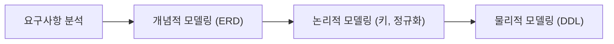
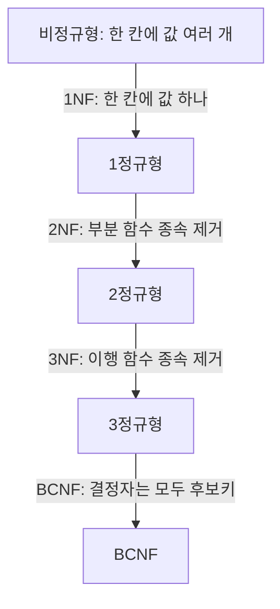
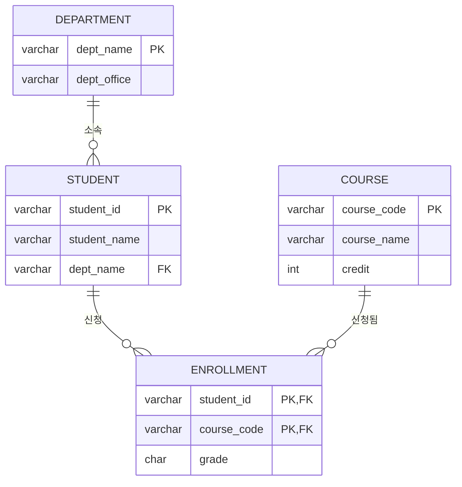

## 들어가며 (Situation)

오늘(10월 14일)은 **데이터베이스 설계**를 배웠다. 수업 필기에는 개념적·논리적·물리적 모델링, 교차 엔티티, 바커 표기법, cascade, 정규형이 한 번에 적혀 있다. 수업 후에는 아티팩트 5편(설계 절차 → 개념적 모델링 → 속성과 식별자 → 정규화 → 물리적 모델링)으로 개념을 다시 공부했다.

**먼저 밝혀 둘 것.**

- 5편 중 **'정규화 실험실'은 파일에 제목과 소개 두 줄만 들어 있었다.** 실습 화면의 내용은 가져오지 못했다. 그래서 정규화 설명은 내 필기와 3편·5편에 나온 정규화 관련 문장을 바탕으로 쓰고, 나머지는 일반적인 정의로 채웠다.
- 정규화 예시 표(수강신청)는 설명을 위해 **직접 만든 예시 코드/예시 데이터**다. 실제 DB에서 실행해 보지는 않았다.
- 표기 규칙: "필기"는 수업 필기, "아티팩트"는 아티팩트에서 확인한 내용, "예시"는 이 글을 위해 만든 것이다.

## 문제 상황 (Task)

오늘 풀어야 했던 질문은 이렇다.

- 설계를 왜 4단계로 나누고, 각 단계에서 무엇을 결정하는가?
- 필기에 "1정규형은 데이터 하나씩, 2정규형은 PK별로, 3정규형은 FK까지 연결"이라고 이해하고 적었는데, **이 이해가 맞는가?**
- 필기 TODO: "unique랑 pk는 선언하고 이후 아래에서 해도 되나?"
- 필기: "실무에선 제3정규형까지만 한다. join이 늘수록 속도가 떨어진다." 그렇다면 정규화는 어디서 멈추는가?

## 해결 과정 (Action)

### 1. 설계는 4단계로 나눠서 한다

아티팩트 1편의 정리에 필기를 합치면 다음과 같다.

| 단계 | 핵심 질문 | 산출물 | 필기 |
|---|---|---|---|
| 요구사항 분석 | 어떤 데이터를 관리해야 하는가 | 요구사항 정의서 | "회원은 결제를 한다"보다 "고객은 상품을 장바구니에 담을 수 있어야 한다"처럼 쓴다 |
| 개념적 모델링 | 무엇이 존재하고 어떻게 연결되는가 | ERD | 어느 시야에서 보는지가 중요, 관계선은 양방향으로 정의 |
| 논리적 모델링 | 어떤 속성, 키, 구조로 만들 것인가 | 논리 데이터 모델 | FK/PK 설정, **정규화** |
| 물리적 모델링 | 특정 DBMS에서 어떻게 구현하는가 | 물리 모델 + DDL | 자료형, 제약조건 |



필기에는 "이 모든 단계는 생략하지 않고 모두 한다"고 적혀 있다. 아티팩트에서는 이유를 "단계를 건너뛰고 바로 테이블을 만들면 확장성, 정합성, 유지보수성에 문제가 생길 가능성이 높다"고 설명한다.

### 2. 개념적 모델링에서 기억할 것

- **엔티티 후보를 고를 때 걸러내기.** 필기의 게시판 예제에서 "사용자"와 "회원"은 유사하니 하나로 통일하고, "회원가입"은 행위라서 엔티티가 아니라 메서드로 보고 제외했다.
- **N:M은 그대로 둘 수 없다.** 학생과 과목은 서로 여러 개와 연결되므로 사이에 교차(행위) 엔티티 '수강'을 두어 1:N 두 개로 바꾼다. 아티팩트는 주문 한 건에 메뉴 3개를 담는 상황으로, 주문 테이블 한 칸에 메뉴를 모두 넣는 방식과 교차 엔티티 방식을 비교한다.
- **필수/선택은 방향마다 다르다.** 파일은 반드시 폴더 안에 있어야 하지만(필수), 폴더는 비어 있어도 된다(선택). 최소값 0은 선택, 1은 필수다. 필기의 "관계선은 양방향으로 고려"가 이 뜻이다.
- **표기법.** 필기의 Barker 표기는 `#`이 PK, `*`가 NOT NULL, `o`가 NULL 허용이다. 아티팩트에 따르면 시험은 피터첸, 실무 도구(ERDCloud 등)는 IE 표기법이 많다.

### 3. 키: 정규화의 재료

정규화는 "어떤 속성이 어떤 키에 딸려 있는가"를 따지는 작업이라서 키부터 정리해야 했다.

| 키 | 정의 | 필기 / 아티팩트 포인트 |
|---|---|---|
| 후보키 | 행을 유일하게 식별하는 최소 속성 집합 | 지금 데이터에서 안 겹친다고 후보키가 되는 게 아니라 **업무 규칙**으로 정한다 |
| 기본키(PK) | 후보키 중 대표 하나, NOT NULL + UNIQUE | 유일성, 최소성, 불변성, 단순성 |
| 대체키 | PK가 되지 못한 후보키 | UNIQUE로 관리 |
| 외래키(FK) | 다른 엔티티의 PK를 참조 | 관계를 구현 |

필기의 "unique, not null이어도 변경 가능성까지 따져야 한다. 입력값보다 시스템이 부여하는 값이 좋다"는 **불변성** 기준 그대로다. 전화번호와 이메일은 바뀔 수 있고 개인정보이므로 PK 대신 UNIQUE 대체키로 둔다.

**복합키**는 교차 엔티티에서 쓴다. 장바구니는 고객번호만으로도 상품번호만으로도 행을 구분할 수 없지만 둘을 묶으면 "이 고객이 담은 이 상품"이 하나로 정해진다. 이때 복합키의 각 속성은 동시에 FK다. **이 복합키가 바로 2정규형을 이해하는 열쇠가 된다.**

### 4. 정규화: 표를 왜, 어떻게 쪼개는가

#### 4-1. 왜 쪼개는가

아티팩트 1편의 설명은 이렇다. 설계를 잘못하면 같은 정보가 여러 곳에 중복 저장되고, 한쪽만 고치면 값이 서로 달라진다. 중복 제거는 정규화로 하고, 정규화는 논리적 모델링 단계에서 한다.

#### 4-2. 실험 대상: 수강신청 표 (예시 데이터)

한 표에 다 넣은 수강신청 표를 가정했다. 기본키는 (학번, 과목코드)다. 이 표와 아래 모든 데이터는 **예시**다.

| 학번 | 학생이름 | 학과 | 학과사무실 | 과목코드 | 과목명 | 학점 | 성적 |
|---|---|---|---|---|---|---|---|
| S1 | 김민수 | 컴공 | 공학관 101 | C1, C2 | DB, 자바 | 3, 3 | A, B |
| S2 | 이서연 | 컴공 | 공학관 101 | C1 | DB | 3 | A |
| S3 | 박지훈 | 전자 | 공학관 202 | C1, C2 | DB, 자바 | 3, 3 | B, A |



#### 4-3. 1정규형: 한 칸에는 값 하나

위 표의 과목코드, 과목명, 학점, 성적 칸에는 값이 여러 개 들어 있다. 3편 아티팩트가 말한 **다가 속성**이다. 1정규형은 한 칸에 하나의 값만 두는 것이라서, 행을 (학생, 과목) 단위로 펼친다. 필기의 "1정규형은 데이터 하나씩"이 이것이다.

| 학번(PK) | 학생이름 | 학과 | 학과사무실 | 과목코드(PK) | 과목명 | 학점 | 성적 |
|---|---|---|---|---|---|---|---|
| S1 | 김민수 | 컴공 | 공학관 101 | C1 | DB | 3 | A |
| S1 | 김민수 | 컴공 | 공학관 101 | C2 | 자바 | 3 | B |
| S2 | 이서연 | 컴공 | 공학관 101 | C1 | DB | 3 | A |
| S3 | 박지훈 | 전자 | 공학관 202 | C1 | DB | 3 | B |
| S3 | 박지훈 | 전자 | 공학관 202 | C2 | 자바 | 3 | A |

값은 한 칸에 하나씩이 되었지만, 김민수 정보가 두 번, DB 과목 정보가 세 번 반복된다. 이 표에서 일어나는 **이상 현상(anomaly)** 은 이렇다.

| 이상 | 이 표에서의 상황 |
|---|---|
| 갱신 이상 | 컴공 사무실이 바뀌면 컴공 학생 3행을 모두 고쳐야 한다. 하나라도 빠지면 불일치 |
| 삽입 이상 | 아직 아무도 수강하지 않은 새 과목은 (학번, 과목코드) PK의 학번이 비어 넣을 수 없다 |
| 삭제 이상 | 박지훈의 마지막 수강 기록을 지우면 '전자과 사무실이 공학관 202'라는 정보도 같이 사라진다 |

1편 아티팩트의 "회원 연락처 바꿔 보기" 실습이 보여 주려던 문제가 이것이다.

#### 4-4. 2정규형: PK 일부에만 딸린 속성 분리

2정규형은 1정규형이면서, PK가 복합키일 때 **PK의 일부에만 종속된 속성(부분 함수 종속)이 없어야** 한다.

| 속성 | 종속 대상 | 판단 |
|---|---|---|
| 학생이름, 학과, 학과사무실 | 학번만으로 결정 | 부분 종속, 분리 대상 |
| 과목명, 학점 | 과목코드만으로 결정 | 부분 종속, 분리 대상 |
| 성적 | (학번, 과목코드) 둘 다 있어야 결정 | 완전 종속, 수강에 남김 |

필기의 "2정규형은 PK별로 구분하는 거"를 정확히 쓰면 **"PK(복합키)의 일부에만 딸린 것을 따로 빼는 것"** 이다. 그래서 단일 PK인 표는 1정규형이면 자동으로 2정규형이 된다.

결과는 학생(학번, 학생이름, 학과, 학과사무실), 과목(과목코드, 과목명, 학점), 수강(학번, 과목코드, 성적) 세 표다.

#### 4-5. 3정규형: 일반 속성이 다른 일반 속성을 결정하는 것 분리

3정규형은 2정규형이면서 **PK가 아닌 속성이 다른 PK 아닌 속성을 결정하는 관계(이행 함수 종속)가 없어야** 한다.

학생 표에서 `학번 → 학과 → 학과사무실`로 이어진다. 학과사무실은 학번에 직접 딸린 것이 아니라 학과를 거쳐 정해진다. 그래서 학과 표를 따로 만든다.

필기의 "3정규형은 fk까지 연결해주는 거"는 **결과 쪽에서 본 모습**이다. 학과를 분리하고 나면 학생 표에는 학과를 가리키는 FK만 남는다. 정의는 FK 연결이 아니라 **이행 종속 제거**다. 이 차이는 필기에서 정정해 둔다.



수강(ENROLLMENT)은 앞에서 정리한 **교차 엔티티**이고, 복합 PK의 두 속성이 모두 FK다. 모델링에서 N:M을 해소한 구조가 정규화의 결과와 같다는 점이 오늘 가장 크게 연결된 부분이었다.

#### 4-6. BCNF (아티팩트 3편에서 언급만 됨)

3편 마지막에 "다음 시간에는 수강신청 표를 비정규형부터 BCNF까지 쪼갠다"는 문장이 있다. BCNF는 일반적인 정의로 **"모든 결정자가 후보키여야 한다"** 이다. 위 예시는 3정규형 단계에서 이미 모든 결정자(학번, 과목코드, 학과명)가 각 표의 키라서 BCNF도 만족한다. BCNF가 3NF와 달라지는 사례(예를 들어 '교수 → 과목' 종속이 생기는 경우)는 수업에서 다루지 않았고 내가 확인하지 못해서 여기서는 적지 않는다.

#### 4-7. 정규화 전후 비교 (예시 데이터를 손으로 센 값)

| 구분 | 1정규형 | 3정규형 |
|---|---|---|
| 표 개수 | 1 | 4 (학과, 학생, 과목, 수강) |
| 저장된 칸 수 | 5행 x 8열 = 40 | 4 + 9 + 6 + 15 = 34 |
| 컴공 사무실 위치가 저장된 곳 | 3곳 | 1곳 |
| 사무실이 바뀔 때 고칠 행 | 3행 | 1행 |

예시 데이터가 아주 작아서 칸 수는 40에서 34로 약 15% 줄 뿐이다. 중요한 것은 칸 수보다 **같은 사실이 한 곳에만 저장된다**는 점이다. 이 수치는 실행 결과가 아니라 예시 데이터를 손으로 센 값이다.

#### 4-8. 어디까지 하나: 필기의 "실무는 3정규형까지"

쪼갤수록 표가 늘고, 조회하려면 JOIN이 필요하다. 위 예시만 해도 "학생 이름, 학과 사무실, 과목명을 한 번에 보려면" 표 4개를 JOIN해야 한다. 필기의 "join이 늘수록 속도가 떨어진다"는 이 트레이드오프다. 1편 아티팩트도 "정합성과 성능은 트레이드오프 관계이므로 균형을 잡는 것이 중요하다"고 말한다.

> 이 글에서 '실무는 3정규형까지'는 **필기에 적힌 선생님 말씀**이다. 나는 이를 뒷받침할 공식 문서를 찾지 못했다. 일반 원칙으로 받아들이지 말고, 성능 문제가 확인될 때 의도적으로 역정규화하는 것으로 이해하려고 한다.

### 5. 정규화한 구조를 MySQL로 옮기기 (물리적 모델링)

#### 5-1. 예시 DDL

아래 DDL은 위 3정규형 결과를 **예시로 작성한 것**이다. 실행해 보지 않았다.

```sql
CREATE TABLE department (
    dept_name   VARCHAR(20) PRIMARY KEY,
    dept_office VARCHAR(30) NOT NULL
);

CREATE TABLE student (
    student_id   VARCHAR(10),
    student_name VARCHAR(20) NOT NULL,
    dept_name    VARCHAR(20) NOT NULL,
    PRIMARY KEY (student_id),
    CONSTRAINT fk_student_dept FOREIGN KEY (dept_name) REFERENCES department (dept_name)
);

CREATE TABLE course (
    course_code VARCHAR(10) PRIMARY KEY,
    course_name VARCHAR(30) NOT NULL,
    credit      INT NOT NULL CHECK (credit > 0)
);

CREATE TABLE enrollment (
    student_id  VARCHAR(10),
    course_code VARCHAR(10),
    grade       CHAR(1),
    PRIMARY KEY (student_id, course_code),
    CONSTRAINT fk_enroll_student FOREIGN KEY (student_id) REFERENCES student (student_id),
    CONSTRAINT fk_enroll_course  FOREIGN KEY (course_code) REFERENCES course (course_code)
);
```

필기의 질문 "unique랑 pk는 선언하고 이후 아래에서 해도 되나"의 답은 위 `student`와 `enrollment`에 있다. 아티팩트 1편의 `tbl_user`도 컬럼을 모두 선언한 뒤 아래에 `PRIMARY KEY (user_no)`, `UNIQUE (phone)`를 쓴다. 복합 PK는 이 형태로만 쓸 수 있다. `references` 뒤에 나오는 쪽이 부모 테이블이라서 부모(department, course)를 먼저 만든다.

#### 5-2. 참조 무결성 옵션(cascade)

필기의 "자식에서 진행해도 부모에 영향을 준다"는 방향이 반대다. 5편 아티팩트의 정의는 **부모 키가 수정, 삭제될 때 자식이 어떻게 반응하는지**를 정하는 옵션이다.

| 옵션 | 동작 | 주의 |
|---|---|---|
| `RESTRICT` | 자식이 참조 중이면 부모 변경/삭제 불가 (옵션을 안 쓰면 이 동작) | 기본 안전 설정 |
| `CASCADE` | 부모가 바뀌면 자식도 함께 변경/삭제 | 대량 삭제 위험 |
| `SET NULL` | 부모가 바뀌면 자식 FK를 NULL로 | FK 컬럼이 NULL 허용이어야 함 |

필기의 "시스템적으로 요구사항이 명확한 경우에만 사용, 잘못 설정한 cascade"는 이 `CASCADE`의 위험을 말한 것이다. 예를 들어 `enrollment`에 `ON DELETE CASCADE`를 걸면 학생을 지울 때 수강 기록도 지워진다. 성적을 보존해야 한다면 `RESTRICT`가 맞다. MySQL의 InnoDB에서는 `SET DEFAULT`가 지원되지 않고, `NO ACTION`도 `RESTRICT`처럼 동작한다고 아티팩트에 적혀 있다.

#### 5-3. 이름 규칙

필기의 "테이블 명명 규칙은 팀원과 잘 말해두기"는 아티팩트와 같은 결론이다. 소문자 snake_case와 단수형을 쓰고, `order`는 예약어와 충돌한다. 접두어(`tbl_`)는 정답이 없고 **프로젝트 안에서 하나로 통일하는 것**이 핵심이다.

## 결과 (Result)

| 처음 질문 | 오늘의 정리 |
|---|---|
| 1/2/3정규형 이해가 맞는가 | 방향은 맞았지만 정의가 달랐다. 1NF는 한 칸에 값 하나, 2NF는 복합키 일부에만 딸린 속성 분리, 3NF는 일반 속성끼리의 종속(이행 종속) 분리 |
| unique/pk를 아래에서 선언해도 되나 | 된다. 복합 PK는 아래에서만 가능 |
| 정규화는 어디까지인가 | 필기상 실무는 3NF까지, 대신 JOIN 비용과 맞바꾸는 트레이드오프 |
| cascade 방향 | 부모 변경이 자식에게 전파되는 옵션이며, 필기와 방향이 반대였다 |

정량 지표는 **측정하지 못했다.** 서버에서 실행하지 않았고, 4-7의 40칸에서 34칸은 예시 데이터를 손으로 센 값이다.

**배운 점.** 정규화는 외우는 규칙이 아니라 "이 속성은 어떤 키에 딸려 있는가"를 묻는 도구였다. 그리고 그 답이 키 설계(3편)와 N:M 해소(2편)와 같은 구조로 이어졌다.

**남은 TODO.**

- 아티팩트 4편(정규화 실험실)의 실습 내용을 직접 열어서 내 예시와 비교하기
- BCNF가 3NF와 달라지는 사례 찾기
- 프로젝트 ERD를 ERDCloud에서 팀원과 함께 만들기 (필기: DA#은 공동작업 불가)

## 더 학습하면 좋은 개념

- **함수 종속성(Functional Dependency)과 결정자** — 1~3NF와 BCNF의 정의가 모두 "A가 B를 결정한다"로 쓰여서, 종속성을 읽는 눈이 있어야 정규형 판정이 외우기가 아니게 된다.
- **역정규화(Denormalization)** — 필기의 "join이 늘수록 느려진다"에 대한 실무적 대안이다. 언제 정규화를 의도적으로 깨는지 알아야 3NF에서 멈추는 이유가 설명된다.
- **인덱스(Index)** — JOIN 성능을 결정하는 요소다. FK 컬럼에 인덱스가 어떻게 걸리는지 알면 정규화 후 성능 문제를 어디서 풀지 보인다.
- **트랜잭션(Transaction)** — 5편에서 `CASCADE` 삭제를 `START TRANSACTION`으로 묶어 되돌리라고 한 이유가 여기에 있다.
- **JPA 연관관계 매핑** — 1:N, N:M 해소, 교차 엔티티가 엔티티 클래스의 연관관계로 그대로 이어진다.

## 참고 자료

- 수업 아티팩트 5편: DB 설계 1(설계의 필요성과 요구사항 분석) ~ 5(물리적 모델링)
- [MySQL 8.0 공식 문서 - FOREIGN KEY 제약조건](https://dev.mysql.com/doc/refman/8.0/en/create-table-foreign-keys.html)
- [MySQL 8.0 공식 문서 - CHECK 제약조건](https://dev.mysql.com/doc/refman/8.0/en/create-table-check-constraints.html)
- [Microsoft 문서 - Database normalization description](https://learn.microsoft.com/en-us/office/troubleshoot/access/database-normalization-description)
