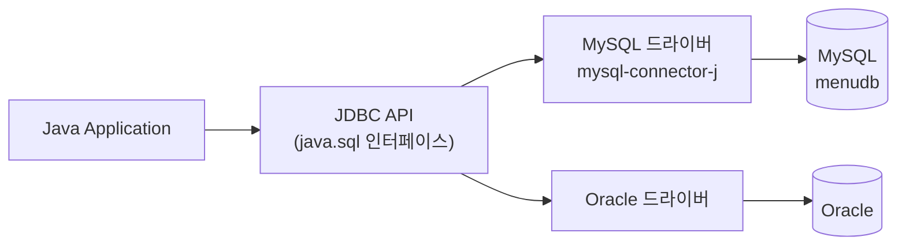
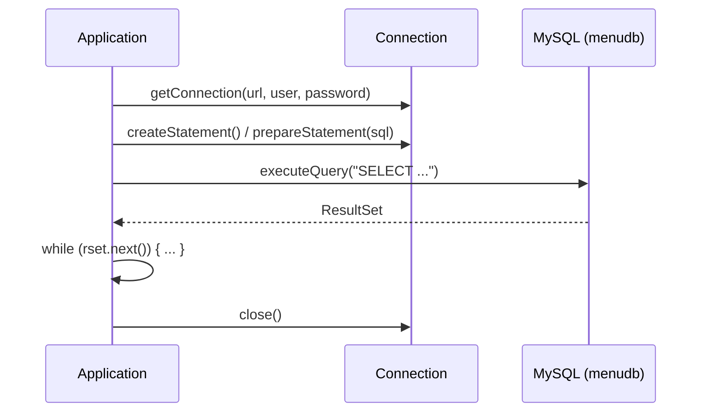
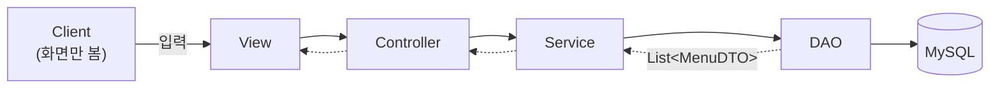

## 들어가며 (Situation)

MySQL 수업에서는 Workbench에 SQL을 직접 입력했다. 하지만 실제 프로그램은 사람이 쿼리를 칠 수 없다. **자바 코드가 DB에 쿼리를 보내고 결과를 받아야 한다.** 그 연결 다리가 JDBC다.

이 글은 10/15(JDBC 소개, Gradle)와 10/19(Statement, PreparedStatement, DTO, MVC, DAO) 두 번의 필기를 하나로 합친 것이다. 코드는 수업 프로젝트(`chap01-jdbc-connection`, `chap02-statement`, `chap03-crud`)를 그대로 인용했고, 수업 코드가 아닌 것은 **"예시 코드"**라고 표시했다. 이 글을 쓰는 환경에서는 코드를 실행하지 못했고, 실행 결과나 수치도 지어내지 않았다.

## 문제 상황 (Task)

필기에는 이해한 것과 헷갈리는 것이 섞여 있었다.

- 왜 애플리케이션과 DB를 **바로** 연결하지 않고 JDBC를 중간에 두는가?
- Gradle은 정확히 무슨 일을 하는가? (필기에는 "zip을 빠르게 해줌"이라고 적혀 있었다.)
- DB의 NULL 허용 컬럼을 `int`로 받으면 무엇이 문제인가?
- `Statement`와 `PreparedStatement`는 객체 생성 시점과 실행 순서가 왜 다른가? "이미 컴파일한 쿼리를 재사용한다"는 말은 MySQL에서도 그대로 맞는가?
- DTO, DAO, MVC는 각각 무엇을 맡는가?

## 해결 과정 (Action)

### 1. JDBC: 자바와 DB 사이에 "약속"을 둔다

수업 정의는 이렇다. **JDBC는 자바와 데이터베이스를 연결해 주는 API다.** 10/15 필기에도 적었듯 애플리케이션이 MySQL, Oracle에 각각 직접 맞추지 않고 JDBC라는 공통 규격을 사이에 둔다.



| 구분 | 누가 만드나 | 예 |
|---|---|---|
| JDBC API | 자바 표준 (`java.sql`) | `Connection`, `Statement`, `ResultSet` 인터페이스 |
| JDBC 드라이버 | DB 회사 | MySQL의 `com.mysql.cj.jdbc.Driver` |

`Connection`, `Statement`, `ResultSet`이 모두 **인터페이스**라는 점이 핵심이다. 내 코드는 인터페이스만 보고 작성하고, 실제 구현은 드라이버가 채운다. 그래서 DB를 바꿔도 드라이버와 접속 정보만 바꾸면 된다. 수업 코드 주석에도 "Connection 객체는 인터페이스이기 때문에 직접 생성하지 못하고 `DriverManager`를 통해 만든다"고 적혀 있다.

수업에서 자주 쓴 클래스 세 개는 다음과 같다.

| 클래스 | 역할 | 만드는 방법 |
|---|---|---|
| `Connection` | DB에 접근하기 위한 연결 | `DriverManager.getConnection(url, user, password)` |
| `Statement` | SQL 쿼리문을 담아 실행 | `con.createStatement()` |
| `ResultSet` | 쿼리 실행 결과를 담음 | `stmt.executeQuery(sql)`의 반환값 |



### 2. Gradle: 외부 라이브러리를 가져오고 빌드하는 도구

10/15 필기의 "Gradle은 zip을 빠르게 해 준다"는 정확한 표현이 아니었다. Gradle 공식 문서는 Gradle을 **빌드 자동화 도구**로 소개한다. 외부 라이브러리(jar)를 받아 오고, 컴파일하고, 실행 파일로 묶는 과정을 자동으로 해 준다. "묶는 것"이 결과물 중 하나라서 zip처럼 느껴진 것 같다.

- `build.gradle`은 **Groovy 문법**으로 쓴 설정 파일이다. (필기: "groovy는 문법")
- 외부 라이브러리는 [Maven Repository](https://mvnrepository.com/artifact/com.mysql/mysql-connector-j)에서 Gradle용 한 줄을 복사해 `dependencies`에 붙인다.
- 붙인 뒤 IntelliJ의 **코끼리 아이콘(Gradle 동기화)**을 눌러야 실제로 내려받는다.

```groovy
// 수업 코드 (chap01-jdbc-connection/build.gradle)
dependencies {
    // mysql 연동을 위한 외부 api 의존성
    implementation 'com.mysql:mysql-connector-j:8.4.0'
}
```

JDBC 드라이버가 바로 이 외부 라이브러리다. 이 한 줄이 없으면 `Class.forName("com.mysql.cj.jdbc.Driver")`에서 `ClassNotFoundException`이 난다. 선생님이 "`build.gradle` 파일은 자주 보라"고 한 이유다.

### 3. Connection: 접속 정보를 코드에서 빼낸다

수업은 같은 연결 코드를 세 단계로 고쳐 나갔다.

| 단계 | 파일 | 바뀐 점 | 남은 문제 |
|---|---|---|---|
| 1 | `Application01` | URL, 아이디, 비밀번호를 코드에 직접 작성 | 민감 정보가 클래스에 노출됨 |
| 2 | `Application02` | `jdbc-config.properties`로 분리 후 `Properties`로 읽음 | 연결 코드를 매번 복사해야 함 |
| 3 | `JDBCTemplate` | `getConnection()`, `close()`를 static 메서드로 묶음 | — |

```properties
# 수업 코드 (jdbc-config.properties) — 비밀번호는 가렸다
driver=com.mysql.cj.jdbc.Driver
url=jdbc:mysql://localhost/menudb
user=wanted
password=****
```

```java
// 수업 코드 (JDBCTemplate) — 사용한 Connection 객체를 해제하는 메서드
public static void close(Connection con){
    try {
        if (con != null && !con.isClosed()){
            con.close();
        }
    } catch (SQLException e) {
        throw new RuntimeException(e);
    }
}
```

10/19 필기의 "메모리는 시작과 동시에 떠 있다가 종료되면 꺼진다"는 말이 여기와 이어진다. `Connection`은 DB 쪽 연결 자원까지 붙잡고 있어서, 프로그램이 끝날 때까지 기다리지 말고 **다 쓰면 바로 닫아야** 한다. 처음 `Application01`의 `finally`는 `con = null;`만 하고 `close()`를 부르지 않았다. 변수만 비울 뿐 연결은 닫지 않는 코드라서 `JDBCTemplate.close()`가 필요해졌다.

### 4. Statement → PreparedStatement

#### 4-1. Statement로 조회하기

```java
// 수업 코드 (a_statements/Application01) — 메뉴 전체 조회
stmt = con.createStatement();
rset = stmt.executeQuery("SELECT * FROM TBL_MENU");

while (rset.next()){   // 다음 행이 있으면 true, 없으면 false
    System.out.println(
            rset.getString("MENU_NAME") + " 은/는 "
            + rset.getString("MENU_PRICE") + "원 입니다. "
    );
}
```

사용자 입력을 조건에 넣으려면 문자열을 이어 붙여야 했다.

```java
// 수업 코드 (a_statements/Application02)
rset = stmt.executeQuery(
    "SELECT MENU_CODE, MENU_PRICE, ORDERABLE_STATUS FROM TBL_MENU WHERE MENU_NAME = '" + menuName +"'");
```

작은따옴표를 직접 챙겨야 해서 실수하기 쉽다. 게다가 **SQL 문법이 틀려도 자바 컴파일러는 모른다.** SQL은 그냥 문자열이라서, 필기대로 컴파일 에러가 아니라 실행 중에 `SQLException`(런타임 에러)으로 드러난다.

#### 4-2. PreparedStatement: `?` 자리를 나중에 채운다

`PreparedStatement`는 `Statement`를 **상속한 자식 인터페이스**다. 필기에 적은 대로 이름 앞에 `Prepared`가 붙었고, `Statement`의 기능을 모두 가지면서 기능이 더 있다.

```java
// 수업 코드 (b_preparedstatements/Application04) — 메뉴 가격 수정
String query = prop.getProperty("modifyMenuPriceByMenuName");
// UPDATE TBL_MENU SET MENU_PRICE = ? WHERE MENU_NAME = ?

pstmt = con.prepareStatement(query);
pstmt.setInt(1, price);        // 첫 번째 ?
pstmt.setString(2, menuName);  // 두 번째 ?

// 반환 타입 int : DML 수행 후 영향을 받은 행의 수
result = pstmt.executeUpdate();
```

필기의 "객체 생성 시점과 실행 순서 차이는 `setString` 때문"이라는 말을 표로 정리하면 이렇다.

| 항목 | Statement | PreparedStatement |
|---|---|---|
| SQL을 넘기는 시점 | **실행할 때** `executeQuery(sql)` | **객체를 만들 때** `prepareStatement(sql)` |
| 값 넣는 방법 | 문자열 이어 붙이기 (`'` 직접 처리) | `?` 자리에 `setInt`, `setString`으로 바인딩 |
| 실행 순서 | 생성 → 실행(SQL 전달) | 생성(SQL 전달) → `setXxx` → 실행 |
| 조회 / DML | `executeQuery()` / `executeUpdate()` | 같음 (인자 없이 호출) |

`?`에 값을 채우려면 SQL이 먼저 정해져 있어야 한다. 그래서 `PreparedStatement`는 만들 때 SQL을 받는다.

`setString`, `setInt`의 첫 인자 `parameterIndex`는 **0이 아니라 1부터** 센다. 배열 인덱스와 다르다. [PreparedStatement 공식 Javadoc](https://docs.oracle.com/en/java/javase/21/docs/api/java.sql/java/sql/PreparedStatement.html)에도 첫 번째 파라미터는 1이라고 적혀 있다.

#### 4-3. "재사용해서 빠르다"는 말을 확인해 보기

수업 코드 주석의 설명은 이렇다.

> Statement는 SQL 쿼리문을 실행할 때마다 DB에서 파싱(번역)하고 컴파일한다. PreparedStatement는 최초 1회 파싱·컴파일한 SQL을 재사용하므로 성능이 향상된다. — 수업 코드 주석

`PreparedStatement` Javadoc도 "SQL 문장이 미리 컴파일되어 저장된다(precompiled)"고 설명한다. 다만 실제로 그렇게 동작하는지는 **드라이버마다 다르다.** [MySQL Connector/J 설정 문서](https://dev.mysql.com/doc/connector-j/en/connector-j-connp-props-prepared-statements.html)를 보면 서버 쪽 prepared statement를 쓰는 `useServerPrepStmts` 옵션의 기본값이 `false`다. 기본 설정에서는 드라이버가 `?`에 값을 채운 완성된 SQL을 서버로 보낸다. 수업처럼 매번 `prepareStatement()`를 새로 부르고 바로 닫는 코드에서는 "재사용으로 빨라진다"는 효과를 기대하기 어렵다.

그래도 `PreparedStatement`를 쓰는 이유는 분명하다. 값을 SQL 문법과 분리해서 넘기므로 작은따옴표 처리 실수가 사라지고, 입력값으로 SQL을 조작하는 **SQL Injection**을 막을 수 있다.

```java
// 예시 코드 — Statement에 사용자가 이런 값을 입력하면?
String menuName = "' OR '1'='1";
// 완성된 SQL: ... WHERE MENU_NAME = '' OR '1'='1'  → 모든 행이 조회된다
```

#### 4-4. 쿼리를 XML로 분리하기

필기의 ".xml 확장자로 쿼리 구문을 분리"는 `menu-query.xml`이다. DOCTYPE을 `properties`로 지정하면 `Properties.loadFromXML()`로 읽을 수 있다. 자바 코드에는 키 이름만 남고, SQL은 한 파일에서 관리된다.

```xml
<!-- 수업 코드 (menu-query.xml) -->
<!DOCTYPE properties SYSTEM "http://java.sun.com/dtd/properties.dtd">
<properties>
    <entry key="modifyMenuPriceByMenuName">
        UPDATE TBL_MENU
        SET MENU_PRICE = ?
        WHERE MENU_NAME = ?
    </entry>
</properties>
```

### 5. NULL 허용 컬럼은 `int`가 아니라 `Integer`로

10/15 필기에서는 "DB에서 NULL을 허용하는 값을 자바 `int`로 받으면 처리하기 어려워서 `Integer`(기본형의 Wrapper 클래스)를 쓴다"고 적었다. 공식 문서를 보니 이유가 조금 더 구체적이었다.

[ResultSet Javadoc](https://docs.oracle.com/en/java/javase/21/docs/api/java.sql/java/sql/ResultSet.html)에 따르면 `getInt()`는 값이 SQL NULL이면 **에러를 내지 않고 `0`을 반환**한다. 그래서 "값이 없음"과 "진짜 0"을 구분할 수 없게 된다.

| 자바 타입 | NULL을 담을 수 있나 | `getInt()`로 NULL을 읽으면 |
|---|---|---|
| `int` (기본형) | 불가 | `0`이 들어감 → 진짜 0과 구분 불가 |
| `Integer` (참조형, Wrapper) | 가능 | `getObject("컬럼", Integer.class)`로 읽으면 `null` 유지 |

```java
// 예시 코드 — NULL을 그대로 살려서 읽기
Integer bonus = rset.getObject("BONUS", Integer.class); // NULL이면 null
```

수업의 `EmployeeDTO`는 보너스를 `double empBonus`로, 값을 `rset.getDouble("BONUS")`로 받는다. `BONUS` 컬럼이 NULL을 허용한다면 보너스가 없는 직원도 `0.0`으로 들어온다. 이 차이가 중요한 화면이라면 `Double`로 바꿔야 한다. (실제 테이블 정의는 확인하지 못했다.)

### 6. DTO, DAO, MVC: 역할별로 클래스를 나눈다

#### DTO

필기에는 "Data Transformation Object"라고 적었는데, 정확한 이름은 **Data Transfer Object**다. 계층 사이에서 데이터를 **옮기는** 객체다. 필기대로 필드에 집중한 클래스이고, 수업 `MenuDTO` 주석은 구성 요소를 이렇게 정리한다.

> 1. 필드 2. 기본 생성자 3. 모든 필드를 초기화하는 생성자 4. Getter, Setter 5. toString — 수업 코드 주석 (MenuDTO)

#### MVC와 DAO

클래스는 **데이터(필드)**와 **행위(메서드)**로 이루어진다. DTO가 데이터 쪽이라면, MVC는 행위를 누가 맡을지 나누는 아키텍처 관점이다.

| 계층 | 필기 | 수업 코드에서 맡는 일 (`chap03-crud`) |
|---|---|---|
| View | 입출력 | `MenuInputView`(Scanner 입력), `MenuOutputView`(출력) |
| Controller | 커멘드센터 | View의 요청을 받아 알맞은 Service 호출. Scanner, SQL은 다루지 않음 |
| Service | — | 비즈니스 로직, Connection 생성, 트랜잭션(commit/rollback) |
| DAO (Model) | 값 | SQL 실행, `?` 바인딩, `ResultSet`을 DTO로 변환 |



**DAO(Data Access Object)**는 DB로 들어가는 유일한 관문이다. 수업 `MenuDAO`는 Service에게 `Connection`을 받아 쿼리만 실행한다.

```java
// 수업 코드 (MenuDAO.findAll)
try (PreparedStatement pstmt = connection.prepareStatement(query)) {
    ResultSet rset = pstmt.executeQuery();
    while (rset.next()) {
        MenuDTO menu = new MenuDTO(
                rset.getInt("MENU_CODE"),
                rset.getString("MENU_NAME"),
                rset.getInt("MENU_PRICE"),
                rset.getInt("CATEGORY_CODE"),
                rset.getString("ORDERABLE_STATUS")
        );
        menus.add(menu);
    }
}
```

`chap03`에서는 `finally`에서 직접 `close()`하던 방식이 **try-with-resources**로 바뀌었다. `try ( )` 괄호 안에서 만든 자원은 블록이 끝나면 자동으로 닫힌다. `Application`의 주석에 따르면 이렇게 객체를 직접 조립하는 방식은 나중에 Spring이 대신해 주는 구조를 "미리 맛보는" 것이다.

### 시행착오와 확인하지 못한 점

- **닫는 순서:** chap02 예제의 `finally`는 `close(con) → close(rset) → close(stmt)` 순서다. 보통은 만든 순서의 반대(`ResultSet → Statement → Connection`)로 닫는다. try-with-resources도 선언의 역순으로 닫는다.
- **XML 파일의 오타:** 수업 `menu-query.xml`에는 `</entry>` 뒤에 `entry`라는 글자가 하나 더 붙어 있다. `loadFromXML()`이 이 파일을 문제없이 읽는지는 실행해 보지 못했다.
- **PreparedStatement 성능:** Connector/J 기본값으로 재사용 효과가 나는지는 직접 측정하지 못했다. 위 설명은 공식 문서의 기본값을 근거로 한 것이다.

## 결과 (Result)

이번 정리로 필기의 질문들이 다음처럼 바뀌었다. 실행 시간 같은 수치는 측정하지 못해서 적지 않았다.

| 필기의 이해 | 정리 후 |
|---|---|
| Gradle은 zip을 빠르게 해 준다 | 의존성 관리 + 빌드 자동화 도구. `build.gradle`은 Groovy 문법 |
| NULL을 `int`로 받으면 처리하기 어렵다 | `getInt()`는 NULL을 `0`으로 바꿔서 구분이 안 된다 → `Integer` + `getObject` |
| PreparedStatement는 컴파일을 재사용해 빠르다 | 드라이버 설정에 따라 다르다. 확실한 장점은 바인딩과 SQL Injection 방지 |
| DTO = Data Transformation Object | **Data Transfer** Object |
| 생성 시점 차이는 `setString` 때문 | `?`를 채우려면 SQL이 먼저 있어야 해서 생성할 때 SQL을 받는다 |

코드 구조는 세 단계로 다듬어졌다. `main`에 모든 것을 쓰던 코드(chap01)에서 `JDBCTemplate`으로 연결을 묶고(chap02), View-Controller-Service-DAO로 역할을 나눴다(chap03). 배운 점은 **"공통으로 반복되는 코드는 빼내고, 클래스마다 한 가지 책임만 맡긴다"**는 방향이 JDBC 수업 내내 이어졌다는 것이다.

## 더 학습하면 좋은 개념

- **SQL Injection과 방어** — PreparedStatement를 써야 하는 가장 실질적인 이유다. 어떤 입력이 왜 위험한지 알면 바인딩의 의미가 분명해진다.
- **커넥션 풀(Connection Pool, 예: HikariCP)** — 요청마다 `getConnection()`으로 연결을 새로 만드는 비용을 줄이는 방법이다. Spring Boot가 기본으로 사용한다.
- **JDBC 트랜잭션 (`setAutoCommit`, `commit`, `rollback`)** — Service 계층의 책임으로 적힌 "트랜잭션 처리"를 자바 코드로 어떻게 하는지 이어서 배울 내용이다.
- **MyBatis / JPA** — 쿼리를 XML로 빼고 `ResultSet`을 DTO로 옮기던 반복 작업을 자동화한 도구다. 다음 수업(JPA)과 바로 이어진다.
- **의존성 주입(DI)** — `Application`에서 `new`로 객체를 조립하던 과정을 Spring이 대신해 주는 원리다.

## 참고 자료

- [Oracle Java Tutorials - JDBC Basics](https://docs.oracle.com/javase/tutorial/jdbc/basics/index.html)
- [Java SE 21 API - PreparedStatement](https://docs.oracle.com/en/java/javase/21/docs/api/java.sql/java/sql/PreparedStatement.html)
- [Java SE 21 API - ResultSet](https://docs.oracle.com/en/java/javase/21/docs/api/java.sql/java/sql/ResultSet.html)
- [Java SE 21 API - Properties (loadFromXML)](https://docs.oracle.com/en/java/javase/21/docs/api/java.base/java/util/Properties.html)
- [Oracle Java Tutorials - The try-with-resources Statement](https://docs.oracle.com/javase/tutorial/essential/exceptions/tryResourceClose.html)
- [MySQL Connector/J - Prepared Statements 설정](https://dev.mysql.com/doc/connector-j/en/connector-j-connp-props-prepared-statements.html)
- [Gradle 공식 문서 - Declaring Dependencies](https://docs.gradle.org/current/userguide/declaring_dependencies.html)
- [OWASP - SQL Injection Prevention Cheat Sheet](https://cheatsheetseries.owasp.org/cheatsheets/SQL_Injection_Prevention_Cheat_Sheet.html)
