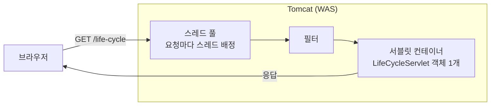
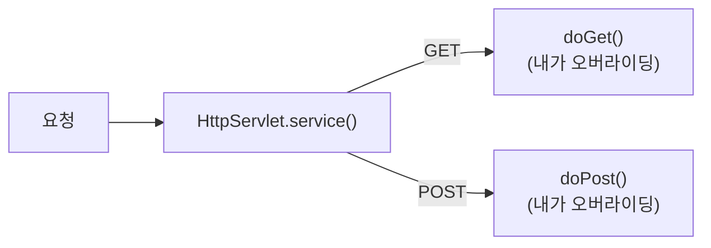
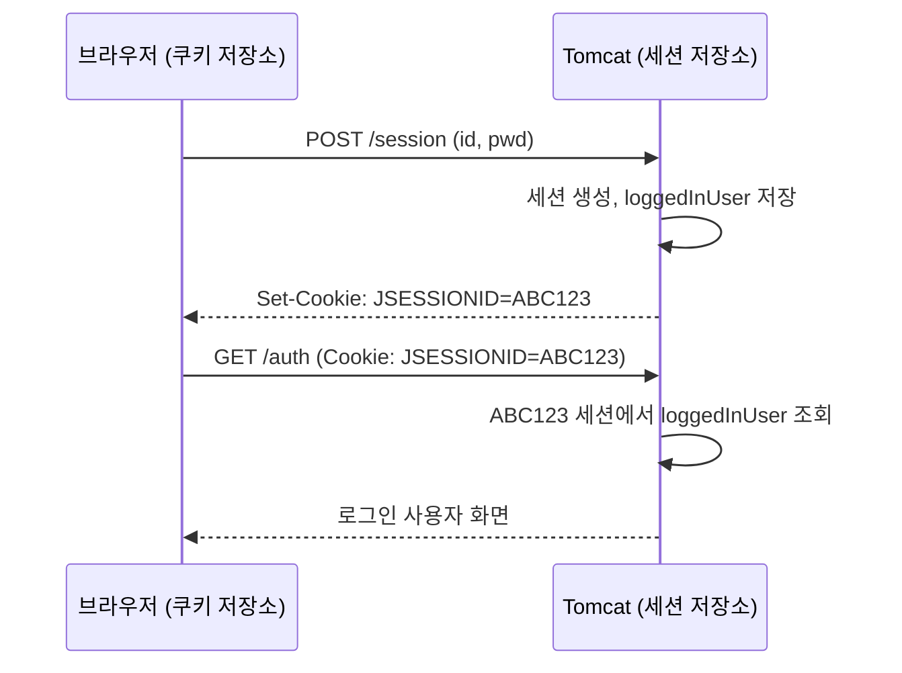
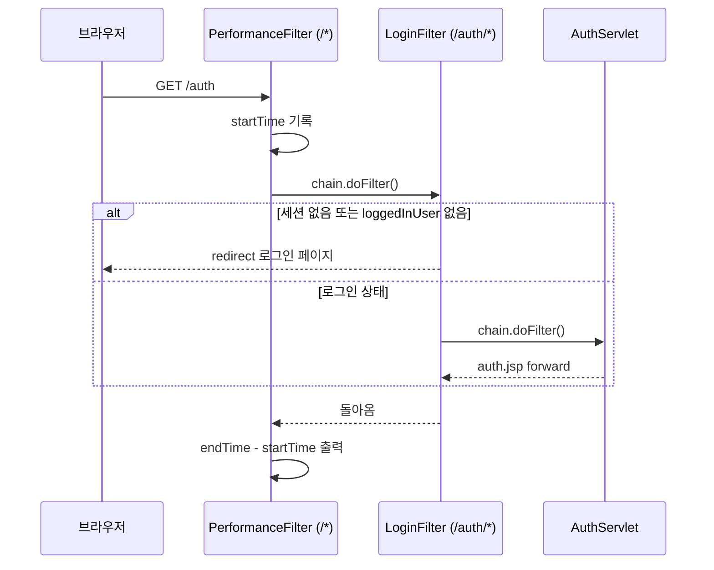
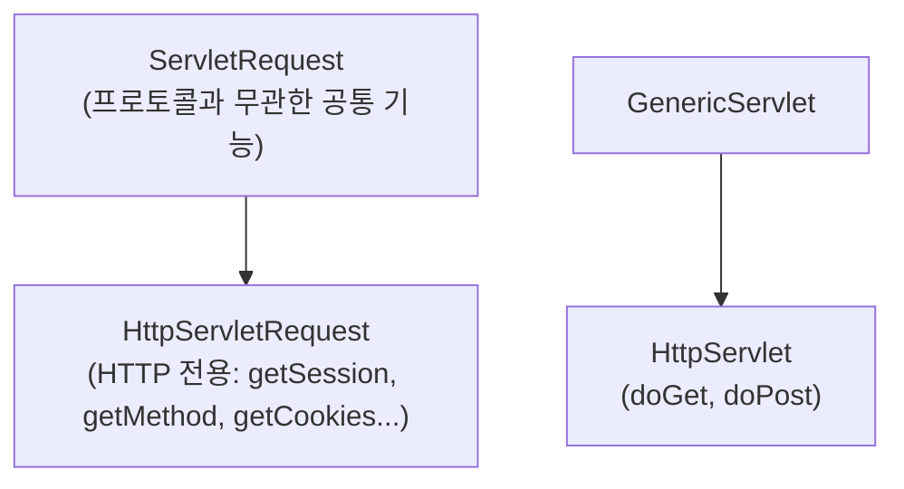

## 들어가며 (Situation)

JDBC까지는 `main()`에서 프로그램이 시작해 콘솔에 결과를 찍었다. 서블릿 수업에 들어오자 **`main()`이 사라졌다.** 클래스를 만들고 `@WebServlet`만 붙였는데 브라우저에서 주소를 치면 코드가 실행됐다.

이 글은 10/21(서블릿 개념, 생명주기, GET/POST)과 10/23(무상태성, 쿠키, 세션, 필터) 필기를 합친 것이다. 코드는 수업 프로젝트 `chap01-servlet`을 인용했고, 수업 코드가 아닌 것은 **"예시 코드"**라고 표시했다. 이 글을 쓰는 환경에서는 Tomcat을 띄우지 못해 실행 결과는 적지 않았다.

선생님이 "서블릿과 JDBC는 면접 질문이 많다. 내부적으로 어떻게 돌아가는지, 기본기가 있는지 확인하려는 것"이라고 했다. 그래서 "어떻게 쓰는가"보다 **"누가, 언제 부르는가"**에 초점을 맞췄다.

## 문제 상황 (Task)

필기를 다시 보니 질문이 남아 있었다.

- `main()`이 없는데 누가 서블릿 객체를 만들고 메서드를 부르는가?
- `init()`이 생성자 역할을 한다는데, 그럼 서블릿 객체는 몇 개 만들어지는가?
- 필기에 "get, post는 오버로딩과 같은 개념(??, 이 부분이 뭔지 모르겠음)"이라고 적어 두었다.
- 쿠키와 세션은 무엇이 다르고, 언제 무엇을 써야 하는가?
- `getAttribute()` 뒤에 `.toString()`을 붙이라고 적었는데 정말 그게 맞는가?
- 필터는 왜 "가장 먼저 동작하고 가장 마지막에 끝나는가"?

## 해결 과정 (Action)

### 1. 웹 서버와 WAS: DB를 들르면 동적이다

| 구분 | 웹 서버 | WAS (Web Application Server) |
|---|---|---|
| 다루는 것 | 정적 파일 (HTML, CSS, 이미지) | 요청마다 결과가 달라지는 동적 응답 |
| 예 | Apache HTTP Server, Nginx | Tomcat |
| 필기 | "정적인 페이지" | "DB를 들르는 순간 동적인 WAS" |

같은 `/menu` 요청이라도 DB에 저장된 메뉴가 바뀌면 응답이 달라진다. 이렇게 **실행할 때마다 결과를 만들어 내야 하면** 자바 코드가 필요하고, 그 자바 코드를 돌리는 곳이 WAS다.

필기의 "반환을 무조건 한다는 것을 기억하기"는 HTTP의 규칙이다. HTTP는 **요청 하나에 응답 하나**가 짝이다. 수업 `LifeCycleServlet`처럼 `service()`에서 콘솔 출력만 하고 아무것도 쓰지 않아도, 브라우저는 빈 응답을 받는다.

### 2. main()이 없는 이유: 서블릿 컨테이너가 대신 부른다

필기의 "Application / main() X → tomcat에서 알아서 찾아감"을 풀면 이렇다. Tomcat 안에는 **서블릿 컨테이너**가 있다. 필기 표현으로는 "서블릿을 보관하는 창고"다. 컨테이너가 `@WebServlet`이 붙은 클래스를 찾아 URL과 연결해 두고, 요청이 오면 알맞은 서블릿을 부른다.

```java
// 수업 코드 (LifeCycleServlet)
@WebServlet(value = "/life-cycle")   // /life-cycle 요청이 오면 이 서블릿이 동작
public class LifeCycleServlet extends HttpServlet { ... }
```

수업 `build.gradle`을 보면 서블릿 API가 `implementation`이 아니라 `compileOnly`다. 컴파일할 때만 필요하고, 실행할 때는 Tomcat이 이미 가지고 있기 때문이다. 결과물도 실행 가능한 jar가 아니라 Tomcat에 올리는 `war`다.

```groovy
// 수업 코드 (chap01-servlet/build.gradle)
plugins { id 'war' }
dependencies {
    compileOnly('jakarta.servlet:jakarta.servlet-api:6.1.0')
}
```

필기의 "시작점: `index.html`"은 주소 뒤에 파일 이름 없이 접속했을 때 보여 주는 **환영 파일(welcome file)**이다. Tomcat은 기본 설정에서 `index.html`을 먼저 찾는다.



### 3. 생명주기: 객체는 한 번 만들고 요청마다 service()

수업 `LifeCycleServlet`은 생성자, `init()`, `service()`, `destroy()`마다 횟수를 찍는다.

```java
// 수업 코드 (LifeCycleServlet)
public LifeCycleServlet() { System.out.println("기본 생성자 호출됨..."); }

@Override
public void init(ServletConfig config) throws ServletException {
    System.out.println("init() 호출됨... : " + initCount++);
}

@Override
protected void service(HttpServletRequest req, HttpServletResponse resp) ... {
    System.out.println("service() 호출됨... : " + serviceCount++);
}

@Override
public void destroy() { System.out.println("destroy() 호출됨... : " + destroyCount++); }
```

| 메서드 | 언제 | 몇 번 |
|---|---|---|
| 생성자 | 첫 요청 때 (또는 서버 시작 때) | 1번 |
| `init()` | 생성 직후, 초기화 | 1번 |
| `service()` | 요청이 올 때마다 | 요청 수만큼 |
| `destroy()` | 서버 종료 또는 재배포 때 | 1번 |

필기의 "init이 생성자와 같은 역할을 하면서 서블릿을 반복해서 만들지 않음"이 이 표다. [Jakarta Servlet 명세](https://jakarta.ee/specifications/servlet/6.1/jakarta-servlet-spec-6.1)에 따르면 컨테이너는 서블릿 선언 하나에 **인스턴스를 하나만** 만든다. 요청이 100번 와도 객체는 1개이고, `service()`만 100번 불린다.

필기에 따로 적었던 "스레드 풀"과 "싱글톤"이 여기서 연결된다.

- **싱글톤처럼 동작:** 서블릿 객체는 하나다.
- **스레드 풀:** 요청마다 스레드를 새로 만들지 않고, Tomcat이 미리 만들어 둔 스레드를 빌려준다.
- **그래서 생기는 주의점:** 동시에 들어온 요청 여러 개가 **같은 서블릿 객체를 동시에** 쓴다. `serviceCount` 같은 인스턴스 필드는 모든 요청이 나눠 쓰는 값이 된다. 사용자별 값을 필드에 저장하면 다른 사용자 값과 섞일 수 있다. 요청별 값은 메서드 안의 지역 변수나 `request`에 담는다.

### 4. GET과 POST: 오버로딩이 아니라 오버라이딩

필기에 "오버로딩과 같은 개념(??)"이라고 적은 부분을 정리했다. 결론은 **오버로딩이 아니다.**

| 구분 | 오버로딩 | 서블릿의 doGet / doPost |
|---|---|---|
| 메서드 이름 | 같음 | **다름** (`doGet`, `doPost`) |
| 매개변수 | 다름 | **같음** (`req`, `resp`) |
| 누가 고르나 | 컴파일러가 인자 타입으로 고름 | `service()`가 HTTP 메서드를 보고 고름 |

실제 구조는 이렇다. 부모 클래스 `HttpServlet`의 `service()`가 요청의 HTTP 메서드(`GET`, `POST` 등)를 확인하고 `doGet()`이나 `doPost()`를 대신 불러 준다. 우리는 이 두 메서드를 **오버라이딩**해서 내용을 채운다. [HttpServlet API 문서](https://jakarta.ee/specifications/servlet/6.0/apidocs/jakarta.servlet/jakarta/servlet/http/httpservlet)도 `service()`는 요청을 `doXXX` 메서드로 나눠 보내는 역할이라 직접 오버라이딩할 이유가 거의 없다고 설명한다.



수업 `ServiceMethodServlet`도 처음에는 `service()`를 직접 오버라이딩해서 `req.getMethod()`를 찍어 보다가, 주석 처리하고 `doGet`, `doPost`로 나눴다. "오버로딩처럼 보였던" 이유는 이름이 비슷하고 요청 종류에 따라 다른 메서드가 불리기 때문인 것 같다.

| 항목 | GET | POST |
|---|---|---|
| 데이터 위치 | URL 뒤 쿼리스트링 (`?name=값`) | 요청 본문(body) |
| URL | 바뀌고 데이터가 노출됨 (필기) | 바뀌지 않음 |
| 주 용도 | 조회 | 데이터 전송, 생성 |
| 예 | `<a href>` 클릭, 주소창 입력 | `<form method="post">` |

POST라고 안전한 것은 아니다. 본문도 HTTPS가 아니면 그대로 보인다. URL에 남지 않을 뿐이다.

### 5. 무상태성과 쿠키, 세션

HTTP는 **무상태(stateless)** 프로토콜이다. 서버는 방금 요청을 보낸 사람이 직전에 로그인한 사람과 같은지 기억하지 않는다. 그래서 상태를 어딘가에 저장해 두고 요청마다 보여 주는 장치가 필요하다. 필기대로 저장 **주체가 어디냐**에 따라 쿠키와 세션으로 나뉜다.

#### 쿠키: 손님이 들고 다니는 스탬프 쿠폰

```java
// 수업 코드 (CookieServlet.doPost)
Cookie cookie = new Cookie("userValue", cookieValue);
cookie.setMaxAge(60 * 60); // 만료 1시간 설정 (단위: 초)
resp.addCookie(cookie);
```

`setMaxAge()`의 단위는 **초**다. 그래서 `60 * 60`은 1시간, `60 * 60 * 24`는 하루다. 서버가 쿠키를 응답에 실어 보내면 브라우저가 저장해 두고, 이후 같은 사이트에 요청할 때마다 자동으로 함께 보낸다.

#### 세션: 가게가 장부에 적어 두는 정보

```java
// 수업 코드 (SessionServlet.doPost)
HttpSession session = req.getSession(true);     // 없으면 새로 만든다
session.setAttribute("loggedInUser", userId);
session.setMaxInactiveInterval(30);             // 30초 동안 요청이 없으면 만료
```

```java
// 수업 코드 (ExpireServlet) — 로그아웃
HttpSession session = req.getSession(false);    // 있으면 가져오고, 없으면 null
if (session != null) {
    session.invalidate();                       // 세션 무효화
}
```

여기서 필기에 없던 사실 하나를 확인했다. 세션 정보는 서버에 있지만, **서버가 "이 브라우저는 몇 번 세션"인지 알아보는 세션 ID는 쿠키(`JSESSIONID`)로 브라우저에 저장된다.** 세션도 결국 쿠키 하나에 기대는 구조다.



그래서 필기의 "세션은 정보가 브라우저에 노출되지 않는다"는 **사용자 정보 자체**에 대해서는 맞다. 하지만 세션 ID를 도둑맞으면 남이 내 세션을 쓸 수 있다(세션 하이재킹). 세션 만료 시간을 짧게 잡는 것이 필기의 "만료시간 지정 → 안정성 추가"가 의미 있는 이유다.

| 항목 | 쿠키 | 세션 |
|---|---|---|
| 저장 위치 | 브라우저 | 서버 (브라우저엔 세션 ID 쿠키만) |
| 비유 (필기) | 카페 스탬프 쿠폰을 손님이 보관 | 가게 장부 |
| 보안 | 같은 PC를 쓰면 탈취·조작이 쉬움 | 서버에서 검증 가능, 정보 노출 적음 |
| 용량 | 작음 | 서버 메모리를 사용자 수만큼 사용 (필기: "요청만큼 공간이 생김") |
| 만료 | `setMaxAge(초)` | `setMaxInactiveInterval(초)`, `invalidate()` |
| 어울리는 것 | 작고 털려도 괜찮은 값 (팝업 안 보기, 테마) | 로그인 정보처럼 검증이 필요한 값 |

필기의 "작고 빠르다는 장점에 탈취 가능성이 적으면 쿠키를 쓴다"가 이 표의 트레이드오프다. 수업에서는 모바일은 기기를 잘 공유하지 않고 잠금이 되어 있어 쿠키를 쓰기도 한다는 설명도 있었다. 이 부분은 공식 문서로 확인하지 못해 수업 설명으로만 남긴다.

필기에 함께 적은 **403**은 "권한 없음(Forbidden)"이다. 서버가 요청을 이해했지만 허락하지 않았다는 뜻이다. 로그인을 안 해서 누군지 모르는 상태는 보통 **401(Unauthorized)**로 구분한다.

#### getAttribute()와 .toString()

필기에는 "`getAttribute()`는 뒤에 `.toString()`을 붙여서 파싱해야 한다"고 적었다. 반은 맞다. `getAttribute()`의 반환 타입은 `Object`라서 `String`으로 바꿔야 한다. 하지만 그 방법은 `.toString()`보다 **형변환 연산자 `(String)`**가 안전하다. 수업 코드 주석에도 같은 말이 있다.

```java
// 수업 코드 (SessionServlet.doPost)
// null 발생 여부가 존재하는 변수를 형변환 시 메서드로 형변환하는 것보다
// () : 캐스트 연산자 == 형변환 연산자를 사용하는 것이 안정적이다.
String existUser = (String) session.getAttribute("loggedInUser");
```

| 방법 | 값이 `null`일 때 |
|---|---|
| `session.getAttribute("x").toString()` | `NullPointerException` 발생 |
| `(String) session.getAttribute("x")` | 그냥 `null`이 들어감 → `if`로 처리 가능 |

같은 파일의 `doGet()`은 `.toString()`을 쓴다. 세션은 있는데 `loggedInUser` 값이 없으면 여기서 예외가 날 수 있다.

### 6. 필터: 가장 먼저 들어오고 가장 마지막에 나간다

필터는 요청이 서블릿에 닿기 **전에** 동작한다. 필기의 "가장 먼저 동작하고 가장 마지막에 끝난다"는 `chain.doFilter()` 한 줄로 설명된다.

```java
// 수업 코드 (PerformanceFilter) — 모든 요청(/*)에 동작
long startTime = System.currentTimeMillis();       // ① 서블릿 가기 전

chain.doFilter(request, response);                 // ② 다음 필터 또는 서블릿 실행

long endTime = System.currentTimeMillis();         // ③ 서블릿이 끝나고 돌아온 뒤
System.out.println("[" + req.getRequestURI() + "최종 수행 시간] : " + (endTime-startTime) + "(ms)");
```

`chain.doFilter()` 앞은 요청이 들어갈 때, 뒤는 응답이 나올 때 실행된다. 그래서 필터는 서블릿을 **감싸는** 모양이 된다. 성능 필터는 이 특성을 이용해 서블릿 전체 수행 시간을 잰다. 필기의 "성능 향상은 안 됐을 때와 향상된 점을 비교해 줘야 한다"는 말과 이어진다. 개선 전후 숫자를 이 필터 로그로 얻을 수 있다.



`LoginFilter`는 로그인하지 않은 사용자를 서블릿까지 보내지 않는다. 서블릿마다 로그인 검사를 복사하지 않고 필터 한 곳에서 처리한다. 필기의 "보안, 권한에도 신경 써서 프로젝트 진행하기"를 코드로 옮긴 모양이다.

#### 왜 ServletRequest를 HttpServletRequest로 바꿔야 할까

필기에는 "다 HTTP를 쓰는데 Http 자식 클래스를 쓰지 않는 이유는? 나중에 HTTP보다 좋은 프로토콜이 나올 수 있으니 대비하기 위해"라고 적었다. 코드로 보면 이 질문이 나온 자리가 보인다. `Filter.doFilter()`의 매개변수는 `HttpServletRequest`가 아니라 부모 타입인 `ServletRequest`다. 그래서 `getSession()`을 쓰려면 형변환해야 한다.

```java
// 수업 코드 (LoginFilter)
// 자식이 가지고 있는 getSession() 메서드를 사용하기 위해 클래스 형변환
HttpServletRequest req = (HttpServletRequest) request;
HttpSession session = req.getSession(false);
```



서블릿 API는 처음부터 특정 프로토콜에 묶이지 않도록 공통 부모(`ServletRequest`, `GenericServlet`)와 HTTP 전용 자식(`HttpServletRequest`, `HttpServlet`)으로 나눠 설계됐다. 필터 인터페이스는 공통 부모 타입을 받는다. 선생님 설명대로 다른 프로토콜에 대비한 설계라서 HTTP 기능이 필요하면 자식 타입으로 바꿔 써야 한다.

#### 필터 등록 방법

| 방법 | 수업 예 | 특징 |
|---|---|---|
| `@WebFilter("/경로")` | `PerformanceFilter`, `LoginFilter` | 간단함. 여러 필터의 실행 순서는 보장되지 않음 |
| `web.xml`의 `<filter>`, `<filter-mapping>` | `EncodingFilter` | `<init-param>`으로 설정값 전달 가능, 작성 순서대로 실행 |

### 시행착오와 확인하지 못한 점

- **`init(ServletConfig)` 오버라이딩:** `LifeCycleServlet`은 `init(ServletConfig config)`를 오버라이딩하면서 `super.init(config)`를 부르지 않는다. API 문서는 이 형태를 오버라이딩할 때 `super.init(config)`를 부르라고 안내한다. 안 부르면 나중에 `getServletConfig()`가 `null`을 줄 수 있다. 매개변수 없는 `init()`을 오버라이딩하는 편이 간단하다.
- **세션에 비밀번호 저장:** 수업 `SessionServlet`은 실습용으로 비밀번호를 세션에 넣는다. 실제 서비스에서는 비밀번호를 세션에 보관하지 않고 로그인 검증에만 쓴다.
- **필터 실행 순서:** 어노테이션 필터(`PerformanceFilter`, `LoginFilter`)와 `web.xml` 필터(`EncodingFilter`)가 섞여 있을 때 실제 순서는 Tomcat에서 실행해 보지 못했다.

## 결과 (Result)

실행 시간 같은 수치는 측정하지 못했다. 대신 필기의 이해가 이렇게 바뀌었다.

| 필기의 이해 | 정리 후 |
|---|---|
| main()이 없고 Tomcat이 알아서 찾아감 | 서블릿 컨테이너가 `@WebServlet`을 보고 URL과 연결하고 객체를 관리함 |
| init이 생성자 역할, 반복해서 만들지 않음 | 서블릿은 인스턴스 1개 + 요청마다 스레드 → 인스턴스 필드는 공유되므로 주의 |
| get, post는 오버로딩 같은 개념(??) | 오버로딩이 아님. `service()`가 HTTP 메서드를 보고 고르고, 우리는 `doGet`, `doPost`를 오버라이딩 |
| 세션은 브라우저에 노출되지 않음 | 정보는 서버에 있지만 세션 ID는 `JSESSIONID` 쿠키로 브라우저에 있음 |
| `getAttribute()`엔 `.toString()` | `(String)` 형변환이 null에 안전함 |
| 필터는 가장 먼저, 가장 마지막 | `chain.doFilter()` 앞뒤로 나뉘어 서블릿을 감싸는 구조 |

배운 점은 **"내가 부르지 않는 코드는 누가 부르는지부터 찾는다"**는 것이다. 서블릿은 `main()`이 없어서 막막했다. 컨테이너가 생성자 → `init()` → `service()` → `doGet()` 순서로 부른다는 흐름을 알고 나니 각 코드의 위치가 이해됐다. 다음 수업인 Spring도 같은 방식(내가 아니라 프레임워크가 내 코드를 부른다)이라 이 흐름이 이어질 것 같다.

## 더 학습하면 좋은 개념

- **IoC (제어의 역전)** — `main()` 없이 컨테이너가 내 코드를 부르는 구조의 이름이다. Spring 컨테이너를 이해하는 출발점이다.
- **DispatcherServlet과 Spring MVC** — Spring MVC는 서블릿 하나가 모든 요청을 받아 컨트롤러로 나눠 주는 구조다. 이번에 본 `service()` → `doGet()` 분배가 더 커진 모양이다.
- **스레드 안전성 (Thread Safety)** — 서블릿 객체 하나를 여러 스레드가 함께 쓰기 때문에 필드에 무엇을 둬도 되는지 판단하는 기준이 된다.
- **쿠키 보안 속성 (HttpOnly, Secure, SameSite)** — 필기에서 걱정한 "쿠키 탈취"를 줄이는 실제 방법이다.
- **토큰 인증 (JWT)** — 서버가 세션을 저장하지 않는 방식이다. 세션의 "서버 용량 부담"이라는 단점과 비교해 보면 좋다.

## 참고 자료

- [Jakarta Servlet 6.1 Specification](https://jakarta.ee/specifications/servlet/6.1/jakarta-servlet-spec-6.1)
- [Jakarta Servlet API - HttpServlet](https://jakarta.ee/specifications/servlet/6.0/apidocs/jakarta.servlet/jakarta/servlet/http/httpservlet)
- [Jakarta Servlet API - Cookie](https://jakarta.ee/specifications/servlet/6.0/apidocs/jakarta.servlet/jakarta/servlet/http/cookie)
- [Jakarta Servlet API - HttpSession](https://jakarta.ee/specifications/servlet/6.0/apidocs/jakarta.servlet/jakarta/servlet/http/httpsession)
- [Jakarta Servlet API - Filter](https://jakarta.ee/specifications/servlet/6.0/apidocs/jakarta.servlet/jakarta/servlet/filter)
- [Jakarta EE Tutorial - Jakarta Servlet](https://jakarta.ee/learn/docs/jakartaee-tutorial/current/web/servlets/servlets.html)
- [MDN - Using HTTP cookies](https://developer.mozilla.org/en-US/docs/Web/HTTP/Cookies)
- [MDN - 403 Forbidden](https://developer.mozilla.org/en-US/docs/Web/HTTP/Status/403)
- [OWASP - Session Management Cheat Sheet](https://cheatsheetseries.owasp.org/cheatsheets/Session_Management_Cheat_Sheet.html)
