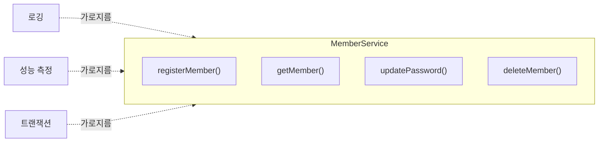
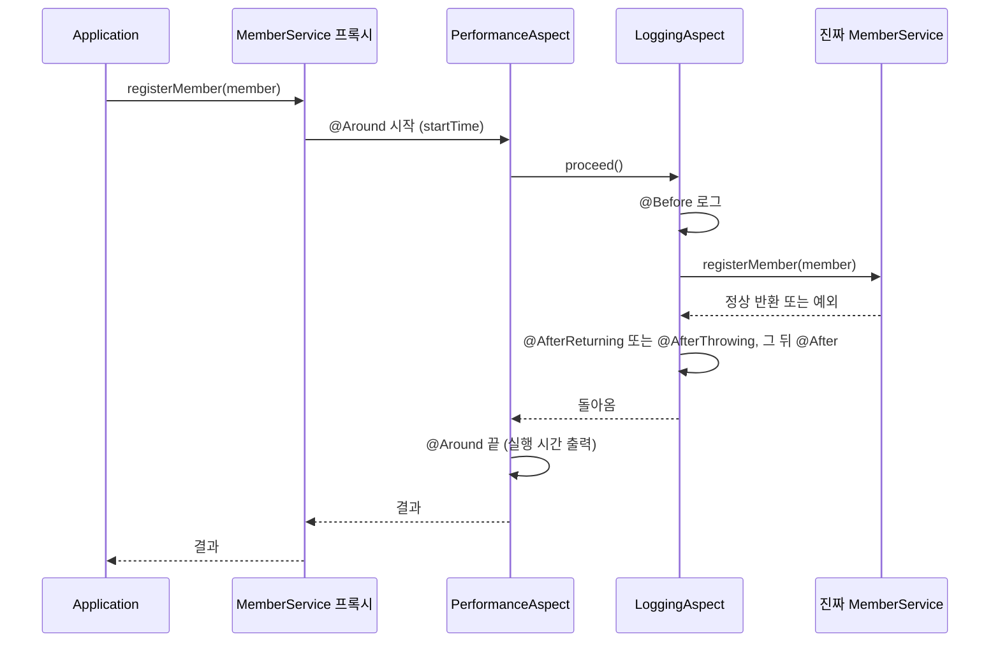
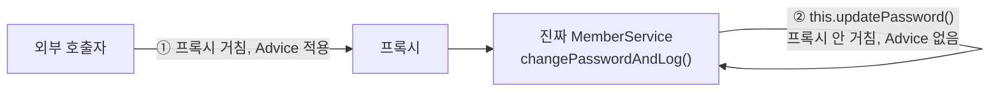
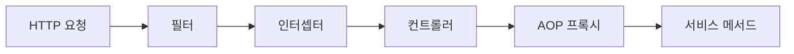

## 들어가며 (Situation)

10/27 수업 주제는 **AOP(Aspect Oriented Programming)**였다. 필기 첫 줄에 "측면, 관점"이라고 적었고, 바로 아래에 "로깅, 성능 측정, 트랜잭션"을 적었다. 수업은 회원 관리 프로그램(회원가입, 조회, 비밀번호 변경, 탈퇴)을 두 번 만드는 방식으로 진행됐다.

- `section01`: AOP 없이, 모든 메서드 안에 로깅·성능 측정·트랜잭션 코드를 직접 쓴 버전
- `section02`: 같은 기능을 Spring AOP의 Aspect로 분리한 버전

코드는 수업 프로젝트 `chap03-aop`을 인용했고, 수업 코드가 아닌 것은 **"예시 코드"**라고 표시했다. 이 글을 쓰는 환경에서는 프로젝트를 실행하지 못해서 실행 결과는 적지 않았다. 대신 "이 순서로 실행될 것"이라고 쓴 부분은 공식 문서를 근거로 적었다.

IoC 컨테이너와 DI는 다른 글에서 정리한다. 이 글에서는 "Spring 컨테이너가 객체(빈)를 만들어 관리한다"는 사실만 빌려 쓴다. 이 사실이 AOP가 동작하는 원리와 직접 이어진다.

## 문제 상황 (Task)

필기와 수업 코드를 다시 보니 질문이 남아 있었다.

- 필기의 "비기능: CRUD 말고"는 정확히 무엇을 말하는가? 왜 따로 떼어 내야 하는가?
- 용어 다섯 개(Aspect, Advice, PointCut, JoinPoint, Weaving)를 적었는데, Advice는 "시점"이고 PointCut은 "어디"라면 실제로 실행되는 코드는 무엇이라고 부르는가?
- `MemberService` 코드에는 로그 코드가 한 줄도 없는데 어떻게 로그가 찍히는가? 누가 내 메서드 앞뒤에 코드를 끼워 넣는가?
- `@Order(1)`은 왜 `PerformanceAspect`에만 붙어 있는가?
- AOP를 쓰면 모든 메서드 호출에 적용되는가?

## 해결 과정 (Action)

### 1. section01: 핵심 로직보다 부가 코드가 더 많다

`section01`의 `MemberService.registerMember()`를 줄여서 보면 이렇다.

```java
// 수업 코드 (section01.MemberService) — 일부 생략
public void registerMember(MemberDTO member) {
    // 성능 측정 시작 - 횡단 관심사 #1
    long startTime = System.currentTimeMillis();
    try {
        // 로깅 - 횡단 관심사 #2
        System.out.println("[로그] 회원 가입 시작: " + member.getEmail());
        // 트랜잭션 시작 (의사코드) - 횡단 관심사 #3
        // beginTransaction();

        // ----- 핵심 비즈니스 로직 시작 -----
        if (memberRepository.containsKey(member.getEmail())) {
            throw new IllegalArgumentException("이미 등록된 이메일입니다: " + member.getEmail());
        }
        memberRepository.put(member.getEmail(), member);
        // ----- 핵심 비즈니스 로직 종료 -----

        // commitTransaction();
        System.out.println("[로그] 회원 가입 성공: " + member.getEmail());
    } catch (Exception e) {
        // rollbackTransaction();
        System.out.println("[로그] 회원 가입 실패: " + e.getMessage());
        throw e;
    } finally {
        // 성능 측정 종료 - 횡단 관심사 #1
        long endTime = System.currentTimeMillis();
        System.out.println("[성능] 회원 가입 처리 시간: " + (endTime - startTime) + "ms");
    }
}
```

`getMember()`, `updatePassword()`, `deleteMember()`도 모양이 같다. `try` 앞에서 시간을 재고, `catch`에서 실패 로그를 찍고, `finally`에서 처리 시간을 찍는다. 바뀌는 것은 가운데 "핵심 비즈니스 로직"뿐이다.

수업 `Application` 주석에 문제점이 정리되어 있다.

```java
// 수업 코드 (section01.Application) 주석
/*  section01 의 문제점
 *  1. 코드의 중복 - 모든 메서드 마다 로깅, 성능측정, 트랜잭션 관리 관련 코드가 반복된다.
 *  2. 낮은 응집도 - 각 메서드가 핵심 비지니스 로직 외에 다른 코드들을 실행한다.
 *  3. 유지보수의 어려움 - 로그 출력 양식, 성능 측정 기준치 변화 시
 *     여러 메서드 내부에 있는 내용을 전부 수정해야 된다. */
```

필기의 "비기능: CRUD 말고"를 이 코드에 맞춰 다시 적으면 이렇다.

| 구분 | 핵심 관심사 (Core Concern) | 횡단 관심사 (Crosscutting Concern) |
|---|---|---|
| 필기 표현 | 기능 (회원가입, 조회, 수정, 탈퇴) | 비기능 (로깅, 성능 측정, 트랜잭션) |
| 무엇을 위한 코드인가 | 이 서비스가 존재하는 이유 | 여러 기능에 **공통으로** 필요한 것 |
| 위치 | 메서드마다 다름 | 메서드마다 **같은 코드가 반복** |
| 예 | 이메일 중복 확인, 회원 저장 | 시작/성공/실패 로그, 실행 시간 |

"비기능"이 "CRUD가 아닌 것"이라는 이해는 반만 맞다. 핵심은 **여러 클래스·메서드를 가로질러(crosscut) 반복된다**는 점이다. [Spring 공식 문서](https://docs.spring.io/spring-framework/reference/core/aop/introduction-defn.html)는 트랜잭션 관리를 횡단 관심사의 대표 예로 든다. 필기의 예시도 같은 뜻이다.

- **로깅**: 필기의 "회원가입을 하면 흔적을 남기는 것"이다. 누가 언제 어떤 메서드를 불렀고 성공했는지 실패했는지를 남긴다.
- **성능 측정**: 필기의 "회원가입 로직이 얼마나 성능이 좋은지"다. 정확히는 **얼마나 오래 걸렸는지**를 재는 것이다. 개선 전후를 비교하려면 이 수치가 먼저 있어야 한다.



AOP는 이렇게 가로지르는 코드를 **한 곳(Aspect)에 모으고**, 어디에 적용할지는 **규칙(Pointcut)으로 따로 지정**하는 방식이다.

### 2. section02: 핵심 로직만 남은 MemberService

`section02`의 `MemberService`는 비즈니스 로직만 남았다.

```java
// 수업 코드 (section02.MemberService) — 일부 생략
@Service
public class MemberService {
    private Map<String, MemberDTO> memberRepository = new HashMap<>();

    public void registerMember(MemberDTO member) {
        // ----- 핵심 비즈니스 로직 시작 -----
        if (memberRepository.containsKey(member.getEmail())) {
            throw new IllegalArgumentException("이미 등록된 이메일입니다: " + member.getEmail());
        }
        memberRepository.put(member.getEmail(), member);
        System.out.println("회원 정보 저장 완료: " + member.getEmail());
        // ----- 핵심 비즈니스 로직 종료 -----
    }
    // getMember, updatePassword, deleteMember 도 같은 방식
}
```

`try`/`catch`/`finally`, `startTime`, `[로그]` 출력이 모두 사라졌다. 사라진 코드는 두 Aspect 클래스로 옮겨졌다.

| 옮겨 간 곳 | 담당 | 사용한 Advice |
|---|---|---|
| `LoggingAspect` | 로깅 | `@Before`, `@After`, `@AfterReturning`, `@AfterThrowing` |
| `PerformanceAspect` | 성능 측정 | `@Around` |

설정 클래스는 세 줄이다.

```java
// 수업 코드 (AppConfig)
@Configuration
@ComponentScan("com.wanted.aop.section02")
@EnableAspectJAutoProxy
public class AppConfig {
}
```

`@ComponentScan`이 `@Service`(MemberService)와 `@Component`(두 Aspect)를 찾아 빈으로 등록한다. **`@EnableAspectJAutoProxy`**가 이 글의 핵심이다. 이 어노테이션이 `@Aspect` 클래스를 찾아 AOP를 켠다. 무엇을 켜는지는 4장에서 다룬다.

`build.gradle`에는 `spring-context` 외에 AOP 관련 의존성이 추가됐다.

```groovy
// 수업 코드 (chap03-aop/build.gradle) — 일부
implementation 'org.springframework:spring-context:7.0.8'
implementation 'org.springframework:spring-aop:7.0.8'
implementation 'org.aspectj:aspectjrt:1.9.25.1'
implementation 'org.aspectj:aspectjweaver:1.9.25.1'
compileOnly 'org.projectlombok:lombok:1.18.46'
annotationProcessor ('org.projectlombok:lombok:1.18.46')
```

`@Aspect`, `@Before`, `JoinPoint`는 패키지 이름이 `org.aspectj`로 시작한다. Spring AOP는 AspectJ의 **어노테이션과 포인트컷 문법만 빌려 쓰고**, 실제 적용은 Spring이 직접 한다. 이 차이도 4장에서 다룬다.

### 3. AOP 용어: 필기와 공식 정의 비교

필기의 용어 정의를 [Spring 공식 문서의 AOP Concepts](https://docs.spring.io/spring-framework/reference/core/aop/introduction-defn.html)와 나란히 놓았다.

| 용어 | 필기 | 공식 문서 정의 (요약) | 수업 코드에서 |
|---|---|---|---|
| **Aspect** | 반복적으로 동작하는 코드를 모아둔 클래스 | 여러 클래스를 가로지르는 관심사를 모듈로 만든 것 | `LoggingAspect`, `PerformanceAspect` |
| **Advice** | 반복 코드가 어느 **시점**에 동작할지 정의 | 특정 Join point에서 Aspect가 하는 **행동(action)** | `logBefore()`, `performance()` 메서드 |
| **Pointcut** | 반복 코드가 **어디에** 적용될지 | Join point를 고르는 조건(predicate) | `"execution(* com.wanted...MemberService.*(..))"` |
| **Join point** | 적용될 위치 및 객체 정보 | 프로그램 실행 중의 한 지점. Spring AOP에서는 **항상 메서드 실행** | `registerMember()`가 실행되는 순간 |
| **Weaving** | 반복 코드가 적용될 위치에 전달되는 행위 | Aspect를 대상과 연결해 **advised object를 만드는 것**. Spring AOP는 런타임에 함 | 컨테이너가 프록시를 만드는 과정 |
| Target object | (필기에 없음) | Aspect가 적용되는 원래 객체 | 진짜 `MemberService` 객체 |
| AOP proxy | (필기에 없음) | Aspect를 적용하려고 프레임워크가 만든 객체. JDK 동적 프록시 또는 CGLIB 프록시 | 컨테이너가 돌려주는 `MemberService` |

정리하면서 고친 점은 세 가지다.

**① Advice는 "시점"만이 아니라 "실행할 코드 + 시점"이다.** 필기의 문제 상황에 적은 의문("그럼 실제로 실행되는 코드는 무엇이라 부르나")의 답이 이것이다. 공식 정의는 "행동(action)"이다. `logBefore()` 메서드 본문이 Advice이고, `@Before`라는 **종류**가 시점을 정한다. 한 문장으로 하면 **"무엇을(Advice) + 언제(Advice 종류) + 어디에(Pointcut)"**이고, 이 셋을 묶은 클래스가 Aspect다.

**② Join point는 "개념"과 "객체"를 구분해야 한다.** 개념으로서 Join point는 "Advice를 끼워 넣을 수 있는 지점"이다. Spring AOP에서는 메서드 실행만 Join point가 된다(필드 접근, 생성자 실행은 안 됨). 필기의 "적용될 위치 및 객체 정보"는 Advice 메서드의 매개변수로 받는 **`JoinPoint` 객체**에 가깝다. 수업 코드 주석도 이쪽을 설명한다.

```java
// 수업 코드 (LoggingAspect)
@Before("execution(* com.wanted.aop.section02.MemberService.*(..))")
public void logBefore(JoinPoint joinPoint) {
    // JoinPoint 란? Advice 메서드가 적용되는 지점에 대한
    // 정보를 제공하는 객체이다. Advice 메서드 매개변수 부분에 작성을 한다.
    String methodName = joinPoint.getSignature().getName();   // 어떤 메서드인가
    Object[] args = joinPoint.getArgs();                       // 어떤 인자로 불렸나
    ...
}
```

**③ Weaving은 "전달"보다 "연결해서 새 객체를 만드는 것"이다.** 공식 문서는 Weaving을 컴파일 시점, 클래스 로딩 시점, 런타임 중 하나에서 할 수 있다고 설명한다. **Spring AOP는 런타임에** 한다. 구체적으로는 컨테이너가 빈을 만들 때 원본 객체를 감싼 **프록시 객체**를 만든다. 코드가 어딘가로 "전달"되는 것이 아니라 원본 앞에 대리 객체가 하나 더 생긴다.

#### Pointcut 표현식 읽기

수업 코드 주석에 정리된 `execution` 문법을 표로 옮겼다.

```text
execution( [접근제어자] 반환타입 [패키지.클래스.]메서드이름(파라미터) )
execution(  *            com.wanted.aop.section02.MemberService.*(..) )
```

| 부분 | 값 | 의미 |
|---|---|---|
| 반환 타입 | `*` | 아무 반환 타입 |
| 선언 타입 | `com.wanted.aop.section02.MemberService` | 이 클래스의 메서드 |
| 메서드 이름 | `*` | 모든 메서드 |
| 파라미터 `(..)` | 0개 이상 아무거나 | `()`는 매개변수 없음, `(String)`은 String 1개, `(String, ..)`는 첫 번째가 String |

수업 주석에는 "접근제어자 반환타입 패키지.클래스.메서드(파라미터)"로 적혀 있는데, [공식 문서의 execution 형식](https://docs.spring.io/spring-framework/reference/core/aop/ataspectj/pointcuts.html)을 보면 접근제어자와 선언 타입은 **생략 가능**하고 반환 타입, 메서드 이름, 파라미터는 필수다. 수업 코드도 접근제어자를 생략했다.

### 4. 원리: 컨테이너는 진짜 객체 대신 프록시를 준다

`MemberService`에 로그 코드가 한 줄도 없는데 로그가 찍히는 이유가 이 장이다. 필기에는 없는 내용이라 [Spring 공식 문서 - Proxying Mechanisms](https://docs.spring.io/spring-framework/reference/core/aop/proxying.html)를 기준으로 정리했다.

`section02.Application`은 객체를 `new`로 만들지 않고 컨테이너에서 꺼낸다.

```java
// 수업 코드 (section02.Application)
ApplicationContext context = new AnnotationConfigApplicationContext(AppConfig.class);
MemberService service = context.getBean(MemberService.class);
service.registerMember(member);
```

`@EnableAspectJAutoProxy`가 켜져 있으면 컨테이너는 빈을 만든 뒤 "이 빈의 메서드 중 Pointcut에 걸리는 것이 있는가"를 확인한다. 걸리면 원본 대신 **프록시**를 빈으로 등록한다. 그래서 `getBean()`이 돌려주는 `service`는 진짜 `MemberService`가 아니라 **`MemberService`처럼 생긴 대리 객체**다.



프록시는 메서드가 불리면 Advice들을 차례로 실행하고, 중간에 진짜 객체의 메서드를 부른다. [공식 문서](https://docs.spring.io/spring-framework/reference/core/aop/introduction-defn.html)도 Spring은 Advice를 **인터셉터 체인**으로 만들어 Join point를 감싼다고 설명한다. 지난 서블릿 글의 필터가 `chain.doFilter()` 앞뒤로 서블릿을 감쌌던 구조와 같은 모양이다.

#### 프록시를 만드는 두 가지 방법

| 구분 | JDK 동적 프록시 | CGLIB 프록시 |
|---|---|---|
| 언제 쓰나 (Spring Framework 기본) | 대상이 인터페이스를 하나 이상 구현할 때 | 대상이 인터페이스를 구현하지 않을 때 |
| 만드는 방식 | 같은 **인터페이스**를 구현한 새 객체 | 대상 클래스를 **상속**한 하위 클래스를 런타임에 생성 |
| 수업 `MemberService` | — | **해당** (인터페이스 없음) |
| 못 하는 것 | 인터페이스에 없는 메서드 | `final` 클래스, `final`·`private` 메서드 |

수업 `MemberService`는 인터페이스를 구현하지 않으므로 공식 문서 기준으로 **CGLIB 프록시**가 만들어진다. CGLIB 프록시는 `MemberService`를 상속한 클래스라서 `MemberService` 타입 변수에 그대로 담긴다. `context.getBean(MemberService.class)`가 문제없이 동작하는 이유다.

공식 문서에 따르면 이 기본값은 환경마다 다를 수 있다. Spring Framework 자체는 인터페이스 기반 프록시를 기본으로 제안하지만 Spring Boot는 설정에 따라 클래스 기반(CGLIB)을 기본으로 쓸 수 있다. 수업 프로젝트 버전인 7.0부터는 `@Proxyable` 어노테이션으로 빈마다 프록시 방식을 정할 수 있다고 한다.

#### 프록시라서 생기는 한계: 내부 호출

프록시 구조를 알면 "AOP를 쓰면 모든 메서드 호출에 적용되는가?"의 답이 나온다. **아니다.** 프록시를 거친 호출에만 적용된다.

```java
// 예시 코드 — 수업 코드에는 없는 내부 호출 상황
@Service
public class MemberService {
    public void changePasswordAndLog(String email, ...) {
        this.updatePassword(email, ...);   // this = 프록시가 아니라 진짜 객체
    }
    public void updatePassword(String email, ...) { ... }
}
```

밖에서 `changePasswordAndLog()`를 부르면 프록시를 거치므로 이 메서드에는 Advice가 적용된다. 하지만 그 안의 `this.updatePassword()`는 **진짜 객체가 자기 자신을 부르는 호출**이라 프록시를 거치지 않는다. 그래서 `updatePassword()`에 대한 로그와 성능 측정은 실행되지 않는다. 공식 문서는 이를 self-invocation이라 부르고, `this`를 통한 호출은 Advice를 우회한다고 적고 있다.



공식 문서가 권하는 해결 순서는 다음과 같다.

| 방법 | 공식 문서 평가 |
|---|---|
| 내부 호출이 생기지 않게 코드 구조를 바꿈 (다른 빈으로 분리) | 가장 좋은 방법 |
| 자기 자신을 주입(self injection)받아 `this` 대신 그 참조로 호출 | 대안 |
| `AopContext.currentProxy()`로 프록시를 꺼내 호출 | 최후의 수단, 권장하지 않음 |

공식 문서는 AspectJ의 컴파일 시점·로드 시점 위빙은 바이트코드 자체를 바꾸기 때문에 이 문제가 없다고 덧붙인다. **Spring AOP와 AspectJ의 차이**가 여기서 드러난다.

| 구분 | Spring AOP | AspectJ |
|---|---|---|
| Weaving 시점 | 런타임 (프록시 생성) | 컴파일 시점, 클래스 로딩 시점 |
| Join point | 메서드 실행만 | 메서드, 생성자, 필드 접근 등 |
| 적용 대상 | Spring 빈만 | 모든 객체 |
| 내부 호출 | 적용 안 됨 | 적용됨 |

수업 코드가 `@Aspect`, `@Before` 같은 AspectJ 어노테이션을 쓰지만 실제로는 Spring AOP 방식(프록시)으로 동작한다. 그래서 `new MemberService()`로 직접 만든 객체에는 Aspect가 적용되지 않는다. `section01`처럼 `new`로 만들면 AOP가 끼어들 틈이 없다.

### 5. Advice 종류: 언제 무엇을 쓰나

수업 `LoggingAspect`는 Advice 네 종류를, `PerformanceAspect`는 `@Around`를 쓴다.

| Advice | 실행 시점 (공식 문서) | 수업 코드 | 쓰임 |
|---|---|---|---|
| `@Before` | Join point 실행 전. 예외를 던지지 않는 한 실행을 막을 수 없음 | `logBefore` | 시작 로그, 인자 확인 |
| `@AfterReturning` | 정상 반환 후 | `logAfterReturning` | 반환값 로그 |
| `@AfterThrowing` | 예외로 끝났을 때 | `logAfterThrowing` | 예외 로그 |
| `@After` | **정상이든 예외든** 끝나면 항상 (finally) | `logAfter` | 자원 정리, 종료 로그 |
| `@Around` | 앞뒤 모두. 대상 메서드를 실행할지 직접 결정 | `performance` | 성능 측정, 트랜잭션 |

#### @After는 "실행 완료 후"가 아니라 "finally"

수업 코드 주석에는 이렇게 적혀 있다.

```java
// 수업 코드 (LoggingAspect) 주석
/* @After : PointCut 명시된 타겟 메서드가 실행 완료된 후 실행되는 Advice
 * 타이머 종료, 종료 로그, 자원 정리 이럴 때 사용이 된다. */
@After("execution(* com.wanted.aop.section02.MemberService.*(..))")
public void logAfter(JoinPoint joinPoint) {
    System.out.println("[After 로그] " + methodName + " 메서드 실행 완료!");
}
```

"실행 완료 후"를 "성공한 뒤"로 읽으면 틀린다. [공식 문서](https://docs.spring.io/spring-framework/reference/core/aop/ataspectj/advice.html)는 `@After`를 **After (finally) advice**라 부르고 정상 반환이든 예외든 **어떤 결과에서도** 실행된다고 설명한다. 성공했을 때만 실행하려면 `@AfterReturning`을 쓴다. 그래서 수업 코드의 `[테스트 5] 존재하지 않는 회원 조회`에서도 `[After 로그] ... 메서드 실행 완료!`가 찍힐 것이다. 예외가 났는데 "완료!"라고 찍히니 로그 문구를 "종료"로 바꾸는 편이 오해가 적다.

`section01`의 `try`/`catch`/`finally`와 1:1로 대응시키면 이해가 쉽다.

```java
// 예시 코드 — Advice 종류를 try 문에 대응시킨 그림
// @Around 시작
try {
    // @Before
    result = 대상메서드();
    // @AfterReturning (returning = "result")
} catch (Exception e) {
    // @AfterThrowing (throwing = "exception")
    throw e;
} finally {
    // @After
}
// @Around 끝
```

`@AfterReturning`의 `returning = "result"`, `@AfterThrowing`의 `throwing = "exception"`은 반환값·예외를 Advice 메서드의 **같은 이름의 매개변수**로 넘기라는 뜻이다. 공식 문서에 따르면 `throwing`의 매개변수 타입은 **필터 역할**도 한다. 수업 코드는 `Exception exception`으로 받으므로 `Exception` 계열 예외에만 실행된다. 또 `@AfterThrowing`은 대상 메서드에서 나온 예외만 받고, 다른 Advice에서 나온 예외는 받지 않는다. 일반적인 예외 처리 장치가 아니라는 것이다. 수업 주석의 "예외 흐름 복구도 할 수 있지만 더 좋은 예외처리로 하는 것이 좋다"와 같은 이야기다.

#### @Around: 가장 강력하지만 가장 실수하기 쉽다

```java
// 수업 코드 (PerformanceAspect)
@Around("execution(* com.wanted.aop.section02.MemberService.*(..))")
public Object performance(ProceedingJoinPoint joinPoint) {
    long startTime = System.currentTimeMillis();
    // ProceedingJoinPoint : 타겟 메서드의 실행을 직접 제어할 수 있다.
    try {
        Object result = joinPoint.proceed();   // 여기서 진짜 메서드 실행
        return result;
    } catch (Throwable e) {
        throw new RuntimeException(e);
    } finally {
        long endTime = System.currentTimeMillis();
        System.out.println("[Around 성능 측정] " + methodName + "메서드 실행 시간" + (endTime - startTime) + "(ms)");
    }
}
```

`@Around`만 `JoinPoint`가 아니라 **`ProceedingJoinPoint`**를 받는다. `proceed()`를 불러야 대상 메서드가 실행된다. 공식 문서 기준 규칙은 이렇다.

- 반환 타입은 `Object`로 선언한다. `void`로 하면 호출자는 항상 `null`을 받는다. `getMember()`의 반환값이 사라진다.
- `proceed()`는 한 번, 여러 번, 아예 안 불러도 문법상 맞다. 안 부르면 대상 메서드가 실행되지 않는다.
- 공식 문서는 **"필요한 동작을 할 수 있는 가장 약한 Advice를 쓰라"**고 권한다. 반환값만 보면 되는 일에 `@Around`를 쓰면 `proceed()`를 빠뜨리는 실수를 할 수 있기 때문이다.

성능 측정은 "앞에서 시작 시간, 뒤에서 종료 시간"이 **한 메서드 안의 지역 변수**로 이어져야 하므로 `@Around`가 맞다. `@Before`와 `@After`로 나누면 `startTime`을 둘 곳이 마땅치 않다. 트랜잭션도 시작·커밋·롤백을 한곳에서 해야 해서 같은 이유로 `@Around` 방식이 어울린다. Spring의 `@Transactional`도 AOP 프록시로 동작한다는 점은 다른 글에서 이어 정리할 예정이다.

### 6. @Order: Aspect가 여러 개일 때 누가 바깥인가

`PerformanceAspect`에만 `@Order(1)`이 붙어 있다. [공식 문서의 Advice Ordering](https://docs.spring.io/spring-framework/reference/core/aop/ataspectj/advice.html)에 따르면 다음과 같다.

- `@Order` 값이 **작을수록 우선순위가 높다.**
- 우선순위가 높은 Advice는 **들어갈 때 먼저, 나올 때 마지막**에 실행된다. 즉 바깥쪽에서 감싼다.
- 서로 다른 Aspect의 Advice가 같은 Join point에 걸리고 순서를 지정하지 않으면 **실행 순서는 정해지지 않는다.**

`LoggingAspect`에는 `@Order`가 없다. Spring의 정렬 규칙에서 순서가 없는 객체는 가장 낮은 우선순위로 취급하므로, `PerformanceAspect`가 바깥, `LoggingAspect`가 안쪽이 된다. 4장의 시퀀스 다이어그램이 이 순서다. 이렇게 하면 성능 측정 시간에 로그 출력 시간까지 포함된다. 순수한 비즈니스 로직 시간만 재고 싶다면 반대로 성능 측정을 안쪽에 두어야 한다. **무엇을 재고 싶은지에 따라 순서를 정하는 것**이 `@Order`의 의미다.

같은 Aspect 안의 Advice끼리는 공식 문서 기준 `@Around` → `@Before` → `@After` → `@AfterReturning` → `@AfterThrowing` 순으로 우선순위가 정해진다. 단 `@After`는 finally 의미라서 같은 Aspect의 `@AfterReturning`/`@AfterThrowing`보다 **뒤에** 실행된다.

### 7. Lombok: DTO를 짧게 쓰는 도구

필기의 "lombok을 사용하면 DTO를 쉽게 작성, 수정할 수 있다"는 `MemberDTO`에 해당한다.

```java
// 수업 코드 (MemberDTO)
// DTO 는 행위 위주의 객체가 아닌 데이터 위주의 객체이다.
@NoArgsConstructor
@AllArgsConstructor
@Getter
@Setter
@ToString
public class MemberDTO {
    private String email;
    private String password;
    private String name;
    private String phone;
    private String role;
}
```

| 어노테이션 | 컴파일할 때 만들어 주는 것 |
|---|---|
| `@NoArgsConstructor` | 기본 생성자 |
| `@AllArgsConstructor` | 모든 필드를 받는 생성자 (`new MemberDTO(email, ****, ...)`) |
| `@Getter` / `@Setter` | 모든 필드의 getter / setter |
| `@ToString` | 모든 필드를 출력하는 `toString()` |

`build.gradle`에서 Lombok이 `compileOnly` + `annotationProcessor`인 이유는 **컴파일할 때 코드를 만들어 넣고 실행할 때는 필요 없기** 때문이다. 필드가 바뀌어도 getter, 생성자를 손으로 고칠 필요가 없다는 점이 필기의 "쉽게 수정"이다.

AOP와 만나는 지점이 하나 있다. `@ToString`은 [기본적으로 모든 필드를 출력](https://projectlombok.org/features/ToString)한다. 이 점은 시행착오 항목에서 다시 다룬다.

### 8. 성능 측정은 어느 계층에서 할까

10/29 필기에 "필터는 서블릿, 인터셉터는 컨트롤러, AOP까지 적용하면 비즈니스 로직에 적용 가능, 필요에 따라 계층별로"가 있다. 성능 측정을 기준으로 짧게 비교하면 이렇다. 필터와 인터셉터 자체는 다른 글에서 다룬다.

| 위치 | 감싸는 범위 | 잴 수 있는 것 | 수업 예 |
|---|---|---|---|
| 서블릿 필터 | 서블릿 요청 전체 | URL 하나의 전체 처리 시간 | `PerformanceFilter` (서블릿 글) |
| Spring 인터셉터 | 컨트롤러 호출 | 컨트롤러 단위 시간 | 10/29 수업 |
| Spring AOP | 빈의 메서드 | **서비스 메서드 하나**의 시간 | `PerformanceAspect` |



필터는 "어느 URL이 느린가", AOP는 "그 URL 안에서 어느 서비스 메서드가 느린가"를 알려 준다. 필기의 "필요에 따라 계층별로"는 **알고 싶은 범위에 맞는 계층을 고른다**는 뜻으로 정리했다.

### 시행착오와 확인하지 못한 점

- **비밀번호가 로그에 찍힌다.** `logBefore()`는 모든 인자를 그대로 출력한다. `registerMember(member)`면 `MemberDTO`의 `@ToString`이 `password=****`까지 출력하고, `updatePassword(email, 현재 비밀번호, 새 비밀번호)`는 비밀번호 문자열 두 개를 그대로 찍는다. `getMember()`의 반환값도 `@AfterReturning`에서 비밀번호와 함께 찍힌다. 실습이라 문제가 없지만, 실제로는 `@ToString.Exclude`로 `password` 필드를 빼고 인자 로그에서 민감한 값을 가려야 한다. 로깅을 한곳에 모으면 **한 번의 실수가 모든 메서드에 퍼진다**는 점도 AOP의 이면이다.
- **`@Around`가 예외 타입을 바꾼다.** `PerformanceAspect`는 `catch (Throwable e)`에서 `throw new RuntimeException(e)`로 감싼다. 그러면 `getMember()`가 던진 `IllegalArgumentException`이 호출자에게는 `RuntimeException`으로 바뀌어 도착한다. [Javadoc](https://docs.oracle.com/en/java/javase/21/docs/api/java.base/java/lang/RuntimeException.html#%3Cinit%3E(java.lang.Throwable))상 이 생성자는 메시지를 `cause.toString()`으로 만들기 때문에 `Application`의 `e.getMessage()`에는 `java.lang.IllegalArgumentException: 존재하지 않는 회원입니다: ...`처럼 예외 클래스 이름이 붙어 출력될 것으로 예상한다(실행해 보지는 못했다). 호출하는 쪽에서 `catch (IllegalArgumentException e)`로 잡고 있었다면 잡히지 않는다. Aspect는 대상 메서드의 동작을 바꾸지 않아야 하므로, 메서드 선언에 `throws Throwable`을 붙이고 예외를 그대로 다시 던지는 방식이 공식 문서 예제와 같은 모양이다.

```java
// 예시 코드 — 예외를 감싸지 않는 @Around
@Around("execution(* com.wanted.aop.section02.MemberService.*(..))")
public Object performance(ProceedingJoinPoint joinPoint) throws Throwable {
    long startTime = System.currentTimeMillis();
    try {
        return joinPoint.proceed();
    } finally {
        System.out.println("[Around 성능 측정] " + joinPoint.getSignature().getName()
                + " 실행 시간 " + (System.currentTimeMillis() - startTime) + "(ms)");
    }
}
```

- **section02 `MemberService`의 주석이 남아 있다.** 각 메서드 Javadoc에 "성능 측정, 로깅, 트랜잭션 처리 코드가 비즈니스 로직과 섞여있다"가 그대로 있다. section01에서 복사해 온 흔적이라 section02에서는 사실과 다르다.
- **트랜잭션은 Aspect로 옮기지 않았다.** `section01`에서도 트랜잭션은 주석 처리된 의사코드였고, `section02`에는 트랜잭션 Aspect가 없다. 실제로는 Spring의 `@Transactional`이 이 역할을 한다.
- **`aspectjrt`와 `aspectjweaver`를 둘 다 넣었다.** 공식 문서는 `@AspectJ` 지원에 `aspectjweaver`가 클래스패스에 있어야 한다고 안내한다. `aspectjrt`를 따로 넣어야 하는지는 확인하지 못했다.
- **`@Order` 없는 Aspect의 우선순위.** `@Order`가 없는 Aspect를 가장 낮은 우선순위로 취급한다는 것은 Spring의 일반적인 `Ordered` 규칙에서 가져왔다. Aspect 정렬에서도 정확히 그렇게 동작하는지는 실행 로그로 확인하지 못했다.
- **실제 출력 순서.** 4장 다이어그램과 `@After` 출력 예상은 공식 문서를 근거로 그렸다. `section02.Application`을 실행해서 확인하지는 못했다.

## 결과 (Result)

실행 시간 같은 수치는 측정하지 못했다. 코드 구조의 변화와 필기 이해의 변화를 정리했다.

| 항목 | section01 | section02 |
|---|---|---|
| `MemberService`가 하는 일 | 비즈니스 로직 + 로깅 + 성능 측정 + 트랜잭션(의사코드) | 비즈니스 로직만 |
| 로그 형식을 바꾸려면 | 메서드 4개를 모두 수정 | `LoggingAspect` 한 곳만 수정 |
| 새 메서드 추가 시 | 로그·성능 코드를 다시 복사 | Pointcut에 걸리면 자동 적용 |
| 객체 생성 | `new MemberService()` | 컨테이너가 프록시로 만들어 줌 |

| 필기의 이해 | 정리 후 |
|---|---|
| 비기능 = CRUD가 아닌 것 | 여러 메서드를 **가로질러 반복되는** 횡단 관심사 (로깅, 성능 측정, 트랜잭션) |
| Aspect = 반복 코드를 모아둔 클래스 | Advice + Pointcut을 묶은 모듈. Spring에서는 `@Aspect` 클래스 |
| Advice = 어느 시점에 동작할지 | 실행할 코드(행동) 자체. 시점은 Advice **종류**가 정함 |
| JoinPoint = 적용될 위치 및 객체 정보 | 개념은 "Advice가 끼어드는 지점"(Spring은 메서드 실행만), 객체 `JoinPoint`는 그 지점의 정보 |
| Weaving = 반복 코드가 위치에 전달되는 행위 | Aspect를 대상과 연결해 새 객체를 만드는 것. Spring은 런타임에 **프록시**를 만듦 |
| (필기에 없음) | 프록시를 거친 호출에만 적용됨. 같은 클래스 내부 호출(`this.`)은 적용 안 됨 |
| `@After` = 실행 완료 후 (수업 주석) | 성공·예외 상관없이 항상 실행 (finally) |
| Lombok = DTO를 쉽게 작성 | 컴파일 시 코드 생성. `@ToString`은 비밀번호까지 출력하므로 주의 |

배운 점은 **"내 코드가 아니라 컨테이너가 준 객체를 쓰고 있다"**는 것이다. `section01`과 `section02`의 `Application`은 거의 같아 보이지만, `new`로 만든 객체와 `getBean()`으로 받은 객체는 다르다. 후자는 프록시이고, 그 프록시가 로그와 성능 측정을 끼워 넣는다. 서블릿에서 "내가 부르지 않는 코드는 누가 부르는지 찾는다"를 배웠다면, AOP에서는 **"내가 부르는 객체가 진짜인지부터 의심한다"**를 배웠다. 내부 호출에서 AOP가 동작하지 않는 문제도 이 한 가지 사실로 설명된다.

## 더 학습하면 좋은 개념

- **`@Transactional`과 트랜잭션 AOP** — 수업에서 의사코드로만 남은 트랜잭션을 Spring이 실제로 처리하는 방법이다. 프록시 기반이라 이번에 정리한 내부 호출 한계가 그대로 적용된다.
- **프록시 패턴과 데코레이터 패턴** — AOP 프록시의 바탕이 되는 디자인 패턴이다. 원본을 감싸서 기능을 더하는 구조를 직접 구현해 보면 Spring이 대신 해 주는 일이 보인다.
- **JDK 동적 프록시(`java.lang.reflect.Proxy`)와 CGLIB** — 두 프록시 생성 방식의 차이를 알면 `final` 메서드나 인터페이스 유무에 따라 AOP가 왜 안 걸리는지 판단할 수 있다.
- **AspectJ 컴파일 시점·로드 시점 위빙** — 프록시 방식의 한계(내부 호출, 메서드 실행만 가능)가 없는 다른 위빙 방식이다. Spring AOP의 범위를 이해하는 비교 대상이다.
- **로깅 프레임워크 (SLF4J, Logback)** — 수업은 `System.out.println`을 썼다. 실제 로깅은 로그 레벨과 출력 위치를 설정으로 관리한다. Aspect 안의 출력문을 바꿀 때 필요하다.

## 참고 자료

- [Spring Framework - AOP Concepts](https://docs.spring.io/spring-framework/reference/core/aop/introduction-defn.html)
- [Spring Framework - Declaring Advice](https://docs.spring.io/spring-framework/reference/core/aop/ataspectj/advice.html)
- [Spring Framework - Declaring a Pointcut](https://docs.spring.io/spring-framework/reference/core/aop/ataspectj/pointcuts.html)
- [Spring Framework - Proxying Mechanisms](https://docs.spring.io/spring-framework/reference/core/aop/proxying.html)
- [Spring Framework - Enabling @AspectJ Support](https://docs.spring.io/spring-framework/reference/core/aop/ataspectj/aspectj-support.html)
- [Project Lombok - @ToString](https://projectlombok.org/features/ToString)
- [Java SE 21 API - RuntimeException](https://docs.oracle.com/en/java/javase/21/docs/api/java.base/java/lang/RuntimeException.html)
