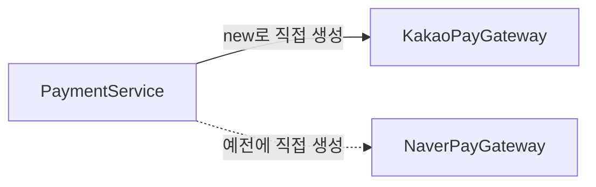
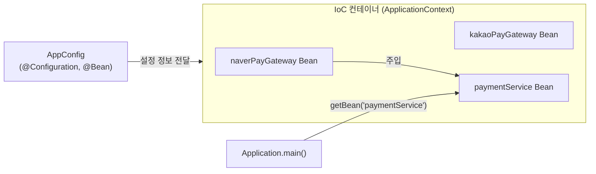
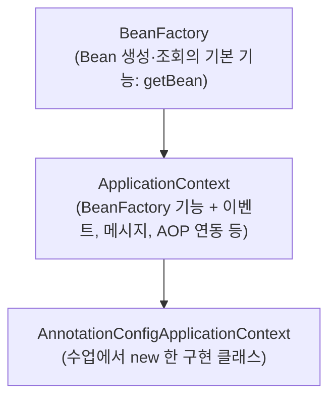
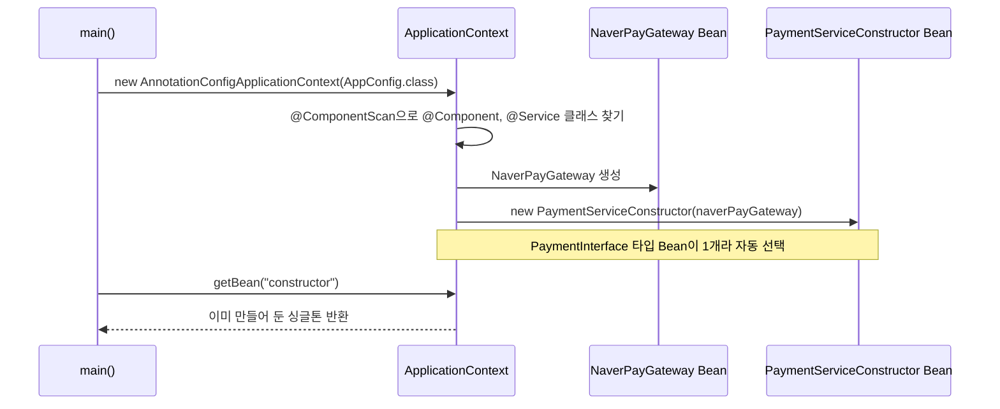
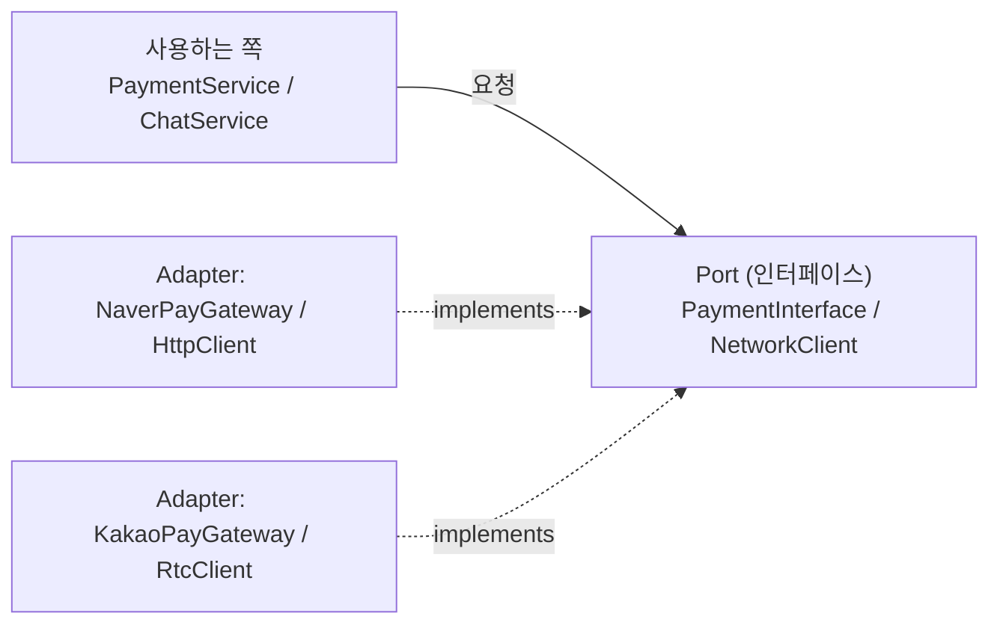

## 들어가며 (Situation)

서블릿 수업에서는 `main()` 없이 Tomcat이 내 코드를 불렀다. Spring 수업 첫날에는 반대로 `main()`이 다시 등장했다. 그런데 이번에는 `main()` 안에서 `new`를 거의 쓰지 않았다. 객체는 **IoC 컨테이너**라는 곳에서 꺼내 왔다.

이 글은 10/27 필기(기존 개발 방식, Spring의 철학, IoC 컨테이너, PSA)를 정리한 것이다. 코드는 수업 프로젝트 `chap01-IoC-container`, `Chap02-dependency-injection`을 인용했고, 수업 코드가 아닌 것은 **"예시 코드"**라고 표시했다. 이 글을 쓰는 환경에서는 코드를 실행하지 못해 실행 결과는 적지 않았다.

수업 예제는 하나의 시나리오로 이어진다. 쇼핑몰에 결제 기능이 있고, 결제 수단으로 네이버페이와 카카오페이가 있다. 그리고 **"네이버페이를 카카오페이로 바꿔 달라"**는 요구사항이 들어온다. 이 요구사항 하나를 어떻게 덜 아프게 처리하느냐가 이번 수업 전체의 흐름이다.

Spring 프로젝트는 아직 Spring Boot가 아니라 `spring-context` 하나만 추가한 순수 Java 프로젝트다.

```groovy
// 수업 코드 (chap01-IoC-container/build.gradle)
dependencies {
    /* spring-context : Spring 프레임 워크의 핵심 의존성. IoC Container 생성 */
    implementation 'org.springframework:spring-context:7.0.8'
}
```

## 문제 상황 (Task)

필기를 다시 보니 정리가 필요한 부분이 있었다.

- 필기에 "기존에는 개발자가 직접 객체를 다루었다(`new Member()`)"라고 적었다. 그게 **왜** 문제인가?
- "인터페이스 사용: 구현체를 변경해도 컴파일 오류가 나지 않음"이라고 적었다. 정말 아무것도 안 고쳐도 되는가?
- "Spring이 필요한 시점에 객체를 주입해준다"에서 **필요한 시점**은 언제인가?
- 필기 맨 아래에 `//IoC == context == factory`라고 적었다. 셋은 정말 같은 것인가?
- 의존성 주입 방법이 세 가지(필드, 세터, 생성자)인데 무엇을 써야 하는가?
- PSA를 "바꾸기 쉬운, 서비스, 추상화"로 적었는데, Spring에서 실제로 어디에 쓰이는가?

## 해결 과정 (Action)

### 1. new로 직접 만들 때의 문제: 한 줄 바꾸려다 여러 줄을 고친다

첫 번째 버전은 Spring 없이 `PaymentService`가 결제 객체를 직접 만든다.

```java
// 수업 코드 (section01.service.PaymentService)
public class PaymentService {

    // 네이버
//    private NaverPayGateway naverPayGateway;
    private KakaoPayGateway kakaoPayGateway;

    public PaymentService() {
//        this.naverPayGateway = new NaverPayGateway();
        this.kakaoPayGateway = new KakaoPayGateway();
    }

    public boolean processPay(String orderId, int amount) {
//        boolean result = naverPayGateway.pay(orderId, amount);
        boolean result = kakaoPayGateway.pay(orderId, amount);
        ...
    }
}
```

주석 처리된 줄이 네이버페이를 쓰던 흔적이다. 카카오페이로 바꾸려고 **필드 타입, 생성자의 `new`, 메서드 호출** 세 군데를 고쳤다. 게다가 두 결제 클래스는 메서드 모양부터 다르다.

```java
// 수업 코드 (section01.gateway.NaverPayGateway)
public boolean pay(String orderId, double amount) { ... }

// 수업 코드 (section01.gateway.KakaoPayGateway)
public boolean pay(String orderId, int amount) { ... }
```

수업 코드 주석은 이 상황을 SOLID의 **개방-폐쇄 원칙(OCP)** 위반이라고 설명한다.

```java
// 수업 코드 (section01.Application) 주석
/*  현재 코드의 문제
 *   1. 요구사항 변경 시 결제 구현체를 직접 변경해야 된다.
 *   2. 만약 메서드 이름이 다르거나, 매개변수가 다르면 전부 수정해야 된다.
 *   위 문제사항은 SOLID 원칙 중 "개방-폐쇄" 원칙을 위반했다고 표현한다.
 *   - 소프트웨어는 확장에는 열려있어야 하며, 변경에는 닫혀있어야 한다.
 */
```

필기의 "개발자가 직접 객체를 다루었다(`new Member()`)"가 문제인 이유가 여기서 보인다. `new KakaoPayGateway()`라고 쓰는 순간 `PaymentService`는 **어떤 구현 클래스를 쓸지까지 스스로 결정**한다. 결정권이 사용하는 쪽에 있으니, 결정이 바뀌면 사용하는 쪽 코드가 바뀐다. 이걸 "결합도가 높다"고 한다.



### 2. 인터페이스로 "사용하는 쪽"을 고정한다

두 번째 버전은 결제 클래스들이 같은 인터페이스를 구현하게 만든다. 메서드 이름과 매개변수가 달랐던 문제를 인터페이스로 통일한다.

```java
// 수업 코드 (section02.gateway.PaymentInterface)
public interface PaymentInterface {
    boolean processPay(String orderId, int amount);
}

// 수업 코드 (section02.gateway.KakaoPayGateway)
public class KakaoPayGateway implements PaymentInterface {
    @Override
    public boolean processPay(String orderId, int amount) { ... }
}
```

그리고 `PaymentService`는 구현 클래스 이름을 모르고, 인터페이스 타입만 안다. 객체도 직접 만들지 않고 **생성자 매개변수로 받는다.**

```java
// 수업 코드 (section02.service.PaymentService)
public class PaymentService {

    private final PaymentInterface paymentInterface;

    public PaymentService(PaymentInterface paymentInterface) {
        this.paymentInterface = paymentInterface;
    }

    public boolean processPay(String orderId, int amount) {
        boolean result = paymentInterface.processPay(orderId, amount);
        ...
    }
}
```

필기의 "인터페이스 사용: 구현체 은닉, 구현체를 변경해도 컴파일 오류가 나지 않음"은 이 코드를 보고 적은 것이다. 정확히는 이렇게 고쳐 적어야 한다.

| 필기 | 정리 |
|---|---|
| 구현체 은닉 | `PaymentService`는 `PaymentInterface`만 안다. 실제로 네이버인지 카카오인지 모른다 |
| 구현체를 변경해도 컴파일 오류가 나지 않음 | **사용하는 쪽(`PaymentService`)은 한 줄도 고치지 않는다.** 하지만 어떤 구현체를 넣을지 정하는 코드는 어딘가에 있어야 하고, 그곳은 고친다 |

그 "어딘가"를 `main()`에서 `new PaymentService(new KakaoPayGateway())`처럼 직접 써도 동작은 한다. Spring은 이 조립 작업을 **IoC 컨테이너**에 맡긴다.

### 3. IoC 컨테이너에 Bean을 등록하고 꺼낸다

조립 정보는 설정 클래스 `AppConfig`에 모은다.

```java
// 수업 코드 (chap01 section02.config.AppConfig)
@Configuration
public class AppConfig {

    // @Bean 어노테이션을 사용하면 컨테이너 내부에서
    // 그 객체의 이름은 메서드명이 기본값이 된다.
    @Bean
    public KakaoPayGateway kakaoPayGateway() {
        return new KakaoPayGateway();
    }

    @Bean
    public NaverPayGateway naverPayGateway() {
        return new NaverPayGateway();
    }

    @Bean
    public PaymentService paymentService() {
        return new PaymentService(naverPayGateway());
    }
}
```

```java
// 수업 코드 (chap01 section02.Application)
ApplicationContext context =
        new AnnotationConfigApplicationContext(AppConfig.class);

// getBean() : 컨테이너 내부에 있는 객체를 꺼내오는 메서드
PaymentService paymentService = context.getBean("paymentService", PaymentService.class);
boolean result = paymentService.processPay("order-001", 3);
```

이제 결제 수단을 카카오페이로 바꾸려면 `AppConfig`의 `naverPayGateway()`를 `kakaoPayGateway()`로 한 단어만 바꾸면 된다. `PaymentService`와 `Application`은 그대로다. 수정 지점이 **설정 한 곳**으로 모였다.

필기의 "Spring의 철학"이 이 구조다. 객체를 만들고 연결하는 **제어권**이 개발자 코드에서 컨테이너로 넘어갔다. 그래서 **IoC(Inversion of Control, 제어의 역전)**라고 부른다. [Spring 공식 문서](https://docs.spring.io/spring-framework/reference/core/beans/introduction.html)는 IoC를 DI라고도 한다고 설명하고, 객체가 의존 대상을 생성자 인자 등으로 정의해 두면 **컨테이너가 Bean을 만들 때 그 의존성을 주입**한다고 적는다. Bean은 수업 주석대로 "Spring 컨테이너가 관리하는 객체"다.



#### @Bean 메서드끼리 호출하면 객체가 두 번 생길까?

`paymentService()` 안에서 `naverPayGateway()`를 직접 호출한다. 그러면 컨테이너가 등록한 `naverPayGateway` Bean과는 다른 `NaverPayGateway`가 하나 더 만들어질 것 같다. [공식 문서(@Configuration)](https://docs.spring.io/spring-framework/reference/core/beans/java/configuration-annotation.html)를 확인해 보니 그렇지 않다.

> All `@Configuration` classes are subclassed at startup-time with `CGLIB`. In the subclass, the child method checks the container first for any cached (scoped) beans before it calls the parent method and creates a new instance.

Spring이 `AppConfig`를 상속한 클래스를 실행 시점에 만들어서, `naverPayGateway()` 호출을 가로채 **컨테이너에 이미 있는 싱글톤 Bean을 돌려준다.** 이 동작은 `@Configuration`이 붙은 클래스에서만 일어난다. 같은 문서는 일반 `@Component` 클래스에서는 이런 방식으로 Bean 간 의존성을 선언할 수 없다고 적는다.

### 4. "IoC == context == factory"는 같은 것인가

수업 코드 주석에도 `// IoC Container == Application Context == Bean Factory`라고 되어 있고, 필기도 이를 따라 적었다. 셋 다 "IoC 컨테이너"를 가리킬 때 쓰는 말이라는 점에서는 맞다. 하지만 **같은 타입은 아니다.**

[공식 문서](https://docs.spring.io/spring-framework/reference/core/beans/introduction.html)는 둘의 관계를 이렇게 설명한다.

> `ApplicationContext` is a sub-interface of `BeanFactory`. ... In short, the `BeanFactory` provides the configuration framework and basic functionality, and the `ApplicationContext` adds more enterprise-specific functionality. The `ApplicationContext` is a complete superset of the `BeanFactory`.



| 이름 | 정체 | 수업 코드에서 |
|---|---|---|
| IoC 컨테이너 | 개념. 객체 생성·연결을 대신 해 주는 것 | 설명할 때 쓰는 말 |
| `BeanFactory` | 컨테이너의 최상위 인터페이스. `getBean()`이 여기 정의됨 | 직접 쓰지 않음 |
| `ApplicationContext` | `BeanFactory`를 상속한 하위 인터페이스. 공식 문서가 "IoC 컨테이너"를 설명할 때 주로 쓰는 타입 | 변수 타입 `ApplicationContext context` |
| `AnnotationConfigApplicationContext` | `@Configuration` 클래스를 읽는 `ApplicationContext` 구현 클래스 | `new AnnotationConfigApplicationContext(AppConfig.class)` |

그래서 `//IoC == context == factory`는 **"context는 factory의 기능을 모두 포함한 확장판이고, 보통 IoC 컨테이너라고 하면 context를 가리킨다"**로 고쳐 적었다. "factory"라는 이름은 컨테이너가 Bean을 만들어 내는 공장 역할을 한다는 데서 왔다고 이해했다.

### 5. "필요한 시점에 주입"의 시점과 Bean 스코프

필기에는 "Spring이 필요한 시점에 객체를 주입해준다"고 적었다. "내가 `getBean()`을 부르는 순간 만든다"로 읽힐 수 있는데, 기본 설정에서는 다르다. [공식 문서(Lazy-initialized Beans)](https://docs.spring.io/spring-framework/reference/core/beans/dependencies/factory-lazy-init.html)에 따르면 `ApplicationContext`는 기본적으로 **컨테이너를 초기화할 때 싱글톤 Bean을 미리(eagerly) 만들고 의존성을 연결**한다. 그래서 의존할 Bean이 없으면 `getBean()`을 부르기 전, 컨테이너를 만드는 시점에 오류가 난다. "필요한 시점"은 **그 Bean이 만들어질 때** 정도로 이해하는 것이 정확하다.

수업 `section03`은 Bean이 몇 개 만들어지는지(스코프)를 확인한다.

```java
// 수업 코드 (chap01 section03.config.AppConfig)
@Bean("single")      // default 메서드명이지만, 직접 이름 지정 가능
@Scope("singleton")  // default 설정은 싱글톤이다.
public PaymentService paymentService() {
    return new PaymentService(naverPayGateway());
}

@Bean("proto")
@Scope("prototype")  // 요청 시마다 매번 새로운 인스턴스를 반환
public PaymentService paymentService2() {
    return new PaymentService(naverPayGateway());
}
```

```java
// 수업 코드 (chap01 section03.Application)
PaymentService single = context.getBean("single", PaymentService.class);
single.processPay("order-001", 3);
System.out.println("single 의 주문 ID = " + single.getOrderId());

PaymentService single2 = context.getBean("single", PaymentService.class);
/* getBean()으로 객체를 2번 꺼냈는데 orderId 는 동일하다.
 * === 1개의 인스턴스를 공유한다. === 싱글톤이다. */
System.out.println("single2 의 주문 ID = " + single2.getOrderId());
```

`single2`로는 `processPay()`를 부르지 않았는데 `single`이 저장한 `order-001`이 보인다는 것이 이 예제의 핵심이다. 두 변수가 **같은 객체**를 가리키기 때문이다. `proto`는 꺼낼 때마다 새 객체라서 `proto2`의 `orderId`는 비어 있을 것이다(실행해서 확인하지는 못했다).

| 스코프 | 객체 수 | 공식 문서 설명 | 주의점 |
|---|---|---|---|
| `singleton` (기본값) | 컨테이너당 1개 | 같은 이름으로 요청하면 항상 같은 인스턴스를 반환 | 필드에 상태를 두면 모든 사용자가 공유 |
| `prototype` | 요청마다 새로 생성 | 주입되거나 `getBean()`할 때마다 새 인스턴스 | 컨테이너가 소멸 콜백을 부르지 않음. 정리는 사용하는 쪽 책임 |

수업 코드 주석의 "가장 주의!!!!"는 서블릿 글에서 정리한 내용과 같은 이야기다.

```java
// 수업 코드 (chap01 section03.service.PaymentService)
/*   Bean은 기본적으로 Singleton 이다.
 *   가장 주의!!!!
 *   - Bean 이 상태(필드) 값을 가지게 되면 모든 요청이 해당 필드 값을 공유하게 된다.
 *   - 따라서 필드에는 행위 위주의 클래스(ex) service, dao) 만 작성하고
 *   - 데이터 저장이 필요한 경우에는 각 요청별로 DTO 를 통해서 데이터를 저장한다. */
private String orderId;
```

서블릿 객체가 1개라서 인스턴스 필드가 모든 요청에 공유됐던 것처럼, 싱글톤 Bean의 `orderId` 필드도 모든 사용자가 나눠 쓰게 된다. `PaymentService`의 `orderId` 필드는 이 위험을 보여 주려고 **일부러 넣은 나쁜 예**다.

### 6. Bean이 100개라면: @ComponentScan과 @Component

`AppConfig`에 `@Bean` 메서드를 하나씩 쓰는 방식에는 한계가 있다. 수업 주석이 던진 질문 그대로다.

```java
// 수업 코드 (Chap02 section01.Application)
/*   AppConfig 파일 하위에 Bean들을 정의해서 IoC 컨테이너에 등록했었다.
 *   문제 제기! : 만약 Bean 이 100개 라면? */
```

그래서 클래스에 `@Component`를 붙이고, 설정 클래스에는 `@ComponentScan`만 붙여 Spring이 직접 찾아 등록하게 한다.

```java
// 수업 코드 (Chap02 section01.gateway.NaverPayGateway)
@Component
public class NaverPayGateway implements PaymentInterface { ... }

// 수업 코드 (Chap02 section01.service.PaymentService)
@Service   // @Component의 특수한 형태. Service 계층 Bean에 붙인다.
public class PaymentService { ... }
```

```java
// 수업 코드 (Chap02 section01.config.AppConfig) — 일부
@Configuration
@ComponentScan(basePackages = "com.wanted.di.section01",
        excludeFilters = @ComponentScan.Filter(
                type = FilterType.REGEX, pattern = {"com.wnated,di.section01.service.*"}
        )
)
public class AppConfig { }
```

| 등록 방식 | 수업 예 | 장점 | 단점 |
|---|---|---|---|
| `@Configuration` + `@Bean` | chap01 `AppConfig` | 등록 내용이 한 파일에 보임. 외부 라이브러리 클래스도 등록 가능 | Bean마다 메서드를 써야 함 |
| `@ComponentScan` + `@Component` | Chap02 `AppConfig` | 클래스에 어노테이션만 붙이면 끝 | 무엇이 등록되는지 한눈에 보기 어려움 |

`@Service`, `@Repository`, `@Controller`는 [공식 문서](https://docs.spring.io/spring-framework/reference/core/beans/classpath-scanning.html)에서 `@Component`의 **특수화(specialization)**라고 설명한다. 스캔 대상이 된다는 점은 같고, 계층의 역할을 이름으로 드러낸다.

수업 주석에는 "basePackages를 지정하지 않으면 `@ComponentScan`이 달린 클래스와 동일한 레벨(같은 패키지)까지만 스캔한다"고 적혀 있다. [`@ComponentScan` Javadoc](https://docs.spring.io/spring-framework/docs/current/javadoc-api/org/springframework/context/annotation/ComponentScan.html)을 확인해 보니 조금 다르다.

> If specific packages are not defined, scanning will occur recursively beginning with the package of the class that declares this annotation.

**같은 패키지부터 시작해서 하위 패키지까지 재귀적으로** 스캔한다. 그래서 Spring Boot 프로젝트에서 메인 클래스를 최상위 패키지에 두는 것이다.

### 7. 의존성 주입(DI) 세 가지 비교

`@Component`로 등록한 Bean끼리는 `@Bean` 메서드 안에서 `new PaymentService(naverPayGateway())`처럼 직접 연결해 줄 곳이 없다. 대신 `@Autowired`로 "여기에 맞는 Bean을 넣어 달라"고 표시한다. 수업 `Chap02 section02`는 같은 결제 서비스를 세 가지 방식으로 만들었다.

```java
// 수업 코드 (PaymentServiceField) — 필드 주입
@Service("field")
public class PaymentServiceField {
    @Autowired
    private PaymentInterface paymentInterface;
}
```

```java
// 수업 코드 (PaymentServiceSetter) — 세터 주입
@Service("setter")
public class PaymentServiceSetter {
    private PaymentInterface paymentInterface;

    @Autowired
    public void setPaymentInterface(PaymentInterface paymentInterface) {
        this.paymentInterface = paymentInterface;
    }
}
```

```java
// 수업 코드 (PaymentServiceConstructor) — 생성자 주입
@Service("constructor")
public class PaymentServiceConstructor {
    private final PaymentInterface paymentInterface;

//    @Autowired   // 생성자가 1개면 생략 가능
    public PaymentServiceConstructor(PaymentInterface paymentInterface) {
        this.paymentInterface = paymentInterface;
    }
}
```

세 클래스 모두 `PaymentInterface` 타입을 요구하고, 이 타입을 구현한 Bean은 `NaverPayGateway` 하나뿐이다. 그래서 Spring이 타입으로 찾아 `NaverPayGateway`를 넣는다.



| 항목 | 필드 주입 | 세터 주입 | 생성자 주입 |
|---|---|---|---|
| `final` 사용 | 불가 | 불가 | **가능** (불변 보장) |
| 필수 의존성 강제 | 안 됨 | 안 됨 | 객체 생성 시점에 반드시 전달 |
| 컨테이너 없이 테스트 | 어려움 (private 필드에 넣을 방법이 없음) | 세터로 넣을 수 있음 | `new`로 바로 넣을 수 있음 |
| 나중에 교체 | 불가 | **가능** (재주입) | 불가 |
| 수업 주석의 단점 | 직접 `new`로 대입해도 컴파일 에러가 나지 않음 | 세터가 호출되지 않으면 `null` | 생성자 인자가 많아지면 길어짐 |
| 공식 문서 입장 | 레퍼런스의 DI 두 방식에 없음 | 선택적 의존성에 사용 | **권장** |

[공식 문서(Dependency Injection)](https://docs.spring.io/spring-framework/reference/core/beans/dependencies/factory-collaborators.html)는 DI를 "생성자 기반"과 "세터 기반" 두 가지로 설명하고, 생성자 주입을 권장한다.

> The Spring team generally advocates constructor injection, as it lets you implement application components as immutable objects and ensures that required dependencies are not `null`.

> Setter injection should primarily only be used for optional dependencies that can be assigned reasonable default values within the class.

수업 주석의 "생성자가 1개 뿐이라면 `@Autowired`를 작성하지 않더라도 의존성이 주입된다"도 [공식 문서(@Autowired)](https://docs.spring.io/spring-framework/reference/core/beans/annotation-config/autowired.html)에서 확인했다. Spring 4.3부터 대상 Bean에 생성자가 하나뿐이면 `@Autowired`를 생략할 수 있다.

한 가지 짚어 둘 점이 있다. 수업 주석은 세터 주입의 단점을 "setter 메서드가 호출되지 않으면 `null`"이라고 했다. 컨테이너 없이 `new PaymentServiceSetter()`로 만들면 맞다. 하지만 `@Autowired`는 기본값이 `required = true`라서, 컨테이너에서는 넣을 Bean이 없으면 `null`로 두지 않고 시작할 때 오류를 낸다. 세터 주입을 정말 "선택적"으로 쓰려면 `@Autowired(required = false)`처럼 따로 지정해야 한다.

### 8. PSA: 바꾸기 쉽게 만드는 서비스 추상화

필기의 PSA 부분은 결국 2번에서 한 일(인터페이스로 사용하는 쪽을 고정)을 **Spring 자체가 기술 단위로** 해 둔 것이다. 필기 예시를 코드로 옮기면 이렇다.

```java
// 예시 코드 — 필기의 "네트워크 통신 인터페이스" 예
public interface NetworkClient {
    Response request(Request req);   // 필기: req, resp는 반드시 구성
}

public class HttpClient implements NetworkClient {
    public Response request(Request req) { /* HTTP로 전송 */ return null; }
}

public class RtcClient implements NetworkClient {   // 필기: RTC가 생기면 implement만 하면 됨
    public Response request(Request req) { /* RTC로 전송 */ return null; }
}

public class ChatService {
    private final NetworkClient client;               // Http에 의존하지 않는다
    public ChatService(NetworkClient client) { this.client = client; }
}
```

필기의 "Http에 의존하지 않아서 Http를 사용하지 않아도 문제가 생기지 않음"은 `ChatService`가 `HttpClient`가 아니라 `NetworkClient`에 의존한다는 뜻이다. 결제 예제의 `PaymentService` → `PaymentInterface`와 같은 구조다.

11/05 필기의 "PSA: Port/Adapter — 필요한 쪽은 Port로 요청, 요청 받는 쪽은 Adapter로 구현"도 같은 그림으로 연결된다. Port/Adapter는 원래 **헥사고날 아키텍처**의 용어라서 PSA와 같은 말은 아니다. 다만 "사용하는 쪽은 인터페이스(Port)에 요청하고, 실제 기술은 그 인터페이스를 구현한 쪽(Adapter)이 맡는다"는 모양은 같다.



Spring에서 대표적인 예가 **트랜잭션 추상화**다. JDBC, JPA, JTA는 트랜잭션을 시작하고 커밋하는 API가 서로 다르다. Spring은 이를 `PlatformTransactionManager` 인터페이스 하나로 감싸고, 기술별로 구현체를 둔다. [공식 문서(Transaction Abstraction)](https://docs.spring.io/spring-framework/reference/data-access/transaction/strategies.html)는 트랜잭션 설정을 바꿔도 **애플리케이션 코드는 바뀔 필요가 없다**고 설명한다.

| 역할 | 결제 예제 | 필기 예시 | Spring 트랜잭션 |
|---|---|---|---|
| 사용하는 쪽 | `PaymentService` | `ChatService` | `@Transactional`을 붙인 서비스 코드 |
| 추상화 (Port) | `PaymentInterface` | `NetworkClient` | `PlatformTransactionManager` |
| 구현 (Adapter) | `NaverPayGateway`, `KakaoPayGateway` | `HttpClient`, `RtcClient` | `DataSourceTransactionManager`(JDBC), `JtaTransactionManager` 등 |
| 바꾸는 곳 | `AppConfig` | 설정 코드 | 트랜잭션 매니저 Bean 설정 |

필기의 "interface를 적극적으로 사용하자"는 결국 이 표의 가운데 열을 두라는 말이다. 그리고 IoC 컨테이너가 있기 때문에 "어떤 구현을 끼울지"를 설정 한 곳에서 바꿀 수 있다. **IoC/DI가 PSA를 실제로 쓸 수 있게 해 주는 바탕**이다.

Spring의 또 다른 핵심 개념인 **AOP**는 다음 글에서 따로 다룬다.

### 시행착오와 확인하지 못한 점

수업 코드를 읽으면서 실행하면 문제가 될 것 같은 부분을 찾았다. 직접 실행해 보지는 못했다.

- **존재하지 않는 Bean 이름 조회 (Chap02 `section01.Application`):** `context.getBean("paymentServiceField", PaymentService.class)`를 호출한다. 그런데 `section01`의 `PaymentService`는 이름 없이 `@Service`만 붙어 있어 Bean 이름이 기본값인 `paymentService`가 된다. `paymentServiceField`라는 Bean은 없으므로 `NoSuchBeanDefinitionException`이 날 것으로 보인다. `section02`의 `"field"` 이름 Bean과 헷갈린 것 같다.
- **정규표현식 오타 (Chap02 `section01.config.AppConfig`):** 제외 패턴이 `"com.wnated,di.section01.service.*"`로 `wanted`가 `wnated`, `.`이 `,`로 적혀 있다. 이대로면 아무 클래스도 제외되지 않는다. 의도대로라면 `"com\\.wanted\\.di\\.section01\\.service\\..*"` 같은 형태여야 한다.
- **세터 Bean을 꺼내고 쓰지 않음 (Chap02 `section02.Application`):** `pay2`로 `setter` Bean을 꺼낸 뒤 `pay.processPay(...)`를 다시 부른다. 세터 주입 결과를 확인하려면 `pay2.processPay(...)`여야 한다. 생성자 주입 Bean(`"constructor"`)은 아예 꺼내지 않는다.
- **`@ComponentScan` 두 번 사용:** `AppConfig`에 `basePackages`를 지정한 `@ComponentScan`과 빈 `@ComponentScan`이 함께 붙어 있다. `@ComponentScan`은 반복 가능(`@Repeatable`) 어노테이션이라 문법 오류는 아니지만, 빈 쪽은 `config` 패키지만 스캔해서 앞의 범위에 이미 포함된다. 하나만 있어도 된다.
- **section01의 `double` 매개변수:** `NaverPayGateway.pay(String, double)`과 `KakaoPayGateway.pay(String, int)`는 매개변수 타입이 다르다. 하지만 `int`를 `double` 자리에 넘기는 것은 자바의 자동 형변환(widening)으로 컴파일된다. 이 예제에서 실제로 고쳐야 했던 것은 매개변수보다 **클래스 이름(필드 타입, `new`)**이었다.
- **PSA라는 용어의 출처:** Spring 공식 레퍼런스에서 "Portable Service Abstraction"을 정의하는 절은 찾지 못했다. 트랜잭션 추상화처럼 개별 기능 문서에서 "추상화"라는 설명은 확인했다. PSA라는 이름 자체는 Spring을 설명하는 교재·강의에서 주로 쓰는 표현으로 남겨 둔다.
- **prototype 결과:** `proto2.getOrderId()`가 `null`일 것이라는 내용은 코드와 공식 문서로 추론한 것이고, 실행해서 확인하지는 못했다.

## 결과 (Result)

코드를 실행하지 못해 수치로 보여 줄 결과는 없다. 대신 필기의 이해가 이렇게 바뀌었다.

| 필기의 이해 | 정리 후 |
|---|---|
| 기존에는 개발자가 직접 객체를 다뤘다 (`new Member()`) | `new 구현클래스()`를 쓰면 사용하는 쪽이 구현까지 결정해 결합도가 높아지고 OCP를 어긴다 |
| 인터페이스를 쓰면 구현체를 바꿔도 컴파일 오류가 안 남 | **사용하는 쪽 코드**는 안 바뀐다. 어떤 구현을 넣을지는 설정(`AppConfig`) 한 곳에서 바꾼다 |
| Spring이 필요한 시점에 객체를 주입해 준다 | 기본적으로 싱글톤 Bean은 컨테이너 초기화 때 미리 만들어지고, 그때 의존성이 주입된다 |
| `IoC == context == factory` | `ApplicationContext`는 `BeanFactory`의 하위 인터페이스이자 확장판. 보통 IoC 컨테이너라고 하면 `ApplicationContext` |
| (수업 주석) basePackages가 없으면 같은 패키지까지만 스캔 | 선언한 클래스의 패키지부터 **하위 패키지까지 재귀적으로** 스캔 |
| 주입 방법은 필드, 세터, 생성자 세 가지 | 공식 문서는 생성자 주입을 권장. 세터는 선택적 의존성용. 필드 주입은 테스트와 불변성에서 불리 |
| PSA = 바꾸기 쉬운 서비스 추상화, interface를 쓰자 | 사용하는 쪽은 추상화(Port)에만 의존하고 기술은 구현(Adapter)이 맡는 구조. Spring 트랜잭션 추상화가 대표 예 |

배운 점은 **"바뀔 수 있는 결정은 사용하는 코드 밖으로 뺀다"**는 것이다. 결제 수단, 통신 방식, 트랜잭션 기술은 언젠가 바뀐다. 그 결정을 `new` 한 줄로 서비스 코드 안에 박아 두면 바뀔 때마다 서비스 코드를 고쳐야 한다. 인터페이스로 사용하는 쪽을 고정하고(PSA), 조립은 컨테이너에 맡기면(IoC/DI) 고칠 곳이 설정 한 군데로 줄어든다. 서블릿 글에서 "내가 부르지 않는 코드는 누가 부르는지 찾자"고 했는데, Spring에서는 **"내가 만들지 않는 객체는 누가 만드는지"**까지 같은 질문이 이어졌다.

## 더 학습하면 좋은 개념

- **SOLID 원칙 (특히 OCP, DIP)** — 수업 주석에 나온 개방-폐쇄 원칙과, "구체 클래스가 아니라 추상화에 의존하라"는 의존 역전 원칙은 이번 글 전체의 이론적 배경이다.
- **같은 타입의 Bean이 여러 개일 때 (`@Primary`, `@Qualifier`)** — 수업 Chap02에는 `PaymentInterface` 구현 Bean이 하나뿐이었다. `KakaoPayGateway`에도 `@Component`를 붙이면 어떤 Bean을 넣을지 정해야 한다.
- **Bean 생명주기 콜백 (`@PostConstruct`, `@PreDestroy`)** — 서블릿의 `init()`, `destroy()`에 해당하는 Spring 쪽 개념이다. prototype Bean에서 소멸 콜백이 불리지 않는 이유도 함께 볼 수 있다.
- **AOP (관점 지향 프로그래밍)** — 트랜잭션 추상화가 `@Transactional` 한 줄로 동작하는 원리다. IoC/DI, PSA와 함께 Spring의 핵심 개념으로 묶인다.
- **헥사고날 아키텍처 (Ports and Adapters)** — 11/05 필기의 Port/Adapter가 나온 원래 설계 방식이다. 인터페이스 분리를 애플리케이션 전체 구조로 넓힌 것이다.

## 참고 자료

- [Spring Framework - Introduction to the Spring IoC Container and Beans](https://docs.spring.io/spring-framework/reference/core/beans/introduction.html)
- [Spring Framework - Dependency Injection](https://docs.spring.io/spring-framework/reference/core/beans/dependencies/factory-collaborators.html)
- [Spring Framework - Lazy-initialized Beans](https://docs.spring.io/spring-framework/reference/core/beans/dependencies/factory-lazy-init.html)
- [Spring Framework - Bean Scopes](https://docs.spring.io/spring-framework/reference/core/beans/factory-scopes.html)
- [Spring Framework - Using the @Configuration annotation](https://docs.spring.io/spring-framework/reference/core/beans/java/configuration-annotation.html)
- [Spring Framework - Classpath Scanning and Managed Components](https://docs.spring.io/spring-framework/reference/core/beans/classpath-scanning.html)
- [Spring Framework - Using @Autowired](https://docs.spring.io/spring-framework/reference/core/beans/annotation-config/autowired.html)
- [Spring Framework Javadoc - @ComponentScan](https://docs.spring.io/spring-framework/docs/current/javadoc-api/org/springframework/context/annotation/ComponentScan.html)
- [Spring Framework - Understanding the Spring Framework Transaction Abstraction](https://docs.spring.io/spring-framework/reference/data-access/transaction/strategies.html)
