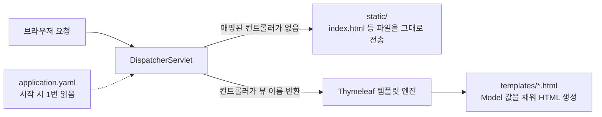
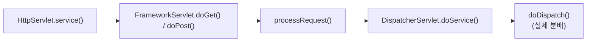
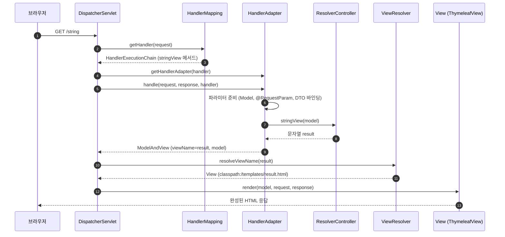
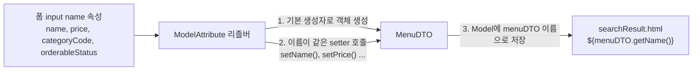
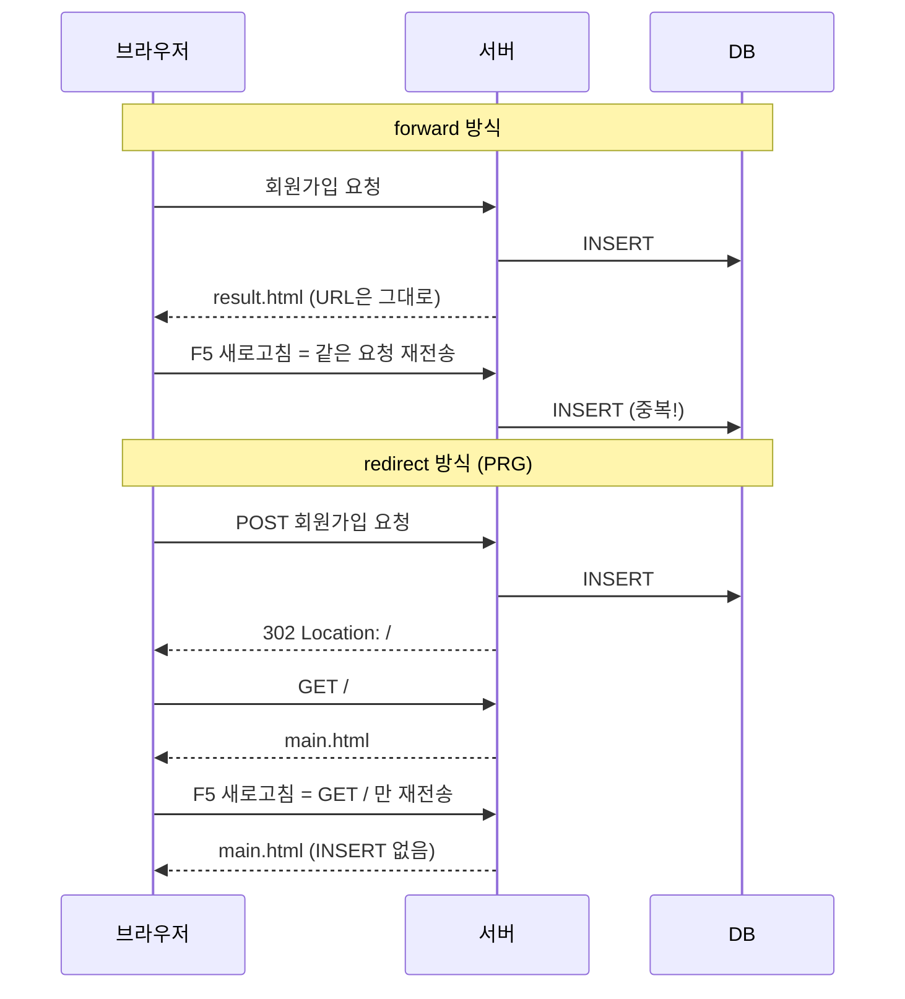

## 들어가며 (Situation)

서블릿 수업에서는 `main()`이 사라졌다. Tomcat이 서블릿 객체를 만들고 `service()` → `doGet()` 순서로 불러 줬다. Spring Boot 수업에 들어오자 **`main()`이 다시 생겼다.** 그런데 이번에는 `@WebServlet`도, `doGet()`도 없다. `@Controller`를 붙인 클래스의 메서드가 문자열 하나만 반환해도 화면이 나왔다.

이 글은 10/28~10/29 Spring Web MVC 필기를 정리한 것이다. 코드는 수업 프로젝트 `chap01-request-mapping`, `chap02-handler-method`, `chap03-view-resolver`에서 인용했고, 수업 코드가 아닌 것은 **"예시 코드"**라고 표시했다. 이 글을 쓰는 환경에서는 애플리케이션을 실행하지 못해 실행 결과는 적지 않았다. 대신 필기에서 막힌 부분은 Spring 공식 문서와, 로컬 Gradle 캐시에 있던 Spring Framework 7.0 / Thymeleaf 3.1 소스 코드로 확인했다.

선생님이 "호출 흐름, DispatcherServlet은 면접에서 꼭 물어본다"고 했다. 그래서 어노테이션 사용법보다 **"요청 하나가 들어와서 HTML이 나갈 때까지 누가 무엇을 하는가"**를 중심에 뒀다.

## 문제 상황 (Task)

필기를 다시 보니 물음표가 남아 있었다.

- View를 반환하는 방법으로 `String`과 `void`를 적어 두고 **"차이가 뭐지"**라고 썼다.
- "templates는 응답 전용 서블릿"이라고 적었는데, 정말 서블릿인가?
- "DTO랑 키 값을 맞추지 않으면 500 에러가 뜬다 → NullPointerException 때문"이라고 적었는데, 정말 그런가?
- "!!! resolvercontroller import 문들 확인하기 !!!"라고 크게 적었는데, 무엇을 확인해야 하는지는 적지 않았다.
- "컨트롤러 책임 3가지??" — 3가지가 무엇인지 비어 있다.
- "DML 관련은 forward하면 안 됨!!!"의 이유를 설명할 수 있는가?

## 해결 과정 (Action)

### 1. Spring Boot: main()이 돌아왔고, 버전은 Boot가 맞춘다

직전 서블릿 프로젝트와 `build.gradle`을 나란히 놓으면 차이가 잘 보인다.

```groovy
// 수업 코드 (chap01-request-mapping/build.gradle)
plugins {
    id 'java'
    id 'org.springframework.boot' version '4.1.2'
    id 'io.spring.dependency-management' version '1.1.7'
}
dependencies {
    implementation 'org.springframework.boot:spring-boot-starter-thymeleaf'
    implementation 'org.springframework.boot:spring-boot-starter-webmvc'
}
```

| 항목 | 서블릿 프로젝트 (chap01-servlet) | Spring Boot 프로젝트 (chap01-request-mapping) |
|---|---|---|
| 시작점 | 없음. 외부 Tomcat이 `war`를 올림 | `main()`의 `SpringApplication.run()` |
| Tomcat | 따로 설치, 서블릿 API는 `compileOnly` | **내장**. starter에 포함되어 함께 실행됨 |
| 의존성 버전 | 직접 적음 (`servlet-api:6.1.0`) | starter에 **버전을 적지 않음** |
| 요청 처리 | 요청마다 내가 만든 서블릿 | `DispatcherServlet` 하나가 받아 컨트롤러에 나눠 줌 |

필기의 "톰캣이 자동 내장"은 `spring-boot-starter-webmvc`가 내장 Tomcat을 끌어오기 때문이다. `main()`에서 `SpringApplication.run()`을 부르면 Spring 컨테이너를 만들고 그 안에서 Tomcat까지 띄운다.

필기의 "알아서 버전을 맞춰서 버전 오류가 없도록 함"은 **의존성 관리(dependency management)** 기능이다. [Spring Boot Gradle 플러그인 문서](https://docs.spring.io/spring-boot/gradle-plugin/managing-dependencies.html)에 따르면 `io.spring.dependency-management` 플러그인을 적용하면 Boot가 검증한 버전 목록(`spring-boot-dependencies` BOM)을 가져온다. 그래서 starter 뒤에 버전을 적지 않아도 서로 맞는 버전이 들어온다. chap02에서 추가한 Lombok도 버전 없이 `compileOnly 'org.projectlombok:lombok'`만 적었다.

필기의 "클래스 만들고 @ 빈 등록"은 수업 `Test` 클래스로 실습했다.

```java
// 수업 코드 (Test)
@Component
public class Test {
}
```

`@SpringBootApplication`은 자기 패키지(`com.wanted.requestmapping`)와 그 하위 패키지를 스캔해서 `@Component`가 붙은 클래스를 객체로 만들어 Spring 컨테이너에 등록한다. `@Controller`도 내부에 `@Component`를 가진 어노테이션이라 같은 방식으로 등록된다. 서블릿에서 `@WebServlet`을 보고 Tomcat이 객체를 만들던 것과 같은 그림이다. 이번에는 만드는 주체가 Spring 컨테이너다.

### 2. resources 구조: static, templates, application.yaml



| 폴더/파일 | 필기 | 정리 |
|---|---|---|
| `static/` | 정적인 요소들, 누구에게나 보여 주는 파일 | 맞다. URL로 바로 접근 가능하고 서버 데이터를 끼워 넣을 수 없다 |
| `templates/` | WAS 개념이 포함된 폴더, **응답 전용 서블릿** | 서블릿이 아니다. **Thymeleaf 템플릿 엔진**이 읽어서 HTML을 만드는 원본 파일이다. URL로 직접 열 수 없고 컨트롤러가 반환한 뷰 이름으로만 쓰인다 |
| `application.yaml` | 환경설정 파일, run하자마자 돌아감 | 맞다. 애플리케이션 시작 시 읽어서 설정값으로 쓴다 |

**"templates는 응답 전용 서블릿" 정정.** `templates/` 안의 파일은 서블릿 클래스가 아니라 `th:text` 같은 Thymeleaf 문법이 들어간 HTML 원본이다. 요청은 여전히 `DispatcherServlet`이라는 서블릿 하나가 받는다. 컨트롤러가 뷰 이름을 돌려주면 Thymeleaf가 `templates/`에서 파일을 찾아 Model 값을 채워 넣고 완성된 HTML을 응답에 쓴다. "응답 화면을 만드는 데만 쓰는 곳"이라는 감각은 맞지만, 그 일을 하는 것은 템플릿 엔진이다.

```html
<!-- 수업 코드 (templates/result.html) -->
<h3 th:text="${forwardMessage}">여기에는 작성해도 화면에 나오지 않음</h3>
```

수업 주석 그대로, `th:text`가 있으면 태그 안의 글자는 Model 값으로 바뀐다. 이 치환이 서버에서 일어나기 때문에 필기의 "static은 서버에서 전달해 준 데이터를 받아들이지 못한다"가 성립한다.

#### 메인 페이지에 게시판을 띄우고 싶다면?

필기에는 "index.html은 static 폴더에 있어야 한다"와 "메인페이지에 게시판을 띄워주고 싶다면? → templates 아래에 동적인 페이지를 만들어야 한다"가 함께 있다. 두 문장은 조금 부딪친다. [Spring Boot 문서 - Welcome Page](https://docs.spring.io/spring-boot/reference/web/servlet.html#web.servlet.spring-mvc.welcome-page)는 이렇게 설명한다.

> Spring Boot supports both static and templated welcome pages. It first looks for an `index.html` file in the configured static content locations. If one is not found, it then looks for an `index` template.

즉 `index.html`이 반드시 static에 있어야 하는 것은 아니다. static에 있으면 그것을 먼저 쓰고, 없으면 `templates/index.html`을 찾는다. chap03은 아예 다른 방법을 쓴다. static에 `index.html`을 두지 않고 컨트롤러가 `/`를 직접 받는다.

```java
// 수업 코드 (MainController)
// {} 내부에는 여러 경로를 , 기준으로 작성할 수 있다.
@RequestMapping(value = {"/", "/main"})
public String mainPage() {
    System.out.println("main 페이지 핸들러메서드 동작함...");
    return "main";
}
```

필기의 "8080 뒤에는 /가 생략되어 있고 요청의 한 종류"가 여기서 쓰인다. `http://localhost:8080`에 접속하면 브라우저는 `GET /`를 보낸다. `/`도 다른 URL과 똑같은 요청이라 컨트롤러가 받을 수 있다. 게시판 목록처럼 DB 데이터를 메인에 보여 주려면 이렇게 컨트롤러에서 Model에 담아 템플릿으로 보내야 한다. Spring Boot 소스를 보면 컨트롤러 매핑(`RequestMappingHandlerMapping`, order 0)이 웰컴 페이지 매핑(`WelcomePageHandlerMapping`, order 2)보다 먼저 검사된다. 그래서 `/`를 컨트롤러가 잡으면 static의 `index.html`보다 컨트롤러가 우선한다.

#### application.yaml: 탭이 아니라 공백

```yaml
# 수업 코드 (chap01-request-mapping/application.yaml)
spring:
  application:
    name: chap01-request-mapping

server:
  port: 7777
```

필기의 "`spring.application.name` (탭 = 하위)"는 **들여쓰기가 계층**이라는 뜻으로는 맞다. 하지만 YAML은 들여쓰기에 **탭 문자를 쓸 수 없다.** [YAML 1.2.2 명세](https://yaml.org/spec/1.2.2/#61-indentation-spaces)는 들여쓰기를 공백(space)으로만 정의한다. IntelliJ에서 Tab 키를 눌러도 공백으로 바꿔 넣어 주기 때문에 문제없이 동작했던 것이다. 다른 편집기에서 실제 탭이 들어가면 시작할 때 파싱 오류가 난다.

chap01만 `server.port: 7777`이라 `localhost:7777`로 접속하고, 포트를 적지 않은 chap02, chap03은 기본값 8080을 쓴다. 필기의 "run하자마자 바로 돌아감(static 같은 느낌)"은 [외부 설정 문서](https://docs.spring.io/spring-boot/reference/features/external-config.html)의 설명대로 시작 시점에 한 번 읽어서 `Environment`에 올려 두는 동작이다. 자바 `static`처럼 클래스 로딩과 묶인 것은 아니지만, "애플리케이션이 뜨기 전에 먼저 준비된다"는 감각은 맞다.

### 3. DispatcherServlet 호출 흐름 (면접 단골)

서블릿 글에서 `HttpServlet.service()`가 HTTP 메서드를 보고 `doGet()`, `doPost()`로 나눠 준다고 정리했다. **DispatcherServlet은 그 구조를 한 단계 키운 것이다.** 서블릿 하나가 모든 요청을 받고, 어느 컨트롤러 메서드로 보낼지는 URL과 HTTP 메서드를 보고 정한다. [Spring 공식 문서](https://docs.spring.io/spring-framework/reference/web/webmvc/mvc-servlet.html)는 이것을 **Front Controller 패턴**이라고 부른다.

실제로 Spring 소스를 따라가 보면 서블릿 글의 흐름과 그대로 이어진다.



`DispatcherServlet`은 `HttpServlet`의 자식이다. 부모의 `service()`가 `doGet()`을 부르는 것까지는 서블릿과 같고, `FrameworkServlet`이 `doGet()`, `doPost()` 모두를 `processRequest()` 한 곳으로 모은 뒤 `doDispatch()`에서 아래 순서로 일을 나눈다. 수업 코드 `ResolverController.stringView()`로 요청 하나를 따라가 봤다.



| 단계 | 담당 | 하는 일 | 기본 구현 (어노테이션 컨트롤러 기준) |
|---|---|---|---|
| ① 요청 받기 | `DispatcherServlet` | 모든 요청의 입구. 아래 부품을 순서대로 부름 | — |
| ② 핸들러 찾기 | `HandlerMapping` | URL, HTTP 메서드를 보고 처리할 메서드를 찾음 | `RequestMappingHandlerMapping` (`@RequestMapping` 정보 보관) |
| ③ 실행 방법 찾기 | `HandlerAdapter` | 찾은 핸들러를 어떻게 호출할지 아는 어댑터 선택 | `RequestMappingHandlerAdapter` |
| ④ 컨트롤러 호출 | `HandlerAdapter` → `Controller` | 파라미터를 만들어 메서드 호출, 반환값을 `ModelAndView`로 정리 | 파라미터는 `HandlerMethodArgumentResolver`들이 만듦 |
| ⑤ 뷰 찾기 | `ViewResolver` | 뷰 이름 → 실제 View 객체 | Boot + Thymeleaf면 `ThymeleafViewResolver` (`classpath:/templates/` + 이름 + `.html`) |
| ⑥ 렌더링 | `View` | Model 값을 넣어 응답 작성 | `ThymeleafView` |

면접용으로 한 줄로 줄이면 이렇다. **"DispatcherServlet이 요청을 받아 HandlerMapping으로 핸들러를 찾고, HandlerAdapter로 컨트롤러를 실행해 ModelAndView를 받은 뒤, ViewResolver로 View를 찾아 렌더링한다."**

왜 HandlerAdapter라는 단계가 따로 있을까. [DispatcherServlet 특수 빈 문서](https://docs.spring.io/spring-framework/reference/web/webmvc/mvc-servlet/special-bean-types.html)는 HandlerAdapter가 "핸들러가 실제로 어떻게 호출되는지에 대한 세부 사항으로부터 DispatcherServlet을 보호한다"고 설명한다. 컨트롤러 메서드마다 파라미터 모양이 제각각인데(`Model`, `WebRequest`, `@RequestParam int` ...), 이걸 맞춰서 호출하는 복잡한 일을 어댑터가 맡는다. 4절의 파라미터들이 전부 ④단계에서 만들어진다.

### 4. 요청 매핑: @RequestMapping과 @GetMapping

#### 메서드에 매핑하기

```java
// 수업 코드 (MethodController)
@RequestMapping("/menu/regist")                                   // 메서드 지정 없음
public String registMenu(Model model) { ... return "mappingResult"; }

// @RequestMapping : Servlet -> service() : get/post/delete
@RequestMapping(value = "/menu/regist", method = RequestMethod.POST)
public String postregistMenu(Model model) { ... }

@GetMapping("/menu/modify")
public String getModifyMenu(Model model) { ... }

@PostMapping("/menu/modify")
public String postModifyMenu(Model model) { ... }
```

| 어노테이션 | 같은 의미 | 받는 요청 |
|---|---|---|
| `@RequestMapping("/a")` | — | `/a`의 **모든** HTTP 메서드 |
| `@RequestMapping(value="/a", method=RequestMethod.POST)` | `@PostMapping("/a")` | `POST /a`만 |
| `@GetMapping("/a")` | `@RequestMapping(value="/a", method=RequestMethod.GET)` | `GET /a`만 |

수업 주석의 "`@RequestMapping` : Servlet → `service()`"는 좋은 비유다. 메서드를 지정하지 않은 `@RequestMapping`은 서블릿의 `service()`처럼 GET, POST를 가리지 않는다.

그러면 `POST /menu/regist`는 메서드 지정이 없는 `registMenu()`와 POST를 지정한 `postregistMenu()` 둘 다에 맞는데, 어느 쪽이 실행될까? [요청 매핑 문서](https://docs.spring.io/spring-framework/reference/web/webmvc/mvc-controller/ann-requestmapping.html)는 여러 매핑이 맞으면 **더 구체적인 쪽**을 고른다고 설명한다. Spring 소스(`RequestMethodsRequestCondition.compareTo()`)를 보면 HTTP 메서드를 명시한 조건이 명시하지 않은 조건보다 우선한다. 그래서 GET은 `registMenu()`, POST는 `postregistMenu()`로 간다.

#### 클래스에 매핑하기와 @PathVariable

```java
// 수업 코드 (ClassController)
@Controller
@RequestMapping("/order/*")
public class ClassController {

    @GetMapping("/regist")                 // → GET /order/regist
    public String registOrder(Model model) { ... }

    /* 요청 경로 : /order/detail/3
     * 3 : pathVariable 이라고 불리우며 요청 url을 타고 서버로 넘어오는 값을 의미한다. */
    @GetMapping("/detail/{orderNo}")
    public String pathVariable(Model model, @PathVariable("orderNo") int no) { ... }
}
```

클래스의 `/order/*`와 메서드의 `/regist`가 어떻게 합쳐지는지 궁금했다. Spring의 `PathPattern.combine()` 주석에 정확히 이 예가 있다. `/hotels/*` + `/booking` → `/hotels/booking`. 클래스 쪽 끝의 `*`가 메서드 경로로 바뀌어 `/order/regist`가 된다. 공통 경로를 클래스에 한 번만 적어 두는 용도라서, 보통은 `*` 없이 `@RequestMapping("/order")`로 쓰는 경우가 많다.

### 5. 핸들러 메서드 파라미터: WebRequest, @RequestParam, @ModelAttribute

chap02는 같은 폼 데이터를 세 가지 방식으로 꺼낸다. 4절 시퀀스의 ④ "파라미터 준비" 단계에서 Spring이 각 파라미터 타입에 맞는 리졸버를 골라 값을 만들어 넣는다.

#### WebRequest: 서블릿의 request와 비슷

```java
// 수업 코드 (RequestController.registMenu)
// WebRequest 는 Servlet 환경의 HttpServletRequest 의 역할을 한다.
String menuName = request.getParameter("name");
int menuPrice = Integer.parseInt(request.getParameter("price"));
int categoryCode = Integer.parseInt(request.getParameter("categoryCode"));
```

서블릿에서 하던 `getParameter()` + `parseInt()`를 그대로 한다. 필기의 "WebRequest는 잘 사용하지 않음"의 이유가 이 코드에 보인다. 값마다 꺼내고, 형변환하고, 이름 문자열을 직접 적는다. 반복 코드가 많고, `price`가 비어 있으면 `parseInt()`에서 `NumberFormatException`이 나서 **500**이 된다.

#### @RequestParam: 한두 개만 꺼낼 때

```java
// 수업 코드 (RequestController.modifyMenu)
/* @RequestParam 은 사용자의 request에 들어있는 값을 손쉽게 꺼낼 수 있는 어노테이션이다.
 * 단, 가장 주의해야 할 것.
 * - View 쪽에서 input 타입의 name 속성에 작성해둔 값과 변수명을 일치시키지 않으면
 *   400 Bad Request 가 발생한다. */
@PostMapping("modify")
public String modifyMenu(Model model,
                         @RequestParam("modifyName") String name,
                         @RequestParam int modifyPrice) { ... }
```

`@RequestParam("modifyName")`처럼 이름을 적으면 변수명은 달라도 되고, `@RequestParam int modifyPrice`처럼 생략하면 **변수명이 곧 파라미터 이름**이 된다. 형변환(`String` → `int`)도 Spring이 해 준다. [@RequestParam 문서](https://docs.spring.io/spring-framework/reference/web/webmvc/mvc-controller/ann-methods/requestparam.html)에 따르면 기본값이 `required = true`라서 이름이 맞는 값이 없으면 예외가 나고 400으로 응답한다. 수업 주석의 400은 정확하다. 값이 없을 수도 있다면 `required = false`나 `defaultValue`를 쓴다.

필기의 "값을 1개, 2개 정도 꺼낸다면 RequestParam도 많이 사용한다"는 이 특징과 맞다. 개수가 늘면 파라미터 목록이 길어지니 다음 방법을 쓴다.

#### @ModelAttribute: DTO 하나로 묶기

```java
// 수업 코드 (MenuDTO) — Lombok으로 기본 생성자, getter/setter 생성
@NoArgsConstructor @AllArgsConstructor @Getter @Setter @ToString
public class MenuDTO {
    private String name;
    private int price;
    private int categoryCode;
    private String orderableStatus;
}
```

```java
// 수업 코드 (RequestController.searchMenu)
@PostMapping("search")
public String searchMenu(@ModelAttribute MenuDTO menu){
    /* Model 객체를 활용하지 않아도 forward 되는 페이지에서 값들을 활용할 수 있다.
     * MenuDTO -> menuDTO 이름으로 사용될 수 있다. */
    System.out.println("menu = " + menu);
    return "request/searchResult";
}
```



[@ModelAttribute 문서](https://docs.spring.io/spring-framework/reference/web/webmvc/mvc-controller/ann-methods/modelattrib-method-args.html)대로, Spring은 객체를 만든 뒤 **요청 파라미터 이름과 같은 이름의 프로퍼티**에 값을 넣는다(데이터 바인딩). 그리고 그 객체를 Model에도 넣는다. 이름을 따로 주지 않으면 클래스 이름 첫 글자를 소문자로 바꾼 `menuDTO`가 키가 된다. 그래서 `searchResult.html`이 `${menuDTO.getName()}`으로 값을 꺼낼 수 있다.

#### "DTO랑 키 값을 맞추지 않으면 500 → NPE" 정정

필기의 이 문장은 **원인과 결과가 섞여 있다.** 바인딩 동작을 경우별로 나누면 이렇다.

| 상황 | 바인딩 결과 | 응답 |
|---|---|---|
| 폼 `name`과 DTO 필드 이름이 **안 맞음** | 그 필드에 값이 안 들어감. `String`은 `null`, `int`는 `0`으로 **남을 뿐, 에러는 나지 않음** | 정상 응답 (값만 비어 있음) |
| 이름은 맞는데 **형변환 실패** (예: `price`에 `"abc"`) | 바인딩 오류 발생 | `@Valid`/`BindingResult`가 없으면 예외 → **400** |
| 이름이 안 맞아 `null`인 필드를 **내 코드가 사용** (예: `menu.getName().length()`) | — | `NullPointerException` → **500** |

즉 이름이 안 맞는 것 자체는 에러가 아니다. 비어 있는 값을 **뒤에서 누군가 참조할 때** NPE가 나고, 처리하지 못한 예외라서 500이 된다. 필기의 "담기지 않은 것에 `.get()`을 하는 상황"은 세 번째 줄에 해당한다. 그래서 "이름이 안 맞으면 바로 에러가 난다"고 기억하면 오히려 위험하다. **에러 없이 조용히 `null`이 들어가는 경우**가 더 찾기 어렵다.

| 방식 | 장점 | 단점 | 어울리는 상황 |
|---|---|---|---|
| `WebRequest` | 서블릿 방식과 같아 익숙함 | 꺼내기·형변환을 직접. 코드가 김 | 거의 안 씀 (필기) |
| `@RequestParam` | 형변환 자동, 필수 여부 지정 | 값이 많으면 파라미터가 길어짐 | 값 1~2개 (필기) |
| `@ModelAttribute` + DTO | 여러 값을 객체 하나로, Model에도 자동 저장 | 이름이 안 맞으면 조용히 `null`/`0` | 폼 전체, 등록·검색 |

### 6. View를 반환하는 방법: String, void, ModelAndView

필기의 "차이가 뭐지"를 풀기 위해 chap02와 chap03의 주석을 한 표로 모았다.

```java
// 수업 코드 (ResolverController)
/* View를 반환하는 방법은 3가지가 있다.
 * 1. 반환타입 void : 요청한 url 곧 view 의 경로가 된다.
 * 2. 반환타입 String : 문자열 리턴값이 곧 view 의 경로가 된다.
 * 3. 반환타입 ModelAndView : setViewName("문자열"); 문자열이 곧 view 경로 */
```

```java
// 수업 코드 (RequestController) — void
@GetMapping("regist")
public void regist(){}          // GET /request/regist → templates/request/regist.html

// 수업 코드 (ResolverController) — String
@GetMapping("/string")
public String stringView(Model model){
    model.addAttribute("forwardMessage", "문자열로 View 반환");
    return "result";            // → templates/result.html
}

// 수업 코드 (ResolverController) — ModelAndView
@GetMapping("modelAndView")
public ModelAndView modelAndView(ModelAndView mv){
    mv.addObject("forwardMessage", "MV 활용 뷰와 데이터");
    mv.setViewName("result");
    return mv;
}
```

**void는 어떻게 뷰를 찾을까.** [반환 타입 문서](https://docs.spring.io/spring-framework/reference/web/webmvc/mvc-controller/ann-methods/return-types.html)에 따르면 `void`를 반환하고 응답을 직접 쓰지도 않았다면, HTML 컨트롤러에서는 **기본 뷰 이름**을 쓴다는 뜻이 된다. 3절 소스의 `applyDefaultViewName()` 단계에서 `DefaultRequestToViewNameTranslator`가 요청 경로 `/request/regist`의 앞 `/`를 떼서 `request/regist`를 뷰 이름으로 만든다. 그다음은 String과 똑같이 ViewResolver가 `templates/request/regist.html`을 찾는다.

| 방식 | 뷰 이름 결정 | 데이터 전달 | redirect 가능 | 언제 쓰나 |
|---|---|---|---|---|
| `void` | **요청 URL**에서 자동으로 | 파라미터 `Model` | 불가 | 폼 화면처럼 URL과 파일 경로가 같고 로직이 없을 때 |
| `String` | **반환한 문자열** | 파라미터 `Model` | `"redirect:/"` | 가장 일반적. URL과 다른 화면을 고르거나 redirect할 때 |
| `ModelAndView` | `setViewName()` | 같은 객체에 `addObject()` | `setViewName("redirect:/")` | 데이터와 뷰를 한 객체로 묶어 반환하고 싶을 때 (필기: "데이터도 넣고 지정") |

핵심 차이는 **뷰 이름을 누가 정하느냐**다. `void`는 URL이 정하고, `String`과 `ModelAndView`는 내가 정한다. 그래서 `void`는 URL을 바꾸면 템플릿 파일 위치도 같이 바꿔야 하고, 같은 URL에서 상황에 따라 다른 화면을 보여 줄 수 없다. 필기의 "화면 리턴하는 방법은 상황에 맞게 사용하기"는 이 표로 판단하면 된다.

어느 방식이든 최종적으로는 3절의 `ModelAndView`로 정리되어 DispatcherServlet에 돌아간다. 겉모양만 다르고 내부 흐름은 같다.

#### "forward 방식으로 보여줌"의 정확한 의미

수업 주석과 필기는 String 반환을 "Servlet → `forward(req, res)`"에 비유했다. 브라우저 입장에서는 맞다. 요청은 한 번이고 URL은 바뀌지 않으며, 같은 요청 안에서 Model 값을 화면에 쓸 수 있다. 다만 Thymeleaf 소스(`ThymeleafView`)를 보니 `RequestDispatcher.forward()`를 부르지 않고 **템플릿 처리 결과를 `response.getWriter()`에 바로 쓴다.** 서블릿의 forward(JSP로 넘기기)와 "효과는 같고 구현은 다르다" 정도로 기억하는 것이 정확하다.

수업 주석의 "Model 객체는 Request 객체이다"도 비슷하다. `Model`은 request 객체 자체가 아니라 **View에 넘길 데이터를 담는 Map 같은 그릇**이다. 요청 한 번 동안만 유지된다는 점이 request 영역과 같아서 그렇게 비유한 것으로 보인다.

### 7. forward vs redirect, 그리고 "DML 후 forward 금지"

```java
// 수업 코드 (ResolverController.redirect)
@GetMapping("/string-redirect")
public String redirect(RedirectAttributes rttr){
    /* 가정 1. 해당 메서드 내부에서 회원가입이 로직 수행 */
    // service.registMember(); insert
    System.out.println("회원가입 완료!!!!");

    /* redirect 시에는 2번의 요청이 발생한다.
     * 그렇기 때문에 최초에 model 에 담아둔 값은 재요청 시 소멸되며 / 요청에서는 사용할 수 없게 된다.
     * Spring 에서는 RedirectAttributes 라는 객체를 통해서
     * redirect 시 값을 저장할 수 있는 방법을 제공해준다. */
    rttr.addFlashAttribute("flashMessage", "리다이랙트 된 페이지에서도 유지되는 값!");
    return "redirect:/";
}
```

[View Resolution 문서](https://docs.spring.io/spring-framework/reference/web/webmvc/mvc-servlet/viewresolver.html)대로 뷰 이름 앞에 `redirect:`를 붙이면 ViewResolver가 템플릿 대신 **RedirectView**를 만든다. 서버는 HTML 대신 "이 주소로 다시 요청하라"는 3xx 응답과 `Location` 헤더를 보내고, 브라우저가 그 주소로 새 요청을 보낸다.

| 항목 | forward (기본 String 반환) | redirect (`"redirect:/"`) |
|---|---|---|
| 요청 횟수 | 1번 | **2번** (응답 3xx → 브라우저가 재요청) |
| 브라우저 URL | 처음 요청 URL 그대로 (`/string`) | 새 URL로 바뀜 (`/`) |
| Model 값 | 그대로 사용 가능 | 사라짐 → `RedirectAttributes` 필요 |
| 새로고침(F5) 시 | **처음 요청을 다시 보냄** | 마지막 GET(`/`)만 다시 보냄 |
| 어울리는 곳 | 조회 결과 보여 주기 | 등록·수정·삭제(DML) 직후 |

#### 왜 DML 후에는 forward하면 안 되는가

수업 `stringView()`는 회원가입(insert)을 한다고 가정하고 forward로 `result`를 보여 준다. 이때 브라우저 주소창은 여전히 `/string`이다. 사용자가 F5를 누르면 브라우저는 **마지막으로 보낸 요청**인 `/string`을 다시 보낸다. insert가 한 번 더 실행되어 같은 회원이 두 번 가입된다. 결제나 주문이라면 중복 결제다.



redirect를 쓰면 마지막 요청이 조회용 `GET /`로 바뀌어서 새로고침해도 insert가 반복되지 않는다. 이 흐름을 **PRG(Post/Redirect/Get) 패턴**이라고 부른다. [MDN - Redirections in HTTP](https://developer.mozilla.org/en-US/docs/Web/HTTP/Guides/Redirections)도 POST 처리 후 303 redirect로 결과 페이지를 보여 주면 새로고침 시 작업이 다시 실행되는 것을 막을 수 있다고 설명한다. 필기의 "회원가입, insert 이런 거도 고려해서 제작해야 함"이 바로 이것이다.

redirect하면 Model 값이 사라지므로 메시지를 전달하려면 `RedirectAttributes`를 쓴다. [Flash Attributes 문서](https://docs.spring.io/spring-framework/reference/web/webmvc/mvc-controller/ann-methods/flash-attributes.html)에 따르면 `addFlashAttribute()`로 넣은 값은 redirect 직전에 **세션에 잠깐 저장**되었다가, redirect된 요청에서 Model로 옮겨진 뒤 바로 지워진다. 서블릿 글에서 정리한 세션을 Spring이 대신 써 주는 셈이다. 수업 주석의 "Servlet 개념인 session과 cookie를 사용해야 한다"와 연결된다.

| 메서드 | 값이 실리는 곳 | URL에 보이나 | 유지 기간 |
|---|---|---|---|
| `rttr.addAttribute("k", v)` | redirect URL 쿼리스트링 (`/?k=v`) | 보임 | URL에 남음 |
| `rttr.addFlashAttribute("k", v)` | 세션 (잠깐) | 안 보임 | redirect된 요청 1번 |

### 8. "!!! ResolverController import 문 확인하기 !!!"

필기에 느낌표까지 붙여 둔 부분을 실제 import로 확인했다.

```java
// 수업 코드 (ResolverController)
import org.springframework.stereotype.Controller;
import org.springframework.ui.Model;
import org.springframework.web.bind.annotation.GetMapping;
import org.springframework.web.servlet.ModelAndView;
import org.springframework.web.servlet.mvc.support.RedirectAttributes;
```

| 클래스 | 패키지 | 의미 |
|---|---|---|
| `Model` | `org.springframework.ui` | 웹 기술과 무관한 공통 패키지 |
| `ModelAndView` | `org.springframework.web.servlet` | **서블릿 기반 Spring MVC 전용** |
| `RedirectAttributes` | `org.springframework.web.servlet.mvc.support` | **서블릿 기반 Spring MVC 전용** |

`Model`과 달리 `ModelAndView`, `RedirectAttributes`는 `web.servlet` 패키지에 있다. 같은 이름의 클래스가 다른 라이브러리에 있을 때 IDE 자동 import가 엉뚱한 패키지를 고를 수 있다. 그러면 두 가지 문제가 생길 수 있다.

1. **컴파일 오류**: `mv.setViewName()`, `rttr.addFlashAttribute()` 같은 메서드가 없다고 나온다.
2. **런타임에야 드러나는 문제**: 컴파일은 되지만 Spring이 그 타입을 모르는 경우다. Spring 소스(`RequestMappingHandlerAdapter`)를 보면 `RedirectAttributes`, `Model` 같은 타입은 전용 리졸버가 처리하고, 목록 맨 끝에는 **"모르는 객체 타입이면 `@ModelAttribute`처럼 처리"**하는 리졸버가 있다. 엉뚱한 패키지의 같은 이름 클래스는 전용 리졸버를 만나지 못하고 이 마지막 리졸버로 넘어간다. 그 결과 객체를 만들지 못해 요청 시점에 예외가 나거나, 만들어지더라도 flash 저장소와 연결되지 않은 객체가 된다.

수업에서 "import 확인"을 강조한 이유는 이 두 번째 경우처럼 **컴파일은 통과했는데 실행해야 문제가 보이는 상황**을 막으려는 것으로 이해했다. 실제로 잘못 import했을 때 어떤 증상이 나는지는 실행해 보지 못했다. 자동 import 후에는 패키지가 `org.springframework.web.servlet`으로 시작하는지 확인한다.

### 9. "컨트롤러 책임 3가지??"

필기에는 숫자만 있고 내용이 비어 있어서, 수업 코드 주석과 이후(11/05) 필기를 모아 정리했다.

| 책임 | 근거 (수업 코드 주석 / 필기) | 수업 코드에서의 모습 |
|---|---|---|
| ① 요청 받기 | "Servlet은 Http 요청을 받는 즉시 @Controller 어노테이션이 달린 클래스에 요청을 위임한다" (`MethodController`) | `@GetMapping`, `@RequestParam`, `@ModelAttribute` |
| ② 간단한 유효성 검사 | 11/05 필기 "간단한 유효성 검사" | 이번 수업 코드에는 아직 없음 |
| ③ 비즈니스 로직 호출 | "service(menuName, menuPrice, categoryCode)" 주석 (`RequestController`) | `// service.registMember();` 처럼 Service에 맡김 |
| ④ 응답(View) 결정 | "@Controller 계층의 마지막 임무는 사용자에게 어떤 응답을 해줄 것인지를 결정하는 것이다" (`MethodController`) | `return "result"`, `"redirect:/"` |

11/05 필기 기준으로는 4가지이고, "3가지"는 유효성 검사를 ①에 포함해 **받기 → 맡기기 → 응답하기**로 센 것으로 보인다. 숫자보다 중요한 것은 **컨트롤러가 직접 DB 작업(비즈니스 로직)을 하지 않는다**는 점이다. 수업 코드에서도 insert는 주석으로 Service에 맡겨 두었다. 이 구분은 Spring 공식 문서가 정한 규칙이 아니라 계층을 나누는 설계 관례다. JDBC 글의 MVC/DAO 구조와 같은 생각이다.

### 시행착오와 확인하지 못한 점

수업 코드를 읽으면서 실행해 보면 문제가 날 부분을 찾았다.

- **매핑이 없는 버튼들:** `chap01`의 `index.html`에는 `POST /order/regist`, `/order/modify`, `POST /order/delete` 버튼이 있지만 `ClassController`에는 `GET /order/regist`와 `/order/detail/{orderNo}`만 있다. 경로는 있지만 메서드가 다른 `POST /order/regist`는 405(Method Not Allowed), 경로 자체가 없는 나머지는 404가 날 것이다. `chap02`의 `/request/body`, `modify.html`의 두 번째 폼(`modifyAll`), `chap03` `main.html`의 `string-redirect-attr` 버튼도 대응하는 핸들러가 없다. 다음 수업에서 채울 자리로 보인다.
- **`modifyMenu()`는 Model에 값을 넣지 않는다:** `printResult.html`은 `${message}`를 출력하는데 `modifyMenu()`는 콘솔에만 찍고 Model에 `message`를 넣지 않는다. 화면에는 "메뉴 등록 성공!" 제목과 빈 줄만 나올 것이다. 제목도 수정이 아니라 "등록"이다.
- **GET으로 insert:** `stringView()`와 `redirect()`는 회원가입(insert)을 가정하면서 `@GetMapping`이다. 수업에서는 forward/redirect 차이만 보여 주려는 예제지만, 실제로 데이터를 바꾸는 요청은 POST로 받아야 한다. 링크 미리보기나 브라우저 미리 불러오기처럼 GET은 사용자가 의도하지 않아도 보내질 수 있다.
- **`ModelAndView`를 파라미터로 받는 방식:** `modelAndView(ModelAndView mv)`는 동작하지만, `ModelAndView`는 [핸들러 메서드 인자 문서](https://docs.spring.io/spring-framework/reference/web/webmvc/mvc-controller/ann-methods/arguments.html)의 지원 목록에 없다. Spring 소스상 8절에서 본 "모르는 타입 → `@ModelAttribute` 처리" 리졸버가 빈 `ModelAndView`를 만들어 주기 때문에 동작하는 것으로 보인다. 공식 문서가 보장하는 방식은 메서드 안에서 `new ModelAndView()`로 만들어 반환하는 것이다.
- **경로 앞 슬래시:** 같은 파일 안에 `@GetMapping("/string")`과 `@GetMapping("modelAndView")`가 섞여 있다. Spring이 앞에 `/`를 붙여 주어 둘 다 동작하지만, 한 가지로 통일하는 편이 읽기 쉽다.
- **확인하지 못한 점 — 실제 500의 원인:** 필기의 "DTO 키 값이 안 맞으면 500"을 수업 때 실제로 봤는지, 어느 코드에서 났는지는 필기에 없다. 바인딩 자체는 500을 내지 않으므로, 템플릿에서 Model에 없는 이름(예: `menuDTO` 대신 `${menu.name}`)을 참조해 Thymeleaf 표현식 오류가 났을 가능성도 있다. 실행해서 확인하지 못했다.
- **확인하지 못한 점 — 빈 숫자 입력:** `<input type="number" name="price">`를 비워서 보내면 `int price` 바인딩이 실패해 400이 될 것으로 판단했다(5절 표). 실행해서 확인하지는 않았다.
- **확인하지 못한 점 — redirect 상태 코드:** Spring의 `RedirectView`는 기본 설정에서 302를 보낸다(소스의 `http10Compatible = true`). PRG에는 303이 의미상 더 정확하지만, 수업 코드의 실제 응답 코드는 개발자 도구로 확인하지 못했다.

## 결과 (Result)

애플리케이션을 실행하지 못해 수치는 없다. 대신 필기의 이해가 이렇게 바뀌었다.

| 필기의 이해 | 정리 후 |
|---|---|
| Spring Boot는 톰캣 내장, 버전을 알아서 맞춤 | `main()`의 `SpringApplication.run()`이 내장 Tomcat을 띄움. 버전은 `io.spring.dependency-management` + Boot BOM이 관리 |
| templates는 응답 전용 서블릿 | 서블릿이 아니라 **Thymeleaf가 렌더링하는 템플릿 원본**. 요청은 DispatcherServlet이 받음 |
| index.html은 static에 있어야 함 | static `index.html`을 먼저 찾고, 없으면 `templates/index`. 컨트롤러가 `/`를 매핑하면 컨트롤러가 우선 |
| yaml은 탭 = 하위 | 들여쓰기 = 하위는 맞지만 **탭 문자 금지, 공백만** |
| String과 void, 차이가 뭐지 | 뷰 이름을 **반환값이 정하느냐(String) URL이 정하느냐(void)**의 차이 |
| 화면은 forward 방식으로 보여 줌 | 요청 1번, URL 유지라는 효과는 같음. Thymeleaf는 `forward()` 없이 응답에 바로 씀 |
| DTO 키가 안 맞으면 500 → NPE | 이름 불일치는 에러 없이 `null`/`0`. 그 `null`을 **내 코드가 참조할 때** NPE → 500. 형변환 실패는 400 |
| resolvercontroller import 확인 | `ModelAndView`, `RedirectAttributes`는 `org.springframework.web.servlet` 패키지. 잘못 import하면 컴파일 오류나 런타임 오작동 |
| 컨트롤러 책임 3가지?? | 요청 받기(+간단한 검증) → 비즈니스 로직은 Service에 맡기기 → 응답(View) 결정 |
| DML은 forward 금지!!! | 새로고침 시 마지막 요청이 재전송되어 DML이 중복 실행됨 → **PRG 패턴**, 값은 `addFlashAttribute()` |
| 호출 흐름은 면접에 나옴 | DispatcherServlet → HandlerMapping → HandlerAdapter → Controller → ViewResolver → View |

배운 점은 **"어노테이션 뒤에도 결국 서블릿이 있다"**는 것이다. 처음에는 `return "result"` 한 줄로 화면이 나오는 게 마법 같았다. 소스를 따라가 보니 `HttpServlet.service()` → `doGet()` → `doDispatch()`로 이어지는, 서블릿 수업에서 본 그 흐름이었다. 컨트롤러가 반환하는 모양(String, void, ModelAndView)이 달라도 모두 `ModelAndView`로 모여 같은 ViewResolver를 지난다는 것을 알고 나니, "어느 걸 써야 하지"라는 고민이 "뷰 이름을 누가 정해야 하지"라는 질문으로 바뀌었다.

## 더 학습하면 좋은 개념

- **HandlerMethodArgumentResolver** — `Model`, `@RequestParam`, `@ModelAttribute`가 어떻게 자동으로 채워지는지의 실체다. 직접 리졸버를 만들어 보면 "로그인 사용자 객체를 파라미터로 바로 받기" 같은 것도 가능하다.
- **Bean Validation (`@Valid`, `BindingResult`)** — 컨트롤러 책임 중 "간단한 유효성 검사"를 담당한다. 5절의 400 에러를 직접 받아서 폼에 오류 메시지를 보여 주는 방법이다.
- **`@ResponseBody`와 `@RestController`** — View 대신 데이터(JSON)를 반환하는 방식이다. 3절 흐름에서 ViewResolver 단계가 빠지고 `HttpMessageConverter`가 그 자리를 맡는다. chap02의 `@RequestBody` 버튼과도 이어진다.
- **HTTP 메서드의 안전성과 멱등성** — GET은 서버 상태를 바꾸지 않아야 한다는 규칙이다. "GET으로 insert하면 안 되는 이유"와 PRG 패턴의 근거가 된다.
- **Spring Boot 자동 구성 (Auto-configuration)** — 설정 한 줄 없이 DispatcherServlet, ThymeleafViewResolver가 등록되는 원리다. "Boot가 알아서 해 주는 것"의 정체를 알 수 있다.

## 참고 자료

- [Spring Framework - DispatcherServlet](https://docs.spring.io/spring-framework/reference/web/webmvc/mvc-servlet.html)
- [Spring Framework - Special Bean Types](https://docs.spring.io/spring-framework/reference/web/webmvc/mvc-servlet/special-bean-types.html)
- [Spring Framework - Processing (요청 처리 순서)](https://docs.spring.io/spring-framework/reference/web/webmvc/mvc-servlet/sequence.html)
- [Spring Framework - View Resolution (redirect:, forward:)](https://docs.spring.io/spring-framework/reference/web/webmvc/mvc-servlet/viewresolver.html)
- [Spring Framework - Mapping Requests](https://docs.spring.io/spring-framework/reference/web/webmvc/mvc-controller/ann-requestmapping.html)
- [Spring Framework - Method Arguments](https://docs.spring.io/spring-framework/reference/web/webmvc/mvc-controller/ann-methods/arguments.html)
- [Spring Framework - Return Values](https://docs.spring.io/spring-framework/reference/web/webmvc/mvc-controller/ann-methods/return-types.html)
- [Spring Framework - @RequestParam](https://docs.spring.io/spring-framework/reference/web/webmvc/mvc-controller/ann-methods/requestparam.html)
- [Spring Framework - @ModelAttribute](https://docs.spring.io/spring-framework/reference/web/webmvc/mvc-controller/ann-methods/modelattrib-method-args.html)
- [Spring Framework - Flash Attributes](https://docs.spring.io/spring-framework/reference/web/webmvc/mvc-controller/ann-methods/flash-attributes.html)
- [Spring Boot - Servlet Web Applications (Static Content, Welcome Page, Template Engines)](https://docs.spring.io/spring-boot/reference/web/servlet.html)
- [Spring Boot - Externalized Configuration](https://docs.spring.io/spring-boot/reference/features/external-config.html)
- [Spring Boot Gradle Plugin - Managing Dependencies](https://docs.spring.io/spring-boot/gradle-plugin/managing-dependencies.html)
- [Thymeleaf + Spring 튜토리얼](https://www.thymeleaf.org/doc/tutorials/3.1/thymeleafspring.html)
- [YAML 1.2.2 Specification - Indentation Spaces](https://yaml.org/spec/1.2.2/#61-indentation-spaces)
- [MDN - Redirections in HTTP](https://developer.mozilla.org/en-US/docs/Web/HTTP/Guides/Redirections)
