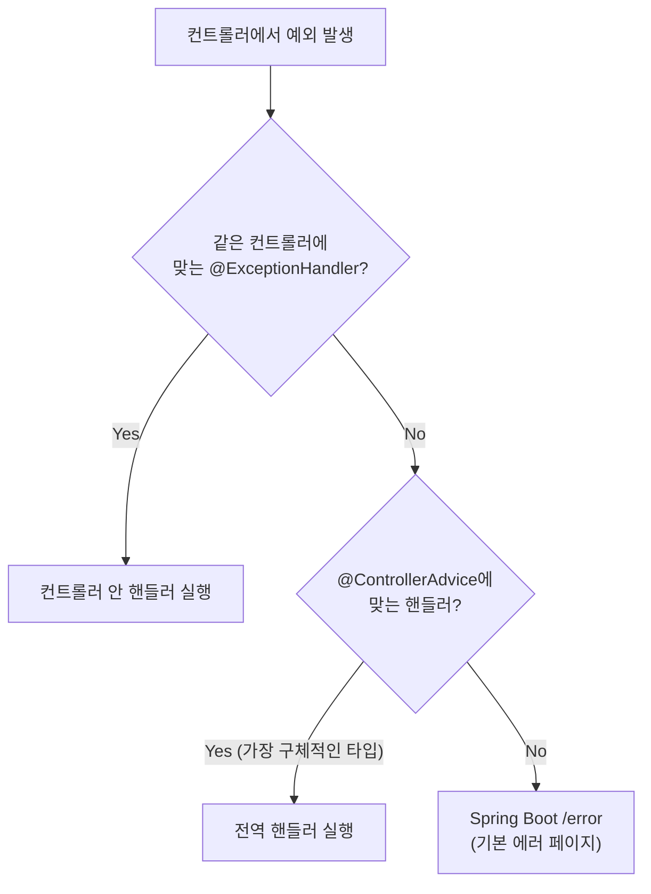
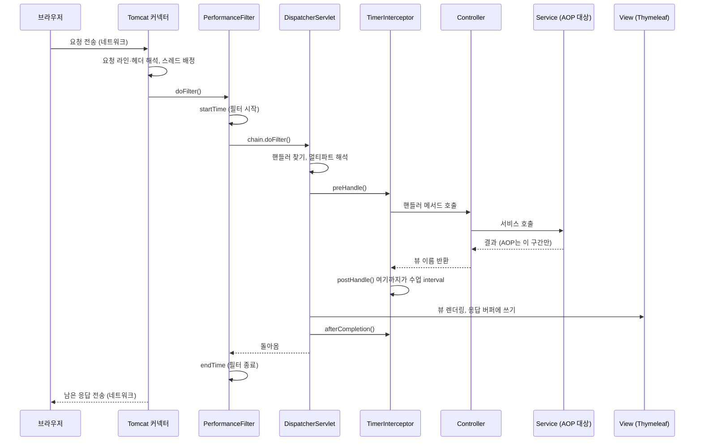
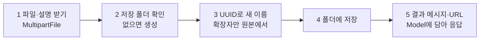

## 들어가며 (Situation)

10/23 서블릿 수업에서 `PerformanceFilter`로 요청 처리 시간을 쟀다. 10/29 Spring MVC 수업에서는 같은 일을 **인터셉터**(`TimerInterceptor`)로 다시 했다. 같은 날 예외 처리(`@ExceptionHandler`, `@ControllerAdvice`)와 파일 업로드(`MultipartFile`)도 배웠다.

이 글은 10/29 필기와 수업 프로젝트 `chap04-exception-handler`, `chap05-interceptor`, `chap06-file-upload`를 정리한 것이다. 코드는 수업 코드를 인용했고, 수업 코드가 아닌 것은 **"예시 코드"**라고 표시했다. 이 글을 쓰는 환경에서는 애플리케이션을 실행하지 못해 실행 결과와 측정값은 적지 않았다.

요청 매핑, 뷰 반환, `DispatcherServlet`의 기본 흐름은 다른 글에서 다룬다. 여기서는 인터셉터가 어디에 끼어드는지 설명하는 데 필요한 만큼만 쓴다.

## 문제 상황 (Task)

필기를 다시 보니 이렇게 적혀 있었다.

```text
필터는 서블렛 꺼 / 인터셉터는 컨트롤러
필터를 먼저 시간을 재고 인터셉트에서 시간을 잼
필터는 사용자들마다 네트워크 속도가 다름
인터셉트는 순수한 코드의 시간을 체크할 수 있음
AOP까지 적용하면 비지니스 로직에 적용 가능
```

여기서 질문이 생겼다.

- 서버 안에서 도는 필터가 정말 **사용자의 네트워크 시간**까지 재는가?
- 인터셉터가 재는 시간은 정말 "순수한 코드 시간"인가? 어디부터 어디까지인가?
- 예외 처리 핸들러를 컨트롤러 안에 두는 것과 `@ControllerAdvice`에 두는 것은 무엇이 다른가?
- 업로드한 파일은 어디에, 어떤 이름으로 저장해야 안전한가?

## 해결 과정 (Action)

### 1. 예외 처리: 컨트롤러 단위 @ExceptionHandler

먼저 수업 `ExceptionTestController`다. 일부러 `NullPointerException`을 낸다.

```java
// 수업 코드 (ExceptionTestController)
@GetMapping("nullpointer")
public String nullPointer() {
    String str = null;
    System.out.println(str.toLowerCase(Locale.ROOT)); // NullPointerException 발생
    return "/";
}

@ExceptionHandler(NullPointerException.class)
public String nullHandler(Model model, NullPointerException e) {
    model.addAttribute("key", e.getMessage());
    return "error/nullPointer";
}
```

컨트롤러 메서드에서 예외가 나면 Spring이 그 예외 타입에 맞는 `@ExceptionHandler` 메서드를 찾아 대신 실행한다. 수업 주석 표현으로는 "예외핸들러가 Controller의 흐름을 가로채서 동작"한다. 핸들러 메서드도 일반 컨트롤러 메서드처럼 `Model`을 받고 **뷰 이름(String)을 반환**할 수 있다. [Spring 공식 문서](https://docs.spring.io/spring-framework/reference/web/webmvc/mvc-controller/ann-exceptionhandler.html)의 반환 타입 표에도 `String`은 "뷰 이름"으로 나와 있다. 그래서 사용자는 500 에러 화면 대신 `templates/error/nullPointer.html`을 본다.

```html
<!-- 수업 코드 (templates/error/nullPointer.html) -->
<h3>많이 놀라셨죠?</h3>
<h4>죄송합니다.</h4>
<h4 th:text="${key}"></h4>
```

#### 커스텀 예외

수업에서는 직접 만든 예외도 같은 방식으로 처리했다.

```java
// 수업 코드 (MemberNotFoundException)
public class MemberNotFoundException extends Throwable {
    public MemberNotFoundException(String 아프지_말자_우리) {
        super(아프지_말자_우리);
    }
}
```

```java
// 수업 코드 (ExceptionTestController)
@GetMapping("userexception")
public String userException() throws MemberNotFoundException {
    boolean check = true;
    if (check) {
        throw new MemberNotFoundException("아프지 말자 우리");
    }
    return "/";
}

@ExceptionHandler(MemberNotFoundException.class)
public String userException(Model model, MemberNotFoundException e) {
    model.addAttribute("key", e.getMessage());
    return "error/nullPointer";
}
```

여기서 하나 눈에 띈 것이 있다. `MemberNotFoundException`이 `Exception`이 아니라 **`Throwable`을 바로 상속**한다. 이 차이는 아래 시행착오에서 따로 정리했다.

### 2. 전역 예외 처리: @ControllerAdvice

컨트롤러 안의 `@ExceptionHandler`는 **그 컨트롤러에서 난 예외만** 처리한다. 수업 `GlobalTestController`의 주석이 이 점을 확인한다.

```java
// 수업 코드 (GlobalTestController)
/* ExceptionTestController 에서 작성해둔
 * null-pointer 예외처리 핸들러가 동작하지 않는다.
 * 이유는 다른 클래스 내부에 있는 메서드는 알수 없다. */
@GetMapping("global-nullpointer")
public String globalNull() {
    String str = null;
    System.out.println(str.toLowerCase(Locale.ROOT));
    return "/";
}

@GetMapping("global-default")
public String anyException() {
    int[] iarr = new int[0];
    System.out.println(iarr[1]); // ArrayIndexOutOfBoundsException
    return "/";
}
```

컨트롤러마다 같은 핸들러를 복사하지 않으려고 쓰는 것이 `@ControllerAdvice`다.

```java
// 수업 코드 (GlobalExceptionHandler)
@ControllerAdvice
public class GlobalExceptionHandler {

    @ExceptionHandler(NullPointerException.class)
    public String nullHandler(Model model, NullPointerException e) {
        System.out.println("전역 예외처리 핸들러 동작!!!");
        model.addAttribute("key", e.getMessage());
        return "error/nullPointer";
    }

    @ExceptionHandler(Exception.class)
    public String defaultException(Model model, Exception e){
        model.addAttribute("class" , e.getClass());
        model.addAttribute("message" , e.getClass());
        return "error/default";
    }
}
```

수업 주석은 "Advice는 AOP 챕터에서 반복적으로 동작해야 하는 코드를 뭉쳐둔 메서드를 지칭하는 단어였다"고 설명한다. 여러 컨트롤러에 공통으로 적용할 코드를 한곳에 모은다는 점에서 이름이 같다.

#### 우선순위: 컨트롤러 안 → 전역

수업 주석은 "같은 클래스 내부에 있는 핸들러 > 전역 핸들러"라고 적었다. [Controller Advice 공식 문서](https://docs.spring.io/spring-framework/reference/web/webmvc/mvc-controller/ann-advice.html)에도 같은 내용이 있다.

> Global `@ExceptionHandler` methods, from an `@ControllerAdvice`, are applied _after_ local ones, from the `@Controller`.

그리고 같은 클래스 안에서는 **더 구체적인 예외 타입**이 먼저 선택된다. 공식 문서는 예외 계층의 깊이를 비교하는 `ExceptionDepthComparator`로 정렬한다고 설명한다. 그래서 `/global-nullpointer`에서는 `Exception` 핸들러가 아니라 `NullPointerException` 핸들러가 동작한다.



| 요청 | 발생 예외 | 동작하는 핸들러 | 화면 |
|---|---|---|---|
| `/nullpointer` | `NullPointerException` | `ExceptionTestController.nullHandler` (컨트롤러 안) | `error/nullPointer` |
| `/userexception` | `MemberNotFoundException` | `ExceptionTestController.userException` | `error/nullPointer` |
| `/global-nullpointer` | `NullPointerException` | `GlobalExceptionHandler.nullHandler` (전역) | `error/nullPointer` |
| `/global-default` | `ArrayIndexOutOfBoundsException` | `GlobalExceptionHandler.defaultException` | `error/default` |

표는 코드와 공식 문서를 기준으로 예상한 것이다. 실행해서 확인하지는 못했다.

| 구분 | 컨트롤러 안 `@ExceptionHandler` | `@ControllerAdvice` |
|---|---|---|
| 적용 범위 | 그 컨트롤러에서 난 예외만 | 기본적으로 모든 컨트롤러 (패키지, 어노테이션으로 좁힐 수 있음) |
| 우선순위 | 먼저 | 컨트롤러 안 핸들러가 없을 때 |
| 어울리는 것 | 그 컨트롤러에만 있는 특별한 처리 | 공통 에러 화면, 마지막 안전망(`Exception.class`) |

#### Spring Boot의 기본 에러 페이지

아무 핸들러도 잡지 못한 예외는 어떻게 될까. [Spring Boot 공식 문서](https://docs.spring.io/spring-boot/reference/web/servlet.html)에 따르면 Spring Boot는 `/error` 매핑을 기본으로 등록해 두고, 브라우저에는 "whitelabel" 에러 화면을 보여 준다. 상태 코드별 화면을 바꾸고 싶으면 `error/` 디렉토리에 상태 코드 이름의 파일(`404.html`, `5xx.html` 등)을 둔다.

```text
// 예시 코드 (디렉토리 구조)
src/main/resources/templates/error/404.html   → 404일 때
src/main/resources/templates/error/5xx.html   → 500번대일 때
```

수업의 `error/nullPointer.html`, `error/default.html`은 이 규칙이 아니라 **핸들러가 직접 반환한 뷰 이름**이다. 같은 `error/` 폴더에 있어도 동작 방식이 다르다.

### 3. 인터셉터: 컨트롤러 앞뒤에 끼어든다

#### HandlerInterceptor의 세 메서드

```java
// 수업 코드 (TimerInterceptor)
@Component
public class TimerInterceptor implements HandlerInterceptor {

    // 컨트롤러 도달 전
    @Override
    public boolean preHandle(HttpServletRequest request, HttpServletResponse response, Object handler) throws Exception {
        System.out.println("preHandle() 동작함..");
        long startTime = System.currentTimeMillis();
        request.setAttribute("startTime", startTime);
        // true : 다음 인터셉터가 있다면 호출 / 없다면 컨트롤러의 핸들러 메서드 호출
        return true;
    }

    // 컨트롤러 핸들러메서드 실행 후
    @Override
    public void postHandle(HttpServletRequest request, HttpServletResponse response, Object handler, @Nullable ModelAndView modelAndView) throws Exception {
        System.out.println("postHandler() 호출됨..");
        long endTime = System.currentTimeMillis();
        long startTime = (long) request.getAttribute("startTime");
        modelAndView.addObject("interval", endTime - startTime);
    }
}
```

```java
// 수업 코드 (InterceptorController)
@GetMapping("stopwatch")
public String handle() throws InterruptedException {
    System.out.println("stopwatch 요청을 처리하는 핸들러 메서드 동작..");
    Thread.sleep(2000); // 2초간 정지
    return "result";
}
```

[HandlerInterceptor Javadoc](https://docs.spring.io/spring-framework/docs/current/javadoc-api/org/springframework/web/servlet/HandlerInterceptor.html)과 [공식 문서](https://docs.spring.io/spring-framework/reference/web/webmvc/mvc-servlet/handlermapping-interceptor.html)로 세 메서드의 시점을 확인했다.

| 메서드 | 언제 | 특징 |
|---|---|---|
| `preHandle` | 핸들러(컨트롤러 메서드) 실행 **전** | `false`를 반환하면 이후 체인과 핸들러를 실행하지 않음 |
| `postHandle` | 핸들러 실행 **후, 뷰 렌더링 전** | `ModelAndView`에 모델 값을 추가할 수 있음. `modelAndView`는 `null`일 수 있음 |
| `afterCompletion` | **뷰 렌더링까지 끝난 후** | 예외가 나도 호출됨. 단, 그 인터셉터의 `preHandle`이 `true`를 반환했을 때만 |

수업 코드는 `postHandle`에서 시간을 계산해 `interval`을 모델에 넣고, `result.html`이 화면에 찍는다. 뷰 렌더링 **전에** 값을 넣어야 화면에 나오니, 이 용도에서는 `postHandle`이 맞는 자리다. 컨트롤러가 2초를 쉬니 화면에는 2000ms보다 조금 큰 값이 나올 것으로 예상한다.

`startTime`을 인터셉터의 필드가 아니라 `request.setAttribute()`에 넣은 것도 의미가 있다. `TimerInterceptor`는 `@Component`라서 **빈 하나를 모든 요청이 함께 쓴다**. 지난 서블릿 글에서 본 "서블릿 인스턴스 1개 + 요청마다 스레드" 구조와 같다. 필드에 시작 시간을 두면 동시에 들어온 요청끼리 값이 섞인다. 요청 객체에 담으면 요청마다 따로 보관된다.

#### WebConfig로 등록

인터셉터는 만들기만 해서는 동작하지 않는다. `WebMvcConfigurer`를 구현한 설정 클래스에서 등록한다.

```java
// 수업 코드 (WebConfig)
@Configuration
public class WebConfig implements WebMvcConfigurer {

    private final TimerInterceptor timerInterceptor;

    @Autowired
    public WebConfig(TimerInterceptor timerInterceptor) {
        this.timerInterceptor = timerInterceptor;
    }

    @Override
    public void addInterceptors(InterceptorRegistry registry) {
        registry.addInterceptor(timerInterceptor)
                .addPathPatterns("/*")               // 인터셉터가 동작할 경로
                .excludePathPatterns("/css/**")      // 정적 요소 제외
                .excludePathPatterns("/images/**")
                .excludePathPatterns("/js/**")
                .excludePathPatterns("/video/**");
    }
}
```

| 패턴 | 의미 | 예 |
|---|---|---|
| `/*` | 한 단계 경로만 | `/stopwatch` O, `/member/list` X |
| `/**` | 모든 하위 경로까지 | `/css/a.css`, `/member/list` 모두 O |

수업 주석의 "Spring MVC 패턴의 기본설정은 유지하며 추가적인 커스터마이징이 필요할 때 구현하는 인터페이스"가 `WebMvcConfigurer`의 역할이다. Spring Boot가 해 준 MVC 자동 설정은 그대로 두고, 인터셉터나 CORS 같은 것만 덧붙인다.

### 4. 필터 vs 인터셉터 vs AOP: 무엇이 어디를 재는가

이제 필기의 핵심 주장을 검증할 차례다. 지난 글의 `PerformanceFilter`와 이번 `TimerInterceptor`를 한 요청 흐름에 놓아 봤다.



#### 필기 정정 1: 필터는 클라이언트 네트워크 시간을 재지 않는다

필터는 **서버 안의 코드**다. Tomcat이 요청을 받아 해석하고 스레드를 배정한 **뒤에야** `doFilter()`가 시작된다. 그래서 다음은 필터 측정값에 들어가지 않는다.

- 브라우저에서 서버까지 요청이 오는 시간 (DNS, TCP·TLS 연결, 요청 헤더 전송)
- Tomcat 스레드를 기다린 시간
- 필터가 끝난 뒤 남은 응답이 브라우저까지 가는 시간, 브라우저가 화면을 그리는 시간

"사용자마다 네트워크 속도가 다르다"는 것은 **브라우저 개발자 도구에서 본 응답 시간**에 대한 말로는 맞다. 하지만 서버 필터로 잰 값에 네트워크 왕복 전체가 들어가는 것은 아니다.

다만 필터 값이 인터셉터 값보다 큰 데는 이유가 있다. 필터는 `chain.doFilter()`로 그 **안쪽 전부**를 감싸기 때문이다.

- 뒤에 있는 다른 필터들 (인코딩 필터, Spring Security 필터 등)
- `DispatcherServlet`의 핸들러 찾기, 멀티파트 해석
- 컨트롤러 실행
- **뷰 렌더링**과 응답 쓰기

그리고 네트워크가 **일부** 끼어드는 경우도 있다. 아래는 동작 원리로 추론한 것이고 측정해서 확인하지는 못했다.

- **요청 본문이 클 때:** 파일 업로드처럼 본문이 큰 요청은 서버가 본문을 읽는 동안 클라이언트가 보내는 속도에 영향을 받는다. 멀티파트 해석은 `DispatcherServlet` 안에서 핸들러 호출 전에 일어나므로 필터 구간에는 들어가고 인터셉터 `preHandle` 이후 구간에는 들어가지 않는다.
- **응답이 클 때:** 응답 버퍼가 가득 차면 서버가 소켓으로 내보내야 다음을 쓸 수 있어, 느린 클라이언트가 응답 쓰기 시간을 늘릴 수 있다.

#### 필기 정정 2: 인터셉터는 "순수한 코드 시간"이 아니라 "핸들러 구간"이다

수업 `TimerInterceptor`가 재는 것은 `preHandle` → `postHandle`, 즉 **핸들러 메서드 실행 구간**이다. 컨트롤러가 부르는 서비스, DAO, **DB 왕복 시간까지 포함**된다. DB 서버와의 네트워크도 네트워크다. 반대로 뷰 렌더링은 빠진다. 렌더링까지 포함하려면 `afterCompletion`에서 끝 시간을 찍어야 한다.

#### 필기 정정 3: 측정 위치는 "계층별로" 고르는 것

필기의 마지막 줄 "필요에 따라 계층 별로"가 결론이다. 정리하면 이렇다.

| 측정 위치 | 시작 ~ 끝 | 포함되는 것 | 포함되지 않는 것 |
|---|---|---|---|
| 브라우저 개발자 도구 | 요청 시작 ~ 응답 수신 | 네트워크 왕복 + 서버 처리 전체 | 브라우저 렌더링 일부 |
| 필터 (`PerformanceFilter`) | `chain.doFilter()` 전 ~ 후 | 다른 필터, Spring MVC 전체, 뷰 렌더링, 응답 쓰기 | 연결·요청 수신, 스레드 대기, 남은 응답 전송 |
| 인터셉터 `preHandle` ~ `afterCompletion` | 핸들러 전 ~ 렌더링 후 | 핸들러 + 뷰 렌더링 | 필터, 멀티파트 해석 |
| 인터셉터 `preHandle` ~ `postHandle` (수업) | 핸들러 전 ~ 핸들러 후 | 컨트롤러 + 서비스 + DB 호출 | 뷰 렌더링 |
| AOP `@Around` (서비스 메서드) | 메서드 호출 전 ~ 후 | 그 메서드(비즈니스 로직)와 그 안의 DB 호출 | 컨트롤러, 웹 계층 전부 |

| 구분 | 필터 | 인터셉터 | AOP |
|---|---|---|---|
| 소속 | 서블릿 컨테이너 (Servlet 명세) | Spring MVC (`DispatcherServlet`) | Spring 컨테이너 (빈 프록시) |
| 필기 | "서블렛 꺼" | "컨트롤러" | "비즈니스 로직에 적용" |
| 감싸는 대상 | 서블릿 (`DispatcherServlet` 포함) | 핸들러 (컨트롤러 메서드) | 빈의 메서드 (주로 서비스) |
| 다룰 수 있는 것 | `ServletRequest`/`Response`, 교체도 가능 | 요청, 응답, 핸들러 정보, `ModelAndView` | 메서드 인자, 반환값 |
| 어울리는 일 | 인코딩, 보안, 요청 로그, 압축 | 컨트롤러 공통 전·후처리, 화면에 넘길 공통 값 | 트랜잭션, 서비스 메서드 성능 측정 |

필기의 "필터를 먼저 시간을 재고 인터셉트에서 시간을 잰다"는 **시작 순서**로는 맞다. 필터가 먼저 시작하고, 인터셉터가 그 안에서 시작하고, 인터셉터가 먼저 끝난 뒤 필터가 마지막에 끝난다. 필터 구간 안에 인터셉터 구간이 **들어 있는** 모양이다.

Javadoc도 둘을 비교한다. 인터셉터는 필터와 비슷하지만 전처리·후처리와 핸들러 실행 막기만 할 수 있고, 필터는 요청·응답 객체를 바꿔 넘기는 일까지 할 수 있어 더 강력하다. 그래서 멀티파트, GZIP 압축 같은 요청·응답 내용 처리는 필터가, 핸들러와 관련된 세밀한 전처리는 인터셉터가 어울린다고 한다.

AOP로 서비스 메서드만 재면 이런 모양이 된다. 수업에서 아직 이 코드를 쓰지 않았으므로 예시로만 남긴다.

```java
// 예시 코드 (spring-boot-starter-aop 등 AOP 의존성이 필요)
@Aspect
@Component
public class ServiceTimerAspect {

    @Around("execution(* com.wanted..service..*(..))")
    public Object measure(ProceedingJoinPoint joinPoint) throws Throwable {
        long start = System.nanoTime();
        try {
            return joinPoint.proceed();
        } finally {
            long elapsedMs = (System.nanoTime() - start) / 1_000_000;
            System.out.println(joinPoint.getSignature() + " : " + elapsedMs + "ms");
        }
    }
}
```

### 5. 파일 업로드: MultipartFile

#### 폼: enctype이 핵심

```html
<!-- 수업 코드 (templates/main.html) -->
<form action="single-file" method="post" enctype="multipart/form-data">
    파일 : <input type="file" name="singleFile"> <br>
    파일 설명 : <input type="text" name="description"><br>
    <input type="submit">
</form>
```

`enctype="multipart/form-data"`가 없으면 파일 내용이 아니라 파일 이름 문자열만 전송된다. 수업 주석대로 "encoding을 보내줄 때 맞춰주어야 Spring에서도 알맞은 타입으로 전달받을 수 있다". `name="singleFile"`은 컨트롤러의 매개변수 이름과 맞춘다.

#### application.yaml: 크기 제한과 저장 경로

```yaml
# 수업 코드 (chap06-file-upload/application.yaml)
spring:
  servlet:
    multipart:
      max-file-size: 200MB      # 파일 1개의 최대 크기
      max-request-size: 1000MB  # 요청 1개의 전체 최대 크기
file:
  upload-dir: ./uploads         # 직접 만든 설정 키
```

| 설정 | 기본값 | 수업 값 | 의미 |
|---|---|---|---|
| `spring.servlet.multipart.max-file-size` | 1MB | 200MB | 파일 1개 최대 크기 |
| `spring.servlet.multipart.max-request-size` | 10MB | 1000MB | 여러 파일을 합친 요청 전체 최대 크기 |
| `file.upload-dir` | 없음 (직접 정의) | `./uploads` | 저장 경로. `@Value`로 읽음 |

기본값은 [MultipartProperties API 문서](https://docs.spring.io/spring-boot/api/java/org/springframework/boot/servlet/autoconfigure/MultipartProperties.html)에서 확인했다. 기본값 1MB면 사진 한 장도 막힐 수 있어서 설정을 바꾼 것이다. `spring.servlet.multipart.*`는 Spring Boot가 아는 키이고, `file.upload-dir`은 우리가 만든 키라서 컨트롤러에서 직접 꺼내 쓴다.

```java
// 수업 코드 (FileController)
@Value("${file.upload-dir}")
private String uploadDir;
```

#### 컨트롤러: 저장 순서

수업 주석에 정리된 순서다.



```java
// 수업 코드 (FileController) — 수업 중 작성하다 멈춘 상태
@PostMapping("single-file")
public ModelAndView single(@RequestParam MultipartFile singleFile,
                           @RequestParam String description,
                           ModelAndView mv) {
    String savedName = save(singleFile);
    return mv;
}

private String save(MultipartFile file) {
    String originName = file.getOriginalFilename();                                   // test.png
    String ext = originName.substring(originName.lastIndexOf(".")).toLowerCase();     // .png
    String savedName = UUID.randomUUID().toString() + ext;                            // 중복 방지
    // (이후 저장·반환 코드는 아직 없음)
}
```

수업 코드는 3단계(UUID 이름 만들기)까지 작성되어 있다. 원본 파일명을 그대로 쓰지 않고 UUID로 바꾸는 이유는 수업 주석대로 **이름 중복 방지**다. 그런데 [MultipartFile Javadoc](https://docs.spring.io/spring-framework/docs/current/javadoc-api/org/springframework/web/multipart/MultipartFile.html)을 보니 이유가 하나 더 있었다.

> this filename is supplied by the client and should not be used blindly. ... the file name could also contain characters such as ".." and others that can be used maliciously. It is recommended to not use this filename directly. Preferably generate a unique one ...

원본 파일명은 **클라이언트가 보낸 값**이다. `../../` 같은 문자로 저장 폴더 밖에 파일을 쓰게 만들 수 있다(경로 조작). UUID로 이름을 새로 만드는 것은 중복 방지이자 보안 대책이다.

4~5단계는 수업에서 아직 작성하지 않았다. 공식 문서의 권장 사항을 반영해 나머지를 채우면 이런 모양이 될 것 같다.

```java
// 예시 코드 (수업 코드의 save()를 완성해 본 것, 실행해 보지 않음)
private static final Set<String> ALLOWED_EXT = Set.of(".png", ".jpg", ".jpeg", ".gif", ".pdf");

private String save(MultipartFile file) throws IOException {
    String originName = file.getOriginalFilename();
    if (originName == null || !originName.contains(".")) {
        throw new IllegalArgumentException("확장자가 없는 파일입니다.");
    }
    String ext = originName.substring(originName.lastIndexOf(".")).toLowerCase();
    if (!ALLOWED_EXT.contains(ext)) {
        throw new IllegalArgumentException("허용하지 않는 확장자입니다.");
    }

    Path dir = Paths.get(uploadDir).toAbsolutePath().normalize(); // 절대 경로로 바꿈
    Files.createDirectories(dir);                                  // 2. 폴더가 없으면 생성

    String savedName = UUID.randomUUID() + ext;                    // 3. 새 이름
    file.transferTo(dir.resolve(savedName));                       // 4. 저장
    return savedName;
}
```

절대 경로로 바꾼 데도 이유가 있다. `transferTo()` Javadoc은 "구현에 따라 **상대 경로의 기준 디렉토리가 컨테이너에 따라 달라질 수 있다**(예: 서블릿 멀티파트 처리)"고 적고, 매개변수 설명에도 "typically absolute"라고 쓴다. `./uploads`를 그대로 `File`로 넘기면 프로젝트 폴더가 아니라 Tomcat 임시 폴더 기준으로 해석될 수 있다는 뜻이다.

| 위험 | 수업 코드 | 대응 |
|---|---|---|
| 같은 이름 덮어쓰기 | UUID로 해결 | - |
| 원본 파일명으로 경로 조작 (`../`) | UUID로 해결 (확장자만 사용) | 원본 이름은 DB 등에 표시용으로만 저장 |
| 확장자 없는 파일 | `lastIndexOf(".")`가 -1 → `substring(-1)`에서 예외 | 확장자 확인 후 처리 |
| 실행 가능한 파일 업로드 (`.jsp`, `.html`, `.exe`) | 확장자 제한 없음 | 허용 목록(화이트리스트)으로 제한 |
| 상대 경로 저장 위치가 예상과 다름 | `./uploads` 상대 경로 | `toAbsolutePath()`로 바꿔서 저장 |
| 너무 큰 파일 | yaml에서 200MB 제한 | 실제 필요한 크기로 조정 |

`main.html`의 안내문 "chap06에서 진행하는 파일 관련 처리는 추후에는 권장하지 않는 방식"도 같은 맥락으로 보인다. 실제 서비스는 서버 디스크 대신 S3 같은 외부 저장소에 두는 경우가 많다. 다만 선생님이 정확히 어떤 방식을 염두에 두었는지는 필기에 없다.

### 시행착오와 확인하지 못한 점

- **`MemberNotFoundException extends Throwable`:** `Exception`이 아니라 `Throwable`을 바로 상속한다. 전역 `@ExceptionHandler(Exception.class)`는 이 예외를 **직접** 잡을 수 없다(`Exception`의 자식이 아니므로). Spring 소스(`InvocableHandlerMethod`)를 보면 `Exception`도 `Error`도 아닌 `Throwable`은 `IllegalStateException`으로 감싸서 던진다. 공식 문서는 `@ExceptionHandler`가 감싸진 원인(cause)까지 찾는다고 하니 컨트롤러 안의 핸들러는 원인 매칭으로 동작할 것으로 보인다. 실행해서 확인하지는 못했다. 커스텀 예외는 `Exception`이나 `RuntimeException`을 상속하는 것이 일반적이다.
- **`default.html`의 원인이 클래스 이름으로 나옴:** `GlobalExceptionHandler.defaultException`이 `message`에도 `e.getClass()`를 넣는다. `e.getMessage()`의 오타로 보인다.
- **`e.getMessage()`를 화면에 그대로 출력:** `NullPointerException` 메시지에는 "어떤 변수가 null이라 어떤 메서드를 못 불렀다"는 내부 정보가 담길 수 있다. 사용자 화면에는 정해 둔 안내 문구만 보여 주고, 상세 내용은 로그로 남기는 편이 안전하다.
- **`/global-userexception` 매핑 없음:** `index.html`에 버튼이 있지만 이 경로의 컨트롤러 메서드가 없다. 공식 문서에 따르면 5.3부터 `@ControllerAdvice`의 `@ExceptionHandler`는 컨트롤러가 아닌 핸들러의 예외도 처리할 수 있어, "리소스 없음" 예외가 `Exception.class` 핸들러로 갈 가능성이 있다. 실제로 404 화면이 나오는지 `error/default`가 나오는지는 확인하지 못했다.
- **`postHandle`의 `modelAndView`가 `null`일 수 있음:** Javadoc은 `modelAndView`가 "null일 수 있다"고 적는다. `@ResponseBody` 메서드나 정적 리소스 요청이면 `null`이 넘어와 `modelAndView.addObject()`에서 `NullPointerException`이 날 수 있다. `addPathPatterns("/*")`는 `/index.html`, `/favicon.ico` 같은 한 단계 정적 파일 경로에도 맞는다. 정적 리소스 핸들러에도 인터셉터가 적용되는지는 실행해서 확인하지 못했다. `if (modelAndView != null)` 확인을 넣어 두면 안전하다.
- **`excludePathPatterns("/css/**")`의 실제 효과:** `/*`는 한 단계만 맞으므로 `/css/style.css`는 처음부터 포함되지 않는다. 지금 설정에서는 제외 패턴이 없어도 결과가 같다. 나중에 `/**`로 넓힐 때 의미가 생긴다.
- **예외가 나면 `postHandle`이 불리지 않음:** Javadoc은 `postHandle`을 "핸들러가 성공적으로 실행된 후"라고 설명한다. 컨트롤러에서 예외가 나면 수업 타이머는 시간을 기록하지 못한다. 실패한 요청까지 재려면 `afterCompletion`에서 재야 한다.
- **`System.currentTimeMillis()` vs `System.nanoTime()`:** 경과 시간 측정에는 시스템 시계 변경의 영향을 받지 않는 `nanoTime()`이 권장된다. 2초 단위 실습에서는 차이가 없겠지만 짧은 구간을 잴 때는 의미가 있다.
- **인터셉터를 보안용으로 쓸 때:** [공식 문서](https://docs.spring.io/spring-framework/reference/web/webmvc/mvc-config/interceptors.html)는 인터셉터가 컨트롤러 경로 매칭과 어긋날 수 있어 보안 계층으로는 적합하지 않고, Spring Security나 필터 체인 쪽 방식을 권한다.
- **`FileController`가 컴파일되지 않음:** `save()`에 `return`이 없고 `multi-file` 매핑도 아직 없다. 수업 중간 상태로 보인다.
- **측정 구간 정리는 이론:** 필터와 인터셉터 구간에 네트워크가 "일부" 끼는 경우(큰 요청 본문, 큰 응답)는 동작 원리로 추론한 것이다. 두 값을 실제로 찍어 비교하지 못했다.

## 결과 (Result)

실행하지 못해 측정값은 없다. 대신 필기의 이해가 이렇게 바뀌었다.

| 필기의 이해 | 정리 후 |
|---|---|
| 필터는 서블렛 꺼, 인터셉터는 컨트롤러 | 필터는 서블릿 컨테이너 소속으로 `DispatcherServlet`을 감싸고, 인터셉터는 Spring MVC 소속으로 핸들러(컨트롤러 메서드)를 감싼다 |
| 필터를 먼저 재고 인터셉터에서 잰다 | 시작 순서는 맞다. 필터 구간 안에 인터셉터 구간이 들어 있다 |
| 필터는 사용자마다 네트워크 속도가 달라서 느릴 수 있다 | 필터는 요청이 서버에 도착한 뒤 시작하므로 네트워크 왕복은 포함하지 않는다. 대신 다른 필터, 멀티파트 해석, 뷰 렌더링, 응답 쓰기가 포함된다 |
| 인터셉터는 순수한 코드 시간 | 수업 코드는 핸들러 구간(서비스, DB 호출 포함)을 잰다. 뷰 렌더링은 빠지고, `afterCompletion`으로 재면 포함된다 |
| AOP는 비즈니스 로직에 적용 | 맞다. 빈 메서드(주로 서비스)만 감싸므로 웹 계층 없이 로직 시간만 볼 수 있다 |
| (필기 없음) 예외 처리 | 컨트롤러 안 `@ExceptionHandler`가 먼저, 없으면 `@ControllerAdvice`, 그래도 없으면 Spring Boot `/error` |
| (필기 없음) 파일 업로드 | UUID 이름은 중복 방지이자 경로 조작 방지. 확장자 제한과 절대 경로 저장을 더해야 한다 |

배운 점은 **"시간을 쟀다"가 아니라 "어디부터 어디까지 쟀다"를 말해야 한다**는 것이다. 같은 요청이라도 필터, 인터셉터, AOP가 재는 구간이 다르다. 성능을 개선했다고 말하려면 어느 계층의 숫자인지 함께 적어야 비교가 된다. 필기의 "필요에 따라 계층 별로"가 이 뜻이었다.

## 더 학습하면 좋은 개념

- **Spring AOP와 프록시** — `@Around`가 어떻게 메서드를 감싸는지, 같은 클래스 안에서 메서드를 부르면 왜 AOP가 적용되지 않는지(자기 호출 문제) 이해할 수 있다.
- **`@RestControllerAdvice`와 `ProblemDetail`** — REST API에서는 에러 화면 대신 JSON 에러 응답을 준다. RFC 9457 형식을 Spring이 지원한다.
- **Spring Security 필터 체인** — 공식 문서가 인터셉터 대신 권하는 보안 방식이다. 필터가 실제 서비스에서 어떻게 쓰이는지 볼 수 있다.
- **Micrometer와 Spring Boot Actuator** — `System.out.println`으로 시간을 찍는 대신 요청 처리 시간을 지표로 모으는 방법이다.
- **OWASP 파일 업로드 보안** — 확장자 검증, 저장 위치, 파일 크기 제한 등 업로드 기능의 보안 점검 목록이다.

## 참고 자료

- [Spring Framework - Exceptions (@ExceptionHandler)](https://docs.spring.io/spring-framework/reference/web/webmvc/mvc-controller/ann-exceptionhandler.html)
- [Spring Framework - Controller Advice](https://docs.spring.io/spring-framework/reference/web/webmvc/mvc-controller/ann-advice.html)
- [Spring Framework - Interception](https://docs.spring.io/spring-framework/reference/web/webmvc/mvc-servlet/handlermapping-interceptor.html)
- [Spring Framework - MVC Config: Interceptors](https://docs.spring.io/spring-framework/reference/web/webmvc/mvc-config/interceptors.html)
- [Spring Framework API - HandlerInterceptor](https://docs.spring.io/spring-framework/docs/current/javadoc-api/org/springframework/web/servlet/HandlerInterceptor.html)
- [Spring Framework API - MultipartFile](https://docs.spring.io/spring-framework/docs/current/javadoc-api/org/springframework/web/multipart/MultipartFile.html)
- [Spring Boot - Servlet Web Applications (Error Handling)](https://docs.spring.io/spring-boot/reference/web/servlet.html)
- [Spring Boot API - MultipartProperties](https://docs.spring.io/spring-boot/api/java/org/springframework/boot/servlet/autoconfigure/MultipartProperties.html)
- [Jakarta Servlet API - Filter](https://jakarta.ee/specifications/servlet/6.0/apidocs/jakarta.servlet/jakarta/servlet/filter)
- [OWASP - File Upload Cheat Sheet](https://cheatsheetseries.owasp.org/cheatsheets/File_Upload_Cheat_Sheet.html)
