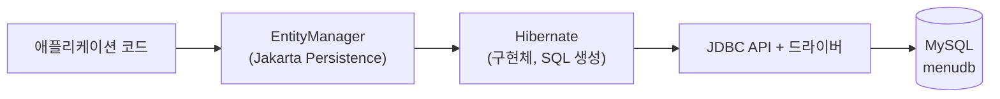
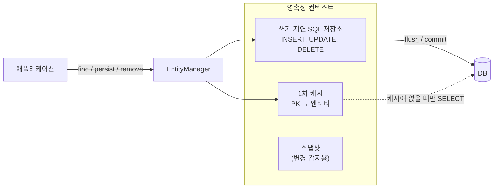
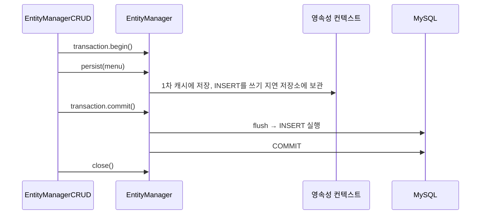
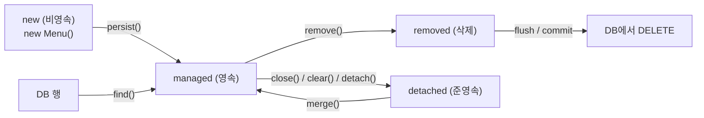
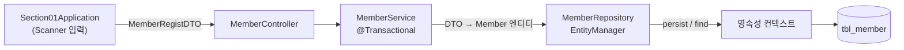
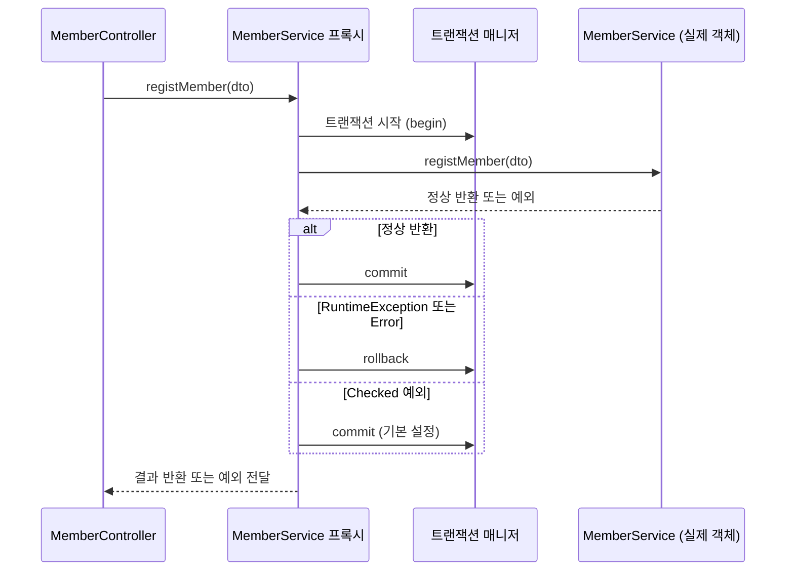
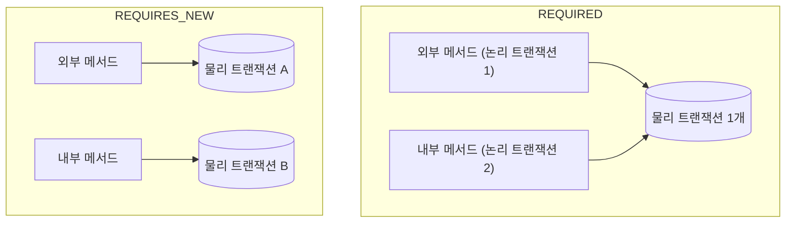

## 들어가며 (Situation)

JDBC 수업에서는 쿼리 하나를 실행하려고 `Connection`을 얻고, `PreparedStatement`에 `?`를 채우고, `ResultSet`을 한 칸씩 DTO에 옮겨 담았다. 그 글의 마지막에 **"MyBatis / JPA는 이 반복 작업을 자동화한 도구"**라고 적어 두었는데, 11/02부터 그 JPA 수업이 시작됐다.

이 글은 11/02(JDBC의 문제와 JPA 소개, datasource 설정)와 11/03(영속성 컨텍스트, 엔티티 매핑, `@Transactional`) 필기를 합친 것이다. 코드는 수업 프로젝트 `chap01-jpa-intro`, `chap02-persistence-context`, `chap03-entity-mapping`을 인용했고, 수업 코드가 아닌 것은 **"예시 코드"**라고 표시했다. 이 글을 쓰는 환경에서는 코드를 실행하지 못했고, 실행 결과나 수치도 지어내지 않았다.

## 문제 상황 (Task)

필기에는 정리가 필요한 부분이 세 가지 있었다.

- "JDBC는 단점이 많고 JPA는 그 단점을 해결한다"고만 적었다. **어떤 단점을 어떻게** 해결하는지는 비어 있었다.
- 필기의 datasource 설정은 `dbcp2` 아래에 `url`, `username`, `password`가 들어 있었다. 수업 `application.yaml`과 모양이 달랐다.
- 11/03 필기에 "트랜잭션은 면접에서 질문이 많이 나온다"며 이렇게 적었다.

```text
메서드 실행 시 begin()
메서드 종료 시 - 정상 종료 : commit(), 예외 발생 : rollback();
블로그 작성 키워드
1. Checked 예외 / UnChecked 예외의 Transactional 동작 방식
2. Transactional 의 전파
```

선생님이 직접 블로그 키워드로 준 두 가지를 확인하다 보니, **"예외 발생 : rollback()"이라는 필기부터 절반만 맞았다.** 이 글의 해결 과정 후반부는 이 부분을 공식 문서로 확인한 내용이다.

## 해결 과정 (Action)

### 1. JDBC를 직접 쓸 때의 문제 네 가지

수업은 `section01/JdbcProblem`에서 JDBC로 메뉴를 조회하며 문제를 하나씩 보여 줬다. 이제는 Spring이 `DataSource`(커넥션 풀)를 Bean으로 만들어 주지만, 그 뒤의 일은 여전히 개발자 몫이다.

```java
// 수업 코드 (JdbcProblem.findAllMenu)
try (Connection con = dataSource.getConnection();
     Statement stmt = con.createStatement();
     ResultSet rset = stmt.executeQuery(query)) {

    while (rset.next()) {
        // 조회 결과(행) 1개를 객체 1개로 직접 옮겨 담는다.
        Menu menu = new Menu();
        menu.setMenuCode(rset.getInt("menu_code"));
        menu.setMenuName(rset.getString("menu_name"));
        menu.setMenuPrice(rset.getInt("menu_price"));
        menu.setCategoryCode(rset.getInt("category_code"));
        menu.setOrderableStatus(rset.getString("orderable_status"));

        menuList.add(menu);
    }
}
```

10/19 글의 `MenuDAO.findAll`과 거의 같은 코드다. 수업 주석이 정리한 문제를 표로 옮기면 이렇다.

| 번호 | 문제 | 수업 예제 | 구체적으로 |
|---|---|---|---|
| 1 | 반복 코드와 수작업 매핑 | `findAllMenu` | `Connection`→`Statement`→`ResultSet` 생성·반납, 컬럼→필드 옮기기가 조회마다 반복 |
| 2 | SQL 의존적인 개발 | `findAllMenuWithCategoryName` | "카테고리 이름도 보여 주세요" 한 마디에 SQL(JOIN), `MenuCategoryDTO`, 매핑 코드가 연쇄 수정 |
| 3 | 패러다임 불일치 | `findMenuAndCategory` | 테이블은 FK **값**(`category_code`)을, 객체는 **참조**(`menu.getCategory()`)를 원한다. 결국 SQL을 한 번 더 실행해 직접 조립 |
| 4 | 동일성 보장 문제 | `compareSameMenu` | 같은 행을 두 번 조회하면 서로 다른 객체 두 개가 생긴다. `menu1`을 고쳐도 `menu2`는 모른다 |

4번은 수업 주석에 "중요!!"라고 표시되어 있었다.

```java
// 수업 코드 (JdbcProblem.compareSameMenu)
Menu menu1 = findMenuByMenuCode(menuCode);
Menu menu2 = findMenuByMenuCode(menuCode);
System.out.println("menu1 == menu2 : " + (menu1 == menu2));   // 조회할 때마다 new Menu()

menu1.setMenuName("이름 변경 테스트");
// menu2.getMenuName() 은 여전히 예전 이름
```

`findMenuByMenuCode` 안에서 매번 `new Menu()`를 하니 `==` 비교는 `false`일 수밖에 없다. DB에서는 같은 한 행인데 자바에서는 두 객체다.

### 2. JPA: SQL 작성과 매핑을 맡기는 ORM 표준

#### 2-1. 이름부터 정리: Java Persistence API → Jakarta Persistence

필기에는 "JPA : Java Persistence API"라고 적었다. 수업 코드 주석은 JPA를 **"자바 진영의 ORM(Object Relational Mapping) 기술 표준"**이라고 설명한다. 둘 다 맞는 말인데, 지금 공식 이름은 조금 다르다.

Java EE가 Eclipse 재단으로 옮겨 가며 **Jakarta EE**가 되었고, JPA도 [Jakarta Persistence](https://jakarta.ee/specifications/persistence/)라는 이름으로 이어지고 있다. Jakarta EE 9용 3.0부터 패키지가 `javax.persistence`에서 `jakarta.persistence`로 바뀌었고, 현재 최신은 Jakarta EE 11의 [Jakarta Persistence 3.2](https://jakarta.ee/specifications/persistence/3.2/)다. 수업 코드가 `import jakarta.persistence.*;`를 쓰는 이유가 이것이다. 약어 "JPA"는 지금도 관용적으로 쓴다.

| 구분 | 역할 | 수업에서 |
|---|---|---|
| Jakarta Persistence (JPA) | **명세(인터페이스와 규칙)** | `EntityManager`, `@Entity`, `@Id` |
| Hibernate | JPA **구현체** | `application.yaml`의 `jpa.hibernate.*` 설정 |
| Spring Data JPA 스타터 | Spring Boot에 JPA·Hibernate·커넥션 풀을 묶어 넣는 의존성 | `spring-boot-starter-data-jpa` |

JDBC 글의 "JDBC API는 인터페이스, 드라이버가 구현"과 같은 구조다. 내 코드는 `jakarta.persistence` 인터페이스만 보고, 실제 SQL 생성은 Hibernate가 한다.



JPA가 JDBC를 대체하는 게 아니라 **JDBC 위에서 동작한다**는 점이 이 그림의 핵심이다. `Connection`, `PreparedStatement`는 여전히 쓰이지만 Hibernate가 대신 다룬다.

#### 2-2. 엔티티 클래스에 테이블 정보를 적는다

```java
// 수업 코드 (section02/Menu)
@Entity
@Table(name = "tbl_menu")
public class Menu {

    @Id
    @Column(name = "menu_code")
    private int menuCode;

    @Column(name = "menu_name")
    private String menuName;

    @Column(name = "menu_price")
    private int menuPrice;

    // categoryCode 필드는 실제로는 Category 테이블의 fk 를 지칭한다.
    @ManyToOne
    @JoinColumn(name = "category_code")
    private Category categoryCode;

    @Column(name = "orderable_status")
    private String orderableStatus;
}
```

`section01`의 `Menu`는 `int categoryCode`였는데, 여기서는 **`Category` 객체**를 필드로 가진다. 테이블의 FK를 객체의 참조로 표현한 것이다. (필드 이름이 `categoryCode`로 남아 있어서 읽을 때 헷갈렸다. 타입은 `Category`다.)

#### 2-3. JDBC 문제가 어떻게 풀리는가

```java
// 수업 코드 (JpaSolution.findMenu)
@PersistenceContext
private EntityManager manager;

public void findMenu(int menuCode) {
    Menu foundMenu = manager.find(Menu.class, menuCode);
    System.out.println(foundMenu);
}
```

`JdbcProblem.findMenuByMenuCode`가 30줄 가까이 하던 일이 `find()` 한 줄이다.

| JDBC 문제 | JPA에서 | 근거 |
|---|---|---|
| 1. 반복 코드·수작업 매핑 | `manager.find(Menu.class, pk)` 한 줄. SQL 생성과 `ResultSet`→객체 변환을 Hibernate가 한다 | 수업 주석 "SQL 작성, JDBC 코드, 매핑 코드를 자동 수행" |
| 2. SQL 의존 | 엔티티에 매핑 정보만 있으면 SQL은 Hibernate가 만든다 (`show-sql: true`로 확인) | — |
| 3. 패러다임 불일치 | `Menu`가 `Category`를 필드로 가진다. `find` 한 번으로 카테고리까지 객체로 받는다 | `@ManyToOne`의 기본 fetch 전략이 **EAGER** (Jakarta Persistence `ManyToOne` Javadoc) |
| 4. 동일성 보장 | **같은 트랜잭션 안에서** 같은 PK로 조회하면 같은 객체 | 영속성 컨텍스트의 1차 캐시 (아래 3절) |

3번에서 `findMenuAndCategory`가 `findMenu`와 코드가 똑같은데도 카테고리가 같이 출력되는 이유가 궁금했다. `@ManyToOne`은 따로 지정하지 않으면 **즉시 로딩(EAGER)**이라서 메뉴를 조회할 때 카테고리도 함께 가져오기 때문이다.

4번은 "같은 트랜잭션 안에서"라는 조건이 중요했다. 수업 코드도 이 메서드에만 `@Transactional`을 붙였다.

```java
// 수업 코드 (JpaSolution.compareSameMenu)
@Transactional(readOnly = true)
public void compareSameMenu(int menuCode) {
    Menu menu1 = manager.find(Menu.class, menuCode);
    Menu menu2 = manager.find(Menu.class, menuCode);
    System.out.println("menu 1 == menu2 : " + (menu1 == menu2));

    menu1.changeMenuName("테스트!");
    System.out.println("menu2 = " + menu2.getMenuName());   // menu1과 같은 객체이므로 바뀐 이름
}
```

[Spring 공식 문서(JPA)](https://docs.spring.io/spring-framework/reference/data-access/orm/jpa.html)에 따르면 `@PersistenceContext`로 주입한 `EntityManager`는 진행 중인 트랜잭션이 있으면 그 트랜잭션의 `EntityManager`에 위임하고, **없으면 작업마다 새 `EntityManager`를 만든다.** 그래서 `@Transactional`이 없는 메서드에서 `find()`를 두 번 부르면 두 번의 조회가 서로 다른 영속성 컨텍스트에서 일어나고, 동일성 보장도 기대할 수 없다. 트랜잭션이 영속성 컨텍스트의 범위를 정하는 셈이다.

### 3. 영속성 컨텍스트와 EntityManager

#### 3-1. 영속성 컨텍스트 = 엔티티를 관리하는 공간

수업 주석의 정의는 이렇다.

> PersistenceContext 는 Entity 객체를 관리하는 컨테이너이다. Application 에서 만든 Entity 객체를 EntityManager 를 통해서 PersistenceContext 에 넣을 수도 있고, 조회할 수도 있다. — 수업 코드 주석 (JpaSolution)

[Jakarta Persistence 3.2 명세](https://jakarta.ee/specifications/persistence/3.2/jakarta-persistence-spec-3.2)도 영속성 컨텍스트를 "영속 식별자(PK)마다 엔티티 인스턴스가 **하나만** 존재하는 엔티티 인스턴스의 집합"으로 정의한다. 2-3의 동일성 보장이 바로 이 정의에서 나온다.



| 기능 | 하는 일 | 수업에서 확인한 곳 |
|---|---|---|
| 1차 캐시 | PK로 조회한 엔티티를 보관. 같은 PK 재조회 시 DB에 가지 않고 같은 객체 반환 | `compareSameMenu` (동일성 보장) |
| 쓰기 지연 | `persist()` 시점이 아니라 `flush()` 시점에 SQL을 모아서 보냄 | `EntityManagerCRUD.registMenu` 주석 |
| 변경 감지 (Dirty Checking) | 조회 시점 상태와 비교해 바뀐 필드를 flush 때 `UPDATE`로 반영 | 수업 코드의 `modifyMenuName`은 비어 있음 → 아래 예시 코드 |

#### 3-2. EntityManager로 CRUD: 조회와 등록

`chap02`는 `@PersistenceContext` 대신 `EntityManagerFactory`를 주입받아, 기능마다 `EntityManager`를 직접 만들고 닫는다.

```java
// 수업 코드 (EntityManagerCRUD.registMenu)
EntityManager manager = factory.createEntityManager();
EntityTransaction transaction = manager.getTransaction();
transaction.begin();

try {
    // 엔티티 매니저는 CUD 작업 시 SQL 을 DB에 바로 반영하지 않는다.
    // "쓰기 지연 SQL 저장소" 에 SQL 을 모아두었다가 flush() 시점에 DB로 SQL을 보내준다.
    manager.persist(menu);
    // commit() 메서드가 호출되면 flush가 자동 실행된다.
    transaction.commit();
} catch (Exception e){
    transaction.rollback();
} finally {
    manager.close();
}
```

JDBC 글의 Service 계층에서 하던 `commit` / `rollback`을 여기서는 `EntityTransaction`으로 한다. `begin → 작업 → commit, 실패하면 rollback → close`라는 틀이 같다. 이 틀을 매번 쓰기 싫어서 나온 것이 `@Transactional`이고, 5절에서 다룬다.



수업 주석은 "엔티티 매니저는 기능 1개당 1개를 별도로 생성해야 하고, 필드에서 매니저를 공유하면 안 된다"고 설명한다. 공식 문서와 대조해 보니 **`EntityManager` 자체에 대해서는 맞고, Spring이 주입한 것에 대해서는 다르다.**

> Although `EntityManagerFactory` instances are thread-safe, `EntityManager` instances are not. … a "shared EntityManager" because it is a shared, thread-safe proxy for the actual transactional EntityManager — [Spring 공식 문서 - JPA](https://docs.spring.io/spring-framework/reference/data-access/orm/jpa.html)

즉 `factory.createEntityManager()`로 만든 진짜 `EntityManager`는 스레드 안전하지 않아서 공유하면 안 된다. 하지만 `@PersistenceContext`로 주입받는 것은 **트랜잭션마다 실제 `EntityManager`를 찾아 위임하는 프록시**라서 싱글톤 Bean의 필드에 두어도 된다. `chap01`의 `JpaSolution`과 `chap03`의 `MemberRepository`가 필드 주입을 쓰는 것도 그래서 문제가 없다.

#### 3-3. 변경 감지: update 메서드가 없다

`chap02`의 `modifyMenuName`, `removeMenu`는 수업 코드에서 비어 있었다. 공식 문서 기준으로 채우면 아래와 같은 모양이 된다.

```java
// 예시 코드 — chap02 EntityManagerCRUD의 빈 메서드를 채워 본 것
public void modifyMenuName(int menuCode, String menuName) {
    EntityManager manager = factory.createEntityManager();
    EntityTransaction tx = manager.getTransaction();
    tx.begin();
    try {
        Menu menu = manager.find(Menu.class, menuCode); // 영속 상태
        menu.setMenuName(menuName);                     // update() 호출이 없다
        tx.commit();                                    // flush 시 변경 감지 → UPDATE
    } catch (RuntimeException e) {
        tx.rollback();
        throw e;
    } finally {
        manager.close();
    }
}

public void removeMenu(int menuCode) {
    // ... begin 동일
    Menu menu = manager.find(Menu.class, menuCode);
    manager.remove(menu);   // 삭제 상태 → flush 시 DELETE
    // ... commit, close 동일
}
```

`EntityManager`에는 `update()` 메서드가 없다. 영속 상태 엔티티의 필드를 바꾸기만 하면 flush 때 Hibernate가 처음 상태와 비교해 `UPDATE`를 만든다. 자바 컬렉션에서 꺼낸 객체를 수정하면 컬렉션 안의 객체도 바뀌는 것과 비슷한 감각이다.

#### 3-4. 엔티티 생명주기

[Jakarta Persistence 명세](https://jakarta.ee/specifications/persistence/3.2/jakarta-persistence-spec-3.2)의 "Entity Instance's Life Cycle"은 엔티티 상태를 네 가지로 나눈다.



| 상태 | 영속성 컨텍스트가 관리하나 | 수업 코드에서 |
|---|---|---|
| new (비영속) | 아니다 | `inputNewMenu()`에서 `new Menu()`로 만든 직후 |
| managed (영속) | 관리한다 (1차 캐시, 변경 감지 대상) | `persist(menu)` 후, `find()` 결과 |
| detached (준영속) | 관리하다가 떨어졌다. 수정해도 DB 반영 안 됨 | `manager.close()` 이후의 `menu` |
| removed (삭제) | 삭제 예정 | 수업 코드 없음 (`removeMenu`가 빈 메서드) |

`registMenu`에서 `commit()` 후 출력하는 `menu`는 아직 영속 상태지만, `finally`에서 `close()`한 뒤에는 준영속이 된다. 그 뒤에 값을 바꿔도 DB에는 반영되지 않는다.

### 4. 엔티티 매핑과 Repository-Service-Controller

#### 4-1. datasource 설정: 필기와 수업 yaml이 달랐다

11/02 필기의 설정과 수업 `application.yaml`을 나란히 놓으면 이렇다. (비밀번호는 가렸다.)

```yaml
# 11/02 필기
spring:
  datasource:
    driver-class-name: com.mysql.cj.jdbc.Driver
    dbcp2:
      url: jdbc:mysql://localhost:3306/menudb
      username: wanted
      password: ****
```

```yaml
# 수업 코드 (chap01~03 application.yaml) — 비밀번호는 가렸다
spring:
  datasource:
    driver-class-name: com.mysql.cj.jdbc.Driver
    url: jdbc:mysql://localhost:3306/menudb
    username: wanted
    password: ****
  jpa:
    show-sql: true          # jpa 가 알아서 생성해주는 sql 구문 보는 설정
    hibernate:
      ddl-auto: none        # chap03은 create
    properties:
      hibernate:
        format_sql: true    # sql 구문을 보기 좋게 포맷팅
```

[Spring Boot 공식 문서 - SQL Databases](https://docs.spring.io/spring-boot/reference/data/sql.html)를 보니 필기 쪽 구조는 의도대로 동작하지 않는다.

| 확인한 것 | 공식 문서 내용 | 필기 yaml에서 |
|---|---|---|
| 접속 정보 위치 | `spring.datasource.url`, `.username`, `.password` | `spring.datasource.dbcp2.url` 아래에 있음 → `spring.datasource.url`이 비어 있음 |
| URL이 없을 때 | "적어도 `spring.datasource.url`은 지정해야 한다. 아니면 내장 DB(H2 등)를 자동 구성하려 한다" | 수업 프로젝트에는 내장 DB 의존성이 없다 |
| 커넥션 풀 선택 | HikariCP가 있으면 **항상** HikariCP. `spring-boot-starter-data-jpa`는 HikariCP를 자동으로 가져온다 | DBCP2는 선택되지 않는다 |
| `dbcp2.*` 접두사 | 풀별 **세부 튜닝** 설정용 (`hikari.*`, `tomcat.*`, `dbcp2.*`) | 지금 쓰는 풀이 Hikari라 `dbcp2.*`는 적용 대상이 아니다 |

정리하면 필기의 `dbcp2:` 줄은 빼고, `url`, `username`, `password`를 `datasource` 바로 아래에 두어야 한다. 수업 yaml이 그렇게 되어 있다. 필기할 때 들여쓰기를 잘못 옮긴 것 같다. 수업 yaml 주석의 "mysql 의존성을 추가하면 데이터베이스 관련 정보를 작성해 주어야 어플리케이션이 실행된다"도 같은 이야기다.

`ddl-auto`는 수업 주석대로 정리하면 이렇다.

| 값 | 수업 주석 | 사용한 곳 |
|---|---|---|
| `create` | 실행 시 테이블 새로 생성 | `chap03` (`tbl_member` 자동 생성) |
| `create-drop` | 실행 시 생성, 종료 시 삭제 | — |
| `update` | 변경된 테이블 구조 반영 | — |
| `none` | 미리 만들어 둔 테이블로만 진행 | `chap01`, `chap02` (기존 `tbl_menu` 사용) |

#### 4-2. @Entity, @Id, @GeneratedValue

`chap03`은 테이블이 없는 상태에서 엔티티로 `tbl_member`를 만들게 한다.

```java
// 수업 코드 (Member) — 일부
@Entity
@Table(name = "tbl_member")
public class Member {

    @Id
    @Column(name = "member_no")
    @GeneratedValue(strategy = GenerationType.IDENTITY)
    private int memberNo;

    @Column(name = "member_id", nullable = false,
            unique = true, columnDefinition = "varchar(10)")
    private String memberId;

    @Column(name = "address", length = 900)
    private String address;

    @Column(name = "enroll_date")
    private LocalDateTime enrollDate;

    @Column(name = "member_role")
    @Enumerated(EnumType.STRING)
    private MemberRole memberRole;

    @Column(name = "status", columnDefinition = "char(1) default 'Y'")
    private String status;
}
```

`@GeneratedValue` 전략은 쓰기 지연과 얽혀 있어서 표로 정리했다.

| 전략 | PK를 만드는 곳 | INSERT 시점 | 쓰기 지연 |
|---|---|---|---|
| `IDENTITY` | DB (MySQL `AUTO_INCREMENT`) | **`persist()` 즉시** | X |
| `SEQUENCE` | DB 시퀀스 (Oracle, PostgreSQL) | flush 시점 | O |
| `TABLE` | 키 생성 전용 테이블 | flush 시점 | O |
| `AUTO` (기본값) | DB에 맞춰 선택 | 선택된 전략에 따름 | — |

`IDENTITY`가 예외인 이유: JPA는 `persist()`가 끝나면 엔티티에 PK가 채워져 있어야 하는데, `AUTO_INCREMENT` 값은 INSERT를 해 봐야 알 수 있다. 그래서 Hibernate는 `persist()` 시점에 바로 INSERT를 보낸다. `MemberService.registMember`가 `save()` 직후 `member.getMemberNo()`를 반환할 수 있는 것도 이 덕분이다.

#### 4-3. @Column 속성은 DDL을 만들 때 쓰인다

| 속성 | 의미 | 수업 예 |
|---|---|---|
| `name` | 매핑할 컬럼명 (기본값: 필드명) | `member_id` |
| `nullable` | `false`면 `NOT NULL` | `memberId`, `memberPwd` |
| `unique` | `UNIQUE` 제약 | `memberId`, `phone` |
| `columnDefinition` | 컬럼 정의를 직접 작성 | `varchar(10)`, `char(1) default 'Y'` |
| `length` | 문자열 길이 (기본 255) | `address` 900 |

수업 주석에도 "위 속성들은 JPA가 테이블을 생성(DDL)할 때 사용된다"고 적혀 있다. `ddl-auto: none`으로 기존 테이블을 쓸 때는 `nullable = false`를 적어도 자바 쪽에서 자동으로 검사해 주는 것은 아니다.

#### 4-4. enum 매핑: ORDINAL vs STRING

```java
// 수업 코드 (MemberRole)
public enum MemberRole {
    ROLE_MEMBER, ROLE_ADMIN;
}
```

| 방식 | DB에 저장되는 값 | 장점 | 단점 |
|---|---|---|---|
| `EnumType.ORDINAL` (기본값) | `0`, `1` (선언 순서) | 크기가 작다 | 중간에 값을 추가하거나 순서를 바꾸면 **기존 데이터의 의미가 바뀐다** |
| `EnumType.STRING` (수업 권장) | `"ROLE_MEMBER"` | 읽기 쉽고 순서 변경에 안전 | 저장 크기가 크다 (큰 문제는 아님) |

예를 들어 `ROLE_GUEST`를 맨 앞에 추가하면, ORDINAL로 `0`이 저장된 기존 일반 회원이 전부 `ROLE_GUEST`로 읽힌다. 그래서 수업은 STRING을 권장했다.

수업 주석에는 "Hibernate 6 + MySQL에서는 STRING으로 매핑하면 MySQL의 `enum('ROLE_ADMIN','ROLE_MEMBER')` 타입 컬럼이 생성된다"는 설명도 있다. [Hibernate 6.2 마이그레이션 가이드](https://docs.hibernate.org/orm/6.2/migration-guide/)에 MySQL에서 enum을 기본으로 `ENUM` 타입으로 저장하도록 바뀌었다는 항목이 있어 주석과 맞는다. `varchar`로 만들고 싶으면 주석대로 `columnDefinition = "varchar(20)"`을 준다.

#### 4-5. Repository - Service - Controller

JDBC 글의 View-Controller-Service-DAO 구조가 그대로 이어진다. 수업 주석은 "Spring에서 JPA를 쓸 때는 DAO 계층을 Repository로 표현하니 DAO == Repository로 인식하자"고 한다.



| 계층 | JDBC 수업 | JPA 수업 (`chap03`) |
|---|---|---|
| Controller | `new`로 Service 생성 | `@Controller`, 생성자 주입 |
| Service | `Connection` 생성, `commit`/`rollback` 직접 호출 | `@Transactional` 한 줄 |
| DAO / Repository | SQL, `?` 바인딩, `ResultSet`→DTO | `manager.persist(member)`, `manager.find(...)` |
| 데이터 | DTO | 계층 사이는 **DTO**, DB와는 **엔티티** |

```java
// 수업 코드 (MemberRepository)
@Repository
public class MemberRepository {

    @PersistenceContext
    private EntityManager manager;

    public void save(Member member) {
        manager.persist(member);
    }

    public Member findByMemberNo(int memberNo) {
        return manager.find(Member.class, memberNo);
    }
}
```

Service는 DTO를 엔티티로 바꿔 Repository에 넘기고, 조회 결과 엔티티를 다시 DTO로 바꿔 돌려준다. 엔티티는 영속성 컨텍스트가 관리하는 객체라서, Controller까지 그대로 내보내지 않고 Service에서 DTO로 끊어 준다는 의도다.

### 5. @Transactional: begin, commit, rollback을 대신 호출한다

#### 5-1. 필기의 이해와 동작 구조

```java
// 수업 코드 (MemberService.registMember)
// 메서드 실행 시 begin()
// 메서드 종료 시 - 정상 종료 : commit(), 예외 발생 : rollback();
@Transactional
public int registMember(MemberRegistDTO dto) {
    Member member = new Member(dto.getMemberId(), /* ... */ dto.getStatus());
    memberRepository.save(member);
    return member.getMemberNo();
}
```

3-2의 `EntityTransaction` 코드와 비교하면 `begin`, `commit`, `rollback`, `close`가 모두 사라졌다. 누가 대신 부르는지 [Spring 공식 문서 - @Transactional](https://docs.spring.io/spring-framework/reference/data-access/transaction/declarative/annotations.html)을 보니 **프록시**였다. Spring은 `MemberService` Bean 대신, 메서드 앞뒤로 트랜잭션 코드를 끼워 넣은 프록시 객체를 Controller에 주입한다.



다이어그램의 마지막 분기가 필기와 다른 부분이다.

#### 5-2. [블로그 키워드 1] Checked 예외 / Unchecked 예외의 롤백 동작

필기에는 "예외 발생 : rollback()"이라고 적었고, `JpaSolution` 수업 주석도 "에러가 발생하면 rollback을 자동 처리해 준다"고 설명한다. 그런데 [Spring 공식 문서 - Rolling Back](https://docs.spring.io/spring-framework/reference/data-access/transaction/declarative/rolling-back.html)은 이렇게 말한다.

> In its default configuration, the Spring Framework's transaction infrastructure code marks a transaction for rollback only in the case of runtime, unchecked exceptions. … (`Error` instances also, by default, result in a rollback). Checked exceptions that are thrown from a transactional method do not result in a rollback in the default configuration.

**모든 예외에서 롤백되는 것이 아니다.** 기본 설정에서는 이렇게 나뉜다.

| 예외 종류 | 예 | 기본 동작 |
|---|---|---|
| Unchecked: `RuntimeException`과 그 하위 | `NullPointerException`, `IllegalArgumentException`, `DataIntegrityViolationException` | **롤백** |
| `Error` | `OutOfMemoryError` | **롤백** |
| Checked: `Exception` 하위 중 `RuntimeException`이 아닌 것 | `IOException`, `SQLException`, 직접 만든 `extends Exception` | **커밋** (예외는 호출자에게 그대로 전달됨) |
| 메서드 안에서 `try-catch`로 잡고 끝낸 예외 | 종류 무관 | 프록시가 예외를 못 보므로 **커밋** |

자바 예외 수업에서 배운 구분과 연결된다. Checked 예외는 컴파일러가 처리를 강제하는 예외라서 "호출자가 복구할 수 있는 예상된 상황"으로 보고, Spring은 이런 예외에서는 트랜잭션을 되돌리지 않는 것을 기본값으로 삼았다.

```java
// 예시 코드 — checked 예외를 던지면 INSERT가 커밋된다
@Transactional
public int registMember(MemberRegistDTO dto) throws IOException {
    Member member = new Member(/* ... */);
    memberRepository.save(member);        // IDENTITY라서 이 시점에 INSERT 실행
    if (dto.getPhone() == null) {
        throw new IOException("전화번호 누락");   // checked 예외 → 기본 설정이면 commit
    }
    return member.getMemberNo();
}
```

호출한 쪽은 예외를 받으니 "등록이 실패했다"고 생각하지만, DB에는 회원이 들어가 있다. 면접에서 이 부분을 묻는 이유가 이것 같다.

롤백 대상을 바꾸는 방법은 공식 문서에 세 가지가 나온다.

| 방법 | 코드 | 범위 |
|---|---|---|
| `rollbackFor` | `@Transactional(rollbackFor = Exception.class)` | 해당 메서드/클래스. 지정 타입과 **그 하위 타입**까지 롤백 |
| `noRollbackFor` | `@Transactional(noRollbackFor = SomeRuntimeException.class)` | 특정 unchecked 예외를 롤백하지 않게 |
| 전역 설정 (Spring 6.2+) | `@EnableTransactionManagement(rollbackOn = ALL_EXCEPTIONS)` | 애플리케이션 전체에서 checked 예외도 롤백 |

```java
// 예시 코드 — checked 예외에서도 롤백
@Transactional(rollbackFor = Exception.class)
public int registMember(MemberRegistDTO dto) throws IOException { /* ... */ }
```

`rollbackFor`는 "지정한 타입과 같거나 하위 타입이면 일치"이고, 규칙이 여러 개 겹치면 **가장 강하게 일치하는 규칙**이 이긴다고 문서에 적혀 있다. 또 다른 방법은 checked 예외를 잡아서 `RuntimeException`으로 감싸 다시 던지는 것인데, 수업 `JdbcProblem`의 `catch (SQLException e) { throw new RuntimeException(e); }`가 바로 그 모양이다.

#### 5-3. [블로그 키워드 2] 트랜잭션 전파 (Propagation)

전파는 **이미 트랜잭션이 진행 중일 때 또 `@Transactional` 메서드를 부르면 어떻게 할지**를 정하는 규칙이다. 예를 들어 `MemberService.registMember`(트랜잭션) 안에서 `PointService.givePoint`(또 `@Transactional`)를 부르는 경우다. 수업 코드에는 이런 중첩 호출이 없어서 아래는 공식 문서와 [`Propagation` Javadoc](https://docs.spring.io/spring-framework/docs/current/javadoc-api/org/springframework/transaction/annotation/Propagation.html)을 기준으로 정리했다.

| 옵션 | 기존 트랜잭션이 있을 때 | 없을 때 |
|---|---|---|
| `REQUIRED` (**기본값**) | 참여한다 (하나의 물리 트랜잭션) | 새로 만든다 |
| `REQUIRES_NEW` | 기존 것을 잠시 멈추고 **새로 만든다** | 새로 만든다 |
| `NESTED` | 같은 물리 트랜잭션 안에 **세이브포인트**를 만든다 | 새로 만든다 (`REQUIRED`처럼) |
| `SUPPORTS` | 참여한다 | 트랜잭션 없이 실행 |
| `NOT_SUPPORTED` | 기존 것을 멈추고 트랜잭션 없이 실행 | 트랜잭션 없이 실행 |
| `MANDATORY` | 참여한다 | **예외** |
| `NEVER` | **예외** | 트랜잭션 없이 실행 |

자주 쓰는 것은 앞의 세 개다. [Spring 공식 문서 - Transaction Propagation](https://docs.spring.io/spring-framework/reference/data-access/transaction/declarative/tx-propagation.html)의 설명을 그림으로 옮기면 이렇다.



**REQUIRED에서 가장 헷갈리는 부분**은 내부 메서드의 예외를 외부에서 잡았을 때다.

```java
// 예시 코드 — 내부 예외를 잡아도 전체가 롤백된다
@Transactional
public void registMember(MemberRegistDTO dto) {
    memberRepository.save(new Member(/* ... */));
    try {
        pointService.givePoint(dto);   // @Transactional(REQUIRED), 안에서 RuntimeException
    } catch (RuntimeException e) {
        // 포인트 실패는 무시하고 회원 가입은 성공시키고 싶다?
    }
}   // → commit 시도 → UnexpectedRollbackException
```

공식 문서에 따르면 REQUIRED에서는 메서드마다 **논리 트랜잭션**은 따로지만 **물리 트랜잭션은 하나**다. 내부 메서드에서 예외가 나면 그 물리 트랜잭션 전체에 "rollback-only" 표시가 붙는다. 외부에서 예외를 잡고 정상 종료해도, 커밋하려는 순간 이미 롤백만 가능한 상태라서 실제로는 롤백되고 `UnexpectedRollbackException`이 던져진다. 문서는 이 예외가 "커밋되지 않았는데 커밋됐다고 착각하지 않게 하기 위한 것"이라고 설명한다.

포인트 지급 실패와 상관없이 회원 가입을 커밋하고 싶다면 내부를 `REQUIRES_NEW`로 분리한다.

```java
// 예시 코드 — 내부 작업을 독립 트랜잭션으로
@Service
public class PointService {
    @Transactional(propagation = Propagation.REQUIRES_NEW)
    public void givePoint(MemberRegistDTO dto) { /* ... */ }
}
```

| 비교 | REQUIRED (내부 예외를 외부에서 catch) | REQUIRES_NEW (내부 예외를 외부에서 catch) |
|---|---|---|
| 내부 작업 | 롤백 | 롤백 (자기 트랜잭션만) |
| 외부 작업 | **롤백** + `UnexpectedRollbackException` | 커밋 가능 |
| 커넥션 | 1개 | 외부가 커넥션을 쥔 채로 내부가 **1개 더** 사용 |

`REQUIRES_NEW`에는 공식 문서의 경고가 붙어 있다. 외부 트랜잭션의 커넥션이 묶인 채로 내부가 새 커넥션을 얻기 때문에, 동시 요청이 많으면 커넥션 풀이 고갈되어 교착 상태가 될 수 있다. 문서는 "커넥션 풀 크기가 동시 스레드 수보다 최소 1 이상 크지 않으면 쓰지 말라"고 한다. `NESTED`는 JDBC 세이브포인트로 동작해서, 문서상 JDBC 리소스 트랜잭션(`DataSourceTransactionManager`)에서만 쓸 수 있다고 되어 있다.

또 하나, REQUIRED로 참여하는 내부 트랜잭션은 자기 `readOnly`, 격리 수준, 타임아웃 설정을 **조용히 무시하고** 외부 설정을 따른다. 내부 메서드에 `readOnly = true`를 붙여도 외부가 쓰기 트랜잭션이면 쓰기 트랜잭션으로 동작한다.

#### 5-4. 프록시라서 생기는 함정: self-invocation

5-1에서 `@Transactional`이 프록시로 동작한다는 것을 확인했는데, 공식 문서는 그 결과를 이렇게 경고한다.

> In proxy mode (which is the default), only external method calls coming in through the proxy are intercepted. This means that self-invocation (in effect, a method within the target object calling another method of the target object) does not lead to an actual transaction at runtime even if the invoked method is marked with `@Transactional`.

```java
// 예시 코드 — 같은 클래스 안에서 호출하면 트랜잭션이 적용되지 않는다
@Service
public class MemberService {

    public void registAll(List<MemberRegistDTO> list) {   // @Transactional 없음
        for (MemberRegistDTO dto : list) {
            registMember(dto);   // this.registMember() → 프록시를 거치지 않음
        }
    }

    @Transactional
    public int registMember(MemberRegistDTO dto) { /* ... */ }
}
```

Controller → 프록시 → `registAll`까지는 프록시를 지나지만, `registAll` 안의 `registMember`는 `this`(실제 객체)의 메서드를 직접 부른다. 그래서 `registMember`의 `@Transactional`은 무시된다. 해결 방법은 트랜잭션이 필요한 메서드를 **다른 Bean으로 분리**하거나, 바깥 메서드(`registAll`)에 `@Transactional`을 붙이는 것이다. 공식 문서는 AspectJ 모드를 대안으로 소개한다.

같은 문서에 따르면 Spring 6.0부터는 클래스 기반 프록시에서 `protected`, package-private 메서드도 트랜잭션 대상이 된다. 그 이전(5.3까지)은 `public` 메서드만 적용됐다. `private` 메서드는 프록시가 가로챌 수 없다.

#### 5-5. readOnly = true는 무엇을 하는가

수업 `MemberService.findByMemberNo` 주석은 "읽기 전용 트랜잭션은 불필요한 변경 감지를 하지 않는다"고 한다. [Spring Data JPA 공식 문서 - Transactionality](https://docs.spring.io/spring-data/jpa/reference/jpa/transactions.html)에도 같은 설명이 있다.

> when used with Hibernate, the flush mode is set to `MANUAL` when you configure a transaction as `readOnly`, which causes Hibernate to skip dirty checks

같은 문서는 `readOnly`가 **수정 쿼리를 막아 주는 검사 장치는 아니고**, JDBC 드라이버와 JPA 구현체에 주는 최적화 힌트라고 덧붙인다.

이걸 알고 나서 `JpaSolution.compareSameMenu`를 다시 보니, `readOnly = true` 안에서 `menu1.changeMenuName("테스트!")`를 호출한다. flush 모드가 `MANUAL`이라 변경 감지가 일어나지 않으므로, 자바 객체의 이름만 바뀌고 **DB의 메뉴 이름은 바뀌지 않을 것**이다. 동일성 확인용 예제라서 DB를 실제로 바꾸지 않는 편이 오히려 안전하다. (실행해서 확인하지는 못했다.)

### 시행착오와 확인하지 못한 점

수업 코드를 읽으며 발견한 주의점이다.

- **`chap03`의 `ddl-auto: create`:** 애플리케이션을 실행할 때마다 `tbl_member`를 지우고 다시 만든다. 이전 실행에서 등록한 회원은 남지 않는다. 같은 `menudb`를 쓰므로, 다른 엔티티에 이 설정을 실수로 적용하면 수업용 `tbl_menu` 데이터도 날아갈 수 있다.
- **`EntityManagerCRUD.registMenu`의 `catch (Exception e) { transaction.rollback(); }`:** 예외를 잡고 롤백만 하고 아무것도 출력하거나 다시 던지지 않는다. 등록이 실패해도 콘솔에는 아무 표시가 없다.
- **`chap02` `Menu`의 `@Id`에 `@GeneratedValue`가 없다:** `inputNewMenu()`는 `menuCode`를 입력받지 않으므로 `int` 기본값 `0`이 PK로 INSERT된다. `tbl_menu.menu_code`가 `AUTO_INCREMENT`라면 MySQL이 0을 새 번호로 바꿔 줄 수도 있지만, 자바 객체의 `menuCode`는 계속 0으로 남는다. 테이블 정의는 확인하지 못했다.
- **`modifyMenuName`, `removeMenu`가 빈 메서드:** 메뉴 3, 4번을 골라도 아무 일도 일어나지 않는다. 3-3의 코드는 예시 코드로 채운 것이다.
- **`MemberService.findByMemberNo`의 null 처리:** 없는 회원 번호를 입력하면 `find()`가 `null`을 반환하고, 바로 `foundMember.getMemberId()`에서 `NullPointerException`이 난다. `Section01Application`은 `NumberFormatException`만 잡으므로 프로그램이 종료된다. `JpaSolution.compareSameMenu`도 `menu1`의 null 검사가 없다.
- **조회 DTO에 비밀번호:** `findByMemberNo`가 `memberPwd`를 담은 DTO를 돌려주고, Controller가 `toString()`으로 콘솔에 출력한다. 연습 코드지만 실제 서비스라면 응답 DTO에서 빼야 할 값이다.
- **`status`의 `default 'Y'`:** `columnDefinition`의 기본값은 INSERT에 해당 컬럼이 **빠졌을 때**만 적용된다. Hibernate는 기본적으로 모든 컬럼을 INSERT에 넣으므로, 자바에서 `status`가 `null`이면 `null`이 들어갈 것으로 보인다. 수업 코드는 입력 단계에서 `"Y"`를 직접 넣어서 문제가 드러나지 않는다. 실행해서 확인하지는 못했다.
- **수업 주석의 "에러가 발생하면 rollback":** 5-2에서 정리했듯 checked 예외는 기본 설정에서 커밋된다.

확인하지 못한 것도 있다.

- **datasource URL이 없을 때의 실제 에러:** 공식 문서는 "URL이 없으면 내장 DB를 자동 구성하려 한다"까지만 말한다. 내장 DB도 없을 때 정확히 어떤 메시지로 실패하는지는 실행해 보지 못했다.
- **JPA 환경의 `NESTED`:** 공식 문서는 JDBC 세이브포인트 기반이라고만 설명한다. `JpaTransactionManager`에서 어디까지 지원되는지는 확인하지 못했다.
- **수업 버전과 문서 버전:** 수업 `build.gradle`은 Spring Boot 4.1.2다. 참고한 Spring Framework 문서는 최신(7.x) 기준이고, Hibernate enum 매핑은 6.2 마이그레이션 가이드 기준이다. 수업 버전에 포함된 Hibernate의 정확한 버전과 DDL 결과는 직접 확인하지 못했다.

## 결과 (Result)

필기의 이해가 이렇게 바뀌었다. 코드를 실행하지 못해서 실행 시간 같은 수치는 적지 않았다.

| 필기의 이해 | 정리 후 |
|---|---|
| JPA = Java Persistence API | 지금 공식 이름은 **Jakarta Persistence** (3.0부터 `jakarta.persistence` 패키지). Hibernate는 그 구현체 |
| JDBC는 단점이 많고 JPA가 해결한다 | 반복 코드·수작업 매핑, SQL 의존, 패러다임 불일치, 동일성 문제 네 가지. JPA는 JDBC를 없애는 게 아니라 그 위에서 대신 다룬다 |
| `datasource.dbcp2` 아래에 `url`/`username`/`password` | `spring.datasource.url` 등에 바로 써야 한다. 스타터의 기본 풀은 HikariCP이고, `dbcp2.*`는 DBCP2를 쓸 때의 세부 튜닝용 |
| 엔티티 매니저는 필드에서 공유하면 안 된다 (수업 주석) | 직접 만든 `EntityManager`는 맞다. `@PersistenceContext`로 주입한 것은 스레드 안전한 공유 프록시라 필드에 둬도 된다 |
| 같은 PK로 조회하면 같은 객체 | **같은 트랜잭션(영속성 컨텍스트) 안에서만.** 트랜잭션이 없으면 조회마다 새 `EntityManager` |
| 메서드 종료 시 예외 발생 : rollback() | `RuntimeException`·`Error`만 롤백. **checked 예외는 커밋.** `rollbackFor`나 6.2+ 전역 설정으로 바꾼다 |
| Transactional의 전파 (키워드만) | 기본 `REQUIRED`는 물리 트랜잭션 1개 → 내부 예외를 잡아도 `UnexpectedRollbackException`. 독립이 필요하면 `REQUIRES_NEW` (커넥션 2개 주의) |
| (필기 없음) | `@Transactional`은 프록시 기반 → 같은 클래스 안의 호출(self-invocation)에는 적용되지 않는다 |
| readOnly = 조회 전용 | Hibernate flush 모드를 `MANUAL`로 → 변경 감지 생략. 수정을 막는 검사 장치는 아니다 |

배운 점은 두 가지다. 첫째, JDBC 글에서 "공통으로 반복되는 코드는 빼낸다"고 정리한 흐름이 JPA에서는 **SQL과 매핑, 트랜잭션 코드까지** 빼내는 데로 이어졌다. 둘째, 빼낸 코드는 사라진 게 아니라 프록시와 영속성 컨텍스트 안으로 숨었다. `@Transactional` 한 줄이 언제 커밋하고 언제 롤백하는지, 어디서 적용되지 않는지는 **숨은 코드의 규칙을 알아야** 답할 수 있었다. 면접 질문이 많은 이유도 여기 있는 것 같다.

## 더 학습하면 좋은 개념

- **지연 로딩(LAZY)과 N+1 문제** — 수업의 `@ManyToOne`은 기본값 EAGER라 메뉴를 조회할 때 카테고리도 함께 가져왔다. 목록 조회에서 이 기본값이 쿼리를 몇 번 만드는지 알아야 실무 성능 문제를 이해할 수 있다.
- **flush 시점과 `FlushModeType`** — 쓰기 지연 SQL이 commit 외에 JPQL 실행 직전에도 flush된다. 언제 SQL이 나가는지 알아야 `show-sql` 로그를 해석할 수 있다.
- **트랜잭션 격리 수준(Isolation)** — MySQL 수업의 트랜잭션과 `@Transactional(isolation = ...)`을 잇는 개념이다. 전파가 "트랜잭션을 몇 개 쓰나"라면, 격리 수준은 "동시에 도는 트랜잭션끼리 무엇을 볼 수 있나"다.
- **Spring AOP와 프록시(JDK 동적 프록시 vs CGLIB)** — self-invocation 문제가 왜 생기는지 근본 원리다. `@Transactional`뿐 아니라 `@Async`, `@Cacheable`도 같은 구조라 같은 함정이 있다.
- **Spring Data JPA의 `JpaRepository`** — `MemberRepository`에서 직접 쓴 `persist`, `find`를 인터페이스 선언만으로 만들어 주는 다음 단계다.

## 참고 자료

- [Jakarta Persistence 3.2](https://jakarta.ee/specifications/persistence/3.2/)
- [Jakarta Persistence 3.2 명세 (Entity Instance's Life Cycle, Persistence Context)](https://jakarta.ee/specifications/persistence/3.2/jakarta-persistence-spec-3.2)
- [Spring Framework 공식 문서 - JPA (Shared EntityManager)](https://docs.spring.io/spring-framework/reference/data-access/orm/jpa.html)
- [Spring Framework 공식 문서 - Using @Transactional](https://docs.spring.io/spring-framework/reference/data-access/transaction/declarative/annotations.html)
- [Spring Framework 공식 문서 - Rolling Back a Declarative Transaction](https://docs.spring.io/spring-framework/reference/data-access/transaction/declarative/rolling-back.html)
- [Spring Framework 공식 문서 - Transaction Propagation](https://docs.spring.io/spring-framework/reference/data-access/transaction/declarative/tx-propagation.html)
- [Spring Framework Javadoc - Propagation](https://docs.spring.io/spring-framework/docs/current/javadoc-api/org/springframework/transaction/annotation/Propagation.html)
- [Spring Data JPA 공식 문서 - Transactionality](https://docs.spring.io/spring-data/jpa/reference/jpa/transactions.html)
- [Spring Boot 공식 문서 - SQL Databases (DataSource, Connection Pool)](https://docs.spring.io/spring-boot/reference/data/sql.html)
- [Hibernate ORM 6.2 Migration Guide](https://docs.hibernate.org/orm/6.2/migration-guide/)
