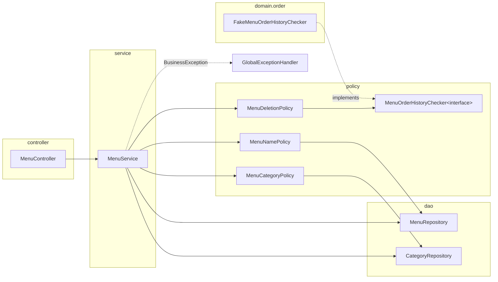
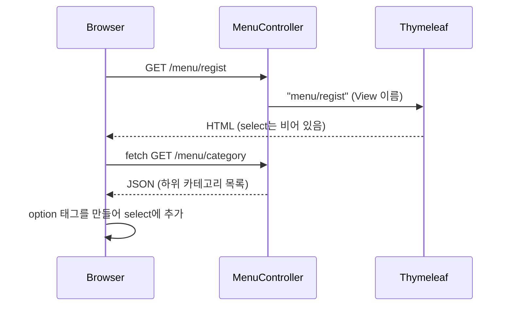
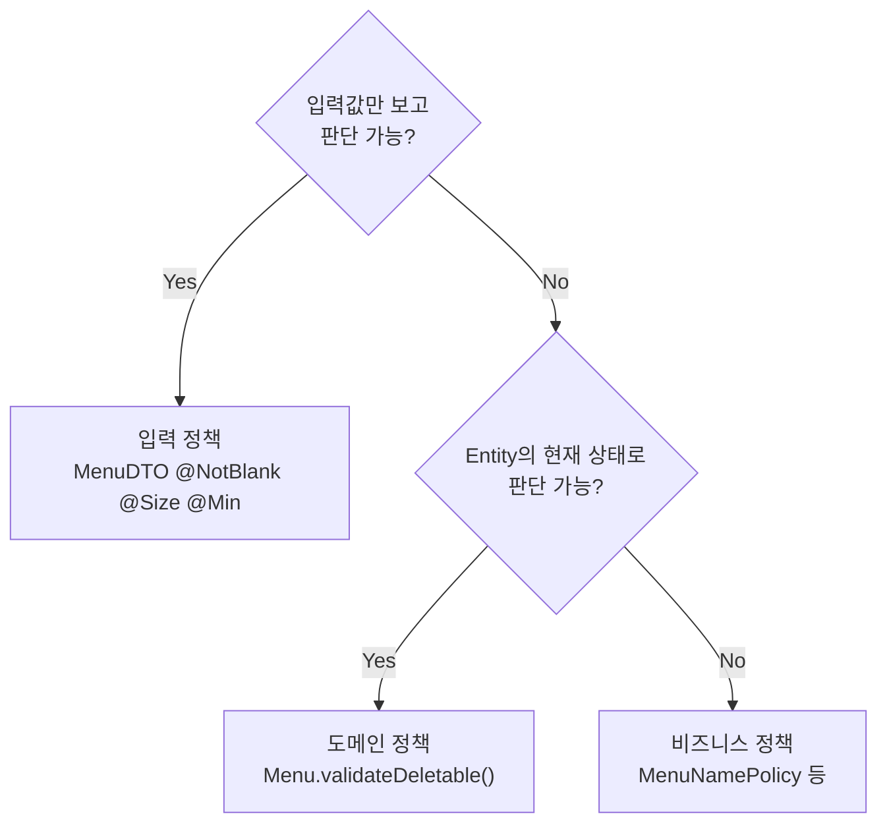
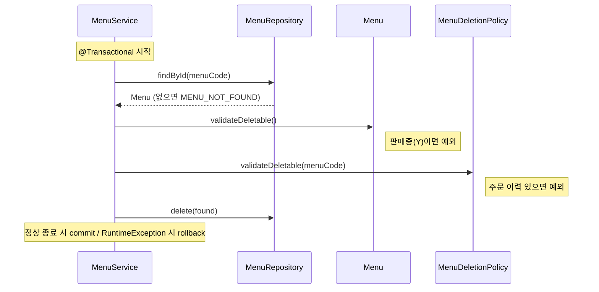
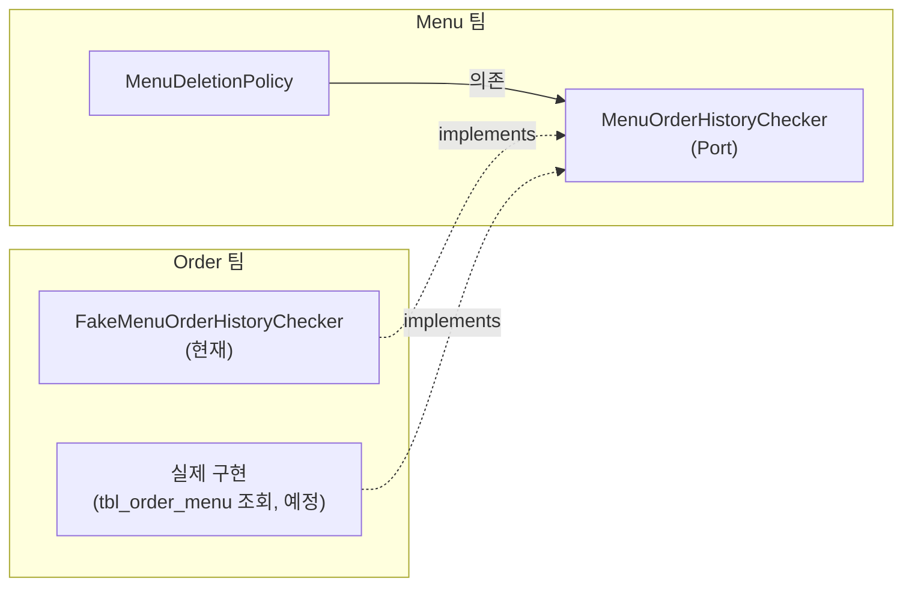
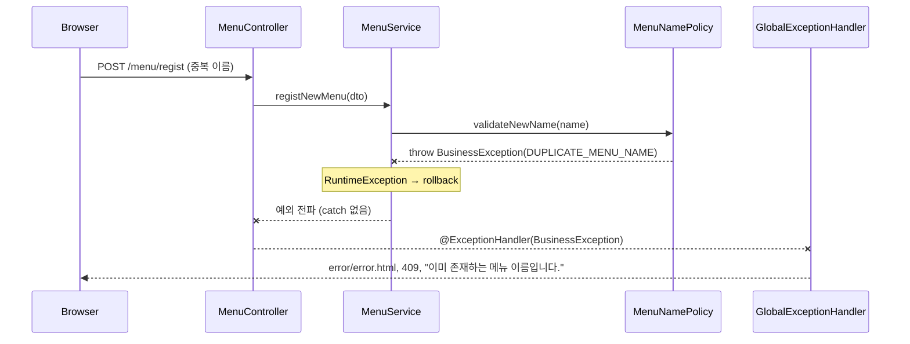

## 들어가며 (Situation)

JDBC 수업에서 View-Controller-Service-DAO로 클래스를 나눠 봤다. 그때는 "Controller는 커맨드 센터, DAO는 SQL"처럼 계층 이름과 하는 일을 짝지어 외우는 수준이었다. 11/05 수업의 JPA 미니 프로젝트(레스토랑 메뉴 관리)에서는 질문이 바뀌었다. 계층이 무엇인지가 아니라 **"이 if 문은 어느 클래스에 있어야 하는가"**를 계속 묻는 수업이었다.

선생님이 강조한 말은 필기에 그대로 남아 있다.

> 문법에 매몰되지 말고 핵심적인 역할과 책임. 단순 MVC 하지 말고 — policy, PSA

이 글은 11/05 필기와 수업 프로젝트(`module07-jpa-mini-project`)를 함께 정리한 것이다. 코드는 수업 코드를 그대로 인용했고, 수업 코드가 아닌 것은 **"예시 코드"**라고 표시했다. 이 글을 쓰는 환경에서는 코드를 실행하지 못했고, 실행 결과나 수치도 지어내지 않았다. 영속성 컨텍스트와 `@Transactional`의 동작 원리는 다른 글에서 다루므로, 여기서는 이 프로젝트에서 **어떻게 쓰였는지만** 적는다.

## 문제 상황 (Task)

필기를 다시 읽어 보니 정리가 필요한 부분이 있었다.

- `@Controller`와 `@RestController`의 차이를 "View를 응답하느냐, 데이터를 응답하느냐"로 적었다. 실제로 어노테이션이 어떻게 구성되어 있는가?
- "나중에는 모든 컨트롤러를 RestController로 사용해서 백엔드는 데이터만 주고 프론트에서"에서 문장이 끊겼다. 무슨 이야기였나?
- 유효성 검사를 "DB를 들러야 아는 것은 Service, 아니면 Controller"로 나눴다. 이 프로젝트에서는 실제로 몇 갈래로 나뉘는가?
- "서비스는 함부로 엔티티에 접근하지 말고 … 메서드 호출로 set"은 무슨 뜻인가?
- 필기에 **"PSA : Port / Adapter"**라고 적었다. PSA와 Port/Adapter는 같은 것인가?

## 해결 과정 (Action)

### 1. 프로젝트 구조부터 보기

수업 프로젝트는 README가 PRD(제품 요구사항 문서)다. "PRD의 각 장이 코드의 한 계층에 대응한다"는 것이 README의 핵심 주장이다.

| PRD 장 | 코드로 옮겨지는 곳 |
|---|---|
| 화면 설계 | `templates/**.html`, Controller의 View 이름 |
| API 명세 | `MenuController`의 `@GetMapping` / `@PostMapping` |
| 정책 정의 | `MenuDTO`(입력 검증), `Menu`(도메인 규칙), `policy` 패키지(비즈니스 규칙) |
| 에러 정의 | `ErrorCode`, `GlobalExceptionHandler` |
| 데이터베이스 | `Menu`, `Category` Entity, Repository |
| 협업 계약 | `MenuOrderHistoryChecker` |

패키지와 호출 방향을 그리면 다음과 같다.



`domain.order`의 `FakeMenuOrderHistoryChecker`가 `menu` 쪽 인터페이스를 가리키는 점선 화살표가 이 글 6장의 주제다.

### 2. @Controller와 @RestController

#### 2-1. 필기 확인: @RestController = @Controller + @ResponseBody

필기의 `// @Controller + @ResponseBody`는 정확했다. [`@RestController` Javadoc](https://docs.spring.io/spring-framework/docs/current/javadoc-api/org/springframework/web/bind/annotation/RestController.html)은 이렇게 설명한다.

> A convenience annotation that is itself annotated with `@Controller` and `@ResponseBody`. … `@RequestMapping` methods assume `@ResponseBody` semantics by default.

즉 `@RestController`는 새로운 기능이 아니라 **두 어노테이션을 합쳐 둔 편의 어노테이션**이다. 클래스에 붙이면 모든 핸들러 메서드에 `@ResponseBody`를 붙인 것과 같다.

| 항목 | `@Controller` | `@RestController` |
|---|---|---|
| 구성 | `@Component`의 한 종류(스테레오타입) | `@Controller` + `@ResponseBody` |
| 반환값 `String` | View 이름으로 해석 → 템플릿 렌더링 | 문자열 그대로 응답 본문에 씀 |
| 반환값 객체 | (`ModelAndView` 등) 화면 렌더링 | HttpMessageConverter가 JSON 등으로 변환 |
| 필기의 마지막 책임 | 사용자에게 **View** 응답 | 사용자에게 **데이터** 응답 |

#### 2-2. 한 Controller 안에 둘 다 있다

이 프로젝트는 `@RestController`를 쓰지 않는다. 대신 `@Controller` 안의 **메서드 하나에만** `@ResponseBody`를 붙였다. 같은 클래스에서 두 가지 응답이 섞이는 모습을 볼 수 있다.

```java
// 수업 코드 (MenuController) — View를 응답
@GetMapping("/{menuCode}")
public ModelAndView findByMenuByPathVariable(@PathVariable int menuCode, ModelAndView mv) {
    MenuDTO findMenu = menuService.findMenuByMenuCode(menuCode);

    // 컨트롤러는 View 를 리턴하며, 응답 값을 View 에 보내준다.
    mv.addObject("result", findMenu);
    mv.setViewName("menu/detail");
    return mv;
}
```

```java
// 수업 코드 (MenuController) — 데이터를 응답
@GetMapping("/category")
@ResponseBody
public List<CategoryDTO> findCategoryList() {
    return menuService.findSubCategories();
}
```

수업 코드 주석은 `@ResponseBody`가 등장한 이유를 이렇게 설명한다.

> 만약 메인 페이지에서 메뉴 목록, 주문 목록, 회원 목록을 전부 보여주게 기획을 했다면? 여러 사람들이 작업한 결과물을 반복해서 또 작성해야 한다. … `@ResponseBody`는 응답 시 View를 리턴하는 것이 아닌 Data를 리턴한다. — 수업 코드 주석 (MenuController)

View를 돌려주는 메서드는 화면 하나에 묶인다. 데이터만 돌려주면 그 데이터를 어느 화면이든 가져다 쓸 수 있다.

#### 2-3. 이 데이터를 받는 쪽: regist.html의 fetch

메뉴 등록 화면은 서버가 HTML을 그려서 보내지만(`return "menu/regist"`), 카테고리 선택지는 **브라우저가 페이지를 연 뒤 JavaScript로 따로 받아 온다.**

```javascript
// 수업 코드 (templates/menu/regist.html)
fetch('/menu/category')
    .then(res => res.json())
    .then(data => {
        const $categoryCode = document.getElementById("categoryCode");
        for (let index in data) {
            const $option = document.createElement("option");
            $option.value = data[index].categoryCode;
            $option.textContent = data[index].categoryName;
            $categoryCode.appendChild($option);
        }
    });
```



#### 2-4. 끊긴 필기 보충: "나중에는 모든 컨트롤러를 RestController로…"

필기는 "백엔드는 데이터만 주고 프론트에서"에서 끊겼다. 위 `fetch` 흐름을 화면 전체로 넓히면 무슨 말인지 짐작할 수 있다. 서버가 HTML을 완성해서 보내는 방식을 흔히 **SSR(서버 사이드 렌더링)**, 서버는 JSON만 주고 브라우저의 JavaScript(React 등)가 화면을 그리는 방식을 **CSR(클라이언트 사이드 렌더링)**이라고 부른다. 아마 "나중에는 프론트엔드가 화면을 그리고, 백엔드 컨트롤러는 모두 `@RestController`로 데이터만 응답하는 구조를 배우게 된다"는 뜻이었을 것이다.

| 방식 | 화면을 그리는 곳 | 백엔드 Controller가 돌려주는 것 | 이 프로젝트에서 |
|---|---|---|---|
| SSR (Thymeleaf) | 서버 | View 이름 + Model | 대부분의 화면 |
| CSR (예: React) | 브라우저 | JSON 데이터 | `/menu/category` 하나 |

다만 이것은 내 추측이고, 실제 서비스가 항상 한쪽만 쓰는 것은 아니다. Next.js처럼 서버에서 먼저 그린 뒤 브라우저가 이어받는 방식도 있어서 "모든 컨트롤러가 결국 RestController가 된다"고 단정하지는 않겠다. 확실한 것은 **Controller의 앞 세 가지 책임(요청 받기, 검증, 로직 호출)은 같고, 마지막 응답 형태만 다르다**는 점이다.

### 3. Controller의 책임: 받고, 검사하고, 맡기고, 응답한다

필기의 네 가지 책임을 수업 코드에 대응시켜 보았다.

| 필기의 책임 | `MenuController`에서 | 하지 않는 것 (수업 주석) |
|---|---|---|
| 요청을 받는다 | `@PathVariable`, `@RequestParam`, `@ModelAttribute` | — |
| 간단한 유효성 검사 | `@Valid`, `@Min` 등 **선언** | 검사 실패 처리(try-catch) |
| 비즈니스 로직 호출 | `menuService.registNewMenu(...)` | 비즈니스 로직, 트랜잭션, Entity |
| 응답 | View 이름, `redirect:`, `@ResponseBody` | — |

```java
// 수업 코드 (MenuController) — 등록
@PostMapping("/regist")
public ModelAndView registMenu(@Valid @ModelAttribute MenuDTO registMenu, ModelAndView mv) {
    int menuCode = menuService.registNewMenu(registMenu);

    // 상세조회 페이지를 재활용
    mv.setViewName("redirect:/menu/" + menuCode);
    return mv;
}
```

메서드 몸통이 두 줄이다. try-catch도, if 문도 없다. 등록 후 `redirect`하는 것은 README의 **PRG 패턴**(Post-Redirect-Get)으로, 새로고침해도 POST가 반복되지 않게 하기 위함이다.

#### 3-1. 필기 정정: 유효성 검사는 두 갈래가 아니라 세 갈래였다

필기에는 "DB를 들러야만 알 수 있는 것은 Service, 그렇지 않으면(글자 수 제한 등) Controller에서 가능"이라고 적었다. 방향은 맞지만, 프로젝트 README는 한 단계 더 나눈다.

```text
입력값 자체만 보면 판단 가능한가? (빈 값, 길이, 범위)    -> 입력 정책    : MenuDTO / Controller (@Valid)
Entity 의 "현재 상태" 를 봐야 판단 가능한가?             -> 도메인 정책  : Entity (Menu)
DB 조회나 다른 도메인 정보가 필요한가?                   -> 비즈니스 정책 : Policy 클래스
```



필기와 비교하면 두 가지가 다르다.

1. "DB를 들러야 아는 것"은 Service가 **직접** 판단하지 않는다. Service는 Policy를 **호출만** 한다. (4장, 5장)
2. 글자 수 제한도 Controller 메서드 안에 if 문으로 쓰지 않았다. 규칙은 **DTO에 어노테이션으로 선언**하고, Controller는 `@Valid`로 "검사해 달라"고 요청만 한다.

```java
// 수업 코드 (MenuDTO)
@NotBlank(message = "메뉴 이름은 필수입니다!")
@Size(max = 30, message = "메뉴 이름은 30자 이하입니다")
private String menuName;

@Min(value = 0, message = "메뉴 가격은 0원 이상 입력!")
private int menuPrice;

@Positive(message = "카테고리를 입력해주세요!")
private int categoryCode;
```

`@RequestParam` 하나만 받는 가격 검색은 파라미터에 직접 제약을 붙였다.

```java
// 수업 코드 (MenuController)
@GetMapping("/search")
public ModelAndView findByMenuPrice(@RequestParam
                                        @Min(value = 0, message = "가격은 0원 이상 입력!") int menuPrice,
                                    ModelAndView mv) { ... }
```

두 방식은 실패했을 때 던지는 예외가 다르다. [Spring MVC 공식 문서 - Validation](https://docs.spring.io/spring-framework/reference/web/webmvc/mvc-controller/ann-validation.html)에 따르면 다음과 같다.

| 선언 방식 | 검증 종류 | 실패 시 예외 |
|---|---|---|
| `@Valid @ModelAttribute MenuDTO` | 파라미터 단위 검증 | `MethodArgumentNotValidException` (`BindException`의 자식) |
| `@RequestParam @Min int` | 메서드 검증 (Spring 6.1+ 내장) | `HandlerMethodValidationException` |

> Applications should handle both `MethodArgumentNotValidException` and `HandlerMethodValidationException` since either may be raised depending on the controller method signature. — Spring 공식 문서

그래서 `GlobalExceptionHandler`에 핸들러가 두 개 따로 있다. (8장)

수업 코드 주석은 "프론트(JS)에서도 검사할 수 있지만 URL·body를 조작하면 막을 수 없으니 백엔드에서도 해야 한다"고 덧붙인다. README의 POL-09도 같은 이유로 "등록 화면은 하위 카테고리만 보여주지만 서버도 반드시 다시 검사한다"고 적혀 있다.

### 4. Service의 책임: 순서를 정하고, 트랜잭션 경계를 긋는다

#### 4-1. Before: Service가 규칙을 직접 판단할 때

수업 코드에는 `registNewMenu`의 Before 버전이 주석으로 남아 있다. 줄여서 옮긴다.

```java
// 수업 코드 (MenuService 주석의 Before 버전)
@Transactional
public int registNewMenu(MenuDTO registMenu) {
    // ① 비즈니스 규칙 : 이름 중복 금지
    if (menuRepository.existsByMenuName(registMenu.getMenuName())) {
        throw new BusinessException(ErrorCode.DUPLICATE_MENU_NAME);
    }
    // ② 비즈니스 규칙 : 하위 카테고리에만 등록
    Category category = categoryRepository.findById(registMenu.getCategoryCode())
            .orElseThrow(() -> new BusinessException(ErrorCode.CATEGORY_NOT_FOUND));
    if (category.getRefCategoryCode() == null) {           // Entity 내부 구조를 Service 가 해석
        throw new BusinessException(ErrorCode.NOT_SUB_CATEGORY);
    }
    // ③ 흐름 : 생성 -> 저장 -> 반환
    Menu menu = Menu.create(registMenu.getMenuName(), registMenu.getMenuPrice(), registMenu.getCategoryCode());
    menuRepository.save(menu);
    return menu.getMenuCode();
}
```

주석이 지적한 문제점은 네 가지다.

| 문제 | 이유 |
|---|---|
| 규칙 복사 | ①의 중복 검사가 수정 메서드에도 복사된다. 한쪽만 고치면 규칙이 달라진다 |
| 내부 구조 노출 | ②에서 Service가 "`refCategoryCode`가 null이면 상위 카테고리"라는 Category의 사정을 알아야 한다 |
| 흐름이 묻힘 | 규칙이 늘수록 if 문이 쌓여 이 메서드가 무엇을 하는지 안 보인다 |
| 테스트 어려움 | 규칙 하나만 테스트하려 해도 Repository 2개를 준비해야 한다 |

#### 4-2. After: 순서만 남은 Service

```java
// 수업 코드 (MenuService)
@Transactional
public int registNewMenu(MenuDTO registMenu) {
    // 1. 비지니스 규칙 확인
    menuNamePolicy.validateNewName(registMenu.getMenuName());
    menuCategoryPolicy.validateRegistrable(registMenu.getCategoryCode());

    // 2. Entity 객체 생성
    Menu menu = Menu.create(
            registMenu.getMenuName(),
            registMenu.getMenuPrice(),
            registMenu.getCategoryCode()
    );

    // 3. 영속성 컨테스트에 Entity 객체 Persist
    menuRepository.save(menu);
    return menu.getMenuCode();
}
```

삭제는 도메인 규칙과 비즈니스 규칙이 한 유스케이스에 같이 나오는 예다.

```java
// 수업 코드 (MenuService)
@Transactional
public void deleteMenu(int menuCode) {
    Menu found = menuRepository
            .findById(menuCode)
            .orElseThrow(() -> new BusinessException(ErrorCode.MENU_NOT_FOUND));

    found.validateDeletable();                     // 1. 도메인 규칙 (Y/N 판단)
    menuDeletionPolicy.validateDeletable(menuCode); // 2. 비즈니스 규칙 (주문 이력)
    menuRepository.delete(found);                   // 3. 통과하면 삭제
}
```



README의 "판매중 여부(자기 상태)를 먼저, 주문 이력(다른 팀에 질문)을 나중에" 검사한다는 순서가 Service 코드에 그대로 드러난다. **Service가 정하는 것은 이 "순서"와 "어디서부터 어디까지가 한 트랜잭션인가"뿐이다.**

트랜잭션 경계와 예외가 만나는 지점도 하나 짚어 둔다. `BusinessException`은 `RuntimeException`을 상속한다. [Spring 공식 문서 - Rolling Back](https://docs.spring.io/spring-framework/reference/data-access/transaction/declarative/rolling-back.html)에 따르면 기본 설정에서 `@Transactional`은 **unchecked 예외(`RuntimeException`)와 `Error`에서 롤백**하고 checked 예외에서는 롤백하지 않는다. 그래서 Policy가 예외를 던지면 그 유스케이스 전체가 롤백된다. `BusinessException` 주석에도 같은 내용이 적혀 있다.

#### 4-3. 필기 정정: "엔티티에 함부로 접근하지 않는다"의 정확한 뜻

필기의 "서비스로직에서는 함부로 엔티티 객체에 접근하지 않도록 … 메서드 호출로 set"은 조금 오해할 수 있는 표현이었다. Service는 엔티티를 조회하고(`findById`), 만들고(`Menu.create`), 저장한다(`save`). 엔티티를 **쓰지 않는** 것이 아니다. 피해야 하는 것은 엔티티의 **내부 값을 꺼내 Service가 해석하거나, setter로 값을 직접 바꾸는 것**이다.

`Menu` 엔티티는 이를 코드로 강제한다. setter가 없고, 전체 필드 생성자는 `private`이다.

```java
// 수업 코드 (Menu)
@NoArgsConstructor
@AllArgsConstructor(access = AccessLevel.PRIVATE)
@Getter
@Entity
@Table(name = "tbl_menu")
public class Menu {
    private static final String ON_SALE = "Y";
    private static final String STOPPED = "N";
    // ... 필드 생략

    public static Menu create(String menuName, int menuPrice, int categoryCode) {
        return new Menu(0, menuName, menuPrice, categoryCode, ON_SALE);
    }

    public void changeMenuName(String newMenuName) {
        this.menuName = newMenuName;
    }

    public void validateDeletable() {
        if (this.orderableStatus.equals(ON_SALE)) {
            throw new BusinessException(ErrorCode.ON_SALE_MENU_CANNOT_DELETE);
        }
    }
}
```

| 메서드 | 의미 | 대신하는 것 |
|---|---|---|
| `create()` (정적 팩터리) | 신규 메뉴는 항상 판매중(Y)으로 시작 (POL-04) | `new Menu(...)` + `setOrderableStatus("Y")` |
| `changeMenuName()` | 이름 변경 | `setMenuName()` |
| `stopSelling()` / `resumeSelling()` | 판매중지/재개 + 상태 규칙 (POL-05, 06) | `setOrderableStatus("N")` |
| `validateDeletable()` | 판매중이면 삭제 불가 (POL-07) | Service의 `if ("Y".equals(getOrderableStatus()))` |

필기의 "메서드 호출로 set"은 이 표의 왼쪽 열을 말한 것이다. 수업 `Menu`에는 가격을 바꾸는 메서드(`changePrice` 같은)는 없다. PRD의 수정 기능(F-05)이 이름 수정만 다루기 때문이다. 이름이 있는 메서드를 쓰면 `"Y"`, `"N"` 같은 내부 표현이 엔티티 밖으로 새지 않는다. README도 "품절(S) 상태를 추가하면 정책이 Entity에 모여 있으니 `Menu` 한 곳만 고치면 된다"고 말한다.

수정은 `save()`를 부르지 않는다.

```java
// 수업 코드 (MenuService)
@Transactional
public void modifyMenuName(int menuCode, String menuName) {
    Menu foundMenu = menuRepository.findById(menuCode)
            .orElseThrow(() -> new BusinessException(ErrorCode.MENU_NOT_FOUND));
    foundMenu.changeMenuName(menuName);
}
```

트랜잭션 안에서 조회한 엔티티의 값을 바꾸면 커밋할 때 변경 감지(Dirty Checking)로 UPDATE가 실행된다. 원리는 영속성 컨텍스트를 다룬 글로 미루고, 여기서는 **Service가 "트랜잭션 경계 + 의미 있는 메서드 호출"만으로 수정을 끝낸다**는 점만 기억해 둔다.

### 5. policy 패키지: DB를 봐야 아는 규칙을 따로 둔다

Entity는 Repository를 주입받지 않는다(`Menu` 주석). 그래서 "다른 메뉴 중에 같은 이름이 있는가"처럼 **조회가 필요한 규칙**은 Entity가 판단할 수 없다. 그렇다고 Service에 두면 4-1의 문제가 생긴다. 그 자리를 채우는 것이 `@Component`로 등록한 Policy 클래스다.

| Policy | 규칙 (PRD) | 필요한 정보 | 위반 시 ErrorCode |
|---|---|---|---|
| `MenuNamePolicy` | 메뉴 이름 중복 금지 (POL-08) | `MenuRepository.existsByMenuName` | `DUPLICATE_MENU_NAME` |
| `MenuCategoryPolicy` | 하위 카테고리에만 등록 (POL-09) | `CategoryRepository.findById` | `CATEGORY_NOT_FOUND`, `NOT_SUB_CATEGORY` |
| `MenuDeletionPolicy` | 주문 이력 있는 메뉴 삭제 금지 (POL-10) | `MenuOrderHistoryChecker` (다른 팀) | `ORDERED_MENU_CANNOT_DELETE` |

Policy의 규칙은 `MenuNamePolicy` 주석에 정리되어 있다. **"된다/안 된다"만 판단하고, 위반하면 예외를 던지고, 통과하면 아무것도 하지 않는다. 상태를 바꾸지 않는다(save, Entity 변경, DTO 반환 금지).**

```java
// 수업 코드 (MenuCategoryPolicy)
public void validateRegistrable(int categoryCode) {
    Category category = categoryRepository.findById(categoryCode)
            .orElseThrow(() -> new BusinessException(ErrorCode.CATEGORY_NOT_FOUND));

    if (!category.isSubCategory()) {
        throw new BusinessException(ErrorCode.NOT_SUB_CATEGORY);
    }
}
```

Before 코드의 `category.getRefCategoryCode() == null`이 `category.isSubCategory()`로 바뀌었다. Policy조차 Category의 내부 구조를 해석하지 않고 **Category에게 묻는다.** "하위 카테고리인가?"는 Category가 자기 값만으로 답할 수 있는 질문이기 때문이다.

`MenuNamePolicy` 주석에는 이 방식의 한계도 적혀 있다. 두 사람이 동시에 같은 이름을 등록하면 조회와 저장 사이의 틈 때문에 둘 다 통과할 수 있다. 그래서 운영 환경에서는 `menu_name` 컬럼에 UNIQUE 제약 조건도 함께 걸어야 한다. 애플리케이션 검사는 친절한 에러 메시지를 위한 것이고, 최종 방어선은 DB라는 뜻이다.

### 6. MenuOrderHistoryChecker: Port/Adapter와 PSA는 같은 것인가

#### 6-1. 다른 팀의 데이터가 필요할 때

삭제 규칙 POL-10은 "주문 이력이 있으면 삭제 불가"다. 주문 데이터(`tbl_order_menu`)는 **Order 팀 소유**다. Before 버전은 Order 팀의 Repository를 직접 주입했다.

```java
// 수업 코드 (MenuService 주석의 Before 버전)
private final OrderMenuRepository orderMenuRepository;   // 다른 팀(Order) 의 Repository 를 직접 주입
```

After에서는 Menu 팀이 **필요한 질문 하나만 담은 인터페이스**를 자기 패키지(`menu.model.policy`)에 만들었다.

```java
// 수업 코드 (MenuOrderHistoryChecker) — 주석 일부
// 필요한 쪽(Menu 팀)이 인터페이스를 정의하고, 정보를 가진 쪽(Order 팀)이 구현한다.
// Order 는 메뉴 가격 때문에 Menu 에 의존하므로, Menu 가 Order 를 직접 의존하면 순환 의존이 생긴다.
// 인터페이스를 Menu 쪽에 두면 의존 방향이 Order -> Menu 한 방향으로 유지된다. (의존성 역전)
public interface MenuOrderHistoryChecker {
    boolean hasOrdered(int menuCode);
}
```

Order 팀의 실제 구현이 아직 없으니 가짜 구현이 대신한다.

```java
// 수업 코드 (FakeMenuOrderHistoryChecker) — domain.order 패키지
@Component
public class FakeMenuOrderHistoryChecker implements MenuOrderHistoryChecker {

    private static final Set<Integer> ORDERED_MENU_CODES = Set.of(1, 2, 3);

    @Override
    public boolean hasOrdered(int menuCode) {
        return ORDERED_MENU_CODES.contains(menuCode);
    }
}
```

`MenuDeletionPolicy`는 인터페이스 타입으로만 주입받으므로, 구현이 Fake인지 진짜인지 모른다. Order 팀이 진짜 구현을 만들면 Fake만 지우면 되고 Menu 팀 코드는 한 줄도 바뀌지 않는다.



필기의 "필요한 쪽은 Port로 요청, 요청 받는 쪽은 Adapter로 구현"이 정확히 이 그림이다.

#### 6-2. 필기 정정: PSA ≠ Port/Adapter

필기에는 `PSA : Port / Adapter`라고 같은 것처럼 적었다. 둘은 **같은 아이디어(인터페이스로 구현을 숨긴다)를 공유하지만 다른 개념**이다.

**Port/Adapter(헥사고날 아키텍처)**는 Alistair Cockburn이 제안한 애플리케이션 설계 패턴이다. 원문의 의도는 이렇다.

> Allow an application to equally be driven by users, programs, automated test or batch scripts, and to be developed and tested in isolation from its eventual run-time devices and databases. — [Alistair Cockburn, Hexagonal Architecture](https://alistair.cockburn.us/hexagonal-architecture/)

포트는 "목적이 있는 대화"를 정의하는 API이고, 어댑터는 그 API를 바깥 장치(DB, 외부 시스템 등)에 맞게 변환하는 구현이다. 경계를 정하는 주체는 **내 애플리케이션**이다.

**PSA(Portable Service Abstraction)**는 Spring의 핵심 가치를 설명할 때 흔히 IoC/DI, AOP와 함께 꼽는 말로, **Spring이 여러 기술을 하나의 추상화로 감싸서 제공하는 것**을 가리킨다. 대표적인 예가 트랜잭션이다. [Spring 공식 문서 - Transaction Management](https://docs.spring.io/spring-framework/reference/data-access/transaction/motivation.html)는 이렇게 설명한다.

> It lets application developers use a consistent programming model in any environment. You write your code once, and it can benefit from different transaction management strategies in different environments.

이 프로젝트의 `@Transactional`이 바로 그 예다. 내 코드는 `@Transactional`만 붙였고, 실제로는 Spring의 `PlatformTransactionManager` 인터페이스 뒤에서 JPA용 구현(`JpaTransactionManager`)이 일한다. JDBC만 쓰는 프로젝트였다면 다른 구현이 일했겠지만 Service 코드는 같다. Spring Data의 `JpaRepository`, Spring MVC의 `@Controller`가 서블릿 API를 감추는 것도 같은 방향으로 볼 수 있다.

| 구분 | PSA | Port/Adapter |
|---|---|---|
| 누가 만드나 | **Spring**이 제공 | **내가**(우리 팀이) 설계 |
| 무엇을 숨기나 | 기술(JDBC/JPA 트랜잭션, 캐시 등)의 차이 | 애플리케이션 바깥(다른 팀, DB, 외부 API)의 구현 |
| 인터페이스 예 | `PlatformTransactionManager` | `MenuOrderHistoryChecker` |
| 구현 예 | `JpaTransactionManager` | `FakeMenuOrderHistoryChecker` |
| 이 프로젝트에서 | `@Transactional`, `JpaRepository` | 주문 이력 확인 계약 |
| 공통점 | 인터페이스에 의존하고 구현은 갈아 끼운다 (의존성 역전) | 같음 |

정리하면 필기의 "PSA"는 선생님이 **"Spring이 PSA로 해 주는 일을 우리 코드에서도 Port/Adapter로 해 보자"**는 흐름으로 함께 말한 것을 하나로 적은 것으로 보인다. PSA는 Spring이 이미 해 둔 추상화를 **쓰는** 쪽이고, Port/Adapter는 내 애플리케이션의 경계에 추상화를 **직접 설계하는** 쪽이다.

README의 협업 규칙 5개도 이 설계에서 나온다.

| 규칙 | 이유 |
|---|---|
| 다른 팀의 Repository/Entity를 import하지 않는다 | 상대 내부 구현이 바뀌어도 영향받지 않게 |
| 값은 Entity가 아닌 기본형/DTO로 주고받는다 | 상대 Entity 구조에 묶이지 않게 |
| 필요한 쪽이 인터페이스를 정의하고, 가진 쪽이 구현한다 | 순환 의존 방지 |
| 상대 구현이 없으면 Fake로 먼저 개발한다 | 상대 팀을 기다리지 않고 개발·테스트 |
| 계약을 바꾸려면 상대 팀과 합의한다 | 인터페이스가 곧 계약 |

### 7. Spring Data JPA Repository: 메서드 이름이 곧 쿼리

Repository는 인터페이스만 선언하고 구현은 만들지 않는다.

```java
// 수업 코드 (MenuRepository)
@Repository
public interface MenuRepository extends JpaRepository<Menu, Integer> {
    List<Menu> findByMenuPriceGreaterThanOrderByMenuPrice(int menuPrice);
    boolean existsByMenuName(String menuName);
}
```

[Spring Data JPA 공식 문서 - Query Methods](https://docs.spring.io/spring-data/jpa/reference/repositories/query-methods-details.html)에 따르면 메서드 이름은 **주어(`find…By`, `exists…By`)와 술어(첫 `By` 뒤)**로 나뉘어 해석된다.

| 메서드 이름 조각 | 의미 | SQL로 옮기면 (예시) |
|---|---|---|
| `findBy` | 조회해서 엔티티 반환 | `SELECT ...` |
| `MenuPriceGreaterThan` | `menuPrice` 필드 **초과** | `WHERE menu_price > ?` |
| `OrderByMenuPrice` | 가격 순 정렬 (방향 생략 시 오름차순) | `ORDER BY menu_price` |
| `existsBy` + `MenuName` | 같은 이름이 있는지 boolean | 존재 여부 확인 쿼리 |

수업 주석의 평가처럼 조건이 적을 때는 메서드 이름만으로 충분하지만, 조건이 많거나 조인이 걸리면 이름이 길어져 읽기 어렵다. 그래서 하위 카테고리 조회는 `@Query`로 SQL을 직접 썼다.

```java
// 수업 코드 (CategoryRepository)
// 기본값은 jpql 이다. nativeQuery = true 로 해야지 실제 SQL 을 작성할 수 있다.
@Query(value = "select * from tbl_category m where ref_category_code is not null order by category_code", nativeQuery = true)
List<Category> findSubCategory();
```

Repository의 책임도 주석에 정해져 있다. **Entity만 다루고**, DTO 변환·트랜잭션·규칙 판단은 Service와 Policy의 몫이다.

### 8. 전역 예외 처리: BusinessException, ErrorCode, GlobalExceptionHandler

Controller에 try-catch가 없었던 이유가 여기 있다. 예외 처리를 세 클래스가 나눠 맡는다.

| 클래스 | 책임 |
|---|---|
| `BusinessException` | 규칙 위반을 **던지기만** 한다. `RuntimeException`이라 `throws` 없이 전파되고 트랜잭션은 롤백된다 |
| `ErrorCode` (enum) | 위반 종류 목록. HTTP 상태 + 메시지를 한 곳에 모은다. 예외 클래스를 규칙마다 만들지 않는다 |
| `GlobalExceptionHandler` | `@ControllerAdvice`로 모든 Controller의 예외를 받아 에러 화면으로 응답한다 |

```java
// 수업 코드 (ErrorCode) — 일부
public enum ErrorCode {
    MENU_NOT_FOUND(HttpStatus.NOT_FOUND, "메뉴를 찾을 수 없습니다."),
    ON_SALE_MENU_CANNOT_DELETE(HttpStatus.CONFLICT, "판매중인 메뉴는 삭제할 수 없습니다. 먼저 판매중지해주세요."),
    DUPLICATE_MENU_NAME(HttpStatus.CONFLICT, "이미 존재하는 메뉴 이름입니다."),
    ORDERED_MENU_CANNOT_DELETE(HttpStatus.CONFLICT, "주문 이력이 있는 메뉴는 삭제할 수 없습니다.");
    // ...
    private final HttpStatus status;
    private final String message;
}
```

```java
// 수업 코드 (GlobalExceptionHandler) — 일부
@ControllerAdvice
public class GlobalExceptionHandler {

    @ExceptionHandler(BusinessException.class)
    public ModelAndView handleBusinessException(BusinessException e) {
        return errorPage(e.getErrorCode().getStatus(), e.getMessage());
    }

    /* MethodArgumentNotValidException(@Valid @ModelAttribute 검증 실패) 는 BindException 의 자식이다. */
    @ExceptionHandler(BindException.class)
    public ModelAndView handleBindException(BindException e) {
        FieldError fieldError = e.getFieldError();
        String message = fieldError.isBindingFailure() ?
                fieldError.getField() + "의 형식이 올바르지 않습니다"
                :
                fieldError.getDefaultMessage();
        return errorPage(HttpStatus.BAD_REQUEST , message);
    }
}
```



`isBindingFailure()`는 `@Valid` 규칙 위반과 **타입 변환 실패**(가격 칸에 문자를 넣은 경우)를 구분한다. 후자는 `@Min`의 message가 아니라 "형식이 올바르지 않습니다"를 보여 준다.

이 구조의 효과는 Controller가 **정상 흐름만** 쓰게 된다는 것이다. 규칙을 추가할 때도 `ErrorCode`에 상수 하나와 Policy/Entity에 `throw` 하나만 추가하면 된다.

### 9. Entity와 DTO를 나누는 이유

마지막으로 데이터 객체 두 종류다.

| 구분 | `Menu` (Entity) | `MenuDTO` |
|---|---|---|
| 매핑 | `tbl_menu` 한 행 | 화면(form, JSON) |
| 검증 | 현재 상태에 따른 규칙 (판매중이면 삭제 불가) | 입력 형식 (`@NotBlank`, `@Size`, `@Min`) |
| 값 변경 | setter 없음, 의미 있는 메서드만 | `@Setter` 있음 (폼 바인딩용) |
| 다니는 범위 | Service 안쪽 (Controller로 나가지 않음) | Controller ↔ Service |
| 변환 | DTO를 모른다 | `MenuDTO.from(Menu)`로 변환을 책임진다 |

`MenuDTO` 주석은 변환 메서드를 DTO 쪽에 둔 이유를 "Entity는 DTO를 몰라야 하므로"라고 설명한다. Entity가 화면용 객체를 알게 되면 화면이 바뀔 때 DB 매핑 클래스까지 고쳐야 한다. 반대로 Entity를 그대로 화면에 넘기면 화면 코드가 `setOrderableStatus` 같은 문을 열어 달라고 요구하게 된다. 둘을 나눠 두면 **입력 검증은 DTO, 상태 규칙은 Entity**로 자연스럽게 갈린다.

```java
// 수업 코드 (MenuService) — Entity 목록을 DTO 목록으로
List<MenuDTO> dtos =
        menuList.stream()
                .map(MenuDTO::from)
                .toList();
```

### 시행착오와 확인하지 못한 점

수업 프로젝트는 TODO를 채워 가는 실습이라 미완성 부분이 있었다. 코드를 읽으며 발견한 것들을 적는다.

- **인터페이스에 정체 모를 메서드 `hs()`:** `MenuOrderHistoryChecker`에 PRD 계약에 없는 `boolean hs();`가 들어 있고, Fake도 `return false;`로 구현했다. 수업 중 실험하다 남은 것으로 보인다. 계약(인터페이스)에 메서드가 하나 늘면 **Order 팀의 진짜 구현도 그 메서드를 강제로 구현해야 한다.** 그래서 README가 "계약을 바꾸려면 상대 팀과 합의하라"고 한 것이다. 블로그 인용에서는 뺐다.
- **"이상"과 "초과":** Controller의 `// TODO 3 : menuPrice 이상의 모든 메뉴 조회`와 Service 주석은 "이상"이라고 적었지만, 메서드는 `GreaterThan`(초과)이고 PRD도 "초과"다. 이상(`>=`)이 필요했다면 `GreaterThanEqual`을 써야 한다.
- **메뉴 이름 수정의 검증 누락:** PRD는 수정에도 POL-01(필수, 30자 이하)과 POL-08(이름 중복, 자기 자신 제외)을 요구한다. 그런데 `modifyMenuName`의 `@RequestParam String menuName`에는 `@NotBlank`, `@Size`가 없고, `MenuNamePolicy.validateRename()`은 비어 있으며 Service에서 호출하지도 않는다. `MenuRepository`에 주석으로 예고된 `existsByMenuNameAndMenuCodeNot()`도 아직 없다.
- **`HandlerMethodValidationException`의 메시지:** `handleMethodValidation`은 `e.getMessage()`를 화면에 보낸다. PRD는 "첫 번째 검증 에러의 message"(`@Min`의 "가격은 0원 이상 입력!")를 원한다. [Javadoc](https://docs.spring.io/spring-framework/docs/current/javadoc-api/org/springframework/web/method/annotation/HandlerMethodValidationException.html)에서 `getMessage()`가 제약 어노테이션의 message를 돌려준다는 설명은 찾지 못했다. 개별 에러는 `getAllErrors()`나 `getParameterValidationResults()`로 꺼내는 것으로 문서화되어 있다. 실제로 어떤 문구가 화면에 뜨는지는 실행해 보지 못했다.
- **비어 있는 TODO:** `findMenuList()`(Controller·Service), `stopSelling()`/`resumeSelling()`(Controller·Service·Entity), `GlobalExceptionHandler`의 TODO 4~7이 `return null;`이거나 비어 있다. 특히 `Menu.stopSelling()`이 비어 있으면 POL-05 검사도 상태 변경도 일어나지 않는다. `null` `ModelAndView`를 반환했을 때 Spring이 정확히 어떻게 응답하는지는 확인하지 못했다.
- **수업 코드 주석의 표현 두 가지:**
  - `MenuRepository` 주석의 "JpaRepository란 영속성 컨텍스트와 엔티티 매니저를 구현한 구현체"는 정확하지 않다. `JpaRepository`는 **인터페이스**이고, 실행 시 Spring Data JPA가 기본 구현(`SimpleJpaRepository`)을 바탕으로 프록시 객체를 만들어 주입한다. 그 구현이 내부에서 `EntityManager`를 사용한다.
  - `MenuService` 주석의 "데이터가 없으면 Error가 발생하지만 Optional은 null을 담아 서비스 종료를 방지"도 다르게 이해해야 한다. `findById()`는 데이터가 없을 때 에러를 내지 않고 **비어 있는 `Optional`**을 돌려준다. 그래서 `orElseThrow()`로 "없으면 `MENU_NOT_FOUND`"를 직접 정하는 것이다.
- **디버깅 출력:** `findByMenuPrice()`에 `System.out.println("menu = " + menu);`가 남아 있다. 실습 중 확인용이다.

## 결과 (Result)

코드를 실행하지 못해서 성능 같은 수치는 없다. 대신 필기의 이해가 어떻게 바뀌었는지 정리한다.

| 필기의 이해 | 정리 후 |
|---|---|
| `@RestController` = `@Controller` + `@ResponseBody` | 맞다. Javadoc상 두 어노테이션을 합친 **편의 어노테이션**. 이 프로젝트는 `@Controller` + 메서드 단위 `@ResponseBody`로 한 곳(`/menu/category`)만 데이터 응답 |
| "나중에는 모든 컨트롤러를 RestController로… 프론트에서" (끊김) | SSR/CSR 맥락으로 보충. 프론트가 화면을 그리면 백엔드는 데이터만 응답하는 구조가 된다. 다만 항상 그렇다고 단정할 수 없다 |
| DB를 들러야 아는 검사는 Service, 아니면 Controller | 세 갈래: 입력 정책(DTO + `@Valid`), 도메인 정책(Entity), 비즈니스 정책(Policy). Service는 **호출만** 한다 |
| Service는 엔티티에 함부로 접근하지 않는다 | 엔티티를 조회·생성·저장은 한다. 피할 것은 **내부 값 해석과 setter**. 대신 `changeMenuName()`, `validateDeletable()` 같은 의미 있는 메서드를 호출 |
| 메서드 호출로 set | `Menu`에는 setter가 없고 `create`, `changeMenuName`, `stopSelling`, `resumeSelling`만 있다. 가격 변경 메서드는 PRD 범위 밖이라 없다 |
| PSA = Port/Adapter | 다른 개념. PSA는 **Spring이** 기술을 추상화해 제공(`@Transactional`), Port/Adapter는 **내가** 애플리케이션 경계를 설계(`MenuOrderHistoryChecker`). 공통점은 인터페이스로 구현을 숨기는 것 |

`registNewMenu`는 Before 버전에서 규칙 if 문 2개 + 흐름 3줄이었지만, After에서는 Policy 호출 2줄 + 흐름 3줄이 되었다. 줄 수는 비슷하지만 **이 메서드를 읽으면 "무엇을 어떤 순서로 하는지"만 보인다.**

배운 점은 필기 첫 줄 그대로다. **문법보다 역할과 책임.** 어떤 코드를 쓰기 전에 "이 판단에 필요한 정보는 누가 갖고 있나?"를 물으면 자리가 정해졌다. 입력값만 필요하면 DTO, 자기 상태면 Entity, 조회가 필요하면 Policy, 다른 팀 정보면 인터페이스(Port)다.

## 더 학습하면 좋은 개념

- **헥사고날 아키텍처 / 클린 아키텍처** — 이번에 `MenuOrderHistoryChecker` 하나로 맛본 Port/Adapter를 애플리케이션 전체(웹, DB까지)에 적용한 구조다. "Repository도 하나의 어댑터"라는 관점을 알면 패키지 구조를 다르게 보게 된다.
- **의존성 역전 원칙(DIP)과 SOLID** — "필요한 쪽이 인터페이스를 정의한다"는 규칙의 이론적 근거다. Policy 분리는 단일 책임 원칙(SRP)과도 이어진다.
- **풍부한 도메인 모델 vs 빈약한 도메인 모델(Anemic Domain Model)** — setter만 있는 Entity와 `Menu`처럼 규칙을 가진 Entity의 차이를 설명하는 개념이다. Service가 왜 얇아지는지 이해할 수 있다.
- **테스트 더블(Fake, Stub, Mock)** — `FakeMenuOrderHistoryChecker`가 Fake의 예다. 인터페이스에 의존하면 Policy를 단위 테스트할 때 무엇을 갈아 끼울 수 있는지 이어서 배울 수 있다.
- **REST API 설계와 `ResponseEntity`, `@RestControllerAdvice`** — 모든 응답을 JSON으로 바꾸면 에러 화면(`ModelAndView`) 대신 상태 코드와 JSON 본문으로 에러를 응답해야 한다. CSR로 넘어갈 때 바로 필요하다.

## 참고 자료

- [Spring Framework Javadoc - @RestController](https://docs.spring.io/spring-framework/docs/current/javadoc-api/org/springframework/web/bind/annotation/RestController.html)
- [Spring Framework 공식 문서 - @ResponseBody](https://docs.spring.io/spring-framework/reference/web/webmvc/mvc-controller/ann-methods/responsebody.html)
- [Spring Framework 공식 문서 - Validation (Spring MVC)](https://docs.spring.io/spring-framework/reference/web/webmvc/mvc-controller/ann-validation.html)
- [Spring Framework Javadoc - HandlerMethodValidationException](https://docs.spring.io/spring-framework/docs/current/javadoc-api/org/springframework/web/method/annotation/HandlerMethodValidationException.html)
- [Spring Framework 공식 문서 - Controller Advice](https://docs.spring.io/spring-framework/reference/web/webmvc/mvc-controller/ann-advice.html)
- [Spring Framework 공식 문서 - Transaction Management: Advantages of the Spring Framework's Transaction Support Model](https://docs.spring.io/spring-framework/reference/data-access/transaction/motivation.html)
- [Spring Framework 공식 문서 - Understanding the Spring Framework Transaction Abstraction](https://docs.spring.io/spring-framework/reference/data-access/transaction/strategies.html)
- [Spring Framework 공식 문서 - Rolling Back a Declarative Transaction](https://docs.spring.io/spring-framework/reference/data-access/transaction/declarative/rolling-back.html)
- [Spring Data JPA 공식 문서 - Defining Query Methods](https://docs.spring.io/spring-data/jpa/reference/repositories/query-methods-details.html)
- [Alistair Cockburn - Hexagonal Architecture](https://alistair.cockburn.us/hexagonal-architecture/)
