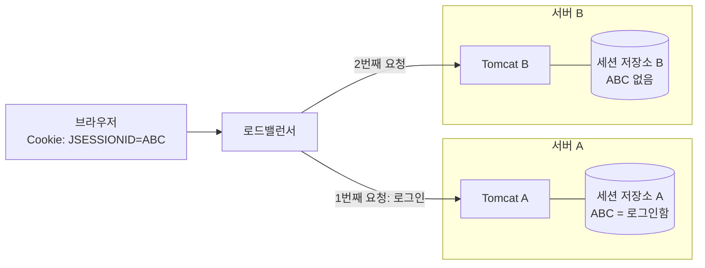
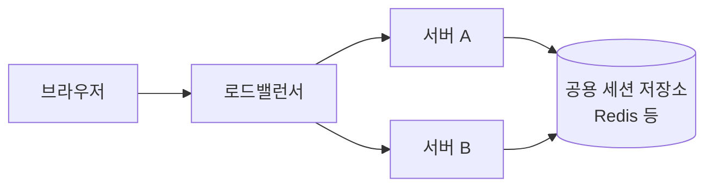
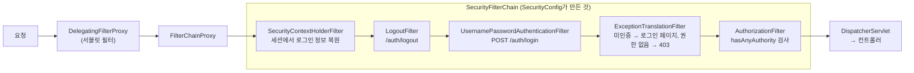
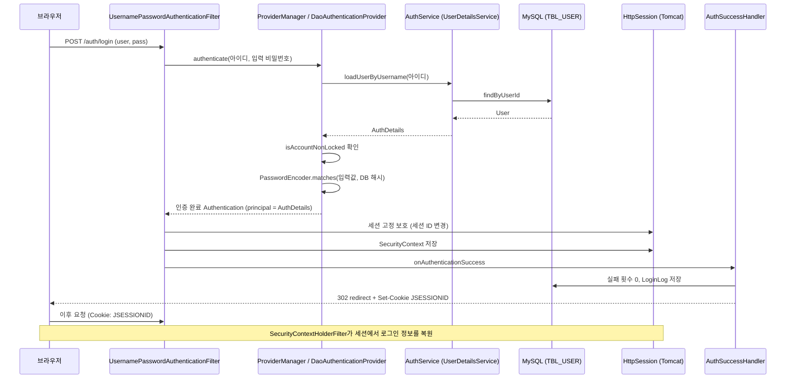
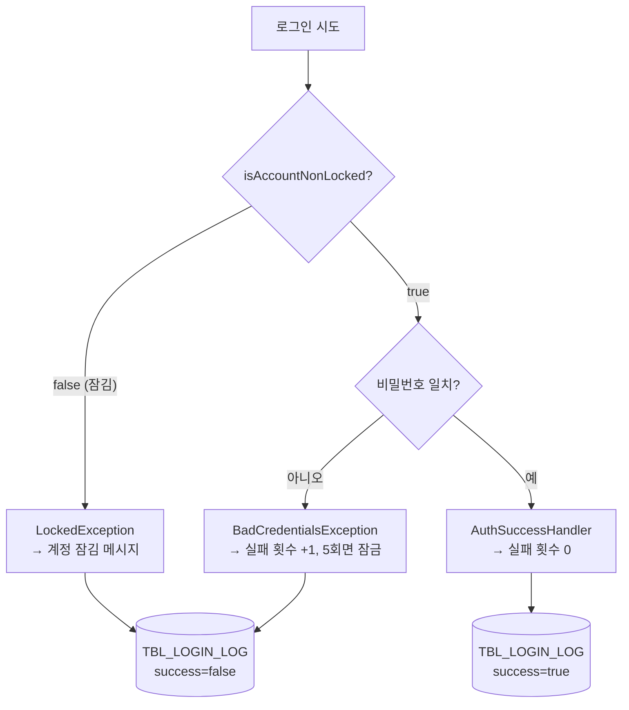

## 들어가며 (Situation)

서블릿 수업에서는 로그인 검사를 **직접** 만들었다. `LoginFilter`에서 세션을 꺼내 `loggedInUser`가 없으면 로그인 페이지로 보내는 코드였다. 11/06부터 Spring Security 수업이 시작됐고, 첫 주제는 **세션 방식 로그인**이다. 선생님은 Security를 두 갈래로 나눴다.

1. Session (이번에 할 일)
2. Token

이 글은 11/06 필기와 수업 프로젝트 `module01-security-session`을 정리한 것이다. 코드는 수업 코드를 인용했고 `// 수업 코드 (클래스명)` 주석을 달았다. 수업 코드가 아닌 것은 **"예시 코드"**라고 표시했다. 이 글을 쓰는 환경에서는 MySQL과 애플리케이션을 띄우지 못해 실행 결과는 적지 않았다.

| 항목 | 버전 (수업 `build.gradle` 기준) |
|---|---|
| Spring Boot | 3.5.13 → Spring Security 6.5 계열 |
| Java | 21 |
| 뷰 | Thymeleaf + `thymeleaf-extras-springsecurity6` |
| DB | MySQL, JPA (`ddl-auto: none`, 테이블은 SQL 스크립트로 생성) |

## 문제 상황 (Task)

필기를 다시 보니 정리되지 않은 부분이 많았다.

- 필기에 "쿠키는 브라우저(웹서버), 세션은 서버"라고 적었다. 쿠키는 웹서버에 있는 것인가?
- "front와 back이 분리되면 front는 서버에 들리기 전엔 모르기 때문에 토큰 방식"이라고 적었다. 무엇을 모른다는 것인지, 분리되면 세션을 못 쓰는 것인지 설명하지 못했다.
- "분산 서버 환경에서 Session 방식은 구멍이 발생한다"고 별표까지 쳤다. **왜** 구멍이 생기는지, 어떻게 메우는지는 적지 않았다.
- 서블릿 때는 로그인 처리 서블릿을 직접 만들었다. 이번 수업 코드에는 `POST /auth/login`을 처리하는 컨트롤러가 **없다.** 그럼 누가 아이디와 비밀번호를 확인하는가?
- "아이디는 무조건 unique 조건 걸어주기"라고 두 번이나 적었다. 수업 코드에는 실제로 걸려 있는가?

## 해결 과정 (Action)

### 1. 인증과 인가: "누구인가"와 "해도 되는가"

필기의 정의를 그대로 표로 옮기고, Spring Security에서 어느 부분이 맡는지 붙였다.

| 구분 | 인증 (Authentication) | 인가 (Authorization) |
|---|---|---|
| 필기 | 로그인. 우리 사이트에 들어와도 되는가, 있는 사람인가 | 특정 행동을 수행해도 되는가 |
| 질문 | 너 누구야? | 너 이거 해도 돼? |
| 수업 코드에서 | `formLogin` + `AuthService` + `PasswordEncoder` | `authorizeHttpRequests`의 `hasAnyAuthority` |
| 실패하면 | 로그인 페이지로 (HTTP 의미로는 401) | 403 Forbidden |

순서가 중요하다. **인가는 인증 다음**이다. 누구인지 모르는데 권한을 따질 수 없다. 서블릿 글에서 정리한 401과 403의 구분이 그대로 이어진다. 401은 "누군지 모른다", 403은 "누군지 아는데 허락하지 않는다"다.

### 2. 쿠키는 브라우저에, 세션은 서버에

필기의 "쿠키는 브라우저(웹서버)"는 고쳐야 한다. 쿠키는 **브라우저에 저장된다.** 서버(웹서버/WAS)는 응답 헤더 `Set-Cookie`로 쿠키를 **내려줄 뿐**이고, 브라우저가 이를 보관했다가 같은 사이트로 요청할 때마다 `Cookie` 헤더에 실어 보낸다([MDN - Using HTTP cookies](https://developer.mozilla.org/en-US/docs/Web/HTTP/Cookies)).

| 구분 | 쿠키 | 세션 |
|---|---|---|
| 저장 위치 | 브라우저 | 서버 메모리 (Tomcat 등) |
| 만드는 쪽 | 서버가 `Set-Cookie`로 내려줌 | 서버 |
| 서로의 관계 | 세션 ID(`JSESSIONID`)를 담는 그릇 | 쿠키로 받은 ID로 서버 저장소를 찾음 |

세션 방식 로그인도 결국 **쿠키 하나(`JSESSIONID`)에 기대는 구조**라는 점이 뒤에 나오는 "분산 서버"와 "토큰" 이야기의 출발점이다.

### 3. 세션 방식 vs 토큰 방식: "분리되면 토큰"이 아니라 트레이드오프

필기의 "front는 서버에 들리기 전엔 모르기 때문에 토큰 방식"을 다시 생각해 봤다. 내가 이해한 의도는 이렇다. SSR에서는 서버가 화면을 만들기 때문에 화면을 그릴 때 이미 세션을 보고 "로그인한 사용자"를 안다. CSR에서는 화면(React 등)이 브라우저에서 먼저 그려지고, 로그인 상태는 **API 서버에 요청을 보내 봐야** 알 수 있다.

하지만 그렇다고 프론트·백 분리 = 세션 불가는 아니다. 프론트가 분리되어 있어도 브라우저는 API 요청에 쿠키를 실어 보낼 수 있다. 다만 도메인이 다르면 CORS와 쿠키 설정(`credentials`, `SameSite` 등)을 맞춰야 하는 부담이 생긴다. 그래서 단정 대신 트레이드오프로 정리했다.

| 항목 | 세션 방식 | 토큰 방식 (예: JWT) |
|---|---|---|
| 로그인 정보 위치 | 서버 (세션 저장소) | 클라이언트가 가진 토큰 안 |
| 서버가 상태를 가지나 | 가짐 (stateful) | 서명 검증만 하면 됨 (stateless에 가까움) |
| 강제 로그아웃 | 서버에서 세션 삭제로 즉시 가능 | 만료 전 토큰 무효화가 어려움 (별도 장치 필요) |
| 서버 여러 대 | 세션 공유 문제 생김 (아래 4절) | 같은 키로 검증하면 어느 서버든 처리 가능 |
| 다른 도메인 프론트 / 모바일 앱 | 쿠키·CORS 설정이 필요, 앱은 쿠키 다루기가 번거로움 | `Authorization` 헤더로 보내면 되어 다루기 쉬움 |
| CSRF | 쿠키가 자동 전송되므로 방어 필요 | 헤더로 보내면 자동 전송되지 않아 위험이 줄어듦 |
| 어울리는 곳 (필기) | 회사 내부 시스템처럼 백엔드가 화면을 렌더링하는 SSR | 프론트와 백을 분리하는 대규모 서비스(CSR) |

정리하면 "분리되면 토큰을 **써야 한다**"가 아니라 "분리되면 도메인, CORS, 모바일, 수평 확장 같은 이유로 토큰이 **편한 경우가 많다**"가 정확하다. 토큰 방식은 다음 수업 주제라서 이번 글에서는 비교까지만 했다.

### 4. 분산 서버에서 세션은 왜 "구멍"이 나는가

별표 친 필기의 이유를 그림으로 그렸다. 세션은 **그 세션을 만든 서버의 메모리**에 있다. 사용자가 많아 서버를 여러 대 두고 로드밸런서가 요청을 나눠 주면, 다음 요청이 다른 서버로 갈 수 있다.



서버 A에서 로그인했는데 두 번째 요청이 서버 B로 가면, 서버 B의 세션 저장소에는 `ABC`가 없다. 사용자는 분명히 로그인했는데 **로그인 안 한 사람으로 취급**된다. 이것이 필기의 "구멍"이다. 해결책은 공식 문서에서 확인되는 범위로 정리했다.

| 방법 | 어떻게 | 확인한 문서 | 한계 |
|---|---|---|---|
| 스티키 세션 | 로드밸런서가 같은 사용자를 항상 같은 서버로 보냄 | Tomcat 클러스터 문서가 로드밸런서를 sticky session 모드로 두라고 안내 | 그 서버가 죽으면 세션도 사라짐 |
| 세션 클러스터링 (복제) | 서버끼리 세션을 복사해 나눠 가짐 | [Tomcat Clustering HOW-TO](https://tomcat.apache.org/tomcat-10.1-doc/cluster-howto.html) — `DeltaManager`는 모든 노드에 복제, 노드 4개 정도를 넘는 큰 클러스터에는 권장하지 않음. 큰 클러스터는 백업 노드 1곳에만 복제하는 `BackupManager` | 서버가 늘수록 복제 비용이 커짐 |
| 외부 세션 저장소 | 세션을 각 서버 메모리가 아니라 Redis, DB 같은 공용 저장소에 둠 | [Spring Session](https://docs.spring.io/spring-session/reference/index.html) — 컨테이너에 묶이지 않고 `HttpSession`을 교체해 클러스터 세션을 지원, Redis·관계형 DB 등에 저장 | 저장소 자체를 운영해야 함 |
| 토큰 방식 | 서버가 세션을 저장하지 않음 | 다음 수업 | 3절 표의 단점 |



### 5. 서블릿 LoginFilter와 Spring Security 필터 체인

서블릿 때 만든 `LoginFilter`는 "세션에 `loggedInUser`가 있나"만 봤다. 로그인 처리, 비밀번호 비교, 권한 구분, 로그아웃은 각각 서블릿을 따로 만들었다. Spring Security는 이 일들을 **여러 개의 필터로 나눠 미리 만들어 둔 것**이다.



[Spring Security 아키텍처 문서](https://docs.spring.io/spring-security/reference/6.5/servlet/architecture.html)에 따르면 Spring Security는 서블릿 필터 하나(`DelegatingFilterProxy`)로 들어와 `FilterChainProxy`가 `SecurityFilterChain`의 필터들을 차례로 실행한다. 위 그림은 이번 설정과 관련된 필터만 골라 그린 것이고, 실제로는 더 많다. [인가 문서](https://docs.spring.io/spring-security/reference/6.5/servlet/authorization/authorize-http-requests.html)는 `AuthorizationFilter`가 기본적으로 체인의 **마지막**이라고 설명한다. 그래서 인증 필터들이 먼저 "누구인지"를 정한 뒤 인가 필터가 "해도 되는지"를 본다. 1절의 "인가는 인증 다음"이 필터 순서로 구현되어 있다.

| 일 | 서블릿 때 (직접) | Spring Security |
|---|---|---|
| 로그인 여부 검사 | `LoginFilter`에서 `getSession(false)` 확인 | `SecurityContextHolderFilter`가 세션에서 복원, `AuthorizationFilter`가 검사 |
| 로그인 처리 | 로그인 서블릿에서 `setAttribute` | `UsernamePasswordAuthenticationFilter` (컨트롤러 없음) |
| 비밀번호 비교 | 직접 `equals` | `DaoAuthenticationProvider` + `PasswordEncoder.matches` |
| 권한 구분 | 없음 (로그인 여부만) | `hasAnyAuthority("ADMIN")` 등 |
| 로그아웃 | `session.invalidate()` 서블릿 | `logout()` 설정 한 줄 묶음 |
| 적용 경로 | `@WebFilter("/auth/*")` | `requestMatchers(...)` |

### 6. SecurityConfig: 보안 규칙을 한 곳에

수업 코드의 핵심은 `SecurityFilterChain` 빈 하나다. 부분별로 나눠 봤다.

#### 6.1 권한별 URL 설정

```java
// 수업 코드 (SecurityConfig)
http.authorizeHttpRequests(auth -> {
    auth.requestMatchers("/auth/login", "/user/signup", "/auth/fail", "/").permitAll(); // 누구나 접근 가능
    auth.requestMatchers("/admin/*").hasAnyAuthority("ADMIN");                         // ADMIN 만
    auth.requestMatchers("/user/*").hasAnyAuthority("USER", "ADMIN");                  // USER, ADMIN
    auth.anyRequest().authenticated();                                                 // 나머지는 로그인만 하면 가능
})
```

공식 문서는 `AuthorizationFilter`가 규칙을 **적힌 순서대로** 보고, **처음 맞는 규칙 하나만** 적용한다고 설명한다. 그래서 좁은 규칙을 위에, `anyRequest()`를 맨 아래에 둔다.

| 요청 | 비로그인 | USER | ADMIN |
|---|---|---|---|
| `/`, `/auth/login`, `/user/signup` | 가능 | 가능 | 가능 |
| `/user/page` | 로그인 페이지로 | 가능 | 가능 |
| `/admin/logs` | 로그인 페이지로 | 403 | 가능 |
| `/method/admin` (규칙 없음) | 로그인 페이지로 | 가능 (`anyRequest().authenticated()`) | 가능 |

`hasAnyAuthority`와 `hasRole`의 차이도 확인했다. 공식 문서에 따르면 `hasRole("ADMIN")`은 `hasAuthority("ROLE_ADMIN")`의 줄임말이다. 수업 DB에는 권한이 `ROLE_` 없이 `"ADMIN"`, `"USER"`로 저장되므로 `hasAnyAuthority`를 써야 맞다. `hasRole`로 바꾸면 접두어가 붙어 아무도 통과하지 못한다.

#### 6.2 formLogin: 로그인 컨트롤러가 없는 이유

```java
// 수업 코드 (SecurityConfig)
.formLogin(login -> {
    login.loginPage("/auth/login");           // 로그인 페이지 GET 요청 경로
    login.usernameParameter("user");          // input 의 name 과 일치
    login.passwordParameter("pass");          // input 의 name 과 일치
    login.successHandler(authSuccessHandler);
    login.failureHandler(authFailHandler);
})
```

```html
<!-- 수업 코드 (auth/login.html) -->
<form th:action="@{/auth/login}" method="post">
    <input type="text" id="user" name="user" placeholder="아이디 입력">
    <input type="password" id="pass" name="pass" placeholder="비밀번호 입력">
    <input type="checkbox" name="remember-me"> 이 컴퓨터에서 로그인 유지하기
</form>
```

`AuthController`에는 `GET /auth/login`(화면)만 있다. 폼이 `POST /auth/login`으로 오면 컨트롤러까지 가기 전에 `UsernamePasswordAuthenticationFilter`가 가로챈다. 기본 파라미터 이름은 `username`, `password`인데 수업 폼은 `user`, `pass`라서 `usernameParameter`, `passwordParameter`로 맞췄다. 이름이 어긋나면 아이디가 빈 값으로 넘어가 로그인이 계속 실패한다.

#### 6.3 logout과 세션 관리

```java
// 수업 코드 (SecurityConfig)
.logout(logout -> {
    logout.logoutUrl("/auth/logout");      // 로그아웃 처리 URL
    logout.deleteCookies("JSESSIONID");    // 세션 쿠키 삭제
    logout.deleteCookies("remember-me");   // Remember Me 쿠키 삭제
    logout.invalidateHttpSession(true);    // 세션 소멸
    logout.logoutSuccessUrl("/");          // 로그아웃 후 이동할 페이지
})
.sessionManagement(session -> {
    session.maximumSessions(1).sessionRegistry(sessionRegistry); // 한 계정 당 동시 접속 세션 1개로 제한
    session.invalidSessionUrl("/");                              // 세션 만료 시 이동할 페이지
})
```

서블릿 `ExpireServlet`에서 직접 하던 `session.invalidate()`가 `invalidateHttpSession(true)` 한 줄이 됐다. [세션 관리 문서](https://docs.spring.io/spring-security/reference/6.5/servlet/authentication/session-management.html)에서 두 가지를 확인했다.

- `maximumSessions(1)`의 기본 동작은 **두 번째 로그인이 첫 번째 세션을 무효화**하는 것이다. 두 번째 로그인을 막으려면 `maxSessionsPreventsLogin(true)`를 추가한다.
- `invalidSessionUrl`은 브라우저를 닫지 않고 로그아웃 후 다시 로그인할 때 만료 오류로 잘못 판단할 수 있다. 문서는 로그아웃 때 `JSESSIONID` 쿠키를 지우라고 권한다. 수업 코드가 `deleteCookies("JSESSIONID")`를 넣은 이유와 맞다.

#### 6.4 CSRF를 끄는 코드의 의미

```java
// 수업 코드 (SecurityConfig)
// 이번 수업에서는 학습 목적으로 비활성화한다. (프로덕션 환경에서는 반드시 활성화!)
.csrf(csrf -> csrf.disable());
```

CSRF는 사용자가 로그인한 상태에서 공격자 사이트가 숨은 폼으로 우리 서버에 요청을 보내게 만드는 공격이다. 세션 방식이 특히 위험한 이유는 브라우저가 **`JSESSIONID` 쿠키를 자동으로 붙여 보내기** 때문이다. [CSRF 문서](https://docs.spring.io/spring-security/reference/features/exploits/csrf.html)는 일반 사용자가 브라우저로 처리할 수 있는 요청에는 CSRF 보호를 쓰고, 브라우저가 아닌 클라이언트만 쓰는 서비스일 때 끄는 것을 고려하라고 권한다. 로그인·로그아웃 요청도 보호 대상이라고 설명한다.

수업 코드를 끈 상태로 두면 생기는 일을 표로 정리했다.

| 항목 | CSRF 켬 (기본) | CSRF 끔 (수업 코드) |
|---|---|---|
| 폼 전송 | 숨은 `_csrf` 토큰 필요 (Thymeleaf `th:action`이 자동 삽입) | 토큰 없이 통과 |
| 로그아웃 요청 | POST만 로그아웃 처리 | **어떤 HTTP 메서드든** 로그아웃 처리 |
| 공격 예 | 차단 | 다른 사이트의 ``만으로 강제 로그아웃 가능 |

로그아웃 행의 근거는 [LogoutConfigurer Javadoc](https://docs.spring.io/spring-security/reference/6.5/api/java/org/springframework/security/config/annotation/web/configurers/LogoutConfigurer.html)이다. "CSRF 보호가 켜져 있으면 요청이 POST여야 하고, 꺼져 있으면 어떤 HTTP 메서드든 허용된다"고 적혀 있다. 수업 코드 주석의 "JWT 토큰 기반 인증 시 → CSRF 보호 불필요"도 조건이 붙는다. 같은 문서는 상태가 없다고(stateless) 해서 안전한 것은 아니며, 토큰을 **쿠키**에 담아 자동 전송되면 여전히 CSRF에 취약하다고 설명한다. 정확하게는 "토큰을 헤더로 직접 보내는 경우" 불필요에 가깝다.

### 7. UserDetailsService와 UserDetails: Security에게 회원 정보 건네기

Security는 우리 DB 구조를 모른다. 그래서 두 개의 "통역" 인터페이스를 구현한다.

| 인터페이스 | 수업 구현체 | 하는 일 |
|---|---|---|
| `UserDetailsService` | `AuthService` | 아이디로 회원을 **조회만** 한다 |
| `UserDetails` | `AuthDetails` | 조회한 회원을 Security가 이해하는 모양으로 감싼다 |

```java
// 수업 코드 (AuthService)
@Override
public UserDetails loadUserByUsername(String username) throws UsernameNotFoundException {
    LoginUserDTO loginUser = memberService.findByUsername(username);

    if (Objects.isNull(loginUser)) {
        throw new UsernameNotFoundException("회원정보가 존재하지 않습니다!");
    }
    return new AuthDetails(loginUser);
}
```

처음엔 "여기서 비밀번호를 비교해야 하는데 왜 아이디만 받지?"라고 생각했다. [DaoAuthenticationProvider 문서](https://docs.spring.io/spring-security/reference/6.5/servlet/authentication/passwords/dao-authentication-provider.html)를 보고 풀렸다. 비교는 `DaoAuthenticationProvider`가 `UserDetails.getPassword()`로 꺼낸 DB 값과 입력값을 `PasswordEncoder`로 대조해서 한다. `AuthService`는 **조회만** 하면 된다.

```java
// 수업 코드 (AuthDetails)
@Override
public Collection<? extends GrantedAuthority> getAuthorities() {
    Collection<GrantedAuthority> authorities = new ArrayList<>();
    loginUserDTO.getRole().forEach(role -> authorities.add(() -> role));
    return authorities;
}

@Override
public boolean isAccountNonLocked() {
    return !loginUserDTO.isAccountLocked();
}
```

`getAuthorities()`가 `Collection`을 반환하는 이유는 한 사람이 여러 권한을 가질 수 있어서다. `LoginUserDTO.getRole()`이 `"USER,ADMIN"`을 쉼표로 잘라 목록으로 만든다. `GrantedAuthority`는 메서드가 하나뿐인 인터페이스라 `() -> role` 람다로 만들 수 있다.

| `UserDetails` 메서드 | 수업 코드 | 의미 |
|---|---|---|
| `getPassword()` | DB의 BCrypt 해시 | 입력 비밀번호와 비교할 값 |
| `getUsername()` | `userId` | 로그인 아이디 |
| `isAccountNonLocked()` | `!isAccountLocked` | 5회 실패 시 `false` → `LockedException` |
| `isAccountNonExpired()`, `isCredentialsNonExpired()`, `isEnabled()` | 항상 `true` | 이번 수업에서는 사용 안 함 |

### 8. 로그인 요청부터 세션 저장까지

여기까지를 한 줄로 이으면 이렇다. Javadoc과 문서로 확인한 순서다.



서블릿 때는 `session.setAttribute("loggedInUser", userId)`를 직접 썼다. Spring Security는 인증 결과(`Authentication`, 그 안의 principal이 `AuthDetails`)를 담은 `SecurityContext`를 `HttpSessionSecurityContextRepository`로 세션에 저장한다. 수업 코드 주석의 "return 되는 객체가 곧 Session 에 저장되는 객체"를 정확히 말하면 **`AuthDetails`를 품은 `SecurityContext`가 저장된다.** 화면에서 `sec:authentication="name"`이나 `${#authentication.principal.loginUserDTO.userId}`로 꺼내 쓸 수 있는 이유다.

로그인 성공 시 세션 ID를 바꾸는 단계도 문서에서 새로 알았다. 세션 관리 문서에 따르면 Servlet 3.1 이상 컨테이너에서는 `changeSessionId`가 기본이다. 로그인 전 세션 ID를 공격자가 미리 심어 두는 **세션 고정 공격**을 막는다. 서블릿 때 직접 만든 로그인에는 이 처리가 없었다.

### 9. 성공·실패 핸들러와 로그인 로그

```java
// 수업 코드 (AuthSuccessHandler)
public void onAuthenticationSuccess(HttpServletRequest request, HttpServletResponse response,
                                    Authentication authentication) throws IOException, ServletException {
    String username = authentication.getName();
    memberService.resetLoginFailCount(username);                                  // 실패 횟수 초기화
    loginLogRepository.save(LoginLog.create(username, true, request.getRemoteAddr())); // 성공 로그
    super.onAuthenticationSuccess(request, response, authentication);             // 원래 가려던 페이지 또는 "/"
}
```

```java
// 수업 코드 (AuthFailHandler)
String username = request.getParameter("user"); // 인증 객체가 없으므로 요청에서 꺼낸다

if (exception instanceof BadCredentialsException) {
    errorMessage = "아이디가 존재하지 않거나 비밀번호가 일치하지 않습니다.";
    if (username != null && !username.isEmpty()) {
        memberService.incrementLoginFailCount(username);
    }
} else if (exception instanceof LockedException) {
    errorMessage = "계정이 잠겨있습니다. 관리자에게 문의하세요.";
} else if (exception instanceof UsernameNotFoundException) {
    errorMessage = "존재하지 않는 아이디입니다.";
} // ...
loginLogRepository.save(LoginLog.create(username, false, request.getRemoteAddr()));
setDefaultFailureUrl("/auth/fail?message=" + URLEncoder.encode(errorMessage, "UTF-8"));
super.onAuthenticationFailure(request, response, exception);
```

두 핸들러 모두 인터페이스를 직접 구현하지 않고 `SimpleUrl...Handler`를 상속해 **"페이지 이동"은 부모에게 맡기고** 로그만 추가한다. 성공 시에는 `authentication.getName()`으로 아이디를 얻지만, 실패 시에는 인증 객체가 없으니 `request.getParameter("user")`로 꺼낸다는 차이가 있다.

실패 분기에서 의문이 생겼다. `AuthService`가 `UsernameNotFoundException`을 던지는데, 실패 핸들러의 `UsernameNotFoundException` 분기는 실행될까? [AbstractUserDetailsAuthenticationProvider Javadoc](https://docs.spring.io/spring-security/reference/api/java/org/springframework/security/authentication/dao/AbstractUserDetailsAuthenticationProvider.html)의 `setHideUserNotFoundExceptions` 설명을 보면 기본값이 `true`다. **아이디가 없어도 비밀번호가 틀려도 똑같이 `BadCredentialsException`을 던진다.** 둘을 구분하면 "이 아이디는 가입되어 있다"는 정보가 새기 때문이다. 그래서 기본 설정에서는 `UsernameNotFoundException` 분기에 들어가지 않고, 메시지도 "아이디가 존재하지 않거나 비밀번호가 일치하지 않습니다"로 뭉뚱그려진다. 수업 코드의 이 메시지가 의도된 보안 설계였다.

계정 잠금은 `User` 엔티티의 도메인 메서드와 JPA 변경 감지로 처리한다.

```java
// 수업 코드 (User)
public void increaseLoginFailCount() {
    this.loginFailCount++;
    if (this.loginFailCount >= 5) {
        this.isAccountLocked = true;
    }
}
```



잠금 확인이 비밀번호 비교보다 먼저인 근거는 Javadoc의 "pre-authentication checks는 자격 증명 검증 **전에** `UserDetails` 상태를 확인한다"는 설명이다. 관리자 페이지(`AdminController`)는 이 로그를 최신순(`findAllByOrderByLoginTimeDesc`)으로 보여 주고, `SessionRegistry`로 활성 사용자 수를 센다.

### 10. 회원가입과 BCrypt

```java
// 수업 코드 (MemberService)
@Transactional
public Integer regist(SignupDTO signupDTO) {
    if (userRepository.existsByUserId(signupDTO.getUserId())) {
        return null; // 중복 아이디
    }
    try {
        User user = User.create(
                signupDTO.getUserId(),
                signupDTO.getUserName(),
                encoder.encode(signupDTO.getUserPass()), // 평문 저장 금지
                signupDTO.getRole()
        );
        return userRepository.save(user).getUserCode();
    } catch (Exception e) {
        e.printStackTrace();
        return 0;
    }
}
```

`PasswordEncoder`는 `SecurityConfig`에서 `BCryptPasswordEncoder` 빈으로 등록했다. 수업 주석의 BCrypt 사용 이유를 [OWASP Password Storage Cheat Sheet](https://cheatsheetseries.owasp.org/cheatsheets/Password_Storage_Cheat_Sheet.html)와 [BCryptPasswordEncoder Javadoc](https://docs.spring.io/spring-security/reference/api/java/org/springframework/security/crypto/bcrypt/BCryptPasswordEncoder.html)으로 확인했다.

| 수업 주석 | 확인한 내용 |
|---|---|
| 무작위 솔트 적용 | 같은 비밀번호도 `encode()`할 때마다 다른 해시가 나온다. 그래서 `encode` 결과끼리 `equals`로 비교하면 안 되고 `matches()`를 써야 한다 |
| 비용(강도) 조절 | 생성자에 strength(log rounds)를 줄 수 있다. 일부러 느리게 만들어 무차별 대입을 어렵게 한다 |
| 검증된 알고리즘 | OWASP는 Argon2id를 우선 권장하고, bcrypt는 레거시 시스템 등에서 쓸 수 있는 선택지로 둔다 |

DB의 `PASSWORD` 컬럼이 `VARCHAR(100)`인 것도 이유가 있다. BCrypt 해시는 60자 정도라 평문 비밀번호 길이가 아니라 **해시 길이**에 맞춰 잡아야 한다.

#### "아이디는 무조건 unique" — 실제로 걸려 있는가

필기에 두 번 적은 규칙을 수업 코드에서 확인했다. **두 곳 모두 걸려 있다.**

```java
// 수업 코드 (User)
@Table(
    name = "TBL_USER",
    uniqueConstraints = {
        @UniqueConstraint(name = "uk_user_id", columnNames = "USER_ID")
    }
)
```

```sql
-- 수업 코드 (sql/create_tables.sql)
CONSTRAINT uk_user_id UNIQUE (USER_ID)
```

여기서 놓칠 뻔한 점이 있다. `application.yaml`이 `ddl-auto: none`이라 JPA는 테이블을 만들지 않는다. 따라서 엔티티의 `@UniqueConstraint`는 **DB에 제약을 만들어 주지 않는다.** 실제로 중복을 막는 것은 SQL 스크립트의 `CONSTRAINT uk_user_id UNIQUE`다. 엔티티의 설정은 문서 역할에 가깝다.

그럼 `existsByUserId`로 미리 확인하는데 DB 제약이 왜 또 필요할까? 두 사람이 **동시에** 같은 아이디로 가입하면 둘 다 `exists`에서 `false`를 받고 둘 다 `save`로 갈 수 있다. 애플리케이션 검사는 친절한 메시지용이고, 마지막 방어선은 DB의 unique 제약이다. 필기의 "무조건"이 맞는 이유다.

| 계층 | 수업 코드 | 역할 |
|---|---|---|
| 애플리케이션 | `existsByUserId` → `null` 반환 → "중복회원이 존재합니다." | 사용자에게 알려 주기 |
| DB | `UNIQUE (USER_ID)` | 동시 요청에서도 중복 저장 차단 |

아이디가 unique여야 하는 이유가 하나 더 있다. `loadUserByUsername(username)`은 아이디로 **한 명**을 찾는다. 같은 아이디가 둘이면 Security가 누구의 비밀번호와 비교해야 하는지 정할 수 없다.

### 11. 권한별 페이지: 서버 규칙과 화면 표시

화면에서는 `thymeleaf-extras-springsecurity6`의 `sec:` 속성으로 권한별로 보여 줄 것을 나눈다.

```html
<!-- 수업 코드 (index.html) -->
<a th:href="@{/admin/logs}" sec:authorize="hasAnyAuthority('ADMIN')">...</a>
<a th:href="@{/user/page}" sec:authorize="hasAnyAuthority('USER', 'ADMIN')">...</a>
<div sec:authorize="isAnonymous()">...</div>
```

처음엔 화면에서 버튼을 숨기면 되니 `SecurityConfig` 규칙은 중복이라고 생각했다. 그렇지 않다. `sec:authorize`는 **링크를 안 보여 줄 뿐**이고, 주소창에 `/admin/logs`를 직접 치는 것은 막지 못한다. 실제 차단은 서버의 `authorizeHttpRequests`가 한다. 화면 표시는 UX, 서버 규칙은 보안이다.

| 위치 | 수업 코드 | 막는 것 |
|---|---|---|
| URL 규칙 | `requestMatchers("/admin/*").hasAnyAuthority("ADMIN")` | 요청 자체 (403) |
| 메서드 규칙 | `@PreAuthorize` (수업 코드에서는 TODO 상태) | 컨트롤러 메서드 실행 |
| 화면 | `sec:authorize` | 메뉴 노출만 |

### 시행착오와 확인하지 못한 점

수업 코드를 읽으며 발견한 주의점이다. 특히 보안 관련 항목이 많았다.

- **회원가입에서 권한을 사용자가 고른다.** `signup.html`에 `<option value="ADMIN">관리자</option>`이 있고, `MemberService`가 `signupDTO.getRole()`을 그대로 저장한다. 실습 편의 기능이지만, 실제 서비스라면 누구나 ADMIN으로 가입할 수 있다. 권한은 서버에서 `USER`로 고정하고 ADMIN 부여는 관리자 기능으로 분리해야 한다.
- **가입 시 평문 비밀번호가 콘솔에 찍힌다.** `UserController`가 `System.out.println("... = " + signupDTO)`를 하는데, `SignupDTO`에 Lombok `@ToString`이 있어 `userPass`가 평문으로 출력된다. 암호화 전 값이다. `LoginUserDTO`의 `@ToString`도 BCrypt 해시를 포함한다. `@ToString.Exclude`로 빼는 것이 안전하다.
- **실패 핸들러가 싱글톤 필드를 요청마다 바꾼다.** `AuthFailHandler`는 `@Component` 빈 하나를 모든 요청이 나눠 쓰는데, 요청마다 `setDefaultFailureUrl(...)`로 **인스턴스 필드**를 바꾼다. 서블릿 글에서 정리한 "인스턴스 필드는 모든 요청이 공유한다"와 같은 문제다. 동시에 두 사람이 다른 이유로 실패하면 다른 사람의 메시지로 이동할 가능성이 있다. 실행으로 재현하지는 못했다. 필드를 바꾸지 않고 `getRedirectStrategy().sendRedirect(request, response, url)`로 직접 이동하는 방식이 더 안전해 보인다.
- **CSRF 비활성화.** 6.4절 정리대로 수업용이다. 켜면 Thymeleaf `th:action` 폼에는 토큰이 자동으로 들어가지만, 로그아웃 폼이 POST인지(수업 `index.html`은 `th:method="post"`로 되어 있음) 함께 확인해야 한다.
- **`maximumSessions(1)`이 의도대로 동작하지 않을 수 있다.** 세션 관리 문서는 직접 만든 `UserDetails`라면 `equals()`와 `hashCode()`를 반드시 오버라이딩하라고 한다. 기본 `SessionRegistry`가 이 메서드로 사용자를 구분하는 Map을 쓰기 때문이다. 수업 `AuthDetails`는 이 부분이 **TODO로 비어 있다.** 로그인할 때마다 새 `AuthDetails` 객체가 생기니, 같은 사람이 다른 사람으로 취급되어 동시 접속 제한과 관리자 페이지의 활성 사용자 수가 틀어질 수 있다.
- **`@EnableMethodSecurity`와 `@PreAuthorize`도 TODO 상태다.** 지금 상태에서는 `/method/admin`에 USER도 접근된다(`anyRequest().authenticated()`만 적용).
- **잠금 해제 기능이 없다.** 5회 실패하면 잠기지만 푸는 코드가 없어 DB를 직접 고쳐야 한다. 또 아이디만 알면 남의 계정에 일부러 5번 틀려 잠가 버릴 수 있다. [OWASP Authentication Cheat Sheet](https://cheatsheetseries.owasp.org/cheatsheets/Authentication_Cheat_Sheet.html)도 계정 잠금이 이런 서비스 거부에 악용될 수 있다고 경고한다.
- **잠금 메시지가 계정 존재를 알려 준다.** 없는 아이디와 틀린 비밀번호는 같은 메시지로 숨겼지만, 잠긴 계정은 "계정이 잠겨있습니다"가 나와 그 아이디가 존재한다는 것을 드러낸다.
- **`/admin/*`는 한 단계 경로만 맞는다.** `/admin/logs`는 맞지만 `/admin/logs/2025` 같은 경로는 맞지 않아 `anyRequest().authenticated()`로 떨어진다. 하위 경로까지 막으려면 `/admin/**`가 안전하다. 지금 수업 코드에는 두 단계 경로가 없어 문제가 드러나지 않는다.
- **Remember-Me 키가 코드에 하드코딩되어 있다.** `rememberMe.key("remember-me-secret-key")`는 설정 파일이나 환경 변수로 빼야 한다. DB 비밀번호도 `application.yaml`에 그대로 있다(`password: ****`로 가림).
- **세션에 비밀번호 해시가 남는지.** 인증 후 Security가 자격 증명을 지우는 기능이 있지만, `AuthDetails`가 `CredentialsContainer`를 구현하지 않아 `LoginUserDTO.password`(해시)는 세션 안의 principal에 남는 것으로 이해했다. 소스를 따라가 본 추론이고 실행으로 확인하지는 못했다.
- **동시 가입 시 결과 화면.** 두 요청이 동시에 `exists`를 통과하면 DB 제약 위반 예외가 난다. `regist`는 예외를 잡아 `0`(서버 오류)을 반환하지만, 같은 트랜잭션이 롤백 전용으로 표시되어 커밋 시점에 다른 예외가 날 수도 있다. 실행해 보지 못했다.
- **필기의 "회사 내부는 SSR, 대규모 서비스는 CSR"** 은 수업에서 들은 경향이다. 공식 문서로 뒷받침할 수 있는 내용이 아니어서 3절 표에는 "필기"라고 표시만 했다.

## 결과 (Result)

애플리케이션을 실행하지 못해 응답 시간 같은 수치는 없다. 대신 필기의 이해가 이렇게 바뀌었다.

| 필기의 이해 | 정리 후 |
|---|---|
| 쿠키는 브라우저(웹서버) | 쿠키는 **브라우저**에 저장된다. 서버는 `Set-Cookie`로 내려줄 뿐이다 |
| front가 분리되면 서버에 들르기 전엔 모르니까 토큰 | 분리돼도 쿠키+세션은 쓸 수 있다. 도메인·CORS·모바일·수평 확장 부담 때문에 토큰을 많이 고르는 트레이드오프다 |
| 분산 서버에서 세션은 구멍 | 세션이 서버마다 따로 있어 다른 서버로 가면 로그인 정보가 없다. 스티키 세션, 세션 클러스터링, 외부 세션 저장소(Spring Session + Redis 등), 토큰으로 해결 |
| 인증: 있는 사람인가 / 인가: 해도 되는가 | 그대로 맞다. Security에서는 인증 필터들 → 마지막 `AuthorizationFilter` 순서로 구현된다 |
| (의문) 로그인 컨트롤러가 없는데 누가 확인하나 | `UsernamePasswordAuthenticationFilter`가 가로채고 `DaoAuthenticationProvider`가 `AuthService`로 조회, `PasswordEncoder`로 비교 |
| 아이디는 무조건 unique | 엔티티와 SQL 모두 걸려 있다. `ddl-auto: none`이라 실제로 막는 것은 SQL 스크립트의 제약이고, `exists` 검사만으로는 동시 가입을 못 막는다 |
| (수업 코드) CSRF 끔 | 학습용. 끄면 세션 쿠키 자동 전송을 악용한 요청과, 어떤 메서드로든 가능한 로그아웃이 열린다 |

배운 점은 **"직접 만들던 것이 어디로 갔는지 찾으면 프레임워크가 읽힌다"**는 것이다. 서블릿 `LoginFilter`의 `getSession(false)` 검사, 로그인 서블릿의 `setAttribute`, `ExpireServlet`의 `invalidate()`가 모두 Security의 필터와 설정 한 줄로 옮겨 가 있었다. 동시에 직접 만들 때 없던 것(세션 고정 보호, 아이디 존재 여부 숨기기)이 기본으로 들어 있다는 것도 알게 됐다. 반대로 실패 핸들러의 싱글톤 필드 문제처럼, 서블릿에서 배운 기본기가 Spring 코드의 버그를 찾는 데 그대로 쓰였다.

## 더 학습하면 좋은 개념

- **JWT와 토큰 기반 인증** — 다음 수업 주제다. 이번 글 3절의 표를 실제 구현으로 확인할 수 있고, 액세스·리프레시 토큰으로 "강제 로그아웃이 어렵다"는 단점을 어떻게 보완하는지 이어서 볼 수 있다.
- **Spring Session (Redis)** — 분산 서버에서 세션 방식을 유지하는 대표적인 방법이다. `HttpSession`을 교체하는 필터 구조를 보면 이번에 본 필터 체인 개념과 연결된다.
- **CORS와 쿠키 속성 (SameSite, Secure, HttpOnly)** — "프론트가 분리되면 세션이 어렵다"의 실제 원인이다. CSRF 방어와도 이어진다.
- **메서드 보안 (`@EnableMethodSecurity`, `@PreAuthorize`)** — 수업 코드에 TODO로 남은 부분이다. URL 규칙과 메서드 규칙을 언제 나눠 쓰는지 판단하는 기준이 된다.
- **비밀번호 해시 알고리즘 비교 (bcrypt, Argon2id, `DelegatingPasswordEncoder`)** — OWASP가 Argon2id를 우선 권장하는 이유와, 알고리즘을 바꿔도 기존 해시를 계속 검증하는 방법을 알 수 있다.

## 참고 자료

- [Spring Security - Architecture](https://docs.spring.io/spring-security/reference/6.5/servlet/architecture.html)
- [Spring Security - Authorize HttpServletRequests](https://docs.spring.io/spring-security/reference/6.5/servlet/authorization/authorize-http-requests.html)
- [Spring Security - DaoAuthenticationProvider](https://docs.spring.io/spring-security/reference/6.5/servlet/authentication/passwords/dao-authentication-provider.html)
- [Spring Security - Authentication Persistence and Session Management](https://docs.spring.io/spring-security/reference/6.5/servlet/authentication/session-management.html)
- [Spring Security - Handling Logouts](https://docs.spring.io/spring-security/reference/6.5/servlet/authentication/logout.html)
- [Spring Security - Cross Site Request Forgery (CSRF)](https://docs.spring.io/spring-security/reference/features/exploits/csrf.html)
- [Spring Security API - LogoutConfigurer](https://docs.spring.io/spring-security/reference/6.5/api/java/org/springframework/security/config/annotation/web/configurers/LogoutConfigurer.html)
- [Spring Security API - AbstractUserDetailsAuthenticationProvider](https://docs.spring.io/spring-security/reference/api/java/org/springframework/security/authentication/dao/AbstractUserDetailsAuthenticationProvider.html)
- [Spring Security API - HttpSessionSecurityContextRepository](https://docs.spring.io/spring-security/reference/api/java/org/springframework/security/web/context/HttpSessionSecurityContextRepository.html)
- [Spring Security API - BCryptPasswordEncoder](https://docs.spring.io/spring-security/reference/api/java/org/springframework/security/crypto/bcrypt/BCryptPasswordEncoder.html)
- [Spring Session Reference](https://docs.spring.io/spring-session/reference/index.html)
- [Apache Tomcat 10.1 - Clustering/Session Replication HOW-TO](https://tomcat.apache.org/tomcat-10.1-doc/cluster-howto.html)
- [MDN - Using HTTP cookies](https://developer.mozilla.org/en-US/docs/Web/HTTP/Cookies)
- [OWASP - Password Storage Cheat Sheet](https://cheatsheetseries.owasp.org/cheatsheets/Password_Storage_Cheat_Sheet.html)
- [OWASP - Authentication Cheat Sheet](https://cheatsheetseries.owasp.org/cheatsheets/Authentication_Cheat_Sheet.html)
