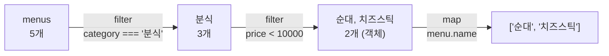

## 들어가며 (Situation)

11/17 자바스크립트 수업 후반부에는 `05_array.js`와 `06_higher-order-method.js`를 작성했다. 필기에는 두 줄만 남았다.

- "자바에서 배열의 특징 — 같은 자료형 리터럴만 들어갈 수 있다."
- "higher-order-method : 고차함수"

코드는 수업 코드(`C:\Lecture\11_JavaScript\01_Core`)이고, 출력은 Node.js v24로 직접 실행한 결과다. 앞 내용은 [변수·객체·함수·호이스팅 글]({{ site.baseurl }})에 있다.

## 문제 상황 (Task)

- Java 배열과 JS 배열은 무엇이 다른가?
- 고차함수(higher-order function)란 무엇이고, `for`문으로도 되는 걸 왜 `forEach`, `map`, `filter`로 쓰는가?
- 수업 중간에 나온 `==`와 `===`는 어떻게 다른가?

## 해결 과정 (Action)

### 1. JS 배열에는 무엇이든 들어간다

```js
// 수업 코드 (05_array.js)
const menus = ['제육', '떡볶이', '순대', 1, {name : 'hi'} , function() {}];

for(let i = 0; i < menus.length; i++) {
    console.log(menus[i]);
}
```

```text
제육
떡볶이
순대
1
{ name: 'hi' }
[Function (anonymous)]
```

문자열, 숫자, 객체, 함수가 한 배열에 들어갔다.

| | Java 배열 | JavaScript 배열 |
|--|----------|----------------|
| 자료형 | 선언 시 고정 (`String[]`) | 명시하지 않음, 섞어서 저장 가능 |
| 길이 | 생성 시 고정 | 늘었다 줄었다 함 (`push`, `pop`) |
| `typeof` | - | `"object"` (배열 확인은 `Array.isArray`) |

섞을 수 있다고 섞어 쓰는 건 아니다. 실습 데이터(아래 `menus`)도 모두 같은 모양의 객체로 채웠다. 같은 모양이어야 고차함수에서 `menu.price`처럼 꺼내 쓸 수 있다.

### 2. 고차함수란

수업 주석의 정의:

> 함수를 인자로 전달 받거나, 함수를 반환하는 함수. 배열의 고차 함수는 콜백 함수를 인자로 받아 배열의 요소를 순회하며 처리하게 된다.

앞 글에서 "함수가 값처럼 다뤄진다"고 정리했다. 그래서 함수를 다른 함수의 **인자**로 넘길 수 있고, 이렇게 넘겨진 함수를 **콜백 함수**라고 부른다.

실습 데이터:

```js
// 수업 코드 (06_higher-order-method.js)
const menus = [
    {name : '치즈 떡볶이' , category : '분식', price : 14000 },
    {name : '엽기 닭도리탕' , category : '한식', price : 24000 },
    {name : '순대' , category : '분식', price : 4000 },
    {name : '마카롱' , category : '디저트', price : 5000 },
    {name : '치즈스틱' , category : '분식', price : 6000 },
];
```

### 3. forEach / map / filter

```js
// 수업 코드 (06_higher-order-method.js)
// forEach : 각 요소마다 콜백 실행 (반환값 없음)
menus.forEach( menu => console.log(menu) );

// map : 콜백의 반환값으로 새로운 배열 return
const names = menus.map( menu => menu.name );
// [ '치즈 떡볶이', '엽기 닭도리탕', '순대', '마카롱', '치즈스틱' ]

// filter : 콜백의 반환값이 true인 요소만 모아 새로운 배열 return
const snacks = menus.filter( menu => menu.category === '분식' );
// 치즈 떡볶이, 순대, 치즈스틱 (3개)
const menu = menus.filter( menu => menu.price < 10000 );
// 순대, 마카롱, 치즈스틱 (3개)
```

| 메서드 | 콜백이 돌려줘야 하는 것 | 결과 | 결과 길이 |
|-------|----------------------|------|----------|
| `forEach` | 없음 | `undefined` | - |
| `map` | 바꾼 값 | 새 배열 | 원본과 같음 (5 → 5) |
| `filter` | `true` / `false` | 새 배열 | 원본 이하 (5 → 3) |

`map`과 `filter`는 **원본 `menus`를 바꾸지 않고** 새 배열을 돌려준다. ([MDN - Array.prototype.map](https://developer.mozilla.org/en-US/docs/Web/JavaScript/Reference/Global_Objects/Array/map), [MDN - Array.prototype.filter](https://developer.mozilla.org/en-US/docs/Web/JavaScript/Reference/Global_Objects/Array/filter))

### 4. 체이닝: 분식 중 1만 원 미만인 메뉴 이름

새 배열을 돌려주기 때문에 이어 붙일 수 있다.

```js
// 수업 코드 (06_higher-order-method.js)
const result = menus
                    .filter(menu => menu.category === '분식')  // 분식만
                    .filter(menu => menu.price < 10000)        // 10000원 미만
                    .map(menu => menu.name)                    // 이름만
console.log(result); // [ '순대', '치즈스틱' ]
```



같은 일을 `for`문으로 쓰면 이렇다. (예시 코드, 비교용으로 직접 작성)

```js
// 예시 코드
const result = [];
for (let i = 0; i < menus.length; i++) {
    if (menus[i].category === '분식' && menus[i].price < 10000) {
        result.push(menus[i].name);
    }
}
```

| | for문 | 고차함수 체이닝 |
|--|------|---------------|
| 쓰는 것 | 어떻게 돌지 (인덱스, push) | 무엇을 할지 (거르고, 바꾸고) |
| 결과 배열 | 직접 만들고 채움 | 메서드가 새로 만들어 줌 |
| 단계 추가 | `if` 조건이 길어짐 | `.filter()` 한 줄 추가 |

Java의 Stream API(`stream().filter().map()`)와 같은 흐름이라 익숙했다.

### 5. `==` 와 `===`

`filter` 조건을 쓰다가 비교 연산자 이야기가 나왔다.

```js
// 수업 코드 (06_higher-order-method.js)
console.log(`1 == 1 : ${1 == '1'}`);   // true
console.log(`1 === 1 : ${1 === '1'}`); // false
```

| 연산자 | 이름 | 동작 |
|-------|------|------|
| `==` | 동등 비교 | 타입을 암묵적으로 변환한 뒤 값 비교 → `1 == '1'`은 `true` |
| `===` | 일치 비교 | 타입과 값이 모두 같아야 함 → `1 === '1'`은 `false` |

앞 글에서 정리한 동적 타입 때문에, 값의 타입을 확신할 수 없는 JS에서는 `===`를 기본으로 쓰는 게 안전하다. 수업 코드의 `filter` 조건도 모두 `===`다. ([MDN - Equality comparisons](https://developer.mozilla.org/en-US/docs/Web/JavaScript/Guide/Equality_comparisons_and_sameness))

## 결과 (Result)

| 질문 | 정리 |
|------|------|
| Java 배열 vs JS 배열 | Java는 한 자료형·고정 길이, JS는 자료형 섞기 가능·가변 길이 |
| 고차함수 | 함수를 인자로 받거나 반환하는 함수. 배열 메서드는 콜백을 받아 순회 |
| `forEach` / `map` / `filter` | 반환 없음 / 같은 길이 새 배열 / 조건 맞는 것만 새 배열 |
| 체이닝 결과 | 5개 메뉴 → 분식 3개 → 1만 원 미만 2개 → `['순대', '치즈스틱']` |
| `==` vs `===` | `===`는 타입까지 비교, 기본으로 사용 |

배운 점: 고차함수는 앞 글의 "함수가 값이다"가 있어야 성립한다. 화살표 함수가 짧은 콜백을 위해 존재한다는 것도 여기서 이해됐다. 이 패턴은 React에서 `menus.map(menu => <li>...</li>)` 형태로 화면을 그릴 때 그대로 쓰일 예정이다.

## 더 학습하면 좋은 개념

- **`reduce`** — 배열을 하나의 값(합계, 객체)으로 접는 고차함수. 장바구니 총액 같은 계산에 쓴다.
- **`find` / `some` / `every`** — 조건에 맞는 요소 하나 찾기, 존재 여부 확인. `filter`보다 의도가 분명할 때가 많다.
- **불변성(Immutability)** — `map`/`filter`가 원본을 바꾸지 않는 이유. React의 상태 업데이트 규칙과 직결된다.
- **전개 구문과 구조 분해 할당** — 다음 수업(`07_spread-syntax.js`, `08_destructuring.js`) 주제. 객체·배열을 복사하고 꺼내는 문법.
- **Java Stream API** — 같은 사고방식을 Java에서 비교해 보면 두 언어가 함께 정리된다.

## 참고 자료

- [MDN - Array](https://developer.mozilla.org/en-US/docs/Web/JavaScript/Reference/Global_Objects/Array)
- [MDN - Array.prototype.forEach](https://developer.mozilla.org/en-US/docs/Web/JavaScript/Reference/Global_Objects/Array/forEach)
- [MDN - Array.prototype.map](https://developer.mozilla.org/en-US/docs/Web/JavaScript/Reference/Global_Objects/Array/map)
- [MDN - Array.prototype.filter](https://developer.mozilla.org/en-US/docs/Web/JavaScript/Reference/Global_Objects/Array/filter)
- [MDN - Callback function](https://developer.mozilla.org/en-US/docs/Glossary/Callback_function)
- [MDN - Equality comparisons and sameness](https://developer.mozilla.org/en-US/docs/Web/JavaScript/Guide/Equality_comparisons_and_sameness)
