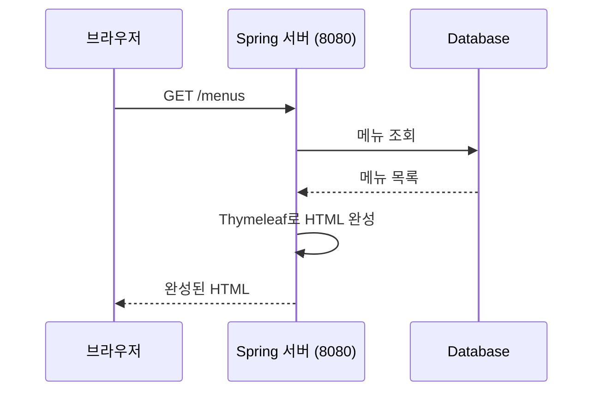
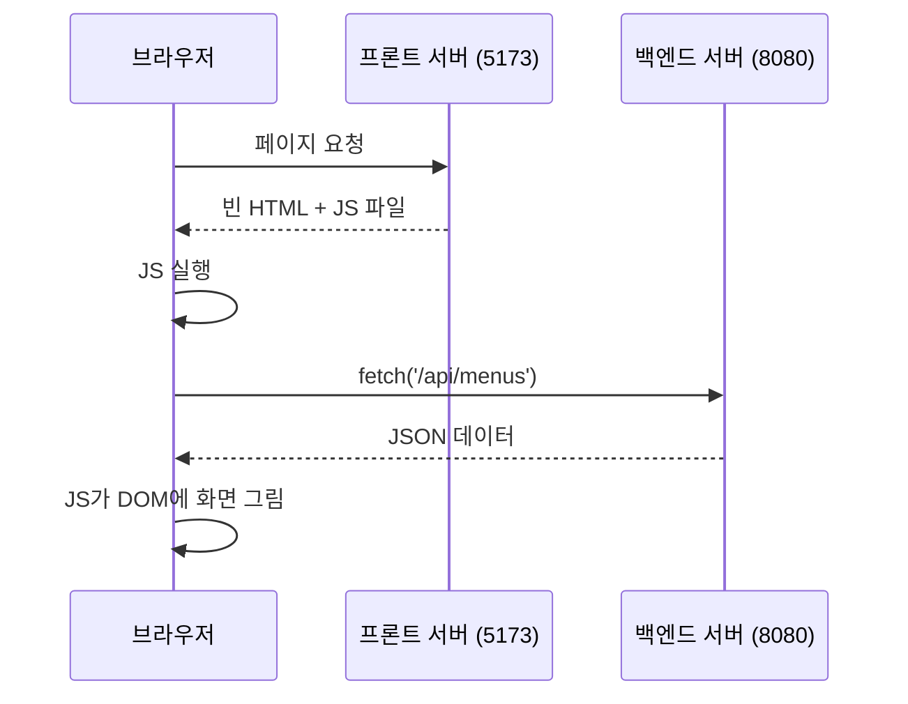
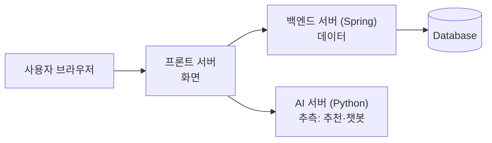
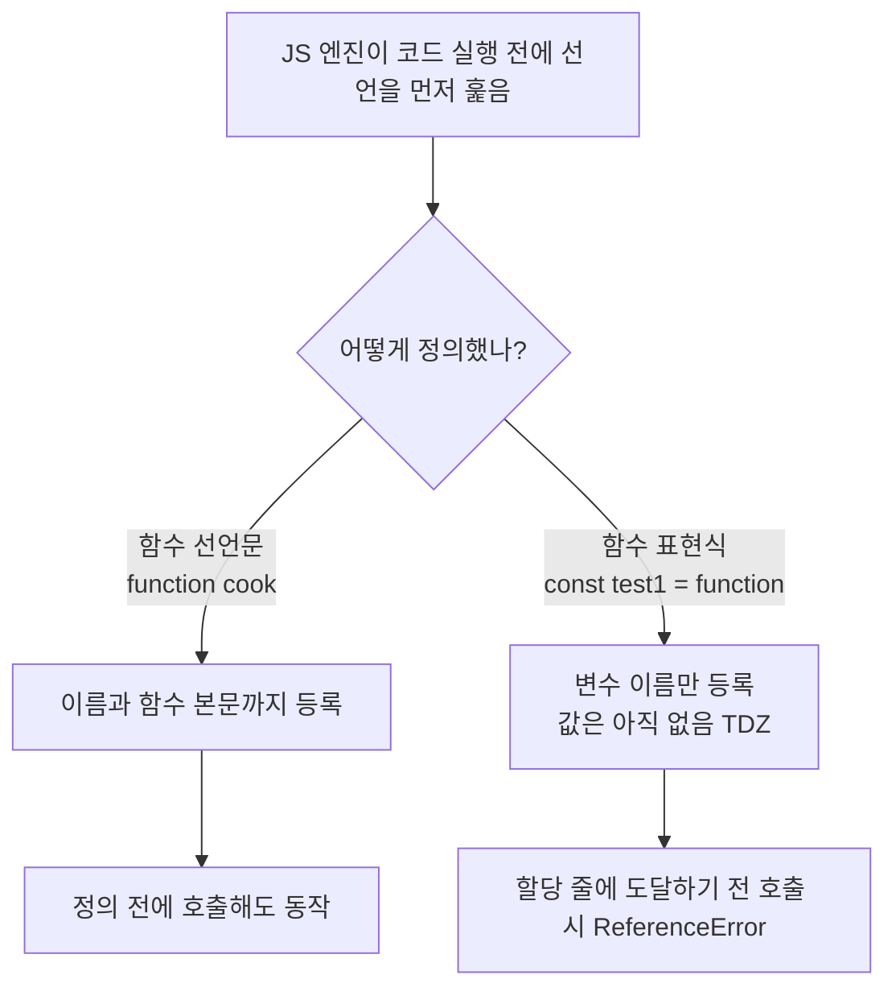

## 들어가며 (Situation)

11/17부터 **자바스크립트** 수업이 시작됐다. 선생님은 먼저 과정 전체에서 지금 어디에 있는지 짚었다.

| 모듈 | 내용 |
|------|------|
| 지금까지 | 백엔드 (Java, Spring, JPA, Security) |
| 모듈 3 (이번) | 백엔드는 기존처럼 두고 **프론트엔드를 추가** |
| 모듈 4 (다음) | **AI를 우리 서비스에 붙이기** (Python 기반 AI 서버) |

오전에는 "왜 서버를 나누는가"를 설명했고, 이어서 `01_Core` 폴더의 파일 6개로 문법을 배웠다.

| 파일 | 내용 |
|------|------|
| `01_variable.js` | `let`, `const`, 동적 타입 |
| `02_object.js` | 객체 |
| `03_function.js` | 함수 선언문·표현식, 호이스팅 |
| `04_arrow-function.js` | 화살표 함수 |
| `05_array.js` | 배열 |
| `06_higher-order-method.js` | 고차함수 `forEach`, `map`, `filter` |

코드는 모두 수업 코드(`C:\Lecture\11_JavaScript\01_Core`)이고, 출력은 Node.js v24로 직접 실행한 결과다. 수업 코드가 아닌 것은 **"예시 코드"**라고 표시했다.

## 문제 상황 (Task)

필기에는 단어만 남아 있었고, 지금까지 Java만 써서 Java 문법으로 JS를 읽으려다 계속 걸렸다.

- "백엔드 서버(8080) — **SSR**", "백엔드 + 프론트 서버(5173) — **CSR**", "화면: 프론트 / 데이터: 백 / 추측: AI" — 무슨 차이이고 왜 나누는가?
- 자료형 없이 `let`, `const`만 쓴다. 타입은 언제 정해지는가?
- "javascript는 **function 기반** 객체 지향 언어" — 무슨 뜻인가?
- "호이스팅 여부는 함수 **선언**만 했는지 **표현**을 했는지에 따라 달라짐" — 같은 함수인데 왜 하나는 되고 하나는 에러인가?
- "자바에서 배열은 같은 자료형 리터럴만" — JS 배열은 무엇이 다른가?
- "higher-order-method : 고차함수" — `for`문으로도 되는 걸 왜 고차함수로 쓰는가?

## 해결 과정 (Action)

### 1부. 서버가 분리된다는 것: SSR과 CSR

#### 자바스크립트가 필요한 이유

필기: "자바스크립트 — 브라우저에서 동작하는 **유일한** 프로그래밍 언어".

Java는 서버(JVM)에서 실행된다. 브라우저는 HTML, CSS, 그리고 자바스크립트만 실행할 수 있다. ([MDN - What is JavaScript?](https://developer.mozilla.org/en-US/docs/Learn_web_development/Core/Scripting/What_is_JavaScript)) 그래서 화면을 브라우저 쪽에서 만들려면 자바스크립트가 필요하다.

> 엄밀히는 WebAssembly도 브라우저에서 실행되지만, 다른 언어를 컴파일한 결과물이고 DOM을 직접 다루려면 여전히 자바스크립트를 거친다. 수업에서 말한 "유일한 언어"는 이런 의미로 이해했다.

#### 이전 방식: SSR (Server Side Rendering)

지금까지 만든 Spring 프로젝트는 **8080 포트 서버 하나**가 다 했다. 컨트롤러가 데이터를 조회하고, Thymeleaf가 HTML을 완성해서 브라우저에 보냈다.



#### 이번 방식: CSR (Client Side Rendering)

이번 모듈에서는 서버가 둘이 된다.

- **프론트 서버 (5173)**: 5173은 Vite 개발 서버의 기본 포트다. ([Vite 공식 문서 - server.port](https://vite.dev/config/server-options#server-port)) 브라우저에 HTML 뼈대와 JS 파일을 내려준다.
- **백엔드 서버 (8080)**: HTML 대신 **데이터(JSON)**만 응답한다.



| 항목 | SSR (이전) | CSR (이번 모듈) |
|------|-----------|----------------|
| 서버 | Spring 하나 (8080) | 프론트 (5173) + 백 (8080) |
| 화면을 만드는 곳 | 서버 (Thymeleaf) | 브라우저 (JavaScript) |
| 백엔드 응답 | 완성된 HTML | JSON 데이터 |
| 페이지 이동 | 매번 새 HTML을 받음 | 필요한 데이터만 받아 일부만 다시 그림 |
| 첫 화면 | 바로 보임 | JS를 받아 실행한 뒤 보임 |

#### 모듈 4: 역할별로 서버를 나누기



| 역할 | 담당 | 기술 |
|------|------|------|
| 화면 | 프론트 서버 | JavaScript (이후 React) |
| 데이터 | 백엔드 서버 | Java, Spring |
| 추측 | AI 서버 | Python (추천 기능, 챗봇) |

서버를 나누면 역할에 맞는 언어를 고를 수 있다. AI 라이브러리는 Python 쪽이 풍부하고, 데이터 처리는 지금까지 배운 Spring을 그대로 쓴다. 대신 서로 다른 포트(5173 ↔ 8080)는 브라우저 입장에서 다른 출처(origin)라서 **CORS** 설정이 필요해진다. ([MDN - CORS](https://developer.mozilla.org/en-US/docs/Web/HTTP/Guides/CORS))

#### 실습 환경: Code Runner

프론트엔드는 IntelliJ보다 **VS Code**를 더 많이 쓴다고 해서, VS Code 확장 Code Runner로 `.js` 파일을 바로 실행했다. 이 확장은 내부적으로 `node 파일명.js`를 실행해 준다. 즉 아직 브라우저가 아니라 **Node.js**에서 문법을 연습하는 단계다.

### 2부. Java 문법으로 읽다 막힌 곳: 변수·객체·함수·호이스팅

#### 변수: 자료형 대신 변수 표현식

```js
// 수업 코드 (01_variable.js)
// Java : 자료형 변수명 = 리터럴;
// JavaScript : 변수표현식 변수명 = 리터럴;

// const 변수 표현식은 상수의 의미 → Java의 final
const shop = "원티드 식당";
// shop = 1;   // TypeError: Assignment to constant variable.

let test = 1;
test = "문자열";   // number → string 으로 바꿔도 된다
console.log(test); // 문자열
```

| 키워드 | 재할당 | Java에 대응 | 수업에서 |
|-------|-------|------------|---------|
| `let` | 가능 | 일반 변수 | 값이 바뀌는 변수 |
| `const` | 불가 | `final` | 기본으로 사용 |
| `var` | 가능 | - | 주석에 이름만 등장, 쓰지 않음 |

> 주의: `const`는 **재할당**을 막을 뿐 객체 내부 변경까지 막지는 않는다. 아래 객체 예제에서 `const order`에 프로퍼티를 추가할 수 있는 이유다. ([MDN - const](https://developer.mozilla.org/en-US/docs/Web/JavaScript/Reference/Statements/const))

#### 동적 타입: 타입은 할당할 때 정해진다

```js
// 수업 코드 (01_variable.js)
let test1;
console.log(typeof test1); // undefined
test1 = 1;               console.log(typeof test1); // number
test1 = "java";          console.log(typeof test1); // string
test1 = true;            console.log(typeof test1); // boolean
test1 = null;            console.log(typeof test1); // object
test1 = {};              console.log(typeof test1); // object
test1 = [];              console.log(typeof test1); // object
test1 = function() {};   console.log(typeof test1); // function
```

- `typeof null`이 `"object"`다. MDN은 이것을 JS 초기 구현에서 생긴 것으로, 호환성 때문에 고치지 못한 동작이라고 설명한다. ([MDN - typeof null](https://developer.mozilla.org/en-US/docs/Web/JavaScript/Reference/Operators/typeof#typeof_null))
- 배열 `[]`도 `"object"`다. 배열인지 확인하려면 `Array.isArray()`를 써야 한다.

| | Java (정적 타입) | JavaScript (동적 타입) |
|--|----------------|----------------------|
| 타입 결정 시점 | 선언할 때 | 값을 할당할 때 |
| 장점 | 실행 전에 타입 오류 발견 | 자료형 신경 쓰지 않고 선언 |
| 단점 | 코드가 길다 | 값을 보기 전에는 타입을 확신할 수 없음 |

#### 객체: 클래스 없이 `{}`로

```js
// 수업 코드 (02_object.js)
// Java로 치면 Store: 클래스 / name, category: 필드 / getInfo: 메서드
const store = {
    name : '원티드 식당',
    category : '분식',
    getInfo : function() {
        return `${this.name} 은 ${this.category} 전문점입니다!`
    }
};
console.log(store.getInfo()); // 원티드 식당 은 분식 전문점입니다!

const order = {menuName : '치킨' }
order.sauce = "뿌링클 시즈닝";  // 동적으로 프로퍼티 추가
order.sauce = "맛초킹 시즈닝";  // 프로퍼티 수정
console.log(order); // { menuName: '치킨', sauce: '맛초킹 시즈닝' }
```

- 객체는 **프로퍼티(key-value)의 집합**이다.
- 클래스에 없는 필드를 Java는 추가할 수 없지만, JS 객체는 실행 중에 `order.sauce = ...`로 추가된다.
- 프로퍼티 value에는 함수도 들어간다. 그게 메서드다.

#### "function 기반 객체 지향"

수업 주석: "Java는 Class 기반의 객체지향 언어라고 한다면 JS는 function 기반의 객체지향 언어라고 할 수 있다."

- `typeof function(){}`이 `"function"`으로, 함수가 **값**처럼 변수에 담긴다.
- 객체 프로퍼티에 함수를 넣으면 메서드가 된다.
- 3부의 `map`, `filter`처럼 함수를 다른 함수에 **인자로 넘긴다**.

> 더 정확히는 JS는 **프로토타입 기반** 객체 지향 언어로 분류된다. ES6의 `class` 문법도 내부적으로는 함수와 프로토타입 위에서 동작한다. ([MDN - Inheritance and the prototype chain](https://developer.mozilla.org/en-US/docs/Web/JavaScript/Guide/Inheritance_and_the_prototype_chain)) 수업의 "function 기반"은 함수가 일급 객체라는 점을 강조한 표현으로 받아들였다.

#### 함수 선언문과 함수 표현식

```js
// 수업 코드 (03_function.js)
// 함수 선언문
function welcome(name) {
    return `${name} 님, 반갑습니다~~!`
}

// 함수 표현식: 함수를 변수에 담는다
const welcome2 = function (name) {
    return `${name} 님, 반갑습니다~~!`
}

const welcome3 = function hello(name) { ... }
// console.log(hello("..."))  // ReferenceError — 'hello'는 함수 안에서만 보이는 이름
```

`welcome3`처럼 표현식에 이름을 붙여도, 바깥에서는 변수명(`welcome3`)으로만 부를 수 있다.

#### 호이스팅: 선언했는가, 표현했는가

```js
// 수업 코드 (03_function.js)
console.log(cook('떡볶이'))      // 떡볶이 조리 시~작~!

function cook(menuName) {         // 함수 선언문
    return `${menuName} 조리 시~작~!`
}

console.log(test1("떡볶이"))      // ReferenceError

const test1 = function (menuName) { // 함수 표현식
    return `${menuName} 조리 시~작~!`
}
```

실제 실행 결과:

```text
떡볶이 조리 시~작~!
ReferenceError: Cannot access 'test1' before initialization
```



- 함수 **선언문**은 런타임 이전에 JS 엔진이 먼저 인식한다. 그래서 위에서 호출해도 된다. 이것이 수업에서 말한 **호이스팅**이다.
- 함수 **표현식**은 결국 `const test1 = 값`이다. `let`/`const` 변수는 할당 줄에 도달하기 전까지 접근할 수 없는 구간(TDZ, Temporal Dead Zone)에 있다. ([MDN - Hoisting](https://developer.mozilla.org/en-US/docs/Glossary/Hoisting), [MDN - TDZ](https://developer.mozilla.org/en-US/docs/Web/JavaScript/Reference/Statements/let#temporal_dead_zone_tdz))

처음에는 "표현식은 호이스팅이 안 된다"고 이해했는데, 에러 메시지가 "is not defined"가 아니라 "before initialization"인 걸 보고 **변수 이름은 알고 있다**는 걸 알게 됐다.

#### 화살표 함수

```js
// 수업 코드 (04_arrow-function.js)
message = function() { return '주문 접수 OK!👌' }
message = () => { return '주문 접수 OK!🙆‍♀️' }
message = () => '주문 접수 OK!👌'                 // 중괄호·return 생략
message = menuName => `${menuName} !!`             // 매개변수 1개면 괄호도 생략
console.log(message("신전떡볶이"));                 // 신전떡볶이 !!

const menuPriceList = [4000, 5000, 140000];
console.log(menuPriceList.map( price => price * 0.9 )) // [ 3600, 4500, 126000 ]
```

수업 주석에 따르면 Java의 **람다 표현식**이 이 문법과 닮았다. `price -> price * 0.9`(Java)와 `price => price * 0.9`(JS)를 나란히 놓으니 바로 읽혔다.

### 3부. for문 대신 고차함수로 메뉴 배열 다루기

#### JS 배열에는 무엇이든 들어간다

```js
// 수업 코드 (05_array.js)
const menus = ['제육', '떡볶이', '순대', 1, {name : 'hi'} , function() {}];

for(let i = 0; i < menus.length; i++) {
    console.log(menus[i]);
}
```

```text
제육
떡볶이
순대
1
{ name: 'hi' }
[Function (anonymous)]
```

| | Java 배열 | JavaScript 배열 |
|--|----------|----------------|
| 자료형 | 선언 시 고정 (`String[]`) | 명시하지 않음, 섞어서 저장 가능 |
| 길이 | 생성 시 고정 | 늘었다 줄었다 함 (`push`, `pop`) |
| `typeof` | - | `"object"` (배열 확인은 `Array.isArray`) |

섞을 수 있다고 섞어 쓰는 건 아니다. 아래 실습 데이터도 모두 같은 모양의 객체다. 같은 모양이어야 `menu.price`처럼 꺼내 쓸 수 있다.

#### 고차함수란

> 함수를 인자로 전달 받거나, 함수를 반환하는 함수. 배열의 고차 함수는 콜백 함수를 인자로 받아 배열의 요소를 순회하며 처리하게 된다. — 수업 코드 `06_higher-order-method.js`

2부에서 "함수가 값처럼 다뤄진다"고 정리했다. 그래서 함수를 다른 함수의 **인자**로 넘길 수 있고, 이렇게 넘겨진 함수를 **콜백 함수**라고 부른다.

```js
// 수업 코드 (06_higher-order-method.js)
const menus = [
    {name : '치즈 떡볶이' , category : '분식', price : 14000 },
    {name : '엽기 닭도리탕' , category : '한식', price : 24000 },
    {name : '순대' , category : '분식', price : 4000 },
    {name : '마카롱' , category : '디저트', price : 5000 },
    {name : '치즈스틱' , category : '분식', price : 6000 },
];

menus.forEach( menu => console.log(menu) );               // 반환값 없음
const names = menus.map( menu => menu.name );             // [ '치즈 떡볶이', '엽기 닭도리탕', '순대', '마카롱', '치즈스틱' ]
const snacks = menus.filter( menu => menu.category === '분식' ); // 치즈 떡볶이, 순대, 치즈스틱
const menu = menus.filter( menu => menu.price < 10000 );        // 순대, 마카롱, 치즈스틱
```

| 메서드 | 콜백이 돌려줘야 하는 것 | 결과 | 결과 길이 |
|-------|----------------------|------|----------|
| `forEach` | 없음 | `undefined` | - |
| `map` | 바꾼 값 | 새 배열 | 원본과 같음 (5 → 5) |
| `filter` | `true` / `false` | 새 배열 | 원본 이하 (5 → 3) |

`map`과 `filter`는 **원본 `menus`를 바꾸지 않고** 새 배열을 돌려준다. ([MDN - Array.prototype.map](https://developer.mozilla.org/en-US/docs/Web/JavaScript/Reference/Global_Objects/Array/map), [MDN - Array.prototype.filter](https://developer.mozilla.org/en-US/docs/Web/JavaScript/Reference/Global_Objects/Array/filter))

#### 체이닝: 분식 중 1만 원 미만인 메뉴 이름

```js
// 수업 코드 (06_higher-order-method.js)
const result = menus
                    .filter(menu => menu.category === '분식')  // 분식만
                    .filter(menu => menu.price < 10000)        // 10000원 미만
                    .map(menu => menu.name)                    // 이름만
console.log(result); // [ '순대', '치즈스틱' ]
```


같은 일을 `for`문으로 쓰면 이렇다. (예시 코드, 비교용으로 직접 작성)

```js
// 예시 코드
const result = [];
for (let i = 0; i < menus.length; i++) {
    if (menus[i].category === '분식' && menus[i].price < 10000) {
        result.push(menus[i].name);
    }
}
```

| | for문 | 고차함수 체이닝 |
|--|------|---------------|
| 쓰는 것 | 어떻게 돌지 (인덱스, push) | 무엇을 할지 (거르고, 바꾸고) |
| 결과 배열 | 직접 만들고 채움 | 메서드가 새로 만들어 줌 |
| 단계 추가 | `if` 조건이 길어짐 | `.filter()` 한 줄 추가 |

Java의 Stream API(`stream().filter().map()`)와 같은 흐름이라 익숙했다.

#### `==` 와 `===`

```js
// 수업 코드 (06_higher-order-method.js)
console.log(`1 == 1 : ${1 == '1'}`);   // true
console.log(`1 === 1 : ${1 === '1'}`); // false
```

| 연산자 | 이름 | 동작 |
|-------|------|------|
| `==` | 동등 비교 | 타입을 암묵적으로 변환한 뒤 값 비교 |
| `===` | 일치 비교 | 타입과 값이 모두 같아야 함 |

2부의 동적 타입 때문에, 값의 타입을 확신할 수 없는 JS에서는 `===`를 기본으로 쓰는 게 안전하다. ([MDN - Equality comparisons](https://developer.mozilla.org/en-US/docs/Web/JavaScript/Guide/Equality_comparisons_and_sameness))

## 결과 (Result)

| 질문 | 정리 |
|------|------|
| 8080 / 5173 | 8080은 Spring 백엔드, 5173은 Vite 프론트 개발 서버의 기본 포트 |
| SSR vs CSR | 서버(Thymeleaf)가 HTML 완성 vs 백은 JSON만, 브라우저의 JS가 화면을 그림 |
| 타입은 언제 정해지나? | 할당할 때 (동적 타입). `typeof`로 확인 |
| `let` vs `const` | `let`은 재할당 가능, `const`는 불가 (Java `final`) |
| function 기반 | 함수가 값으로 다뤄지고, 메서드·인자가 된다 |
| 호이스팅 | 선언문 → 먼저 호출 가능 / 표현식 → `ReferenceError` (TDZ) |
| Java 배열 vs JS 배열 | Java는 한 자료형·고정 길이, JS는 자료형 섞기 가능·가변 길이 |
| 고차함수 | 콜백을 받아 순회. 5개 메뉴 → 분식 3개 → 1만 원 미만 2개 → `['순대', '치즈스틱']` |

수업 파일 6개를 모두 Node.js로 실행해서, 주석에 적힌 `typeof` 결과 8개와 호이스팅 에러 1개, 고차함수 결과를 모두 확인했다.

배운 점: 자바스크립트를 배우는 이유는 "새 언어 하나 추가"가 아니라 "화면 담당 서버를 따로 세우기 위해서"였다. 문법은 Java에 대응시키면 빨리 읽히지만(`const` ≈ `final`, 화살표 함수 ≈ 람다, 고차함수 ≈ Stream), `typeof null`이나 TDZ처럼 대응이 안 되는 곳에서 JS만의 동작 방식이 드러났다. 그리고 그 모든 것의 바탕에는 "함수도 값이다"가 있었다.

> 수업 미션: "Java 언어의 동작 원리와 JavaScript 언어의 동작 원리를 비교하고 서로에게 이해시킬 수 있는 자료 구성하기" — 이 글의 표들을 바탕으로 이어서 정리할 예정이다.

## 더 학습하면 좋은 개념

- **CORS (Cross-Origin Resource Sharing)** — 5173에서 8080으로 요청하면 바로 마주치는 문제. 프론트·백 분리의 첫 관문이다.
- **스코프와 클로저** — `let`/`const`의 블록 스코프, 함수가 바깥 변수를 기억하는 원리. 고차함수와 React Hook을 이해하는 바탕이다.
- **프로토타입** — "function 기반 객체 지향"의 정확한 정체.
- **`reduce`와 불변성** — 배열을 하나의 값으로 접는 고차함수, 그리고 `map`/`filter`가 원본을 바꾸지 않는 이유. React 상태 업데이트 규칙과 직결된다.
- **TypeScript** — 동적 타입의 단점(타입을 확신할 수 없음)을 정적 타입으로 보완하는 선택지.

## 참고 자료

- [MDN - What is JavaScript?](https://developer.mozilla.org/en-US/docs/Learn_web_development/Core/Scripting/What_is_JavaScript)
- [MDN - CORS](https://developer.mozilla.org/en-US/docs/Web/HTTP/Guides/CORS)
- [Vite 공식 문서 - Server Options](https://vite.dev/config/server-options)
- [MDN - let](https://developer.mozilla.org/en-US/docs/Web/JavaScript/Reference/Statements/let) / [const](https://developer.mozilla.org/en-US/docs/Web/JavaScript/Reference/Statements/const)
- [MDN - typeof](https://developer.mozilla.org/en-US/docs/Web/JavaScript/Reference/Operators/typeof)
- [MDN - Hoisting](https://developer.mozilla.org/en-US/docs/Glossary/Hoisting)
- [MDN - Arrow function expressions](https://developer.mozilla.org/en-US/docs/Web/JavaScript/Reference/Functions/Arrow_functions)
- [MDN - Array](https://developer.mozilla.org/en-US/docs/Web/JavaScript/Reference/Global_Objects/Array)
- [MDN - Callback function](https://developer.mozilla.org/en-US/docs/Glossary/Callback_function)
- [MDN - Equality comparisons and sameness](https://developer.mozilla.org/en-US/docs/Web/JavaScript/Guide/Equality_comparisons_and_sameness)
