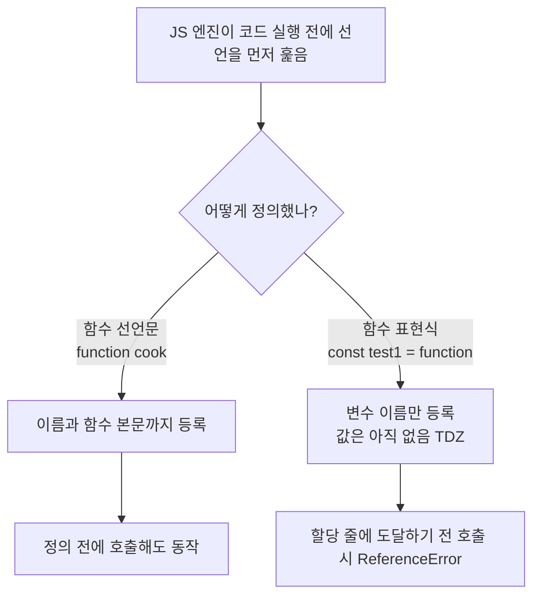

## 들어가며 (Situation)

11/17 자바스크립트 첫 수업에서 `01_Core` 폴더의 `01_variable.js` ~ `04_arrow-function.js`를 작성했다. VS Code의 Code Runner(내부적으로 `node`)로 실행했다.

이 글의 코드는 모두 수업 코드(`C:\Lecture\11_JavaScript\01_Core`)이고, 출력은 Node.js v24로 직접 실행한 결과다. 서버 분리 이야기는 [앞 글]({{ site.baseurl }})에 정리했다.

## 문제 상황 (Task)

지금까지 Java만 써서 Java 문법으로 JS를 읽으려 했고, 그때마다 걸렸다.

- 자료형 없이 `let`, `const`만 쓴다. 타입은 언제 정해지는가?
- 클래스 없이 `{}`만으로 객체를 만든다.
- 필기: "javascript는 **function 기반** 객체 지향 언어". 무슨 뜻인가?
- 필기: "호이스팅 여부는 함수 **선언**만 했는지 **표현**을 했는지에 따라 달라짐". 같은 함수인데 왜 하나는 되고 하나는 에러인가?

## 해결 과정 (Action)

### 1. 변수: 자료형 대신 변수 표현식

수업 코드 주석이 Java와 대응시켜 준다.

```js
// 수업 코드 (01_variable.js)
// Java : 자료형 변수명 = 리터럴;
// JavaScript : 변수표현식 변수명 = 리터럴;

// const 변수 표현식은 상수의 의미 → Java의 final
const shop = "원티드 식당";
// shop = 1;   // TypeError: Assignment to constant variable.

let test = 1;
test = "문자열";   // number → string 으로 바꿔도 된다
console.log(test); // 문자열
```

| 키워드 | 재할당 | Java에 대응 | 수업에서 |
|-------|-------|------------|---------|
| `let` | 가능 | 일반 변수 | 값이 바뀌는 변수 |
| `const` | 불가 | `final` | 기본으로 사용 |
| `var` | 가능 | - | 주석에 이름만 등장, 쓰지 않음 |

> 주의: `const`는 **재할당**을 막을 뿐 객체 내부 변경까지 막지는 않는다. 아래 객체 예제에서 `const order`에 프로퍼티를 추가할 수 있는 이유다. ([MDN - const](https://developer.mozilla.org/en-US/docs/Web/JavaScript/Reference/Statements/const))

### 2. 동적 타입: 타입은 할당할 때 정해진다

Java에서 `String str = "문자열"; str = 1;`은 컴파일 에러다. JS에서는 된다. `typeof`로 확인했다.

```js
// 수업 코드 (01_variable.js)
let test1;
console.log(typeof test1); // undefined
test1 = 1;               console.log(typeof test1); // number
test1 = "java";          console.log(typeof test1); // string
test1 = true;            console.log(typeof test1); // boolean
test1 = null;            console.log(typeof test1); // object
test1 = {};              console.log(typeof test1); // object
test1 = [];              console.log(typeof test1); // object
test1 = function() {};   console.log(typeof test1); // function
```

실행 결과에서 두 가지가 눈에 띄었다.

- `typeof null`이 `"object"`다. MDN은 이것을 JS 초기 구현에서 생긴 것으로, 호환성 때문에 고치지 못한 동작이라고 설명한다. ([MDN - typeof null](https://developer.mozilla.org/en-US/docs/Web/JavaScript/Reference/Operators/typeof#typeof_null))
- 배열 `[]`도 `"object"`다. 배열인지 확인하려면 `Array.isArray()`를 써야 한다.

| | Java (정적 타입) | JavaScript (동적 타입) |
|--|----------------|----------------------|
| 타입 결정 시점 | 선언할 때 | 값을 할당할 때 |
| 장점 | 실행 전에 타입 오류 발견 | 자료형 신경 쓰지 않고 선언 |
| 단점 | 코드가 길다 | 값을 보기 전에는 타입을 확신할 수 없음 |

수업 주석의 단점 설명이 핵심이었다. `test.length`를 쓰는 코드가 있어도, 중간에 `test = 10`이 되면 끝까지 잘 동작한다고 확신할 수 없다.

### 3. 객체: 클래스 없이 `{}`로

```js
// 수업 코드 (02_object.js)
// Java로 치면 Store: 클래스 / name, category: 필드 / getInfo: 메서드
const store = {
    name : '원티드 식당',
    category : '분식',
    getInfo : function() {
        return `${this.name} 은 ${this.category} 전문점입니다!`
    }
};
console.log(store.getInfo()); // 원티드 식당 은 분식 전문점입니다!

const order = {menuName : '치킨' }
order.sauce = "뿌링클 시즈닝";  // 동적으로 프로퍼티 추가
order.sauce = "맛초킹 시즈닝";  // 프로퍼티 수정
console.log(order); // { menuName: '치킨', sauce: '맛초킹 시즈닝' }
```

- 객체는 **프로퍼티(key-value)의 집합**이다.
- 클래스에 없는 필드를 Java는 추가할 수 없지만, JS 객체는 실행 중에 `order.sauce = ...`로 추가된다.
- 프로퍼티 value에는 함수도 들어간다. 그게 메서드다.

### 4. "function 기반 객체 지향"

수업 주석: "Java는 Class 기반의 객체지향 언어라고 한다면 JS는 function 기반의 객체지향 언어라고 할 수 있다."

위 실행 결과로 이해한 근거는 이렇다.

- `typeof function(){}`이 `"function"`으로, 함수가 **값**처럼 변수에 담긴다.
- 객체 프로퍼티에 함수를 넣으면 메서드가 된다.
- 다음 글의 `map`, `filter`처럼 함수를 다른 함수에 **인자로 넘긴다**.

> 더 정확히는 JS는 **프로토타입 기반** 객체 지향 언어로 분류된다. ES6의 `class` 문법도 내부적으로는 함수와 프로토타입 위에서 동작한다. ([MDN - Inheritance and the prototype chain](https://developer.mozilla.org/en-US/docs/Web/JavaScript/Guide/Inheritance_and_the_prototype_chain)) 수업의 "function 기반"은 함수가 일급 객체라는 점을 강조한 표현으로 받아들였다. 이 부분은 다음 수업에서 확인해 볼 생각이다.

### 5. 함수 선언문과 함수 표현식

```js
// 수업 코드 (03_function.js)
// 함수 선언문
function welcome(name) {
    return `${name} 님, 반갑습니다~~!`
}

// 함수 표현식: 함수를 변수에 담는다
const welcome2 = function (name) {
    return `${name} 님, 반갑습니다~~!`
}

const welcome3 = function hello(name) { ... }
// console.log(hello("..."))  // ReferenceError — 'hello'는 함수 안에서만 보이는 이름
```

`welcome3`처럼 표현식에 이름을 붙여도, 바깥에서는 변수명(`welcome3`)으로만 부를 수 있다. 그래서 수업 코드에서 `hello(...)` 호출은 주석 처리되어 있다.

### 6. 호이스팅: 선언했는가, 표현했는가

같은 일을 하는 함수를 **정의보다 먼저** 호출했다.

```js
// 수업 코드 (03_function.js)
console.log(cook('떡볶이'))      // 떡볶이 조리 시~작~!

function cook(menuName) {         // 함수 선언문
    return `${menuName} 조리 시~작~!`
}

console.log(test1("떡볶이"))      // ReferenceError

const test1 = function (menuName) { // 함수 표현식
    return `${menuName} 조리 시~작~!`
}
```

실제 실행 결과:

```text
떡볶이 조리 시~작~!
ReferenceError: Cannot access 'test1' before initialization
```



- 함수 **선언문**은 런타임 이전에 JS 엔진이 먼저 인식한다. 그래서 위에서 호출해도 된다. 이것이 수업에서 말한 **호이스팅**이다.
- 함수 **표현식**은 결국 `const test1 = 값`이다. 변수도 호이스팅되긴 하지만, `let`/`const`는 할당 줄에 도달하기 전까지 접근할 수 없는 구간(TDZ, Temporal Dead Zone)에 있다. 에러 메시지의 "before initialization"이 그 뜻이다. ([MDN - Hoisting](https://developer.mozilla.org/en-US/docs/Glossary/Hoisting), [MDN - TDZ](https://developer.mozilla.org/en-US/docs/Web/JavaScript/Reference/Statements/let#temporal_dead_zone_tdz))

처음에는 "표현식은 호이스팅이 안 된다"고 이해했는데, 에러 메시지가 "is not defined"가 아니라 "before initialization"인 걸 보고 **변수 이름은 알고 있다**는 걸 알게 됐다.

### 7. 화살표 함수

```js
// 수업 코드 (04_arrow-function.js)
message = function() { return '주문 접수 OK!👌' }
message = () => { return '주문 접수 OK!🙆‍♀️' }
message = () => '주문 접수 OK!👌'                 // 중괄호·return 생략
message = menuName => `${menuName} !!`             // 매개변수 1개면 괄호도 생략
console.log(message("신전떡볶이"));                 // 신전떡볶이 !!

const menuPriceList = [4000, 5000, 140000];
console.log(menuPriceList.map( price => price * 0.9 )) // [ 3600, 4500, 126000 ]
```

수업 주석에 따르면 Java의 **람다 표현식**이 이 문법과 닮았다. `price -> price * 0.9`(Java)와 `price => price * 0.9`(JS)를 나란히 놓으니 바로 읽혔다. 화살표 함수는 다음 글의 고차함수에서 계속 쓰인다.

## 결과 (Result)

| 질문 | 정리 |
|------|------|
| 타입은 언제 정해지나? | 할당할 때 (동적 타입). `typeof`로 확인 |
| `let` vs `const` | `let`은 재할당 가능, `const`는 불가 (Java `final`) |
| 클래스 없는 객체 | `{}` = 프로퍼티 집합, 실행 중 추가·수정 가능 |
| function 기반 | 함수가 값으로 다뤄지고, 메서드·인자가 된다 |
| 호이스팅 | 선언문 → 먼저 호출 가능 / 표현식 → `ReferenceError` (TDZ) |

수업 코드 4개 파일을 직접 실행해서 주석에 적힌 결과 8개(`typeof`)와 호이스팅 에러 1개를 모두 확인했다.

배운 점: Java 문법에 대응시키면 빨리 읽히지만(`const` ≈ `final`, 화살표 함수 ≈ 람다), `typeof null`이나 TDZ처럼 대응이 안 되는 곳에서 JS만의 동작 방식이 드러났다.

> 수업 미션: "Java 언어의 동작 원리와 JavaScript 언어의 동작 원리를 비교하고 서로에게 이해시킬 수 있는 자료 구성하기" — 이 글의 표들을 바탕으로 이어서 정리할 예정이다.

## 더 학습하면 좋은 개념

- **스코프와 클로저** — `let`/`const`의 블록 스코프, 함수가 바깥 변수를 기억하는 원리. 고차함수와 React Hook을 이해하는 바탕이다.
- **실행 컨텍스트** — 호이스팅이 "왜" 일어나는지를 설명하는 JS 엔진의 동작 원리.
- **`this` 바인딩** — `getInfo`의 `this.name`이 어떻게 `store`를 가리키는지. 화살표 함수는 `this`를 다르게 다룬다.
- **프로토타입** — "function 기반 객체 지향"의 정확한 정체.
- **TypeScript** — 동적 타입의 단점(타입을 확신할 수 없음)을 정적 타입으로 보완하는 선택지.

## 참고 자료

- [MDN - let](https://developer.mozilla.org/en-US/docs/Web/JavaScript/Reference/Statements/let)
- [MDN - const](https://developer.mozilla.org/en-US/docs/Web/JavaScript/Reference/Statements/const)
- [MDN - typeof](https://developer.mozilla.org/en-US/docs/Web/JavaScript/Reference/Operators/typeof)
- [MDN - Working with objects](https://developer.mozilla.org/en-US/docs/Web/JavaScript/Guide/Working_with_objects)
- [MDN - Hoisting](https://developer.mozilla.org/en-US/docs/Glossary/Hoisting)
- [MDN - Arrow function expressions](https://developer.mozilla.org/en-US/docs/Web/JavaScript/Reference/Functions/Arrow_functions)
