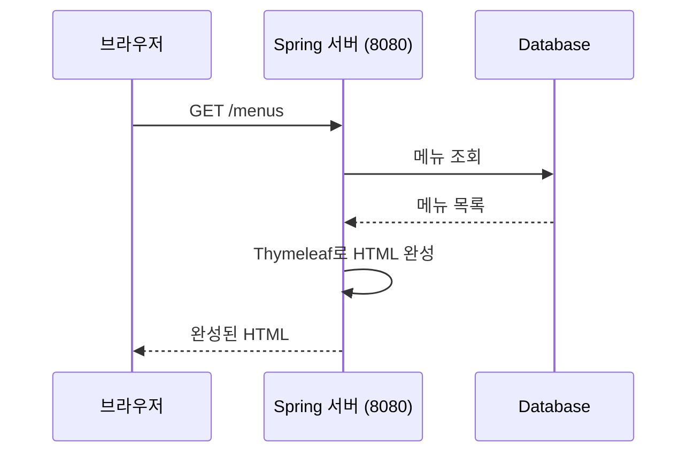
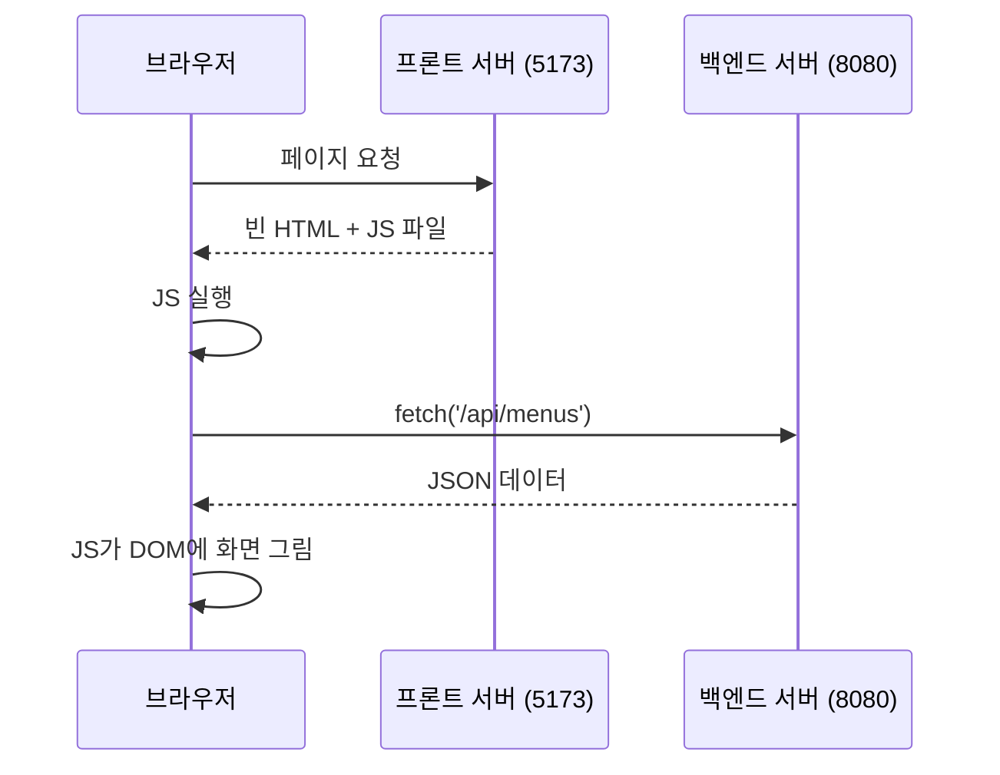
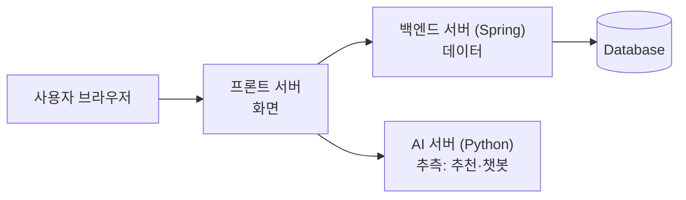

## 들어가며 (Situation)

11/17부터 **자바스크립트** 수업이 시작됐다. 선생님은 먼저 과정 전체에서 지금 어디에 있는지 짚었다.

| 모듈 | 내용 |
|------|------|
| 지금까지 | 백엔드 (Java, Spring, JPA, Security) |
| 모듈 3 (이번) | 백엔드는 기존처럼 두고 **프론트엔드를 추가** |
| 모듈 4 (다음) | **AI를 우리 서비스에 붙이기** (Python 기반 AI 서버) |

필기 첫 줄에 "서버가 분리된다는 개념도 알기"라고 적었다. 이 글은 그 한 줄을 정리한 것이다. 문법은 다음 글([변수·객체·함수·호이스팅]({{ site.baseurl }}), [배열과 고차함수]({{ site.baseurl }}))에서 다룬다.

## 문제 상황 (Task)

필기에는 단어만 적혀 있었다.

- "이전: 백엔드 서버(8080) → 사용자 화면에 보여줄 것도 담당 — **SSR**"
- "이번 모듈: 백엔드 + 프론트 서버(5173) — **CSR**"
- "화면: 프론트 / 데이터: 백 / 추측: AI"

8080과 5173이 무엇인지, SSR과 CSR이 실제로 무엇이 다른지, 왜 굳이 서버를 나누는지는 설명하지 못했다.

## 해결 과정 (Action)

### 1. 자바스크립트가 필요한 이유

필기: "자바스크립트 — 브라우저에서 동작하는 **유일한** 프로그래밍 언어".

Java는 서버(JVM)에서 실행된다. 브라우저는 HTML, CSS, 그리고 자바스크립트만 실행할 수 있다. ([MDN - What is JavaScript?](https://developer.mozilla.org/en-US/docs/Learn_web_development/Core/Scripting/What_is_JavaScript))
그래서 화면을 브라우저 쪽에서 만들려면 자바스크립트가 필요하다.

> 엄밀히는 WebAssembly도 브라우저에서 실행되지만, 다른 언어를 컴파일한 결과물이고 DOM을 직접 다루려면 여전히 자바스크립트를 거친다. 수업에서 말한 "유일한 언어"는 이런 의미로 이해했다.

### 2. 이전 방식: SSR (Server Side Rendering)

지금까지 만든 Spring 프로젝트는 **8080 포트 서버 하나**가 다 했다. 컨트롤러가 데이터를 조회하고, Thymeleaf가 HTML을 완성해서 브라우저에 보냈다.



브라우저는 받은 HTML을 그대로 그리기만 한다. 화면이 **서버에서** 만들어지므로 Server Side Rendering이다.

### 3. 이번 방식: CSR (Client Side Rendering)

이번 모듈에서는 서버가 둘이 된다.

- **프론트 서버 (5173)**: 5173은 Vite 개발 서버의 기본 포트다. ([Vite 공식 문서 - server.port](https://vite.dev/config/server-options#server-port)) 브라우저에 HTML 뼈대와 JS 파일을 내려준다.
- **백엔드 서버 (8080)**: HTML 대신 **데이터(JSON)**만 응답한다.



화면을 그리는 주체가 **브라우저(클라이언트)의 자바스크립트**이므로 Client Side Rendering이다.

| 항목 | SSR (이전) | CSR (이번 모듈) |
|------|-----------|----------------|
| 서버 | Spring 하나 (8080) | 프론트 (5173) + 백 (8080) |
| 화면을 만드는 곳 | 서버 (Thymeleaf) | 브라우저 (JavaScript) |
| 백엔드 응답 | 완성된 HTML | JSON 데이터 |
| 페이지 이동 | 매번 새 HTML을 받음 | 필요한 데이터만 받아 일부만 다시 그림 |
| 첫 화면 | 바로 보임 | JS를 받아 실행한 뒤 보임 |

### 4. 모듈 4: 역할별로 서버를 나누기

필기에 적은 최종 구조를 다이어그램으로 옮겼다.



| 역할 | 담당 | 기술 |
|------|------|------|
| 화면 | 프론트 서버 | JavaScript (이후 React) |
| 데이터 | 백엔드 서버 | Java, Spring |
| 추측 | AI 서버 | Python (추천 기능, 챗봇) |

서버를 나누면 각 역할에 맞는 언어를 고를 수 있다. AI 라이브러리는 Python 쪽이 풍부하고, 데이터 처리는 지금까지 배운 Spring을 그대로 쓸 수 있다. 프론트와 백이 분리되면 백엔드는 HTML을 몰라도 되고 JSON만 주면 된다.

> 분리했을 때의 비용도 있다. 서로 다른 포트(5173 ↔ 8080)는 브라우저 입장에서 다른 출처(origin)라서 **CORS** 설정이 필요하다. ([MDN - CORS](https://developer.mozilla.org/en-US/docs/Web/HTTP/Guides/CORS)) 지난 Security 글에서 "front와 back이 분리되면 토큰 방식"이라고 적었던 것도 이 분리와 이어진다.

### 5. 실습 환경: Code Runner

필기에 "code runner"라고 적었다. 프론트엔드는 IntelliJ보다 **VS Code**를 더 많이 쓴다고 해서, VS Code 확장 Code Runner로 `.js` 파일을 바로 실행했다. 이 확장은 내부적으로 `node 파일명.js`를 실행해 준다. 즉 아직 브라우저가 아니라 **Node.js**에서 문법을 연습하는 단계다.

```bash
# Code Runner가 해주는 일과 같다
node 01_variable.js
```

## 결과 (Result)

| 필기의 단어 | 지금 설명할 수 있는 것 |
|------------|----------------------|
| 8080 / 5173 | 8080은 Spring 백엔드, 5173은 Vite 프론트 개발 서버의 기본 포트 |
| SSR | 서버(Thymeleaf)가 HTML을 완성해 보냄 |
| CSR | 백은 JSON만, 브라우저의 JS가 화면을 그림 |
| 화면/데이터/추측 | 프론트/백/AI(Python) 서버로 역할 분리 |

배운 점: 지금까지 만든 것은 "서버 하나짜리 웹"이었다. 이번 모듈부터는 같은 서비스를 여러 서버가 나눠 맡고, 그 사이를 HTTP와 JSON이 잇는다. 자바스크립트를 배우는 이유가 "새 언어 하나 추가"가 아니라 "화면 담당 서버를 따로 세우기 위해서"라는 점이 정리됐다.

## 더 학습하면 좋은 개념

- **CORS (Cross-Origin Resource Sharing)** — 5173에서 8080으로 요청하면 바로 마주치는 문제. 프론트·백 분리의 첫 관문이다.
- **SPA (Single Page Application)** — CSR로 만든 앱이 페이지 이동 없이 동작하는 방식. React를 배우기 전에 개념을 알아두면 좋다.
- **REST API와 JSON** — 백엔드가 HTML 대신 무엇을 돌려줘야 하는지에 대한 약속.
- **Node.js** — 브라우저 밖에서 JS를 실행하는 런타임. Code Runner와 Vite 모두 Node.js 위에서 돈다.
- **SSR 프레임워크 (Next.js 등)** — CSR의 "첫 화면이 늦다"는 단점을 다시 서버 렌더링으로 보완하는 흐름.

## 참고 자료

- [MDN - What is JavaScript?](https://developer.mozilla.org/en-US/docs/Learn_web_development/Core/Scripting/What_is_JavaScript)
- [MDN - CORS](https://developer.mozilla.org/en-US/docs/Web/HTTP/Guides/CORS)
- [Vite 공식 문서 - Server Options](https://vite.dev/config/server-options)
- [web.dev - Rendering on the Web](https://web.dev/articles/rendering-on-the-web)
