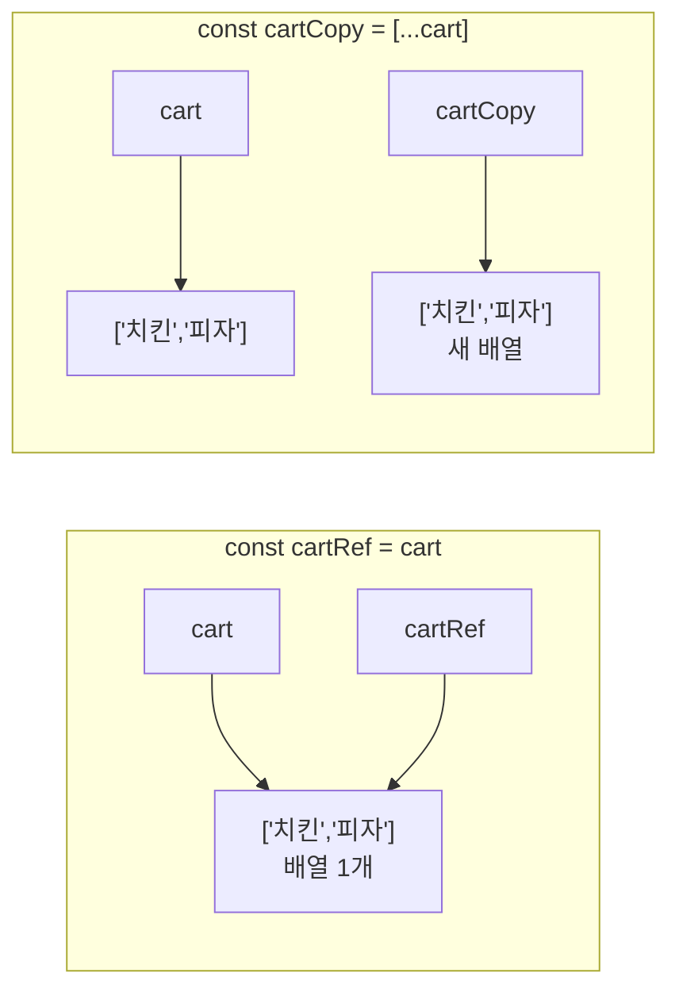
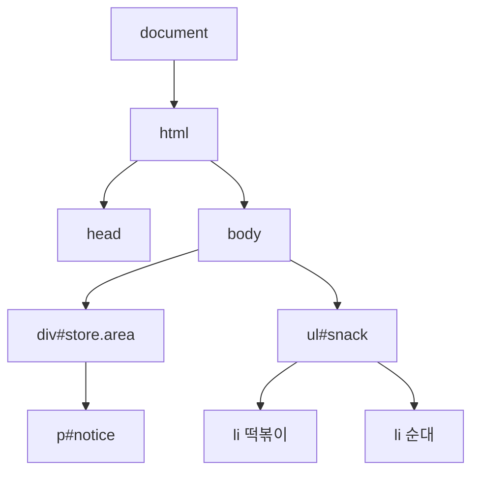

## 들어가며 (Situation)

11/18 자바스크립트 수업은 두 부분으로 나뉘었다.

| 시간 | 폴더 | 파일 |
|------|------|------|
| 오전 | `01_Core` (Node.js에서 실행) | `07_spread-syntax.js`, `08_destructuring.js` |
| 오후 | `02_Web` (브라우저에서 실행) | `01_DOM/01_get-element.html`, `02_EVENT/01~03` |

오후 첫 필기는 "JS는 웹 브라우저에서 동작하는 유일한 프로그래밍 언어이다"였다. 어제까지는 Code Runner(Node.js)로 문법만 연습했고, 오늘 오후부터 처음으로 **브라우저에서** JS가 HTML을 건드렸다.

코드는 모두 수업 코드(`C:\Lecture\11_JavaScript`)다. `.js` 파일은 Node.js v24로, `.html` 파일 중 `01_get-element`, `02_event-object`는 Edge 브라우저(헤드리스)로 직접 실행해서 결과를 확인했다. 수업 코드가 아닌 것은 **"예시 코드"**라고 표시했다. 앞 내용은 [11/17 배열과 고차함수 글]({{ site.baseurl }})에 있다.

## 문제 상황 (Task)

필기에 질문과 "다시 하기"가 남아 있었다.

1. **"Q. 깊은 복사는 같은 공간을 바라보는데 이름표를 여러 개 둔 것??"**
2. **"08 파일 이해 다시하기 — `const {...rest} = menu;`"**
3. "#, . → id, class" 라고만 적었다. DOM 요소는 어떻게 가져오는가?
4. 이벤트 핸들러 등록 방법이 3가지라는데 무엇이 다르고 왜 `addEventListener`를 권장하는가?

## 해결 과정 (Action)

### 1. `=` 와 `...` — 복사했는데 원본이 바뀐다

```js
// 수업 코드 (07_spread-syntax.js)
const cart = ['치킨', '피자'];
const cartRef = cart;          // 수업 주석: 깊은 복사 (주소값을 복사)
const cartCopy = [...cart];    // 수업 주석: 얕은 복사 (값만 복사해서 새로운 배열 생성)

cartRef.push('파스타');
console.log(cart , cartRef);
cartCopy.push('빠네파스타');
console.log(cart , cartCopy);

const order = { menuName : '뿌링클', qty : 2 }
const orderRef = order;
const orderCopy = {...order};
console.log(order === orderRef);  // true
console.log(order === orderCopy); // false
```

```text
[ '치킨', '피자', '파스타' ] [ '치킨', '피자', '파스타' ]
[ '치킨', '피자', '파스타' ] [ '치킨', '피자', '빠네파스타' ]
true
false
```

`cartRef`에 넣은 `'파스타'`는 `cart`에도 들어갔고, `cartCopy`에 넣은 `'빠네파스타'`는 들어가지 않았다.

### 2. 필기 질문의 답: "이름표 여러 개"는 맞다, 그런데 그건 깊은 복사가 아니다

필기의 **"같은 공간을 바라보는데 이름표를 여러 개 둔 것"**은 `cartRef = cart`를 정확히 설명한다. 배열은 하나뿐이고 `cart`, `cartRef`는 같은 주소를 가리키는 이름표 두 개다.



그런데 MDN에서 용어를 확인해 보니 수업 주석과 이름이 달랐다.

| 코드 | 수업 주석 | MDN 기준 | 새 배열 생성 |
|------|----------|---------|------------|
| `cartRef = cart` | 깊은 복사 | **참조 할당** — 복사 없이 주소만 하나 더 | X |
| `[...cart]` | 얕은 복사 | **얕은 복사** (바깥 한 겹만 새로) | O |
| `structuredClone(cart)` | (수업에 없음) | **깊은 복사** (안쪽까지 전부 새로) | O |

> A shallow copy of an object is a copy whose properties share the same references as those of the source object. — [MDN - Shallow copy](https://developer.mozilla.org/en-US/docs/Glossary/Shallow_copy)
>
> A deep copy of an object is a copy whose properties do not share the same references as those of the source object. — [MDN - Deep copy](https://developer.mozilla.org/en-US/docs/Glossary/Deep_copy)

그래서 필기의 "다른 데서 수정한 걸 알지 못하고 수정될 수 있음"은 **참조 할당(`=`)의 단점**이다. 동작 설명은 수업과 같고, 붙은 이름만 일반 용어와 다르다.

`...`가 "얕은" 이유는 배열 안에 객체를 넣어 보면 드러난다. (예시 코드, 직접 실행)

```js
// 예시 코드
const cart = [{ name: '치킨' }];

const copy = [...cart];
copy[0].name = '피자';
console.log(cart[0].name);          // 피자  ← 원본이 바뀜

const deep = structuredClone(cart);
deep[0].name = '파스타';
console.log(cart[0].name);          // 피자  ← 그대로
```

| 방법 | 바깥 배열/객체 | 안쪽 객체 |
|------|--------------|----------|
| `=` | 공유 | 공유 |
| `[...arr]`, `{...obj}` | 새로 생성 | **공유** |
| `structuredClone()` | 새로 생성 | 새로 생성 |

수업 데이터처럼 값이 문자열·숫자뿐이면 `...`만으로 충분하다. 필기의 "데이터만 복사하고자 할 때 많이 사용"이 이 경우다.

### 3. 구조 분해 할당: 배열은 위치, 객체는 key

```js
// 수업 코드 (08_destructuring.js)
const menuArr = ['치킨', '피자'];
const [chi1, piz1] = menuArr;          // menuArr[0], menuArr[1]

const menu = { name : '치즈알밥', price : 7500, category : '퓨전한식' };
const {name, price, category} = menu;  // key 이름으로 꺼냄
console.log(name, price, category);    // 치즈알밥 7500 퓨전한식
// console.log(name1, price1, category1);  // 수업 주석: undefined undefined undefined
```

| | 배열 | 객체 |
|--|------|------|
| 기준 | **인덱스(위치)** | **key 이름** |
| 변수 이름 | 자유 (`chi1`) | key와 같아야 함 (`name`) |
| 안 맞으면 | 순서가 바뀌면 다른 값 | 없는 key → `undefined` |

필기의 "어떤 값을 꺼낼지 모르게 됨"은 이 표의 마지막 줄이다. key가 아닌 이름을 쓰면 JS는 무엇을 꺼낼지 모른다. 다른 변수명을 쓰고 싶으면 `const { name: menuName } = menu`로 쓴다. ([MDN - Destructuring](https://developer.mozilla.org/en-US/docs/Web/JavaScript/Reference/Operators/Destructuring))

### 4. 다시 이해하기: `const {...rest} = menu;`

```js
// 수업 코드 (08_destructuring.js)
const {...rest} = menu;
console.log(rest);  // { name: '치즈알밥', price: 7500, category: '퓨전한식' }
```

구조 분해의 **왼쪽**에 쓴 `...`는 펼치기가 아니라 **"꺼내고 남은 것을 새 객체에 모아라"**(나머지 프로퍼티)다. 여기서는 따로 꺼낸 게 없으니 전부가 나머지가 되어 `{...menu}`와 같은 얕은 복사가 된다. 하나를 꺼내 보면 뜻이 분명해진다. (예시 코드)

```js
// 예시 코드
const { name, ...rest } = menu;
console.log(rest);  // { price: 7500, category: '퓨전한식' }  ← name 빼고 나머지
```

| 위치 | 이름 | 하는 일 |
|------|------|--------|
| 오른쪽 `[...cart]`, `{...order}` | 스프레드 (펼치기) | 값을 펼쳐 새 배열/객체에 넣음 |
| 왼쪽 `const {...rest} = menu` | 나머지 (모으기) | 남은 값을 새 객체로 모음 |

### 5. DOM: JS가 HTML을 객체로 다룬다

여기서부터 `.html` 파일의 `<script>` 안에서 JS를 썼다. 브라우저는 HTML을 읽어 **Document Object Model**, 즉 객체 트리로 만들고, JS는 `document`를 통해 그 트리에 접근한다. ([MDN - DOM](https://developer.mozilla.org/en-US/docs/Web/API/Document_Object_Model/Introduction))



```js
// 수업 코드 (01_get-element.html)
const $store = document.getElementById('store');
$store.style.backgroundColor = 'yellow';

const $snack = document.getElementById('snack');
const $snackLiList = $snack.getElementsByTagName('li');
const liList = Array.from($snackLiList)
liList.forEach( li => li.style.color = 'red' );

const $menus = document.getElementsByClassName('menu');

const $box = document.querySelector(".box");   // 필기: # → id, . → class
$box.style.backgroundColor = 'green';
```

변수 앞의 `$`는 문법이 아니라 "DOM 요소를 담은 변수"라는 표시다(수업 주석).

| 메서드 | 기준 | 반환 |
|--------|------|------|
| `getElementById('store')` | id | 요소 1개 |
| `getElementsByTagName('li')` | 태그 | `HTMLCollection` |
| `getElementsByClassName('menu')` | class | `HTMLCollection` |
| `querySelector('.box')` | CSS 선택자 (`#id`, `.class`) | 첫 번째 1개 |
| `querySelectorAll('.box')` | CSS 선택자 | `NodeList` |

브라우저에서 실행해 확인한 것 두 가지:

- 수업 HTML에는 `id="store"`가 **두 개**(본점, 2호점) 있다. 실행해 보니 **첫 번째(본점)만** 노란색이 됐다. id는 문서에서 하나여야 하고, `getElementById`는 첫 번째 것만 돌려준다.
- 수업 주석은 "`HTMLCollection`, `NodeList`는 배열로 변환 후 접근해야 한다"고 했다. 직접 확인해 보니 조금 달랐다.

| 타입 | `forEach` | `map`, `filter` |
|------|-----------|----------------|
| `HTMLCollection` (`getElementsBy...`) | **없음** | 없음 |
| `NodeList` (`querySelectorAll`) | **있음** | 없음 |
| `Array.from(...)` 결과 | 있음 | 있음 |

`NodeList`는 `forEach`까지는 바로 쓸 수 있고, `map`·`filter`를 쓰려면 `Array.from()`이 필요하다. ([MDN - NodeList](https://developer.mozilla.org/en-US/docs/Web/API/NodeList), [MDN - HTMLCollection](https://developer.mozilla.org/en-US/docs/Web/API/HTMLCollection)) 어제 배운 고차함수를 DOM 목록에 쓰려면 이 변환을 신경 써야 한다.

### 6. 이벤트 핸들러 등록 3가지

수업 파일의 정의: **이벤트 핸들러** = 이벤트가 발생했을 때 브라우저에 호출을 위임한 함수.

```html
<!-- 수업 코드 (01_event-handler.html) -->
<!-- (1) 어트리뷰트 방식: on + 이벤트 타입, 함수 "호출문"을 씀 -->
<button onclick="alert('주문 완료!'); console.log('주문 완료!');">주문하기</button>
```

```js
// 수업 코드 (01_event-handler.html)
// (2) 프로퍼티 방식: 하나의 이벤트에 핸들러 1개만 → 덮어씌워짐
$btnProp.onclick = function() { alert("프로퍼티 방식으로 이벤트 핸들러 등록!!") }
$btnProp.onclick = () => alert("두번째 이벤트 핸들러 등록!!")   // 이것만 실행됨

// (3) addEventListener 방식 (권장): 여러 개 등록 가능
$btnListener.addEventListener('click' , function() { alert('결제 완료!') });
$btnListener.addEventListener('click' , function() { alert('2번째 addEvent 동작!') });

// (4) 제거: 등록할 때와 "같은 함수"를 넘겨야 함
const handleMouseOver = () => alert('결제 버튼에 마우스 호버!');
$btnRemove.addEventListener('mouseover' , handleMouseOver);
$btnRemove.removeEventListener('mouseover' , handleMouseOver);
```

| 방식 | 쓰는 곳 | 같은 이벤트에 여러 개 | 제거 |
|------|--------|-------------------|------|
| 어트리뷰트 `onclick="..."` | HTML | X | 속성 삭제 |
| 프로퍼티 `.onclick = fn` | JS | X (덮어씀) | `null` 대입 |
| `addEventListener` | JS | **O** | `removeEventListener` |

제거할 때 함수를 **변수에 담아 둔** 이유가 여기 있다. `removeEventListener`에 새 화살표 함수를 넘기면 다른 함수로 취급돼 제거되지 않는다. 함수가 값이라는 11/17 내용이 여기서 다시 쓰였다. ([MDN - addEventListener](https://developer.mozilla.org/en-US/docs/Web/API/EventTarget/addEventListener))

### 7. 이벤트 객체와 `this`

```js
// 수업 코드 (02_event-object.html)
function showCoords(e) {
    $msg.textContent = `배달 위치 : ${e.clientX} , ${e.clientY}`;
}
document.onclick = showCoords;   // 이벤트가 생기면 브라우저가 e를 넘겨줌

function handleClick1() { console.log('click1' , this); }  // <button onclick="handleClick1()">
function handleClick2(btn) { console.log('click2', btn); } // <button onclick="handleClick2(this)">
```

브라우저에서 버튼을 눌러 확인한 결과:

```text
click1 [window]
click2 <BUTTON 순대>
```

- 이벤트가 발생하면 브라우저가 **이벤트 객체**(`e`)를 만들어 핸들러에 넘긴다. 클릭 위치(`clientX`, `clientY`) 같은 정보가 들어 있다.
- 어트리뷰트 안에서 함수를 그냥 호출하면 함수 안의 `this`는 `window`다. 버튼 요소가 필요하면 `handleClick2(this)`처럼 직접 넘겨야 한다.

### 8. 폼 이벤트

`03_form-event.html`에서는 주문서 폼으로 값 읽기·쓰기와 폼 전용 이벤트를 다뤘다.

```js
// 수업 코드 (03_form-event.html)
const $form = document.forms.orderForm;           // name 속성으로 폼 취득
$form.username.value = '김코틀린';                  // input 값 변경
$form.menu.value = 'ramen';                        // select 선택 변경

$request.addEventListener('input', (e) => {        // 입력할 때마다 글자 수 갱신
    $form.querySelector('span').textContent = e.target.value.trim().length;
});

$searchForm.onsubmit = function() {
    if(!this.querySelector('input[name=query]').value) {
        alert('검색할 메뉴를 입력하지 않았습니다!');
        return false;   // 전송 취소 (addEventListener 방식에서는 e.preventDefault())
    }
};
```

| 이벤트 | 언제 발생 |
|--------|----------|
| `focus` / `blur` | 요소에 들어올 때 / 나갈 때 (버블링 X) |
| `focusin` / `focusout` | 위와 같지만 버블링 O → 폼 하나에 등록 가능 |
| `change` | 값 변경이 **끝났을 때** (텍스트는 포커스를 잃을 때) |
| `input` | 값이 **바뀔 때마다** |
| `submit` | 폼 전송 직전 → 검증 후 취소 가능 |

## 결과 (Result)

| 필기 | 정리 |
|------|------|
| "같은 공간에 이름표 여러 개?" | 맞다. 단 그건 `=`(참조 할당)이고, MDN 용어로 깊은 복사는 `structuredClone()` |
| `[...cart]` | 얕은 복사: 바깥만 새로, 안쪽 객체는 공유 (중첩 객체 실험으로 확인) |
| 구조 분해 | 배열은 위치, 객체는 key |
| `const {...rest} = menu` | 남은 프로퍼티 전부를 새 객체로 → 얕은 복사 |
| `#`, `.` | `querySelector`의 CSS 선택자 (id, class) |
| 이벤트 등록 3가지 | 여러 개 등록·제거가 되는 `addEventListener` 권장 |

수업 파일 6개 중 4개를 직접 실행했다. `.js` 2개는 Node.js로, `.html` 2개(`01_get-element`, `02_event-object`)는 브라우저에서 버튼 6개를 눌러 결과를 확인했다. `01_event-handler`, `03_form-event`는 실행하지 않고 코드만 정리했다. 그 과정에서 수업 주석과 다른 점 두 가지를 찾았다. 하나는 복사 용어이고, 다른 하나는 `NodeList`에 `forEach`가 있다는 점이다.

배운 점: 오전의 "주소를 공유하느냐"와 오후의 "같은 함수를 넘겨야 제거된다"는 같은 이야기였다. JS에서 객체와 함수는 **주소로 다뤄진다.** 그리고 수업 주석과 공식 문서가 다를 때는 직접 실행해 보고 공식 용어로 맞추는 게 덜 헷갈린다.

## 더 학습하면 좋은 개념

- **원시 타입과 참조 타입** — `=`가 값을 복사할 때와 주소를 복사할 때가 갈리는 이유. Java의 기본형/참조형과 같은 구조다.
- **불변성과 React 상태** — React는 "새 객체인가"로 변경을 감지한다. `{...state, qty: 3}` 패턴이 오늘 배운 스프레드다.
- **이벤트 전파 (버블링·캡처링)와 이벤트 위임** — `focusin`이 버블링된다는 말의 의미. 목록 항목마다 핸들러를 다는 대신 부모 하나에 다는 기법.
- **`this` 바인딩 규칙** — 어트리뷰트 안 일반 함수는 `window`, `addEventListener`의 일반 함수는 요소, 화살표 함수는 바깥 `this`. 수업 파일의 비어 있는 김밥~어묵 버튼 실습이 이 주제다.
- **`e.preventDefault()`** — `return false` 대신 쓰는 표준 방식. 링크·폼의 기본 동작을 막는다.

## 참고 자료

- [MDN - Spread syntax (...)](https://developer.mozilla.org/en-US/docs/Web/JavaScript/Reference/Operators/Spread_syntax)
- [MDN - Destructuring](https://developer.mozilla.org/en-US/docs/Web/JavaScript/Reference/Operators/Destructuring)
- [MDN - Shallow copy](https://developer.mozilla.org/en-US/docs/Glossary/Shallow_copy) / [Deep copy](https://developer.mozilla.org/en-US/docs/Glossary/Deep_copy)
- [MDN - structuredClone()](https://developer.mozilla.org/en-US/docs/Web/API/Window/structuredClone)
- [MDN - Introduction to the DOM](https://developer.mozilla.org/en-US/docs/Web/API/Document_Object_Model/Introduction)
- [MDN - NodeList](https://developer.mozilla.org/en-US/docs/Web/API/NodeList) / [HTMLCollection](https://developer.mozilla.org/en-US/docs/Web/API/HTMLCollection)
- [MDN - addEventListener()](https://developer.mozilla.org/en-US/docs/Web/API/EventTarget/addEventListener)
- [MDN - Event](https://developer.mozilla.org/en-US/docs/Web/API/Event)
