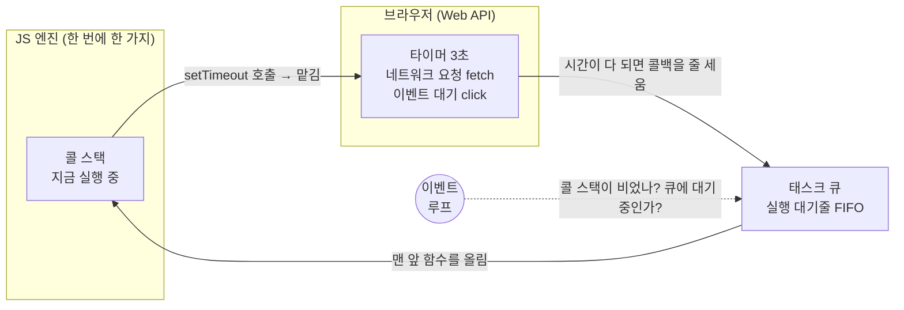
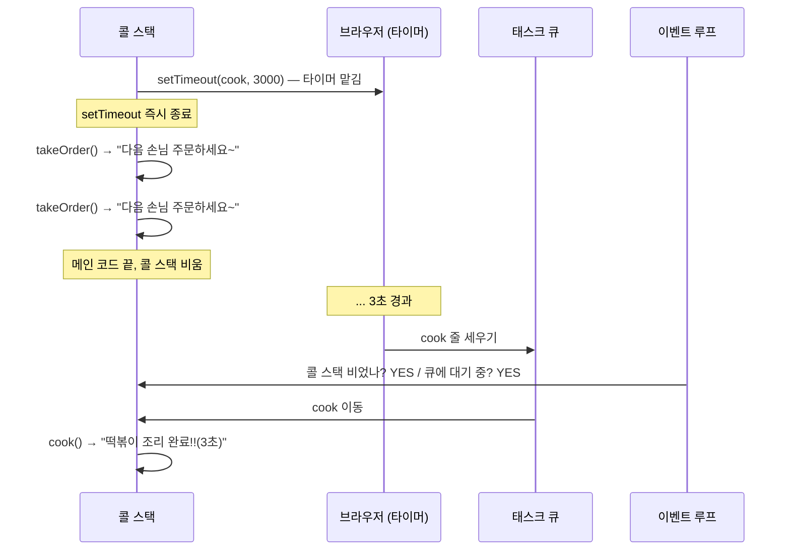

## 들어가며 (Situation)

11/20 자바스크립트 수업은 `03_Async` 폴더였다. 필기 맨 아래에 별표를 치고 이렇게 적었다.

> *오늘 블로그* — **동기, 비동기, 이벤트 루프, 태스크 큐**

그래서 이 글은 이 네 단어를 중심으로 정리한다. Promise, async/await, fetch는 같은 날 배웠지만, 네 단어를 설명하는 데 필요한 만큼만 뒤에서 짧게 다룬다.

| 파일 | 내용 |
|------|------|
| `01_timer.html` | `setTimeout`, `setInterval` |
| `02_asynchronous.html` | 동기 vs 비동기, 태스크 큐, 이벤트 루프 |
| `03_promise-async-await.html` | 콜백 지옥 → Promise → async/await |
| `04_fetch.html` | 외부 API 호출 |

코드는 수업 코드(`C:\Lecture\11_JavaScript\03_Async`)의 `<script>` 부분이다. 모두 `console.log` 결과만 쓰는 코드라 Node.js v24로 실행했고, **몇 ms에 찍혔는지** 시간을 붙여 출력했다. 수업 코드가 아닌 실험은 **"예시 코드"**라고 표시했다.

> Node.js와 브라우저는 이벤트 루프 구현이 조금 다르다. 이 글의 실험(타이머, Promise 순서)은 두 환경에서 같은 결과가 나오는 범위로만 골랐다.

## 문제 상황 (Task)

필기에 적은 문장들이다.

- "코드는 위에서 아래로 흐른다는 규칙을 **우회**하는 것"
- "오래 걸리는 코드를 별도의 작업 공간으로 위임"
- "비동기 작업의 핵심은 **병렬** 작업 수행이다"
- "timeout은 비동기"

여기서 질문이 생겼다.

1. 위에서 아래로 실행하는 게 규칙인데, 어떻게 그 규칙을 "우회"하는가?
2. "별도의 작업 공간"은 어디인가? 누가 대신 기다려 주는가?
3. 기다림이 끝난 함수는 언제, 어떤 순서로 다시 실행되는가? → **태스크 큐, 이벤트 루프**
4. JS가 정말 "병렬"로 실행되는가?

## 해결 과정 (Action)

### 1. 동기(Synchronous): 앞 일이 끝나야 다음 일

수업 코드는 **3초 동안 아무것도 못 하게 붙잡는** `sleep` 함수를 만들어 동기 방식을 보여줬다.

```js
// 수업 코드 (02_asynchronous.html)
function sleep(func, delay) {
    const delayUntill = Date.now() + delay;
    while(Date.now() < delayUntill);   // 3초 동안 계속 시간만 확인
    func();
}
function cook()      { console.log("떡볶이 조리 완료!!(3초)"); }
function takeOrder() { console.log("다음 손님 주문하세요~"); }

sleep(cook, 3000);
takeOrder();
```

```text
 3000ms | 떡볶이 조리 완료!!(3초)
 3002ms | 다음 손님 주문하세요~
 3002ms | 다음 손님 주문하세요~
```

다음 손님은 **3초 뒤에야** 주문할 수 있다. 수업 HTML의 설명 그대로다.

> 동기: 떡볶이 조리(3초)가 끝날 때까지 다음 손님 주문을 받을 수 없게 된다.

코드가 위에서 아래로, 한 줄이 끝나야 다음 줄로 가는 것이 **동기**다. 브라우저였다면 이 3초 동안 클릭도 스크롤도 안 되는 "멈춘 화면"이 된다.

### 2. 비동기(Asynchronous): 맡겨 두고 다음 일

같은 일을 `setTimeout`으로 바꿨다.

```js
// 수업 코드 (02_asynchronous.html)
setTimeout(cook , 3000);
takeOrder();
takeOrder();
```

```text
    0ms | 다음 손님 주문하세요~
    2ms | 다음 손님 주문하세요~
    2ms | (메인 코드 끝)
 3012ms | 떡볶이 조리 완료!!(3초)
```

> 비동기: 떡볶이 조리(3초) 하는 동안 다음 손님의 주문을 먼저 받는다.

코드에는 `cook`이 먼저 적혀 있는데, 출력은 주문이 먼저다. 필기의 "위에서 아래로 흐른다는 규칙을 **우회**"가 이것이다.

`01_timer.html`도 같은 모습이었다.

```js
// 수업 코드 (01_timer.html)
setTimeout( () => console.log('5초 경과! 피자 조리 완료~~🍕') , 5000 );
console.log("주문 하실 사람!~~");
setTimeout( (menuName) => console.log(`3초 경과! ${menuName} 조리 완료~~🍗`) , 3000, "치킨" );

let count = 1;
const interval = setInterval(() => {
    console.log(`배달 도착까지 ${5 - count} 초`);
    count++;
    if(count == 5) {
        clearInterval(interval);   // 종료 조건이 없으면 영원히 반복
        console.log('배달 완료~~~🛒');
    }
} , 1000);
```

```text
    0ms | 주문 하실 사람!~~
 1005ms | 배달 도착까지 4 초
 2014ms | 배달 도착까지 3 초
 3010ms | 3초 경과! 치킨 조리 완료~~🍗
 3025ms | 배달 도착까지 2 초
 4040ms | 배달 도착까지 1 초
 4040ms | 배달 완료~~~🛒
 5009ms | 5초 경과! 피자 조리 완료~~🍕
```

**적은 순서**(피자 → 주문 → 치킨 → 카운트다운)와 **실행된 순서**(주문 → 카운트다운 → 치킨 → 피자)가 완전히 다르다. 결과는 코드 위치가 아니라 **시간이 짧은 순서**로 나왔다.

| | 동기 | 비동기 |
|--|------|--------|
| 실행 방식 | 앞 작업이 끝나야 다음 작업 | 오래 걸리는 작업은 맡겨 두고 다음 작업 |
| 떡볶이 가게 | 사장님이 냄비 앞을 못 떠남 | 냄비는 불에 맡기고 카운터로 |
| 실험 결과 | 주문까지 3000ms | 주문 0ms, 조리 완료 3012ms |
| 코드 순서 = 실행 순서? | O | X |

### 3. "별도의 작업 공간"은 어디인가: 콜 스택과 Web API

여기서 막혔다. JS는 **한 번에 한 가지 일만** 하는 언어다. 실행 중인 함수가 쌓이는 곳, 즉 **콜 스택(call stack)**이 하나뿐이다. 그러면 3초를 누가 세는가?

답은 **JS 엔진 밖**이다. `setTimeout`은 타이머를 **브라우저(Web API)**에 맡기고 바로 끝난다. 3초를 세는 건 브라우저의 일이다. (Node.js에서는 Node 런타임이 같은 역할을 한다.) ([MDN - JavaScript execution model](https://developer.mozilla.org/en-US/docs/Web/JavaScript/Reference/Execution_model))



필기의 "1-1) 오래 걸리는 코드를 별도의 작업 공간으로 위임하는 코드(0.001초 소요)"가 바로 `setTimeout(cook, 3000)` 한 줄이다. 이 줄 자체는 브라우저에 맡기기만 하고 즉시 끝난다. 실험에서 다음 줄이 **0ms**에 실행된 이유다.

#### 필기 "비동기의 핵심은 병렬 작업"을 고쳐 적기

실험 결과를 보고 이 문장을 조금 고쳐야겠다고 생각했다.

- **병렬로 일어나는 것**: 기다리는 일(타이머 세기, 서버 응답 기다리기). 이 일은 브라우저가 JS와 **동시에** 한다.
- **병렬이 아닌 것**: JS 코드 실행. `cook()` 자체는 결국 **같은 콜 스택 하나**에서 실행된다.

그래서 `setTimeout`은 "기다림"을 맡기는 것이지 "무거운 계산"을 다른 곳에서 돌려 주는 것이 아니다. 아래 실험 4가 그 증거다.

### 4. 태스크 큐(Task Queue): 기다림이 끝난 함수의 대기줄

수업 HTML의 정의:

> **태스크 큐** — 비동기 함수의 콜백 함수 or 이벤트 핸들러가 일시적으로 보관되는 영역

3초가 지났다고 `cook`이 바로 실행되지 않는다. 브라우저는 `cook`을 **태스크 큐에 줄 세운다.** 큐는 먼저 들어온 것이 먼저 나가는 **FIFO** 구조다. 11/18에 배운 `addEventListener`의 클릭 핸들러도 클릭이 일어나면 이 큐로 들어온다.

#### 수업 코드 주석 하나 확인하기

수업 코드에 이런 주석이 있었다.

```js
// 수업 코드 (02_asynchronous.html)
setTimeout(cook , 3000); // 코드를 만나는 순간 Stack 영역에 올라가는 것이 아닌 테스크 큐에 올라감
```

선생님의 개념 자료(`00_concept-desktop.html`의 "이벤트 루프 구경")와 MDN을 보니 순서가 조금 더 자세했다.

| 시점 | 실제로 일어나는 일 |
|------|------------------|
| 코드를 만난 순간 | `setTimeout` **호출 자체는 콜 스택**에 올라감 → 타이머를 브라우저에 맡기고 바로 끝남 |
| 0 ~ 3초 | `cook`은 **아직 어디에도 줄 서지 않음.** 브라우저가 타이머만 셈 |
| 3초 후 | 그제야 `cook`이 **태스크 큐**에 들어감 |
| 콜 스택이 빌 때 | 이벤트 루프가 `cook`을 콜 스택으로 옮겨 실행 |

"`cook`이 바로 콜 스택에서 실행되지 않는다"는 주석의 뜻은 맞다. 다만 태스크 큐에 들어가는 때는 "코드를 만난 순간"이 아니라 "**시간이 다 된 뒤**"다.

### 5. 이벤트 루프(Event Loop): 두 가지만 확인하는 감시자

수업 HTML의 정의:

> **이벤트 루프** — 콜 스택에 현재 실행 중인 실행 컨텍스트가 있는지, 태스크 큐에 대기 중인 함수가 있는지를 반복 확인한다. 콜 스택이 비어 있고, 태스크 큐에 대기 중인 함수가 있다면 FIFO(선입선출) 방식으로 콜 스택으로 이동시킨다.

`02_asynchronous.html`의 실행을 시간 순서로 그렸다.



#### 실험: 콜 스택이 비지 않으면 0ms 타이머도 못 들어온다

"콜 스택이 **비어 있어야** 옮긴다"는 조건이 정말인지 확인했다. 타이머를 **0ms**로 걸고, 바로 뒤에서 2초 동안 콜 스택을 붙잡았다. (예시 코드)

```js
// 예시 코드
setTimeout(() => console.log('setTimeout 0ms 콜백 실행'), 0);

const u = Date.now() + 2000;
while (Date.now() < u);           // 2초 동안 콜 스택 점유 (수업의 sleep과 같은 방식)
console.log('2초짜리 동기 코드 끝 (콜 스택 비움)');
```

```text
 2000ms | 2초짜리 동기 코드 끝 (콜 스택 비움)
 2002ms | setTimeout 0ms 콜백 실행
```

0ms 타이머는 거의 즉시 태스크 큐에 들어갔을 것이다. 하지만 **콜 스택이 2초 동안 비지 않아서** 이벤트 루프가 옮기지 못했다. 그래서 2002ms에 실행됐다.

여기서 두 가지를 알게 됐다.

- `setTimeout`의 지연 시간은 "정확히 그 시간 뒤"가 아니라 **"최소 그 시간 뒤"**다. 개념 자료에도 "3000을 줘도 정확히 3.000초가 아니라 3초 이후 가능한 빨리"라고 적혀 있다. ([MDN - setTimeout: Reasons for delays longer than specified](https://developer.mozilla.org/en-US/docs/Web/API/Window/setTimeout#reasons_for_delays_longer_than_specified))
- 3번에서 고쳐 적은 내용의 증거다. 무거운 **계산**을 `setTimeout`에 넣어도, 결국 같은 콜 스택에서 돌기 때문에 그동안 화면은 멈춘다. 비동기로 맡길 수 있는 것은 **기다림**이다.

### 6. 한 단계 더: 태스크 큐가 하나가 아니다

Promise를 배우면서 순서를 하나 더 실험했다. (예시 코드)

```js
// 예시 코드
console.log('1. 동기');
setTimeout(() => console.log('4. setTimeout 0ms (태스크 큐)'), 0);
Promise.resolve().then(() => console.log('3. Promise.then (마이크로태스크 큐)'));
console.log('2. 동기');
```

```text
1. 동기
2. 동기
3. Promise.then (마이크로태스크 큐)
4. setTimeout 0ms (태스크 큐)
```

`setTimeout`이 코드상 먼저인데 `Promise.then`이 먼저 실행됐다. Promise의 콜백은 일반 태스크 큐가 아니라 **마이크로태스크 큐**에 들어간다. 이벤트 루프는 태스크 하나를 처리할 때마다 **마이크로태스크 큐부터 전부 비운다.** ([MDN - Using microtasks](https://developer.mozilla.org/en-US/docs/Web/API/HTML_DOM_API/Microtask_guide))

| 대기줄 | 들어가는 것 | 우선순위 |
|--------|-----------|---------|
| 마이크로태스크 큐 | `Promise.then/catch/finally`, `await` 다음 코드 | 높음 (콜 스택이 비면 먼저 전부) |
| 태스크 큐 | `setTimeout`, `setInterval`, 이벤트 핸들러 | 그다음 하나씩 |

수업에서는 다루지 않은 내용이라, "태스크 큐"를 정확히 이해하려면 알아야 할 부분으로 따로 적어 둔다.

### 7. 비동기의 순서를 다시 지키는 방법 (Promise, async/await, fetch)

비동기는 "언제 끝날지 모른다." 그런데 포인트를 1초마다 10P씩 **순서대로** 쌓아야 한다면? 수업은 세 단계로 보여줬다.

```js
// 수업 코드 (03_promise-async-await.html) — 1. 콜백 지옥
pointCallback(0 , point => {
    console.log(`${point}P`);
    pointCallback(point, point => {
        console.log(`${point}P`);
        pointCallback(point , point => { /* ... 50P까지 계속 안으로 */ })
    })
});
```

```js
// 수업 코드 (03_promise-async-await.html) — 2. Promise, 3. async/await (일부 생략)
function earnPoint(point) {
    return new Promise((resolve , reject) => {
        setTimeout( () => {
            const result = point + 10;
            if(result > 50) return reject(new Error("적립 한도 초과"));
            return resolve(result)
        } , 1000 );
    });
}

async function runAsync() {
    try {
        let point = await earnPoint(0);
        console.log(`${point}P`);
        point = await earnPoint(point);
        // ... 반복
    } catch(e) {
        console.log(e, '발생!!!')
    }
}
```

`runAsync` 실행 결과:

```text
 1002ms | 10P
 2013ms | 20P
 3017ms | 30P
 4023ms | 40P
 5034ms | 50P
 6043ms | Error: 적립 한도 초과 발생!!!
```

| 방식 | 순서 지키는 법 | 예외 처리 | 읽기 |
|------|--------------|----------|------|
| 콜백 | 콜백 안에 콜백 (콜백 지옥) | 단계마다 따로 | 오른쪽으로 계속 들여쓰기 |
| Promise | `.then().then()` 체이닝 | `.catch()` | 아래로 이어짐 |
| async/await | `await`로 한 줄씩 | `try-catch` | 동기 코드처럼 보임 |

수업 주석에 "비동기 처리를 동기 방식으로 동작하게 만드는 문법"이라고 되어 있다. 실험 결과로 보면 **코드가 동기처럼 읽힐 뿐, 실제로는 기다리는 동안 콜 스택을 비워 준다.** `await`에서 함수가 잠시 멈추고, 그 사이 다른 일(클릭 처리 등)이 실행된다. 멈췄던 함수는 6번의 마이크로태스크로 다시 이어진다. ([MDN - await](https://developer.mozilla.org/en-US/docs/Web/JavaScript/Reference/Operators/await))

마지막으로 `04_fetch.html`은 이 모든 것이 왜 필요한지 보여 준다. 11/17에 정리한 [서버 분리 구조(SSR·CSR)]({{ site.baseurl }})에서 프론트는 백엔드에 데이터를 요청한다.

```js
// 수업 코드 (04_fetch.html, 주석과 then 방식 생략)
async function getReviews() {
    const data = fetch('https://jsonplaceholder.typicode.com/posts?_limit=5'); // Promise 객체
    const res = await data;
    const reviews = await res.json();   // JSON 문자열 → JS 객체
    console.log(reviews[0].title);
}
```

> 프론트 서버에서는 백엔드 서버에게 데이터를 달라고 요청을 보내게 되는데, 만약 백엔드 서버에서 응답이 느리게 된다면 사용자는 영문도 모른 채 화면이 멈추는 경험을 하게 된다. 따라서 JS 기반의 프론트 서버는 API 호출은 모두 비동기 방식으로 진행을 하게 된다. — 수업 코드 `02_asynchronous.html`

서버 응답을 기다리는 일은 브라우저(Web API)가 맡고, 응답이 오면 콜백이 큐로 들어와 이벤트 루프를 타고 실행된다. 오늘 배운 네 단어가 그대로 적용된다.

## 결과 (Result)

| 키워드 | 한 줄 정리 | 확인한 실험 |
|--------|----------|-----------|
| **동기** | 앞 작업이 끝나야 다음 작업 | `sleep` → 주문이 3000ms에야 실행 |
| **비동기** | 기다림은 브라우저에 맡기고 다음 줄로 | `setTimeout` → 주문 0ms, 조리 3012ms |
| **태스크 큐** | 기다림이 끝난 콜백이 FIFO로 대기하는 줄 | 타이머 순서대로 치킨(3s) → 피자(5s) |
| **이벤트 루프** | 콜 스택이 비면 큐의 맨 앞을 콜 스택으로 | 0ms 타이머가 2초 동기 코드 뒤 2002ms에 실행 |

필기와 수업 주석에서 고쳐 적은 것:

| 원래 | 고쳐 적은 것 |
|------|------------|
| "비동기의 핵심은 병렬 작업" | 병렬인 건 **기다림**(브라우저). JS 실행은 콜 스택 하나 |
| "setTimeout을 만나는 순간 태스크 큐에 올라감" | 만나는 순간엔 브라우저에 타이머만 맡김. 큐에는 **시간이 다 된 뒤** |
| "비동기를 동기 방식으로 동작하게 만든다" (async/await) | 동기처럼 **읽힐** 뿐, 기다리는 동안 콜 스택은 비어 있음 |

배운 점: "비동기 = 동시에 실행"이라고 막연히 생각했는데, 실제로는 **JS는 혼자 일하고, 기다림만 남에게 맡기는 구조**였다. 0ms 타이머가 2초 늦게 실행되는 실험 하나로 이벤트 루프의 조건("콜 스택이 비어 있어야")이 확실히 이해됐다.

## 더 학습하면 좋은 개념

- **마이크로태스크 큐와 이벤트 루프 처리 순서** — 6번 실험의 원리. Promise와 `setTimeout`이 섞이면 실행 순서를 예측할 수 있어야 한다.
- **실행 컨텍스트와 콜 스택** — 이벤트 루프 정의에 나오는 "실행 컨텍스트"가 무엇인지. 11/17의 호이스팅과도 연결된다.
- **Web Worker** — 3·5번에서 본 "무거운 계산은 `setTimeout`으로도 화면을 멈춘다"는 문제의 해결책. JS 코드를 정말 다른 스레드에서 실행한다.
- **`requestAnimationFrame`과 렌더링** — 이벤트 루프 사이사이에 화면이 언제 다시 그려지는지. 동기 코드가 화면을 멈추는 정확한 이유.
- **Java의 스레드와 비교** — Java는 요청마다 스레드를 늘려 동시에 처리하고, JS는 스레드 하나와 이벤트 루프로 처리한다. 서블릿 수업과 비교해 보면 두 모델의 장단점이 보인다.

## 참고 자료

- [MDN - JavaScript execution model (이벤트 루프, 잡 큐)](https://developer.mozilla.org/en-US/docs/Web/JavaScript/Reference/Execution_model)
- [MDN - Introducing asynchronous JavaScript](https://developer.mozilla.org/en-US/docs/Learn_web_development/Extensions/Async_JS/Introducing)
- [MDN - setTimeout()](https://developer.mozilla.org/en-US/docs/Web/API/Window/setTimeout)
- [MDN - Using microtasks in JavaScript](https://developer.mozilla.org/en-US/docs/Web/API/HTML_DOM_API/Microtask_guide)
- [MDN - Using promises](https://developer.mozilla.org/en-US/docs/Web/JavaScript/Guide/Using_promises)
- [MDN - await](https://developer.mozilla.org/en-US/docs/Web/JavaScript/Reference/Operators/await)
- [MDN - Fetch API](https://developer.mozilla.org/en-US/docs/Web/API/Fetch_API)
- [HTML Living Standard - Event loops](https://html.spec.whatwg.org/multipage/webappapis.html#event-loops)
