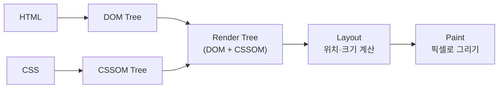
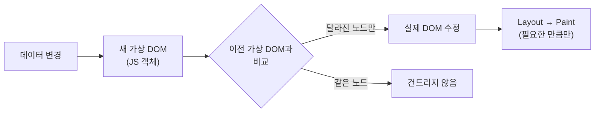
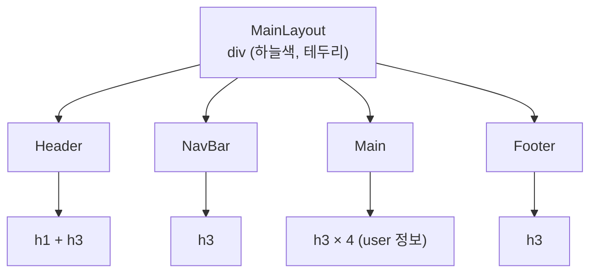

## 들어가며 (Situation)

11/23부터 **React** 수업이 시작됐다. 지난주에는 순수 JS로 DOM을 직접 고르고(`querySelector`), 이벤트를 달고, `fetch`로 데이터를 받아 왔다. ([11/18 글]({{ site.baseurl }}), [11/20 글]({{ site.baseurl }}))

수업은 "브라우저가 화면을 어떻게 그리는가"에서 시작해서, 왜 React가 필요한지, 그리고 컴포넌트로 화면을 조립하는 방법으로 이어졌다.

| 폴더 | 파일 | 내용 |
|------|------|------|
| `01_intro` | `01_createElement.html` | `React.createElement`, 가상 DOM |
| | `02_component.html` | 엘리먼트와 컴포넌트 |
| `02_component/01_JSX` | `01_jsx-intro.html`, `02_fragment.html` | JSX, Fragment |
| `02_component/02_component` | `01_function-component.html`, `02_composition.html` | 함수형 컴포넌트, 합성 |

이 글의 코드는 수업 코드(`C:\Lecture\12_React`)다. 모든 파일을 Edge 브라우저(헤드리스)로 직접 렌더링해서 결과 HTML과 콘솔 경고를 확인했다. 수업 코드가 아닌 것은 **"예시 코드"**라고 표시했다.

> 수업 코드의 `user` 객체에는 실제 이름·전화번호가 들어 있어서, 글에서는 **예시 값**(`홍길동`, `010-0000-0000`)으로 바꿨다.

| 항목 | 버전 (수업 코드 기준) |
|------|---------------------|
| React / ReactDOM | 18.3.1 (CDN `<script>`로 불러옴) |
| Babel | `@babel/standalone` 8.1.3 (브라우저에서 JSX 변환) |

## 문제 상황 (Task)

필기의 흐름은 이랬다.

1. "사용자 화면에 페이지가 등장하는 순서" — `DOMTree / CSSOMTree` → `RenderTree` → `Layout` → `Paint`
2. "순수 html, css, js로 화면을 구성하면, 변경될 때 화면을 재구성하는 과정이 굉장히 빈번하게 발생 … Tree를 구성하는 과정에서 굉장한 딜레이"
3. "→ 화면상에서 Tree를 구성하는 과정을 효과적으로" — **여기서 필기가 끊겼다.**
4. "일반 함수와 element 함수 차이는 앞글자 대문자 유무"
5. "composition: 컴포넌트 합성 — 공용으로 쓸 것들을 컴포넌트로 만들어 두고 조립한다"

끊긴 3번 문장을 채우는 것, 그리고 대문자 하나가 왜 그렇게 중요한지 확인하는 것이 이 글의 목표다.

## 해결 과정 (Action)

### 1. 브라우저가 화면을 그리는 순서

필기의 예시:

```html
<h1 class="test">안녕하세요!</h1>     <!-- HTML 요소 -->
```
```css
.test { background-color: red; }       /* CSS 요소 */
```

브라우저는 HTML과 CSS를 각각 트리로 만든 뒤 합친다. ([MDN - Critical rendering path](https://developer.mozilla.org/en-US/docs/Web/Performance/Guides/Critical_rendering_path), [MDN - How browsers work](https://developer.mozilla.org/en-US/docs/Web/Performance/Guides/How_browsers_work))



| 단계 | 하는 일 | `<h1 class="test">` 예시 |
|------|--------|-------------------------|
| DOM Tree | HTML을 노드 트리로 | `h1` 노드, 텍스트 노드 |
| CSSOM Tree | CSS를 규칙 트리로 | `.test → background-color: red` |
| Render Tree | 화면에 **보일** 노드 + 스타일 | 빨간 배경의 `h1` |
| Layout | 각 노드의 위치·크기 계산 | `h1`이 몇 px, 어디에 |
| Paint | 실제 픽셀로 그림 | 화면에 빨간 제목 |

필기에는 "RenderTree = Html + CSS"라고 적었는데, 정확히는 **DOM Tree + CSSOM Tree**를 합친 것이다. 그리고 `display: none`처럼 화면에 안 보이는 노드는 Render Tree에 들어가지 않는다. ([MDN - Critical rendering path: Render Tree](https://developer.mozilla.org/en-US/docs/Web/Performance/Guides/Critical_rendering_path#render_tree))

### 2. 순수 JS의 문제: 바뀔 때마다 이 과정을 다시

11/18에 했던 것처럼 순수 JS로 화면을 바꾸면, DOM을 건드릴 때마다 브라우저가 위의 **Layout → Paint를 다시** 해야 할 수 있다. 바뀌는 곳이 많고 자주 바뀌면, 필기 그대로 "Tree를 구성하는 과정에서 굉장한 딜레이"가 생긴다.

예를 들어 메뉴 목록 100개 중 가격 하나가 바뀌었을 때를 생각해 보면 (예시 코드):

```js
// 예시 코드 — 순수 JS로 목록 전체를 다시 그리는 방식
$list.innerHTML = menus.map(m => `<li>${m.name} ${m.price}</li>`).join('');
```

바뀐 건 하나인데 `<li>` 100개를 모두 새로 만든다. 그렇다고 바뀐 것만 골라 고치려면 "무엇이 바뀌었는지"를 개발자가 직접 추적해야 한다.

### 3. 끊긴 필기 채우기: React의 가상 DOM

필기의 "→ 화면상에서 Tree를 구성하는 과정을 효과적으로"의 뒷부분은 수업 코드 주석에 있었다.

```js
// 수업 코드 (01_createElement.html)
/*
    React 는 가상 돔(Virtual DOM)이라는 개념을 가지고 있다.
    메모리 상에 존재하는 DOM(코드 상으로 구현)
*/
```

React는 화면을 먼저 **메모리 위의 JS 객체 트리**(가상 DOM)로 만든다. 화면이 바뀌면 새 트리를 만들어 이전 트리와 비교하고, **달라진 부분만** 실제 DOM에 반영한다. React 공식 문서의 표현은 이렇다.

> React only changes the DOM nodes if there's a difference between renders. — [React 공식 문서 - Render and Commit](https://react.dev/learn/render-and-commit)



| | 순수 JS (11/18 방식) | React |
|--|---------------------|-------|
| 화면 변경 방법 | 개발자가 DOM을 직접 고름·수정 | 데이터를 바꾸면 React가 반영 |
| 무엇이 바뀌었는지 | 개발자가 추적 | React가 이전 트리와 비교 |
| 실제 DOM 수정 | 코드에 쓴 만큼 | 달라진 부분만 |

> 정리하다가 조심해야겠다고 느낀 점: "가상 DOM이니까 무조건 빠르다"는 아니다. 비교하는 비용도 있고, 잘 짠 순수 JS가 더 빠를 수도 있다. React가 주는 것은 **"바뀐 곳을 직접 추적하지 않아도, 실제 DOM 수정은 필요한 만큼만"** 이라는 점으로 이해했다.

### 4. 엘리먼트: `React.createElement`

```html
<!-- 수업 코드 (01_createElement.html) — React를 CDN으로 불러오기 -->
<script crossorigin src="https://unpkg.com/react@18.3.1/umd/react.development.js"></script>
<script crossorigin src="https://unpkg.com/react-dom@18.3.1/umd/react-dom.development.js"></script>

<div id = "root"></div>
```

```js
// 수업 코드 (01_createElement.html)
/*
    1번째 인자 : 만들려는 요소의 타입 (ex) h1, div, pre)
    2번째 인자 : 요소의 프로퍼티를 표현
    3번째 인자 : 자식 요소 표현
*/
const hiElement = React.createElement('h1' , {className: 'h1'} ,  'helloworld!');
ReactDOM.createRoot(document.getElementById('root')).render(hiElement);
```

브라우저 렌더링 결과 (`#root` 안):

```html
<h1 class="h1">helloworld!</h1>
```

`createElement`가 만든 `hiElement`는 실제 DOM이 아니라 **"h1을 이렇게 만들어 줘"라는 설명이 담긴 JS 객체**다. `render()`가 이 객체를 보고 `#root` 안에 실제 DOM을 만든다. 11/18에 `document.getElementById`로 DOM을 **직접** 고쳤던 것과의 차이다.

### 5. JSX: `createElement`를 HTML처럼 쓰기

수업 주석: "요소를 만들 때마다 createElement로 만들게 되면 굉장히 복잡하고 힘들다." 그래서 **JSX**를 쓴다.

```html
<!-- 수업 코드 (01_jsx-intro.html) -->
<!-- babel 은 jsx 를 js로 변환해주는 트랜스파일링 툴 -->
<script crossorigin src="https://unpkg.com/@babel/standalone@8.1.3/babel.min.js"></script>
...
<script type="text/babel">
```

```jsx
// 수업 코드 (01_jsx-intro.html) — user 값은 예시 값으로 바꿈
function formatName() {
    return `${user.lastName} ${user.firstName}`;
}
const user = { firstName : '길동', lastName : '홍' };

// jsx 내에서 중괄호를 활용하여 모든 js 표현식을 사용할 수 있다.
const element = <h1 class="test">안녕!! {formatName(user)}</h1>
// const element = React.createElement('h1', {class : 'test'}, "안녕!")
```

두 줄(JSX와 주석 처리된 `createElement`)은 같은 뜻이다. Babel이 JSX를 `React.createElement(...)` 호출로 바꿔 준다. ([React 공식 문서 - Writing Markup with JSX](https://react.dev/learn/writing-markup-with-jsx))

#### 브라우저에서 실행해 보니 나온 경고

렌더링은 됐지만(`<h1 class="test">안녕!! 홍 길동</h1>`), 콘솔에 React 경고가 찍혔다.

```text
Warning: Invalid DOM property `class`. Did you mean `className`?
    at h1
```

JSX는 결국 JS라서 HTML 속성 이름이 아니라 **DOM 프로퍼티 이름**을 쓴다. `class`는 JS 예약어라 `className`이다. 4번의 `createElement`에서 `{className: 'h1'}`로 쓴 이유와 같다. ([React 공식 문서 - JSX: className](https://react.dev/learn/writing-markup-with-jsx))

| HTML | JSX |
|------|-----|
| `class="test"` | `className="test"` |
| `style="background-color: red"` | `style={{ backgroundColor: 'red' }}` |
| `onclick="..."` | `onClick={함수}` |

또 하나, 모든 JSX 파일에서 다음 경고가 나왔다.

```text
You are using the in-browser Babel transformer. Be sure to precompile your scripts for production
```

브라우저에서 매번 Babel로 변환하는 방식은 **학습용**이라는 뜻이다. 실제 프로젝트는 11/17 글에서 본 Vite 같은 도구가 미리 변환한다. 수업 주석의 "React를 사용하는 방법 2가지 — 1. React 앱 생성, 2. script 태그로 임포트" 중 지금은 2번으로 배우는 중이다.

#### Fragment: 최상위 요소는 하나

```jsx
// 수업 코드 (02_fragment.html) — user 값은 예시 값으로 바꿈
const user = { name : '홍길동', phone : '010-0000-0000' }

// 1. 최상위 엘리먼트가 두 개 이상 (== 같은 레벨) 이면 문법 에러
// const element = (
//     <h1>{user.name}</h1>
//     <h3>{user.phone}</h3>
// );

// 2. <div>로 감싸면 되지만 불필요한 div가 생긴다.

// 3. <></> (React.Fragment)
const element = (
        <>
            <h1>{user.name}</h1>
            <h3>{user.phone}</h3>
        </>
);
```

렌더링 결과:

```html
<div id="root"><h1>홍길동</h1><h3>010-0000-0000</h3></div>
```

`<></>`는 결과 HTML에 **아무것도 남기지 않았다.** 1번이 에러인 이유는 JSX가 `createElement(...)` **하나**로 바뀌어야 하기 때문이다. 함수는 값을 하나만 반환할 수 있다. ([React 공식 문서 - Fragment](https://react.dev/reference/react/Fragment))

### 6. 컴포넌트: 엘리먼트를 반환하는 함수, 그리고 대문자

```js
// 수업 코드 (02_component.html)
/*
    React 에서 중요한 키워드
    1. 엘리먼트 - 요소 노드, 어트리뷰트 노드, 텍스트 노드로 구성된다.
    2. 컴포넌트 - 엘리먼트를 반환하는 개념을 가진 화면의 구성 조각 단위
*/
// 함수형 컴포넌트 -> 함수 이름 앞글자 대문자!!
function Helloworld() {
    return React.createElement('h1' , {className: 'h1'} ,  'helloworld!');
}
ReactDOM.createRoot(document.getElementById('root'))
        .render(React.createElement(Helloworld));   // 컴포넌트를 엘리먼트화
```

```jsx
// 수업 코드 (01_function-component.html)
// 함수형 컴포넌트의 특징: 1. 앞글자 대문자!  2. return 엘리먼트!
function Header() {
    return (
        <>
            <h1>😎😎헤더입니다!😎😎</h1>
            <h3>사이트 이름~~~</h3>
        </>
    );
}
ReactDOM.createRoot(document.getElementById('root'))
        // .render(React.createElement(Header));
        .render(<Header/>);
```

| | 엘리먼트 | 컴포넌트 |
|--|---------|---------|
| 정체 | 화면에 그릴 것을 설명하는 **객체** | 엘리먼트를 **반환하는 함수** |
| 예시 | `<h1>...</h1>`, `createElement('h1', ...)` | `function Header() { return <h1/> }` |
| 사용 | `render(element)` | `render(<Header/>)` |

#### 필기 "앞글자 대문자 유무" — 직접 실험

수업 코드 주석: "컴포넌트의 앞글자가 소문자면 컴포넌트로 인식하는 것이 아닌 단순 html 요소로 인식하게 된다." 정말 그런지, 같은 내용의 함수를 소문자 이름으로 만들어 렌더링했다. (예시 코드)

```jsx
// 예시 코드
function header() { return <h1>소문자 컴포넌트</h1>; }
ReactDOM.createRoot(document.getElementById("root2")).render(<header/>);
```

브라우저 렌더링 결과:

```html
<div id="root2"><header></header></div>
```

`<h1>소문자 컴포넌트</h1>`가 아니라 **빈 `<header>` 태그**가 나왔다. 내가 만든 `header` 함수는 아예 호출되지 않았고, React는 이것을 HTML의 `<header>` 태그로 처리했다. 에러도 경고도 없어서 더 찾기 어려운 실수다.

Babel이 JSX를 바꾸는 규칙을 보면 이유가 보인다.

| JSX | Babel 변환 결과 | 의미 |
|-----|---------------|------|
| `<Header/>` (대문자) | `React.createElement(Header)` | **변수(함수)** `Header`를 넘김 → 컴포넌트 |
| `<header/>` (소문자) | `React.createElement('header')` | **문자열** `'header'`를 넘김 → HTML 태그 |

그래서 필기의 "일반 함수와 element 함수 차이는 앞글자 대문자 유무"는 단순한 이름 짓기 습관이 아니라, **JSX에서는 문법적으로 갈리는 규칙**이다. ([React 공식 문서 - Your First Component](https://react.dev/learn/your-first-component#defining-a-component): "React components are regular JavaScript functions, but their names must start with a capital letter or they won't work!")

### 7. 컴포지션: 컴포넌트를 조립한다

필기: "공용으로 쓸 것들을 컴포넌트로 만들어 둔다. 그리고 쓸 것들을 조립한다."

```jsx
// 수업 코드 (02_composition.html) — user 값은 예시 값으로 바꿈
function Header() { return (<><h1>😎😎헤더입니다!😎😎</h1><h3>사이트 이름~~~</h3></>); }
function NavBar() { return (<><h3>🧭🧭네비게이션 바 입니다!!🧭🧭</h3></>); }
function Footer() { return (<><h3>🦶🦶푸터 바 입니다!!🐾🐾</h3></>); }

const user = { name : "홍길동", phone : "010-0000-0000", age : 20, gender : '여' };

function Main() {
    return (
        <>
            <h3>이름 : {user.name}</h3>
            <h3>전화번호 : {user.phone}</h3>
            <h3>나이 : {user.age}</h3>
            <h3>성별 : {user.gender}</h3>
        </>
    );
}

function MainLayout(){
    return(
        <div style={{border : '1px solid black', backgroundColor : 'skyblue'}}>
            <Header/>
            <NavBar/>
            <Main/>
            <Footer/>
        </div>
    );
}
ReactDOM.createRoot(document.getElementById('root')).render(<MainLayout/>);
```



브라우저 렌더링 결과:

```html
<div style="border: 1px solid black; background-color: skyblue;">
  <h1>😎😎헤더입니다!😎😎</h1><h3>사이트 이름~~~</h3>
  <h3>🧭🧭네비게이션 바 입니다!!🧭🧭</h3>
  <h3>이름 : 홍길동</h3><h3>전화번호 : 010-0000-0000</h3><h3>나이 : 20</h3><h3>성별 : 여</h3>
  <h3>🦶🦶푸터 바 입니다!!🐾🐾</h3>
</div>
```

결과에서 눈에 띈 점:

- `Header`, `NavBar`, `Main`, `Footer`라는 이름은 결과 HTML에 **하나도 남지 않았다.** 컴포넌트는 HTML 조각을 만들어 내는 함수일 뿐이고, 남는 것은 반환한 엘리먼트다. 각 컴포넌트가 Fragment(`<></>`)를 써서 불필요한 `div`도 없다.
- `style={{ ... }}`의 바깥 `{}`는 "JS 표현식", 안쪽 `{}`는 "스타일 객체"다. `background-color`가 아니라 `backgroundColor`(camelCase)로 썼다.

필기의 "공용으로 쓸 것"이 바로 `Header`, `NavBar`, `Footer`다. 다른 페이지 레이아웃을 만들 때 이 셋은 그대로 가져다 쓰고 `Main`만 바꾸면 된다. Java로 치면 클래스를 상속해서 확장하기보다, 필요한 부품을 **조합**하는 방식이다. React 구버전 공식 문서는 컴포넌트 재사용에 상속 대신 합성을 권한다. ([React 레거시 문서 - Composition vs Inheritance](https://legacy.reactjs.org/docs/composition-vs-inheritance.html))

## 결과 (Result)

| 필기 | 정리 |
|------|------|
| DOMTree / CSSOMTree → RenderTree → Layout → Paint | Render Tree = DOM Tree + CSSOM Tree (보이는 노드만) |
| "Tree를 구성하는 과정을 효과적으로…" (끊긴 문장) | 가상 DOM으로 비교해서 **달라진 부분만** 실제 DOM에 반영 |
| 엘리먼트 | 화면에 그릴 것을 설명하는 객체 (`createElement`, JSX) |
| 앞글자 대문자 유무 | 대문자 → 함수(컴포넌트) 호출 / 소문자 → HTML 태그 문자열 |
| composition | `Header`, `NavBar`, `Main`, `Footer`를 `MainLayout`에서 조립 |

수업 파일 6개를 모두 브라우저에서 렌더링해 확인했다. 그 과정에서 수업 코드에 대해 두 가지를 찾았다.

| 확인한 것 | 결과 |
|----------|------|
| `01_jsx-intro.html`의 `class="test"` | React 경고 → `className`으로 써야 함 |
| 컴포넌트를 소문자로 쓰면? | 에러 없이 빈 `<header>` 태그가 렌더링됨 (함수는 호출 안 됨) |

배운 점: React는 "HTML을 JS 안에 쓰는 도구"가 아니라 **"화면을 데이터로 설명하면, 실제 DOM 반영은 알아서 필요한 만큼만"** 해 주는 도구였다. 11/17에 배운 "함수가 값이다"가 여기서 다시 나왔다. 컴포넌트는 엘리먼트를 반환하는 **함수**이고, `<Header/>`는 그 함수를 넘기는 문법이다.

## 더 학습하면 좋은 개념

- **재조정(Reconciliation)과 `key`** — React가 이전 트리와 새 트리를 비교하는 규칙. 목록을 `map`으로 그릴 때 `key`가 필요한 이유다.
- **Props** — 지금은 `Main`이 바깥의 `user`를 직접 읽는다. 컴포넌트에 값을 **넘겨서** 같은 컴포넌트로 다른 내용을 그리는 방법. 컴포지션의 다음 단계다.
- **Reflow와 Repaint** — 1번의 Layout·Paint가 언제 다시 일어나는지. 어떤 CSS 변경이 비싼지 알 수 있다.
- **Vite로 React 프로젝트 만들기** — Babel 경고("precompile your scripts")의 해결책. 수업 주석의 "1. React 앱 생성" 방식이다.
- **State와 렌더링** — "데이터를 바꾸면 화면이 바뀐다"의 실제 문법(`useState`). 가상 DOM 비교가 언제 시작되는지 이해할 수 있다.

## 참고 자료

- [MDN - Critical rendering path](https://developer.mozilla.org/en-US/docs/Web/Performance/Guides/Critical_rendering_path)
- [MDN - How browsers work](https://developer.mozilla.org/en-US/docs/Web/Performance/Guides/How_browsers_work)
- [React 공식 문서 - Render and Commit](https://react.dev/learn/render-and-commit)
- [React 공식 문서 - Writing Markup with JSX](https://react.dev/learn/writing-markup-with-jsx)
- [React 공식 문서 - Fragment](https://react.dev/reference/react/Fragment)
- [React 공식 문서 - Your First Component](https://react.dev/learn/your-first-component)
- [React 공식 문서 - createElement](https://react.dev/reference/react/createElement)
