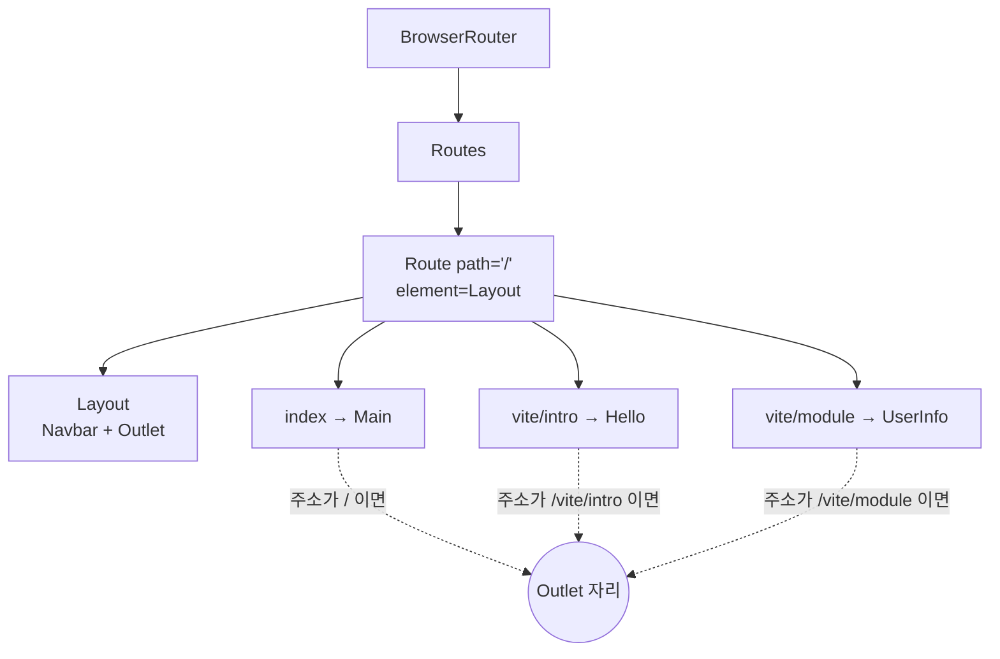
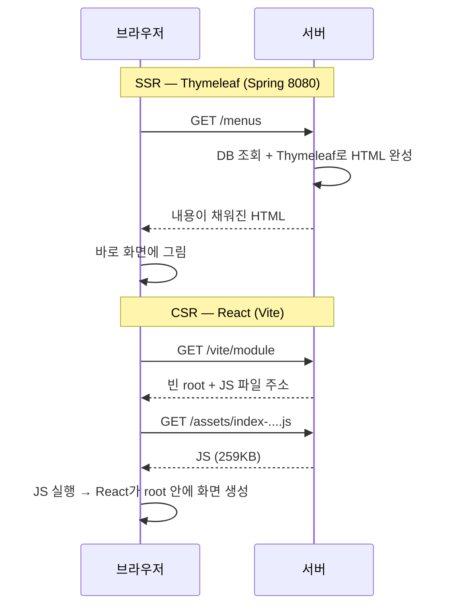
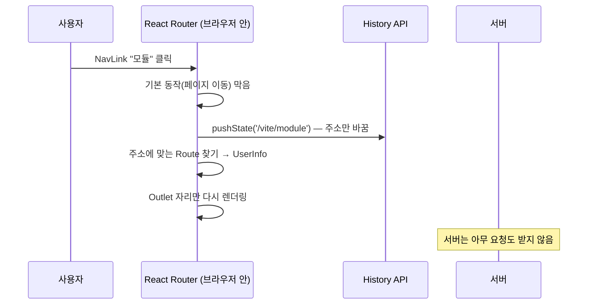
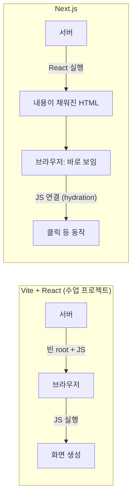

## 들어가며 (Situation)

11/23까지는 HTML 파일 하나에 React를 CDN `<script>`로 불러와서 배웠다. ([11/23 글]({{ site.baseurl }})) 11/24에는 처음으로 **Vite로 React 프로젝트를 만들고**, `react-router-dom`으로 메뉴를 눌러 화면을 바꾸는 앱을 만들었다.

필기에 선생님이 "오늘 블로그 정리 키워드"를 적어 주셨다.

> 1. SSR / CSR 방식의 렌더링 차이 — Thymeleaf 방식은 SSR, React는 CSR 방식
> 2. React의 특징인 SPA (Single Page Application) — 동작 방식
> 3. (심화) React / Next의 렌더링 방식 차이 — React는 CSR 방식, Next는 SSR 방식
> \+ 검색엔진 최적화

이 글은 이 키워드를 중심으로, 수업 프로젝트 `component-app`을 **직접 빌드하고 브라우저에서 눌러 보며** 확인한 내용이다.

| 항목 | 버전 (수업 `package.json` 기준) |
|------|------|
| React / ReactDOM | ^19.3.1 |
| react-router-dom | ^7.18.6 |
| Vite | ^8.3.6 |

코드는 수업 코드(`C:\Lecture\12_React\02_component\component-app`)다. 실험은 `vite build`로 빌드한 결과를 `vite preview`로 띄우고, Edge 브라우저(헤드리스)에서 실행했다. 실험용으로 넣은 코드는 **"예시 코드"**로 표시했다.

> 수업 코드의 `user.js`에는 실제 이름·나이·이메일이 들어 있어서, 글에서는 **예시 값**(`홍길동`, `20`, `hong@example.com`)으로 바꿨다.

## 문제 상황 (Task)

11/17 첫 수업 글에서 SSR과 CSR을 표로 정리했었다. 하지만 그때는 **말로만** 이해한 상태였다.

- CSR이면 "브라우저가 화면을 그린다"는데, 그럼 서버는 **실제로** 무엇을 보내는가?
- SPA는 "페이지가 하나"라는데, 메뉴를 누르면 주소(`/vite/module`)가 바뀐다. 이게 어떻게 한 페이지인가?
- `<a href>` 대신 `NavLink`를 쓰는 이유는?
- "Next는 SSR"이라는데, 그럼 React로는 SSR을 못 하는가? 검색엔진 최적화와는 무슨 관계인가?

## 해결 과정 (Action)

### 1. 프로젝트 만들기: Vite와 npm

```bash
npm create vite@latest component-app   # 프로젝트 생성 (React 템플릿 선택)
npm run dev                            # 개발 서버 실행 → http://localhost:5173
# Ctrl + C                             # 서버 종료
npm install react-router-dom           # 라이브러리 추가
```

필기는 모두 Spring에 빗대어 적었다. 표로 옮겼다.

| 필기 | React (Vite) | Spring에서는 |
|------|-------------|-------------|
| "vite: 프론트 서버 빌드 도구 == gradle 역할" | Vite | Gradle |
| "package.json == build.gradle" | `package.json` (의존성, 실행 스크립트) | `build.gradle` |
| `npm install react-router-dom` | 의존성 추가 → `node_modules/` | `implementation '...'` → Gradle 캐시 |
| "vite 기반 서버: 5173" | `npm run dev` (5173) | `bootRun` (8080) |

```json
// 수업 코드 (package.json, 일부)
{
  "scripts": {
    "dev": "vite",
    "build": "vite build",
    "preview": "vite preview"
  },
  "dependencies": {
    "react": "^19.3.1",
    "react-dom": "^19.3.1",
    "react-router-dom": "^7.18.6"
  }
}
```

엄밀히 말하면 Vite는 Gradle처럼 "의존성 관리"를 하지는 않는다. 의존성은 **npm**이 `package.json`을 보고 설치하고, Vite는 **개발 서버**와 **빌드**(JSX 변환, 파일 묶기)를 맡는다. ([Vite 공식 문서 - Getting Started](https://vite.dev/guide/)) 11/23에 브라우저에서 Babel이 "precompile your scripts"라고 경고했던 일을 이제 Vite가 미리 해 준다.

### 2. 라우팅: 주소에 따라 보여줄 컴포넌트 정하기

```jsx
// 수업 코드 (src/App.jsx, 주석 일부 생략)
/*
  라우팅 : 요청한 url 주소에 따라 보여줄 컴포넌트를 정의하는 것이다.
  1. BrowserRouter : 라우팅 사용 영역을 감싸는 최상위 속성
  2. Routes : Route 를 묶는 부모 속성
  3. Route : path(주소)와 element 를 연결
*/
import { BrowserRouter, Routes, Route } from 'react-router-dom'
import Layout from "./layouts/layout"
import Main from "./pages/Main"

function App() {
  return (
    <BrowserRouter>
      <Routes>
          <Route path="/" element={<Layout/>}>
            <Route index element = {<Main/>}/>
            <Route path="vite/intro" element = {<Hello/>}/>
            <Route path="vite/module" element = {<UserInfo/>}/>
          </Route>
      </Routes>
    </BrowserRouter>
  )
}
```

```jsx
// 수업 코드 (src/layouts/Layout.jsx)
function Layout() {
    return (
        <div className={styles.layout}>
            <Navbar/>
            <main className={styles.content}>
                <Outlet/>   {/* 경로(Path)에 따라 다른 컴포넌트로 대체되는 엘리먼트 */}
            </main>
        </div>
    );
}
```

```jsx
// 수업 코드 (src/components/Navbar.jsx, 주석 일부 생략)
/*
    <a href>는 페이지 전체를 새로 불러오지만, Link는 새로고침 없이 주소만 바꿔 컴포넌트를 교체한다.
    NavLink는 Link와 같고, 현재 주소와 일치하면 isActive가 true가 되어 스타일을 바꿀 수 있다.
*/
const activeStyle = ({isActive}) => isActive ? {backgroundColor: 'orangered', color: 'white'} : undefined;

function Navbar() {
    return (
        <nav className={styles.nav}>
            <h2><NavLink to="/">React 챕터</NavLink></h2>
            <h4>01. Vite</h4>
            <NavLink to="/vite/intro" style={activeStyle}>프로젝트 생성</NavLink>
            <NavLink to="/vite/module" style={activeStyle}>모듈</NavLink>
        </nav>
    );
}
```



`Layout` 안의 `Navbar`는 그대로 있고, **`<Outlet/>` 자리만** 주소에 따라 바뀐다. 11/23에 배운 **컴포지션**(Header·NavBar·Main·Footer 조립)에서 `Main` 자리를 주소에 따라 갈아 끼우는 구조다. ([React Router 공식 문서 - Routing](https://reactrouter.com/start/declarative/routing))

모듈 페이지(`UserInfo`)는 컴포넌트 3개를 `import`해서 조립했다.

```js
// 수업 코드 (src/module/02_module/user.js) — 값은 예시 값으로 바꿈
export const user = { name : '홍길동', age : 20, email : 'hong@example.com' };
```

```jsx
// 수업 코드 (src/module/02_module/AgeCard.jsx)
/*
    export default 는 {} 없이 이름으로 import 받을 수 있지만, 파일 당 1개로 제한이 된다.
    export 는 {} 를 통해서 import 받을 수 있으며, 여러 개를 하나의 파일에서 내보낼 수 있다.
*/
import {user} from "./user";
export default function AgeCard() {
    return <h2 style={{color : 'orange'}}>{user.age}</h2>
}
```

| | `export default` | `export` (named) |
|--|------------------|------------------|
| 내보내기 | `export default function AgeCard()` | `export const user = ...` |
| 가져오기 | `import AgeCard from "./AgeCard"` | `import { user } from "./user"` |
| 파일당 개수 | 1개 | 여러 개 |

### 3. 키워드 1 — SSR/CSR: 빌드 결과로 확인하기

`vite build`를 실행하면 `dist/` 폴더에 실제로 배포할 파일이 생긴다. 결과는 이랬다.

```text
dist/index.html                 (HTML 1개)
dist/assets/index-BSYHW384.css    0.25 kB
dist/assets/index-CtUu9cRi.js   259.43 kB
```

```html
<!-- vite build 결과 dist/index.html (그대로) -->
<!doctype html>
<html lang="en">
  <head>
    <meta charset="UTF-8" />
    <link rel="icon" type="image/svg+xml" href="/favicon.svg" />
    <meta name="viewport" content="width=device-width, initial-scale=1.0" />
    <title>component-app</title>
    <script type="module" crossorigin src="/assets/index-CtUu9cRi.js"></script>
    <link rel="stylesheet" crossorigin href="/assets/index-BSYHW384.css">
  </head>
  <body>
    <div id="root"></div>
  </body>
</html>
```

**`<div id="root"></div>`가 비어 있다.** "React!!", 메뉴, 사용자 정보는 HTML 어디에도 없다. 전부 259KB짜리 JS 안에 있고, 브라우저가 이 JS를 받아 **실행해야** 화면이 생긴다. 이것이 CSR(Client Side Rendering)의 실체였다.

서버에 `/vite/module` 주소를 직접 요청해 봐도 응답은 같았다.

```text
$ curl http://localhost:4199/vite/module
... <title>component-app</title> ... <div id="root"></div> ...
```

Thymeleaf(SSR)와 비교하면:



| | SSR (Thymeleaf) | CSR (React + Vite) |
|--|----------------|-------------------|
| 서버가 보내는 HTML | **내용이 채워진** HTML | **빈 `root`** + JS 주소 |
| 화면을 만드는 곳 | 서버 | 브라우저 (JS 실행) |
| 주소마다 서버 응답 | 주소마다 다른 HTML | **어느 주소든 같은 `index.html`** |
| 첫 화면 | HTML만 오면 보임 | JS를 받고 실행해야 보임 |
| 화면 이동 | 매번 서버에 새 HTML 요청 | JS가 화면만 교체 (아래 SPA) |

### 4. 키워드 2 — SPA: 정말 페이지가 하나인지 눌러 보기

"Single Page Application"의 Single Page는 3번에서 본 **`index.html` 한 장**을 말한다. 그런데 메뉴를 누르면 주소가 바뀐다. 정말 새 페이지를 안 불러오는지 확인하려고, 빌드 결과에 실험 스크립트를 넣고 브라우저에서 `모듈` 메뉴를 클릭했다. (예시 코드)

```js
// 예시 코드 — 실험용 스크립트 (dist/index.html에 추가)
window.__mark = '새로고침 안 됨';   // 페이지가 새로 로드되면 사라지는 값
const nav = document.querySelector('nav');
[...document.querySelectorAll('nav a')].find(a => a.textContent === '모듈').click();
// 0.5초 뒤 확인
// location.pathname, window.__mark, nav === document.querySelector('nav'), ...
```

결과 (2번 줄의 사용자 정보는 예시 값으로 바꿈):

```text
1) 처음 주소: / | main: React!!  왼쪽 메뉴바에서 챕터를 선택해주세요
2) 클릭 후 주소: /vite/module | main: 홍길동 / 20 / hong@example.com
3) window.__mark: 새로고침 안 됨
4) nav 요소가 같은 DOM 노드인가: true
5) 활성 메뉴 스타일: background-color: orangered; color: white;
6) 문서 로드(navigation) 횟수: 1
```

비교를 위해 같은 주소로 가는 **일반 `<a href="/vite/intro">`**를 만들어 클릭했다. (예시 코드)

```text
<a href> 클릭 후 주소: /vite/intro
window.__mark: undefined          ← 페이지가 새로 로드되어 값이 사라짐
main: HelloWorld~~~~~😎😎
```

| | `NavLink` 클릭 | `<a href>` 클릭 |
|--|---------------|----------------|
| 주소 | `/vite/module`로 바뀜 | `/vite/intro`로 바뀜 |
| 페이지 새로 로드 | **안 됨** (`__mark` 유지) | **됨** (`__mark` 사라짐) |
| `nav` 요소 | 같은 DOM 노드 그대로 | 새로 만들어짐 |
| 서버 요청 | 없음 | `index.html` + JS 다시 받음 |



`NavLink`도 결과 HTML에서는 `<a>` 태그다. 다만 React Router가 클릭을 가로채서 **새로고침 대신** 브라우저의 History API로 주소만 바꾸고, `<Outlet/>` 자리만 다시 그린다. ([MDN - History.pushState()](https://developer.mozilla.org/en-US/docs/Web/API/History/pushState), [MDN - SPA](https://developer.mozilla.org/en-US/docs/Glossary/SPA)) 필기의 "NavLink는 a태그처럼 url을 변경해줌"이 바로 이것이고, 결과 5번처럼 현재 주소와 맞는 메뉴에는 `isActive` 스타일이 붙었다.

11/23에 배운 가상 DOM과도 연결된다. 주소가 바뀌어도 `Navbar`는 바뀐 게 없으니 실제 DOM을 건드리지 않았다(4번 결과 `true`). 바뀐 것은 `<main>` 안쪽뿐이다.

### 5. 키워드 3 (심화) — React와 Next.js의 렌더링 차이

필기: "react는 CSR 방식, Next는 SSR 방식". 공식 문서를 찾아보니 조금 더 정확히 적을 수 있었다.

- **React 자체**는 렌더링 장소를 정하지 않는 라이브러리다. `react-dom/server`로 서버에서 HTML을 만드는 API도 있다. ([React 공식 문서 - Server React DOM APIs](https://react.dev/reference/react-dom/server)) 수업에서 만든 **Vite + React 앱이 CSR**인 것이다.
- **Next.js**는 React 위에 만든 프레임워크다. 페이지를 **서버에서 미리 HTML로 만든 뒤** 보내고, 브라우저에서 JS가 붙어 동작하게 한다(hydration). HTML을 만드는 시점은 요청 때(SSR)일 수도 있고, 빌드 때 미리(정적 생성, SSG)일 수도 있다. ([Next.js 공식 문서 - Server and Client Components](https://nextjs.org/docs/app/getting-started/server-and-client-components))



| | Vite + React (CSR) | Next.js (SSR/SSG) | Thymeleaf (SSR) |
|--|-------------------|-------------------|-----------------|
| 첫 HTML | 빈 `root` | 내용 있음 | 내용 있음 |
| 화면 코드 | React 컴포넌트 | React 컴포넌트 | 템플릿 HTML |
| 페이지 이동 | SPA (JS가 교체) | SPA처럼 동작 (JS가 교체) | 매번 새 HTML |
| 서버 필요 | 정적 파일만 있으면 됨 | Node 서버 필요 (SSR일 때) | Spring 서버 |

정리하면 Next.js는 **SSR(첫 화면)과 SPA(이후 이동)의 장점을 합친 방식**이다. "React는 CSR, Next는 SSR"은 "수업에서 쓰는 Vite+React 구성은 CSR, Next는 기본으로 서버에서 HTML을 만든다"로 이해했다.

### 6. 검색엔진 최적화(SEO): 빈 `root`의 대가

필기: "어떤 사이트를 검색하면 사이트의 추가적인 정보를 브라우저에서 미리 볼 수 있음".

검색 결과에 보이는 제목·설명, 카카오톡이나 슬랙에 링크를 붙였을 때 뜨는 미리보기 카드는 **HTML 안의 내용과 `<meta>` 태그**에서 나온다. 3번의 빌드 결과를 다시 보면, JS를 실행하지 않는 쪽이 읽을 수 있는 정보는 이것뿐이다.

```html
<title>component-app</title>
<div id="root"></div>
```

- **Google**은 JS를 실행해서 렌더링한 뒤 색인할 수 있다. 다만 렌더링은 크롤링과 별도 단계로 나중에 처리될 수 있다. ([Google Search Central - JavaScript SEO basics](https://developers.google.com/search/docs/crawling-indexing/javascript/javascript-seo-basics))
- **링크 미리보기**(Open Graph의 `og:title`, `og:image` 등)를 만드는 봇은 많은 경우 JS를 실행하지 않고 HTML만 읽는다. CSR 앱에서 페이지마다 다른 미리보기를 보여주기 어려운 이유다. ([The Open Graph protocol](https://ogp.me/))

| | CSR (Vite + React) | SSR (Next.js, Thymeleaf) |
|--|-------------------|-------------------------|
| JS 없이 보이는 내용 | `<title>`과 빈 `root` | 페이지 내용 전체 |
| 페이지별 `<meta>`/미리보기 | 어려움 (HTML이 한 장) | 페이지마다 다르게 가능 |
| 어울리는 곳 | 로그인 후 쓰는 관리 화면, 대시보드 | 검색 노출이 중요한 쇼핑몰, 블로그 |

참고로 지금 이 블로그(Jekyll)는 빌드할 때 글마다 HTML을 **미리 만들어 두는** 방식이라, 5번 표의 SSG에 해당한다.

### 7. 덤: Windows에서만 되는 import

빌드 로그를 보다가 `App.jsx`의 import가 눈에 걸렸다.

```jsx
import Layout from "./layouts/layout"   // 실제 파일명은 Layout.jsx (대문자 L)
```

Windows는 파일 이름의 대소문자를 구분하지 않아서 개발 서버와 빌드 모두 정상 동작했다. 하지만 배포 서버로 많이 쓰는 Linux는 대소문자를 구분하므로 `layout`과 `Layout`을 다른 파일로 본다. 이 글을 쓰는 환경에서는 Linux 빌드를 해 보지 못했지만, 배포 전에 `./layouts/Layout`으로 맞춰 두는 것이 안전하다.

## 결과 (Result)

| 키워드 | 확인한 것 |
|--------|----------|
| **SSR / CSR** | `vite build` 결과 `index.html`의 `root`가 비어 있음. 어느 주소를 요청해도 같은 HTML |
| **SPA** | `NavLink` 클릭: 주소 `/` → `/vite/module`, 문서 로드 1회, `nav`는 같은 DOM 노드 그대로 |
| `<a href>`와 비교 | 같은 이동을 `<a href>`로 하면 새로 로드됨 (`__mark` 사라짐) |
| **React vs Next** | React는 렌더링 장소를 정하지 않음. Vite 구성은 CSR, Next는 서버에서 HTML을 먼저 만듦 |
| **SEO** | CSR 앱이 JS 없이 보여줄 수 있는 건 `<title>component-app</title>`뿐 |

| 숫자로 본 빌드 결과 | |
|--------|--|
| HTML 파일 | **1개** (Single Page) |
| JS 번들 | 259.43 kB (gzip 82.57 kB) — 화면 전체가 여기 들어 있음 |
| `NavLink`로 이동한 뒤 문서 로드 횟수 | **1회** (처음 접속한 한 번뿐) |

배운 점: 11/17에는 "CSR은 브라우저가 그린다"를 외웠다면, 오늘은 **빈 `<div id="root">`** 하나로 SSR/CSR, SPA, SEO가 한 번에 설명된다는 걸 알았다. HTML이 비어 있으니 브라우저가 JS로 그려야 하고(CSR), HTML이 한 장이니 이동은 JS가 맡고(SPA), JS를 안 돌리는 쪽은 빈 페이지를 보게 된다(SEO). Next.js 같은 SSR 프레임워크는 그 빈 곳을 서버에서 미리 채워 주는 방법이다.

## 더 학습하면 좋은 개념

- **Hydration** — 서버에서 만든 HTML에 브라우저의 React가 "붙는" 과정. Next.js를 이해하는 핵심이다.
- **SSG와 ISR** — 요청 때마다가 아니라 빌드 때 HTML을 미리 만드는 방식(이 블로그의 Jekyll도 SSG). Next.js는 페이지마다 방식을 고를 수 있다.
- **SPA 배포 시 fallback 설정** — `vite preview`는 `/vite/module`에도 `index.html`을 줬지만, 일반 정적 서버는 404를 낼 수 있다. 배포할 때 꼭 마주치는 문제.
- **코드 스플리팅 (`React.lazy`)** — 259KB를 한 번에 받는 대신 페이지별로 나눠 받아 첫 화면을 빠르게 하는 방법.
- **Open Graph / 메타 태그** — 링크 미리보기를 만드는 표준. SEO 필기의 "추가적인 정보를 미리 볼 수 있음"의 정체.

## 참고 자료

- [Vite 공식 문서 - Getting Started](https://vite.dev/guide/)
- [React Router 공식 문서 - Routing](https://reactrouter.com/start/declarative/routing)
- [React Router 공식 문서 - NavLink](https://reactrouter.com/api/components/NavLink)
- [MDN - SPA (Single-page application)](https://developer.mozilla.org/en-US/docs/Glossary/SPA)
- [MDN - History.pushState()](https://developer.mozilla.org/en-US/docs/Web/API/History/pushState)
- [React 공식 문서 - Server React DOM APIs](https://react.dev/reference/react-dom/server)
- [Next.js 공식 문서 - Server and Client Components](https://nextjs.org/docs/app/getting-started/server-and-client-components)
- [Google Search Central - JavaScript SEO basics](https://developers.google.com/search/docs/crawling-indexing/javascript/javascript-seo-basics)
- [The Open Graph protocol](https://ogp.me/)
