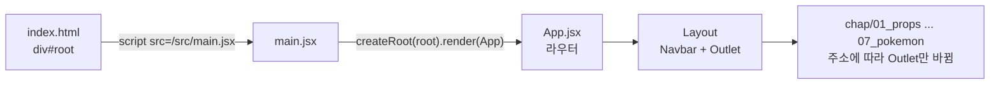
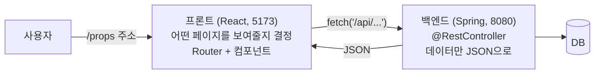
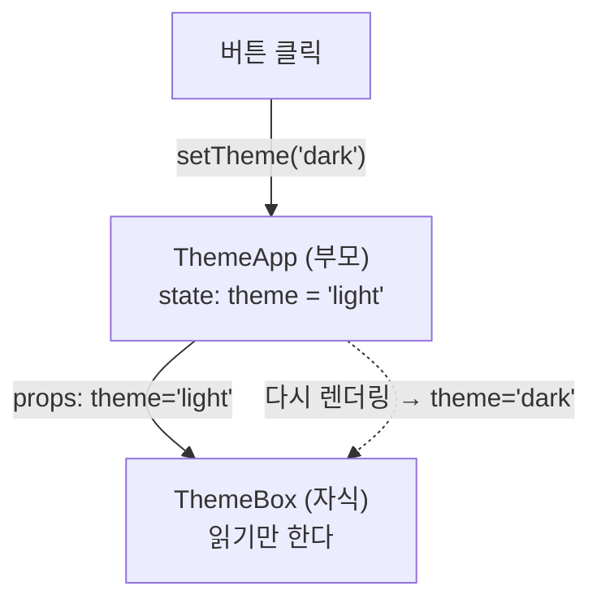
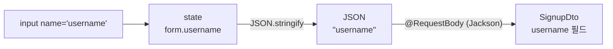

## 들어가며 (Situation)

11/25 React 수업은 새 프로젝트 `data-fetch-app-skeleton`으로 진행했다. 라우터와 메뉴는 선생님이 미리 만들어 두셨고, 수업에서는 `src/chap`의 TODO를 채웠다. 이날 채운 것은 4개다.

| 파일 | 주제 |
|------|------|
| `01_props.jsx` | props, children |
| `02_state.jsx` | `useState`, 이전 값(prev)으로 변경 |
| `03_event.jsx` | 이벤트, 입력값 관리 (제어 컴포넌트) |
| `04_iteration.jsx` | `map` 반복 렌더링, `key`, 배열 state 추가·삭제 |

선생님이 짚어 주신 **프론트에서 중요한 핵심 포인트**는 세 가지였다.

> 1. 컴포넌트  2. 상태관리  3. 렌더링 방식, 렌더링 최적화

그리고 필기에 별을 세 개 친 문장이 있다.

> ⭐⭐⭐ 모듈 3의 핵심: **백엔드와 프론트엔드의 역할 분리** ⭐⭐⭐

이 글은 수업 코드(`C:\Lecture\12_React\data-fetch-app-skeleton`)를 빌드해서 Edge 브라우저(헤드리스)로 버튼을 누르고 값을 입력하며 확인한 내용이다. 수업 코드에 없는 실험은 원본을 건드리지 않고 **복사본에 실험용 컴포넌트를 붙여** 실행했고, **"예시 코드"**로 표시했다.

> 수업 코드에는 실제 이름·아이디가 들어 있어서, 글에서는 예시 이름(`홍길동`, `김철수` 등)으로 바꿨다.

## 문제 상황 (Task)

- 프로젝트를 `git clone`하면 왜 바로 실행되지 않는가? (`node_modules`)
- 주소를 잘못 치면 어떻게 되는가? (예외 처리)
- 백엔드가 페이지를 안 돌려준다면, 백엔드는 무엇을 하는가?
- 부모가 자식에게 값을 어떻게 넘기는가? (props, 필기 예시: 라이트/다크 모드)
- `let count`를 바꿨는데 **왜 화면이 그대로인가?** (state)
- 입력창 여러 개를 객체 하나로 관리할 때 `...form`은 왜 필요한가? 그리고 필기에 붙여 둔 설명 — "**input의 `name`이 결국 백엔드 DTO의 필드 이름과 같아야 한다**" — 는 무슨 뜻인가?

## 해결 과정 (Action)

### 1. 프로젝트 세팅: `node_modules`

필기: "`node_modules`는 Java의 JDK같이 개발 시 필요한 kit들의 모음이다. 용량이 크기 때문에 기본적으로 git-ignore 되어 있으며, clone을 받으면 `npm install`로 우선 세팅해야 한다."

```bash
git clone <저장소 주소>
cd data-fetch-app-skeleton
npm install     # package.json(+package-lock.json)을 보고 node_modules를 다시 만든다
npm run dev
```

| | React (npm) | Spring (Gradle) |
|--|-------------|-----------------|
| 의존성 목록 | `package.json` | `build.gradle` |
| 정확한 버전 고정 | `package-lock.json` | (lock 파일 선택 사항) |
| 내려받은 라이브러리 위치 | 프로젝트 안 `node_modules/` | 사용자 폴더의 Gradle 캐시 |
| Git에 올리는가 | X (`.gitignore`) | X |

엄밀히는 `node_modules`는 JDK보다 **Gradle이 내려받은 라이브러리 캐시**에 더 가깝다. JDK에 해당하는 실행 환경은 Node.js 자체다. 차이는 Gradle은 캐시를 사용자 폴더에 두고, npm은 **프로젝트 폴더 안에** 둔다는 점이라 Git에서 꼭 빼야 한다. ([npm Docs - npm install](https://docs.npmjs.com/cli/commands/npm-install))

필기: "`App.jsx`, `main.jsx`는 삭제하면 안 됨!!" — `index.html`이 `main.jsx`를 불러오고, `main.jsx`가 `App`을 `#root`에 렌더링한다. 시작점이라 지우면 화면 전체가 사라진다.



### 2. 예외 처리: 없는 주소는 404 컴포넌트로

```jsx
// 수업 코드 (src/App.jsx)
<BrowserRouter>
    <Routes>
        <Route path="/" element={<Layout/>}>
            <Route index element={<Main/>}/>
            <Route path="props" element={<Props/>}/>
            {/* ... state, event, iteration, effect, fetch, pokemon */}
        </Route>
        <Route path="*" element={<Error404/>}/>
    </Routes>
</BrowserRouter>
```

필기: "라우트를 하나 더 만들어서 보여줄 컴포넌트 외 다른 요청이 들어오면 보이도록 함". `path="*"`는 위의 어떤 경로와도 맞지 않을 때 걸린다. ([React Router 공식 문서 - Routing](https://reactrouter.com/start/declarative/routing))

브라우저에서 `/abc`로 접속한 결과:

```text
nav 있음? false | 404 NOT FOUND / 준비가 안 된 페이지 입니다. / 메인으로
```

`*` 라우트는 `Layout` **바깥**에 있어서 메뉴(`nav`) 없이 404 화면만 나왔다. 메뉴를 유지한 채 404를 보여주고 싶다면 `Layout` 안쪽 자식 라우트로 넣으면 된다. 어디에 두느냐가 곧 화면 구성이다.

### 3. ⭐ 역할 분리: 백엔드는 데이터만, 페이지는 프론트가

필기:

> 백엔드는 페이지 리턴 X, 백엔드는 `@RestController`를 사용 ⇒ `@Controller` + `@ResponseBody`
> 페이지를 리턴하는 책임에서 벗어나 **데이터만을 JSON으로 return**
> 페이지를 결정하는 주체는 front 서버가 담당한다.

Spring 공식 문서도 `@RestController`를 "`@Controller`와 `@ResponseBody`가 합쳐진 애너테이션"이라고 설명한다. ([Spring Framework - Declaring a Controller](https://docs.spring.io/spring-framework/reference/web/webmvc/mvc-controller.html))

```java
// 예시 코드 — 수업 전(SSR) vs 지금(역할 분리)
@Controller                       // 반환값 = 뷰 이름 → Thymeleaf가 HTML을 만든다
public class MenuViewController {
    @GetMapping("/menus")
    public String list(Model model) {
        model.addAttribute("menus", menuService.findAll());
        return "menu/list";       // templates/menu/list.html
    }
}

@RestController                   // = @Controller + @ResponseBody, 반환값 = 응답 본문(JSON)
public class MenuApiController {
    @GetMapping("/api/menus")
    public List<MenuDto> list() {
        return menuService.findAll();   // [{"name":"떡볶이","price":4000}, ...]
    }
}
```



| | 이전 (SSR, Thymeleaf) | 모듈 3 (역할 분리) |
|--|----------------------|-------------------|
| 컨트롤러 | `@Controller` | `@RestController` |
| 반환값 | 뷰 이름 → HTML | 객체 → JSON |
| 어떤 페이지를 보여줄지 | 백엔드 (`return "menu/list"`) | **프론트** (React Router) |
| 화면을 그리는 곳 | 서버 | 브라우저 |

11/24 글에서 본 "빈 `<div id="root">`"와 SPA가 이 구조의 프론트 쪽이고, `@RestController`가 백엔드 쪽이다. 2번의 404 처리도 같은 이야기다. 없는 **페이지**를 판단하는 것도 이제 프론트의 일이다.

### 4. 핵심 포인트 1 — 컴포넌트와 props: 부모가 자식에게

```jsx
// 수업 코드 (01_props.jsx) — 이름 값은 예시 값으로 바꿈
/*
    props: 부모 컴포넌트가 자식 컴포넌트에게 전달하는 값이다.
    - 전달한 속성들은 하나의 객체(props)로 묶여 함수의 매개변수로 들어온다.
    - props는 읽기 전용이다. 자식 컴포넌트에서 수정하지 않는다.
    - 문자열이 아닌 값(숫자, 배열, 함수 등)은 {}로 전달한다.   age={20}
*/
function Title(props) {
    console.log(props);   // { name: '홍길동' }
    return <h1>안녕하세요 {props.name}님 반갑습니다.</h1>;
}

/* 매개변수에서 구조 분해 할당 (가장 많이 쓰는 형태) */
function Profile({name, age}) {
    return <h3>{name}님은 {age}살입니다.</h3>;
}

export default function Props() {
    return (
        <>
            <Title name="홍길동"/>
            <Title name="gildong"/>
            <Profile name="홍길동" age={20}/>
            <Box>텍스트 노드</Box>
            <Box><Profile name="강감찬" age={30}/></Box>
        </>
    );
}
```

`<Title name="홍길동"/>`은 결국 `Title({ name: '홍길동' })` 호출이다. 필기의 "자바스크립트에서는 key, value가 중요하다"가 여기서 보인다. 속성 이름이 **key**, 값이 **value**인 객체 하나로 들어오고, `{name, age}`로 꺼내 쓰는 것은 11/18에 배운 **구조 분해 할당** 그대로다. ([React 공식 문서 - Passing Props to a Component](https://react.dev/learn/passing-props-to-a-component))

#### 실행해 보니 `Box`가 비어 있었다

렌더링 결과의 `Box` 부분:

```html
<div style="border: 1px solid orangered; padding: 10px; margin: 5px;"></div>
<div style="border: 1px solid orangered; padding: 10px; margin: 5px;"></div>
```

"텍스트 노드"도, 강감찬 `Profile`도 나오지 않았다. 수업 코드의 `Box`는 TODO 3이 아직 덜 채워진 상태였다.

```jsx
// 수업 코드 (01_props.jsx) — 현재 상태
function Box({children}) {
    return <div style={{border: '1px solid orangered', padding: 10, margin: 5}}></div>;
}
```

`children`을 받기만 하고 `div` 안에 넣지 않았다. 태그 사이에 쓴 내용은 `props.children`으로 들어오므로, 직접 출력해야 보인다. (예시 코드, TODO 3 완성본)

```jsx
// 예시 코드
function Box({children}) {
    return <div style={{border: '1px solid orangered', padding: 10, margin: 5}}>{children}</div>;
}
```

#### 필기 예시: 라이트 모드 / 다크 모드를 props로

필기: "전달 개념: props를 통해서 함. 예: 라이트 모드, 다크 모드". 직접 만들어 확인했다. (예시 코드)

```jsx
// 예시 코드
function ThemeBox({ theme }) {             // 자식: 받은 값으로 그리기만 한다
    const style = theme === 'dark'
        ? { background: '#222', color: '#fff' }
        : { background: '#fff', color: '#222' };
    return <p style={style}>현재 테마: {theme}</p>;
}

function ThemeApp() {                      // 부모: 값을 가지고 있고, 바꾸는 것도 부모
    const [theme, setTheme] = useState('light');
    return (
        <>
            <button onClick={() => setTheme(theme === 'light' ? 'dark' : 'light')}>테마 바꾸기</button>
            <ThemeBox theme={theme}/>
        </>
    );
}
```

```text
[처음]        현재 테마: light / rgb(255, 255, 255)
[버튼 클릭 후] 현재 테마: dark  / rgb(34, 34, 34)
```



자식은 props를 **읽기만** 하고, 값을 바꾸는 건 값을 가진 부모다. 값은 위에서 아래로만 흐른다. 필기의 "AI로 코딩해도 구성을 확인하기 — props의 존재, 부모와 자식 간의 값 공유 확인하기"는 이 화살표를 확인하라는 뜻으로 이해했다. 어떤 값이 어느 컴포넌트에 있고 누구에게 내려가는지 보면 코드 구조가 보인다.

### 5. 핵심 포인트 2 — 상태관리: 왜 `let`으로는 화면이 안 바뀌나

수업 TODO 1은 "`let count`로 먼저 만들어서, 콘솔의 count는 바뀌지만 화면은 그대로인 것을 확인하자"였다. 같은 코드를 실험용으로 만들어 버튼을 두 번 눌렀다. (예시 코드)

```jsx
// 예시 코드 — 수업 TODO 1의 let 버전
function LetCounter() {
    let count = 0;
    return (
        <>
            <span>{count}</span>
            <button onClick={() => { count = count + 1; }}>+1</button>
        </>
    );
}
```

```text
[let] 화면: 0 / 변수 값 기록: 1,2
```

**변수는 1, 2로 바뀌었는데 화면은 0이다.** React는 변수가 바뀐 걸 모른다. 화면을 다시 그리려면(리렌더링) React에게 "값이 바뀌었다"고 알려야 하고, 그 통로가 `useState`의 setter다.

```jsx
// 수업 코드 (02_state.jsx)
const [count , setCount] = useState(0);

const onClickPlusOne = () => {
    setCount(count + 1);              // set 함수: 값을 바꾸고 리렌더링을 일으킨다
};
const onClickPlusThree = () => {
    setCount(prev => prev + 1);
    setCount(prev => prev + 1);
    setCount(prev => prev + 1);
};
```

```text
+1 후: count : 1
+3 후: count : 4
초기화 후: count : 0
```

수업 TODO 2의 "`setCount(count + 1)`을 세 번 호출하면 몇이 증가할까?"도 실험했다. (예시 코드)

```jsx
// 예시 코드
<button onClick={() => { setCount(count + 1); setCount(count + 1); setCount(count + 1); }}>x3</button>
```

```text
[setCount(count+1) x3] 화면: 1
```

**3이 아니라 1이 증가했다.** 이번 렌더링에서 `count`는 0으로 고정되어 있어서, 세 번 모두 "0 + 1 = 1로 바꿔 줘"라고 요청한 것이다. 반면 `prev => prev + 1`은 "**직전 값에** 1을 더해 줘"라서 0 → 1 → 2 → 3으로 쌓였다. ([React 공식 문서 - Queueing a Series of State Updates](https://react.dev/learn/queueing-a-series-of-state-updates))

| 코드 | 화면 | 이유 |
|------|------|------|
| `let count`; `count++` | 0 그대로 | React가 변경을 모름 → 리렌더링 없음 |
| `setCount(count + 1)` × 3 | +1 | 세 번 모두 같은 `count`(0)로 계산 |
| `setCount(prev => prev + 1)` × 3 | +3 | 직전 결과를 받아 누적 |

| | props | state |
|--|-------|-------|
| 누가 가지나 | 부모가 넘겨줌 | 컴포넌트 자신 |
| 바꿀 수 있나 | X (읽기 전용) | O (setter로만) |
| 바뀌면 | 부모가 다시 렌더링되며 새 값이 내려옴 | 그 컴포넌트가 다시 렌더링 |

### 6. 이벤트와 입력값: `...form`과 `[e.target.name]`

```jsx
// 수업 코드 (03_event.jsx)
const [form, setForm] = useState({ username: '', email: '' });

const onChangeHandler = e => {
    setForm({
        ...form,                              // 기존 값 복사 (안 하면 다른 값이 사라짐)
        [e.target.name] : e.target.value      // 프로퍼티 키에 []를 씌우면 값이 곧 key가 된다
    })
};
const onResetHandler = () => { setForm({username : '' , email : ''}) };

return (
    <>
        <input name="username" placeholder="이름" value={form.username} onChange={onChangeHandler}/>
        <input name="email" placeholder="이메일" value={form.email} onChange={onChangeHandler}/>
        <button onClick={onResetHandler}>초기화</button>
        <p>입력한 이름: {form.username} / 이메일: {form.email}</p>
    </>
);
```

```text
입력 후:   입력한 이름: 홍길동 / 이메일: hong@test.com
초기화 후: 입력한 이름:  / 이메일:  | input값: []
```

`value={form.username}`을 연결해 두었기 때문에 초기화 버튼이 **입력창까지** 비웠다. input의 값을 state가 쥐고 있는 이런 방식을 **제어 컴포넌트**라고 한다. ([React 공식 문서 - input: Controlling an input with a state variable](https://react.dev/reference/react-dom/components/input#controlling-an-input-with-a-state-variable))

#### `...form`을 빼면? (예시 코드)

```jsx
// 예시 코드
onChange={e => setForm({ [e.target.name]: e.target.value })}   // ...form 없음
```

이름에 "홍길동", 이메일에 "a@b.c"를 차례로 입력한 결과:

```text
console.error: A component is changing a controlled input to be uncontrolled. ...
[...form 없이] state: {"email":"a@b.c"}
```

이메일을 입력하는 순간 state가 `{ email }` **하나만 있는 새 객체**로 바뀌면서 `username`이 통째로 사라졌다. React도 "`username` 입력창의 값이 `undefined`가 됐다"고 경고했다. 수업 주석의 "기존 값을 스프레드 문법으로 복사하지 않으면 기존 값이 초기화된다"가 이것이고, 11/18에 배운 스프레드가 여기서 쓰였다.

### 7. 필기에 붙여 둔 설명: input의 `name` = 백엔드 DTO의 필드 이름

필기 마지막에 붙여 둔 설명의 핵심은 이 한 줄이다.

```
<input name="username">  →  form.username  →  JSON "username"  →  DTO.username
```

1. 6번에서 본 `[e.target.name]: e.target.value` 때문에, **input의 `name`이 그대로 state 객체의 key**가 된다.
2. 이 객체를 `JSON.stringify(form)`으로 보내면 그 key가 **JSON의 key**가 된다.
3. Spring의 `@RequestBody`는 Jackson으로 **JSON key와 이름이 같은 DTO 필드**에 값을 넣는다.

```js
// 예시 코드 — 회원가입 요청 (필기의 설명 그대로)
fetch('/api/signup', {
    method: 'POST',
    headers: { 'Content-Type': 'application/json' },
    body: JSON.stringify(form)     // {"username":"홍길동","email":"hong@test.com"}
});
```

```java
// 예시 코드
public class SignupDto {
    private String username;   // JSON의 "username"이 여기로
    private String email;      // JSON의 "email"이 여기로
}

@PostMapping("/api/signup")
public void signup(@RequestBody SignupDto dto) { ... }
```



#### 이름이 한 글자 다르면? 프론트 쪽에서 확인

필기는 "`name="userName"`처럼 한 글자라도 다르면 백엔드에서 값이 `null`로 들어오고, 에러도 안 난다"고 했다. 백엔드까지는 이번에 띄우지 못해서, **프론트 쪽에서 무슨 일이 생기는지**를 확인했다. (예시 코드)

```jsx
// 예시 코드 — state key는 username인데 input name은 userName
<input name="userName" value={form.username}
       onChange={e => setForm({ ...form, [e.target.name]: e.target.value })}/>
```

"홍길동"을 입력한 결과:

```text
[name="userName" 오타] state: {"username":"","email":"","userName":"홍길동"}
```

- 값은 `username`이 아니라 **새 key `userName`**에 들어갔다. 이 상태로 보내면 JSON에 `"username": ""`과 `"userName": "홍길동"`이 함께 간다.
- 화면의 입력창은 `form.username`(빈 문자열)을 보고 있어서 **글자가 입력되지 않는 것처럼** 보였다.
- 콘솔에는 **에러도 경고도 없었다.**

백엔드에서는 `userName`이라는 필드가 DTO에 없으니 무시된다. Spring이 기본으로 설정하는 Jackson은 **모르는 JSON key가 와도 에러를 내지 않도록**(`FAIL_ON_UNKNOWN_PROPERTIES` 비활성화) 되어 있기 때문이다. ([Spring Framework - Jackson2ObjectMapperBuilder](https://docs.spring.io/spring-framework/docs/current/javadoc-api/org/springframework/http/converter/json/Jackson2ObjectMapperBuilder.html)) 그래서 "에러 없이 값만 비어서 들어오는" 찾기 어려운 버그가 된다.

필기의 "자바스크립트에서는 key, value가 중요하다"를 가장 실감한 부분이다. 프론트의 input `name`, state의 key, JSON의 key, 백엔드 DTO 필드명이 **하나의 이름으로 이어져야** 역할을 나눈 두 서버가 대화할 수 있다.

### 8. 반복 렌더링: `map`과 `key`, 배열 state

```jsx
// 수업 코드 (04_iteration.jsx) — 이름은 예시 이름으로 바꿈
const [names, setNames] = useState([
    {id: 1, name: '김철수'},
    {id: 2, name: '이영희'},
    {id: 3, name: '박민수'}
]);
const [inputText, setInputText] = useState('');
const [nextId, setNextId] = useState(4);

const onClickHandler = () => {
    setNames([...names , {id : nextId , name : inputText} ]);   // 새 배열로 추가
    setNextId(nextId + 1);
    setInputText('');
};
const onRemove = id => {
    setNames(names.filter(name => name.id !== id));             // 새 배열로 삭제
};

{names.map( name =>
    <li key={name.id} onDoubleClick={() => onRemove(name.id)}>{name.id} 번 {name.name}</li>
)}
```

```text
추가 후:           1 번 김철수, 2 번 이영희, 3 번 박민수, 4 번 새이름
첫 항목 더블클릭 후: 2 번 이영희, 3 번 박민수, 4 번 새이름
```

11/17에 배운 고차함수가 그대로 쓰였다. `map`은 데이터 배열을 `<li>` 배열로, `filter`는 삭제를, 스프레드는 추가를 맡는다. 원본 배열을 `push`/`splice`로 고치지 않고 **새 배열**을 만드는 이유는 5번과 같다. React는 "새 값이 들어왔는지"를 보고 다시 그리기 때문이다. ([React 공식 문서 - Updating Arrays in State](https://react.dev/learn/updating-arrays-in-state))

`key`는 핵심 포인트 3(렌더링 최적화)과 이어진다. 11/23에 정리한 것처럼 React는 이전 화면과 새 화면을 비교하는데, `key`가 있어야 "어느 항목이 추가·삭제됐는지"를 구분해 그 `<li>`만 고친다. 수업 주석대로 DB 데이터라면 PK를 쓰고, 순서가 바뀌는 `index`는 피한다. ([React 공식 문서 - Rendering Lists: Keeping list items in order with key](https://react.dev/learn/rendering-lists#keeping-list-items-in-order-with-key))

## 결과 (Result)

| 확인한 것 | 결과 |
|----------|------|
| `/abc` 접속 | `path="*"` → 404 컴포넌트 (Layout 밖이라 메뉴 없음) |
| props 테마 전달 | 부모 state 변경 → 자식 배경 `rgb(255,255,255)` → `rgb(34,34,34)` |
| `let count` 버튼 2번 | 변수는 2, **화면은 0** |
| `setCount(count + 1)` × 3 | **+1** / `prev => prev + 1` × 3 → **+3** |
| `...form` 없이 입력 | `username`이 사라지고 React 경고 |
| input `name` 오타 | 값이 엉뚱한 key `userName`에 저장, **에러·경고 없음** |
| 수업 코드 `Box` | `children`을 출력하지 않아 빈 테두리만 보임 (TODO 3 미완성) |

| 프론트 핵심 포인트 | 오늘 배운 것 |
|-------------------|------------|
| 1. 컴포넌트 | props로 부모 → 자식 전달, children, 404 컴포넌트 |
| 2. 상태관리 | `useState`, setter만이 리렌더링을 일으킨다, prev 업데이트 |
| 3. 렌더링 방식·최적화 | 새 객체/배열로 바꿔야 다시 그림, `key`로 바뀐 항목만 갱신 |

배운 점: 오늘 가장 큰 깨달음은 **역할 분리가 "이름 약속"으로 유지된다**는 점이다. 백엔드는 `@RestController`로 JSON만 주고, 어떤 페이지를 보여줄지는 프론트가 정한다. 두 서버를 잇는 것은 JSON의 key다. 그 key는 프론트의 input `name`에서 시작해 DTO 필드로 끝난다. 한 글자만 달라도 에러 없이 값이 사라지는 것을 직접 보고 나니, 필기의 "자바스크립트에서는 key, value가 중요하다"가 무슨 말인지 알 것 같다.

## 더 학습하면 좋은 개념

- **상태 끌어올리기 (Lifting State Up)** — 형제 컴포넌트가 같은 값을 써야 할 때 state를 공통 부모로 옮기는 방법. 테마 예시를 여러 컴포넌트로 넓히면 바로 필요해진다.
- **Context API** — 테마처럼 거의 모든 컴포넌트가 쓰는 값을 props로 몇 단계씩 내려보내지 않고 공유하는 방법.
- **`useEffect`와 데이터 요청** — 다음 수업(`05_useEffect`, `06_fetch`)의 주제. 역할 분리된 백엔드에서 JSON을 받아오는 실제 코드다.
- **CORS와 Vite 프록시** — 5173의 프론트가 8080의 `@RestController`를 부를 때 마주치는 문제와, 개발 중 `vite.config.js`의 `server.proxy`로 푸는 방법.
- **Bean Validation (`@Valid`)** — input `name` 오타처럼 값이 비어 들어오는 실수를 백엔드에서 잡아내는 방법 (`@NotBlank` 등).

## 참고 자료

- [npm Docs - npm install](https://docs.npmjs.com/cli/commands/npm-install)
- [React Router 공식 문서 - Routing](https://reactrouter.com/start/declarative/routing)
- [Spring Framework - Declaring a Controller (@RestController)](https://docs.spring.io/spring-framework/reference/web/webmvc/mvc-controller.html)
- [React 공식 문서 - Passing Props to a Component](https://react.dev/learn/passing-props-to-a-component)
- [React 공식 문서 - State: A Component's Memory](https://react.dev/learn/state-a-components-memory)
- [React 공식 문서 - Queueing a Series of State Updates](https://react.dev/learn/queueing-a-series-of-state-updates)
- [React 공식 문서 - input (제어 컴포넌트)](https://react.dev/reference/react-dom/components/input)
- [React 공식 문서 - Updating Arrays in State](https://react.dev/learn/updating-arrays-in-state)
- [React 공식 문서 - Rendering Lists](https://react.dev/learn/rendering-lists)
- [Spring Framework - Jackson2ObjectMapperBuilder](https://docs.spring.io/spring-framework/docs/current/javadoc-api/org/springframework/http/converter/json/Jackson2ObjectMapperBuilder.html)
