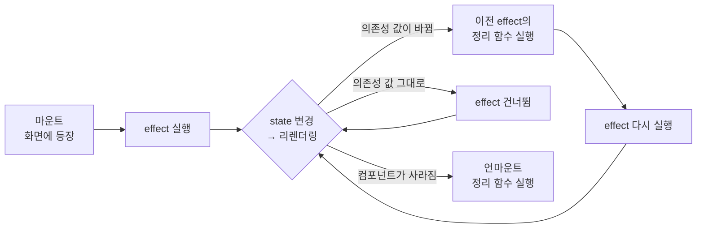
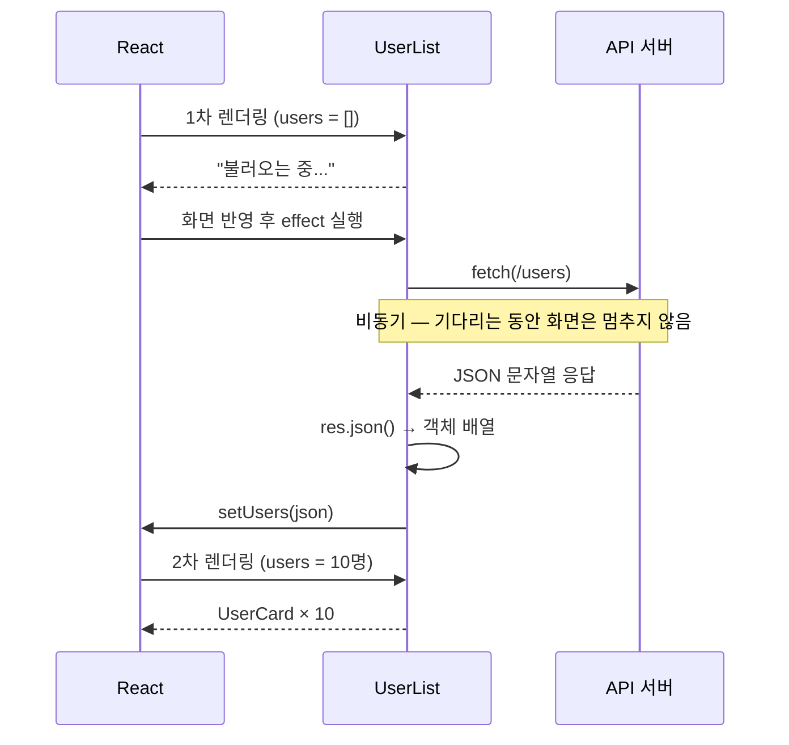
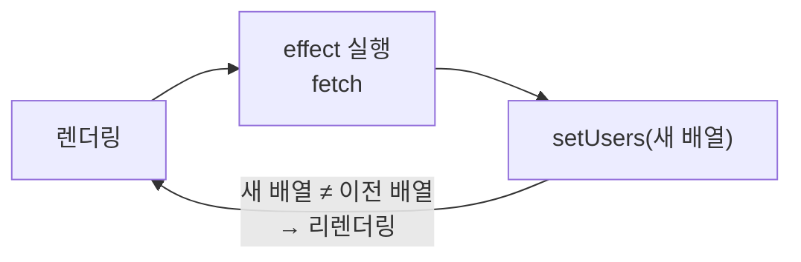
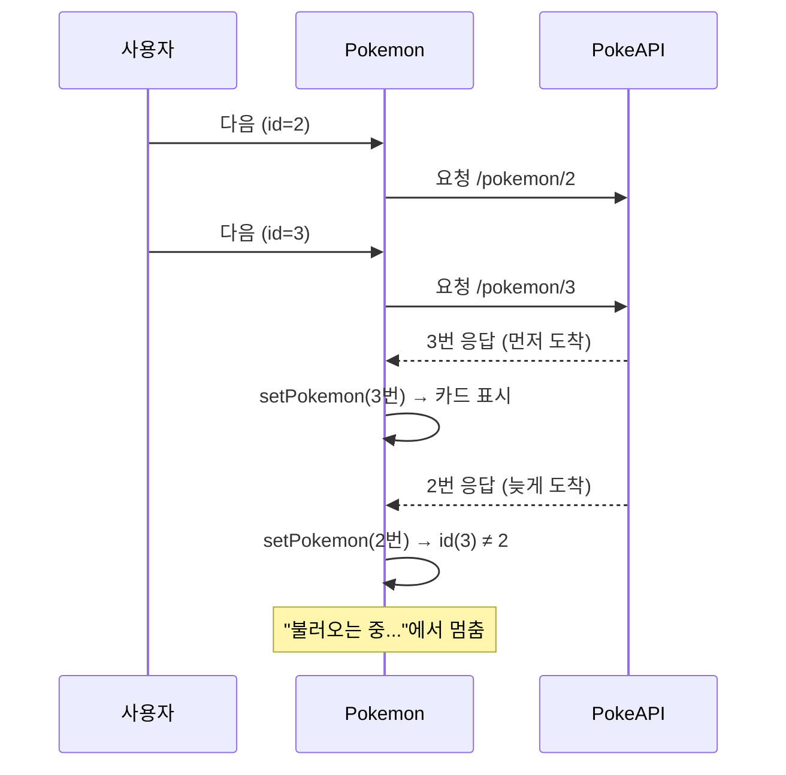

## 들어가며 (Situation)

11/26 React 수업은 어제에 이어 `data-fetch-app-skeleton` 프로젝트의 `src/chap` TODO를 채웠다. 어제까지는 props·state·이벤트로 **화면 안에서** 값을 다뤘다면, 오늘은 **화면 바깥(API)에서 데이터를 가져와** 그리는 단계다.

| 파일 | 주제 |
|------|------|
| `05_useEffect.jsx` | `useEffect`, 의존성 배열 3가지, 정리(clean-up) 함수 |
| `06_fetch.jsx` | 마운트 시 API 호출 → state 저장 → 목록 렌더링 |
| `07_pokemon.jsx` | 종합: 포켓몬 도감 (PokeAPI) |
| `08_simpson.jsx` | 응용: 심슨 ID 카드 도감 (The Simpsons API) |

필기의 첫 줄은 이것이었다.

> `use`로 시작하는 것 = **훅(Hook)**이라고 함

`useState`, `useEffect`처럼 `use`로 시작하는 함수가 훅이다. React 공식 문서도 훅은 `use`로 시작하는 함수이며, **컴포넌트의 최상위에서만** 호출해야 한다(조건문·반복문 안에서 호출 금지)고 규칙을 정해 두었다. ([React 공식 문서 - Rules of Hooks](https://react.dev/reference/rules/rules-of-hooks))

이 글은 수업 코드(`C:\Lecture\12_React\data-fetch-app-skeleton`)를 빌드해서 Edge 브라우저(헤드리스)로 버튼을 누르고 값을 입력하며 콘솔을 확인한 내용이다. 수업 코드에 없는 실험은 원본을 건드리지 않고 **복사본에 실험용 컴포넌트를 붙여** 실행했고, **"예시 코드"**로 표시했다.

## 문제 상황 (Task)

- API 호출은 **언제** 해야 하는가? 컴포넌트 함수 본문에 그냥 `fetch`를 쓰면 안 되는가?
- 필기의 **마운트 / 언마운트**는 무엇이고, `useEffect`와 어떤 관계인가?
- 의존성 배열을 생략 / `[]` / `[count]`로 쓰면 각각 어떻게 다른가? 필기: "**입력하면 실시간으로 키워드 걸리는 거는** `[count]` 같은 방식"
- `useEffect`의 콜백은 왜 `async`로 만들 수 없는가?
- 버튼을 빠르게 누르면 **이전 요청의 응답이 나중에 도착**하는 문제는 어떻게 막는가?
- 과제: 어떤 API든 하나 골라 도감 앱 만들기 → 나는 **심슨 API로 심슨 ID 카드**를 만들었다.

## 해결 과정 (Action)

### 1. 마운트와 언마운트

필기:

> - **마운트 시점**: 컴포넌트가 화면에 등장하는 시점
> - **언마운트 시점**: 컴포넌트가 사용자 화면에서 사라지는 시점

`useEffect`는 이 생애 주기에 맞춰 코드를 실행하는 도구다. 수업 주석: "컴포넌트가 화면에 그려진 **이후**에 실행할 작업을 등록한다. (데이터 요청, 타이머 시작 등)"



**왜 렌더링 "이후"인가?** 수업 주석에 이유가 적혀 있다. "API 호출은 비동기 작업이라 언제 끝날지 알 수 없다. 그래서 화면(컴포넌트)을 먼저 띄워 주고, 응답이 도착하는 대로 데이터를 끼워 넣는다." 11/20에 배운 비동기·이벤트 루프가 여기서 쓰인다. 응답을 기다리는 동안 화면이 멈춰 있으면 안 되니, 먼저 "불러오는 중..."을 그리고 나중에 채운다.

### 2. 의존성 배열 3가지 — 콘솔로 비교하기

```jsx
// 수업 코드 (05_useEffect.jsx)
const [count, setCount] = useState(0);
const [text, setText] = useState('');

// 1. 의존성 배열 없음 → 렌더링될 때마다 실행
useEffect( () => {
    console.log("백엔드에서 메뉴 전체조회 API 호출함!!")
    console.log("[의존성 배열 없음.] 랜더링 이후에 시작")
})

// 2. 빈 배열 → 마운트 시 1번만
useEffect( () => {
    console.log("[빈 배열.] 마운트 시 1번만 실행된다.")
}, [])

// 3. [count] → 마운트 + count가 바뀔 때만
useEffect( () => {
    console.log("[count] 관리하는 count가 바뀔 때만 실행된다.")
}, [count])

console.log("EffectTest 컴포넌트 랜더링!⭐")
```

브라우저에서 ① 처음 접속 → ② `+1` 버튼 한 번 → ③ 입력창에 `abc` 입력, 순서로 콘솔을 받아 보았다.

```text
① 처음 접속 (마운트)
EffectTest 컴포넌트 랜더링!⭐
백엔드에서 메뉴 전체조회 API 호출함!!
[의존성 배열 없음.] 랜더링 이후에 시작
[빈 배열.] 마운트 시 1번만 실행된다.
[count] 관리하는 count가 바뀔 때만 실행된다.

② +1 버튼 클릭 (count 변경)
EffectTest 컴포넌트 랜더링!⭐
백엔드에서 메뉴 전체조회 API 호출함!!
[의존성 배열 없음.] 랜더링 이후에 시작
[count] 관리하는 count가 바뀔 때만 실행된다.

③ 입력창에 abc 입력 (text 변경 3번)
EffectTest 컴포넌트 랜더링!⭐
백엔드에서 메뉴 전체조회 API 호출함!!
[의존성 배열 없음.] 랜더링 이후에 시작
... (위 3줄이 총 3번)
```

두 가지가 눈에 띈다.

1. **"랜더링!⭐"이 항상 effect 로그보다 먼저** 찍힌다. 컴포넌트 함수(렌더링)가 끝나고 화면에 반영된 **뒤에** effect가 실행된다는 증거다.
2. 글자 하나 칠 때마다 "**메뉴 전체조회 API 호출함!!**"이 찍혔다. `abc` 세 글자에 3번. 실제 API였다면 입력과 상관없는 메뉴 목록을 3번 다시 요청한 것이다. 필기의 "문제점: state가 변경되면 리렌더링될 때마다 실행된다"가 이것이다.

| 의존성 배열 | ① 마운트 | ② count 변경 | ③ text 변경 (3번) | 언제 쓰나 (필기) |
|------------|:---:|:---:|:---:|------|
| 생략 | 1 | 1 | **3** | 거의 안 씀 (불필요한 반복 호출) |
| `[]` | 1 | 0 | 0 | 대부분의 백엔드 API 호출. 실시간성이 중요하지 않을 때 |
| `[count]` | 1 | 1 | 0 | 실시간성이 중요할 때. 예: 실시간 검색 |

React 공식 문서의 설명도 같다. 의존성 배열을 생략하면 매 렌더링 후, `[]`이면 처음 한 번, 값을 넣으면 그 값이 `Object.is` 비교로 바뀌었을 때만 다시 실행된다. ([React 공식 문서 - useEffect](https://react.dev/reference/react/useEffect))

#### 필기: "입력하면 실시간으로 키워드 걸리는 거는 `[count]`"

`[count]` 자리에 **검색어 state**를 넣으면 실시간 검색이 된다. 입력할 때마다 검색어가 바뀌고, 바뀔 때마다 검색 API를 호출하는 구조다. (예시 코드)

```jsx
// 예시 코드 — 서버가 검색 API를 제공하는 경우
const [keyword, setKeyword] = useState('');
const [results, setResults] = useState([]);

useEffect(() => {
    async function search() {
        const res = await fetch(`/api/menus?keyword=${keyword}`);
        setResults(await res.json());
    }
    search();
}, [keyword]);   // 입력할 때마다 = keyword가 바뀔 때마다 요청
```

수업 주석에 "**조심해야 할 것?**"이라고 물음표만 남겨 둔 부분이 있다. 실행해 보고 정리한 답은 두 가지다.

- **요청이 너무 많아진다.** `bart`를 치면 `b`, `ba`, `bar`, `bart`로 4번 요청한다. 실무에서는 입력이 멈춘 뒤 일정 시간 후에만 요청하는 **디바운스(debounce)**를 함께 쓴다.
- **응답 순서가 뒤바뀔 수 있다.** `ba`의 응답이 `bart`의 응답보다 늦게 오면 화면이 `ba` 결과로 덮인다. 이 문제는 아래 5번(`ignore`)에서 다룬다.

### 3. 정리(clean-up) 함수 — 숨겨도 계속 도는 타이머

수업 주석: "effect에서 함수를 `return`하면, 컴포넌트가 사라질 때(언마운트) 또는 effect가 다시 실행되기 직전에 실행된다. 타이머처럼 effect에서 시작한 작업은 정리 함수에서 종료해야 한다."

수업 코드의 `Timer`는 TODO 4가 아직 비어 있어서, 토글로 띄워 보니 시간이 멈춰 있었다.

```text
[토글 후 2.5초]  현재 시간: 오후 12:06:05
[다시 2초 후]    현재 시간: 오후 12:06:05   ← setInterval이 없어서 그대로
```

TODO 4가 요구하는 "정리 함수 없이 먼저 토글해 보고, 숨긴 뒤에도 tick이 계속 찍히는 것을 확인하자"를 실험용 컴포넌트 두 개로 비교했다. (예시 코드)

```jsx
// 예시 코드 — 정리 함수 없음
function TimerNoClean() {
    const [time, setTime] = useState(0);
    useEffect(() => {
        setInterval(() => { tickNoClean++; setTime(t => t + 1); }, 1000);
    }, []);
    return <p>no-clean {time}</p>;
}

// 예시 코드 — 정리 함수 있음 (TODO 4 완성 형태)
function TimerClean() {
    const [time, setTime] = useState(0);
    useEffect(() => {
        const id = setInterval(() => { tickClean++; setTime(t => t + 1); }, 1000);
        return () => clearInterval(id);   // 언마운트 시 타이머 종료
    }, []);
    return <p>clean {time}</p>;
}
```

두 타이머를 띄우고 약 3초 뒤 토글로 숨긴 다음, 3초를 더 기다렸다.

| | 숨긴 시점 tick | 숨긴 뒤 3초 후 tick |
|--|:---:|:---:|
| 정리 함수 없음 | 3 | **6** (계속 증가) |
| 정리 함수 있음 | 3 | 3 (멈춤) |

**화면에서 사라졌는데도 정리 함수가 없는 타이머는 계속 돌았다.** 컴포넌트가 언마운트되어도 `setInterval`은 브라우저가 관리하는 작업이라 React가 대신 멈춰 주지 않는다. 시작한 쪽(effect)이 끝내는 것(정리 함수)까지 책임져야 한다. 토글을 여러 번 하면 멈추지 않는 타이머가 계속 쌓인다.

### 4. 마운트 시 API 호출하기 — 가장 많이 쓰는 패턴

```jsx
// 수업 코드 (06_fetch.jsx)
function UserList() {
    const [users, setUsers] = useState([]);            // 1. 빈 값으로 시작

    // [] 빈 배열 why? 최초 1회 컴포넌트 마운트 시점에만 동작하게 하기 위해
    useEffect( () => {                                  // 2. 마운트 시 한 번만
        async function loadUsers() {
            // fetch("api url") : api를 비동기 방식으로 요청, 리턴값은 Promise
            const res = await fetch("https://jsonplaceholder.typicode.com/users");
            // 문자열 json을 진짜 json(객체)으로 변경
            const json = await res.json();
            setUsers(json);                             // 3. state 저장 → 리렌더링
        }
        loadUsers();
    }, []);

    if (users.length === 0) return <h3>불러오는 중...</h3>;

    return (
        <div>
            {/* UserList는 API를 호출하고, 1명을 그리는 자식(UserCard)에게 데이터를 props로 준다 */}
            {users.map( user => <UserCard key={user.id} user={user}/> )}
        </div>
    );
}
```



브라우저에서 확인한 결과: API 요청 **1번**, `UserCard` **10개**가 그려졌다. 어제 배운 것이 모두 들어 있다. `useState`(데이터 보관), `map` + `key`(반복 렌더링), props(`UserCard`에 전달).

`fetch`가 `await`를 두 번 쓰는 이유는 MDN 설명대로 `fetch()`는 **응답 헤더가 도착하면** 끝나는 Promise이고, 본문을 읽어 객체로 바꾸는 `response.json()`도 별도의 Promise이기 때문이다. ([MDN - Using the Fetch API](https://developer.mozilla.org/ko/docs/Web/API/Fetch_API/Using_Fetch))

#### 왜 `useEffect(async () => ...)`로 쓰지 않나

수업 주석: "`useEffect`의 콜백 자체는 `async`로 만들 수 없다(정리 함수만 반환할 수 있다)." `async` 함수는 항상 **Promise를 반환**한다. React는 effect의 반환값을 정리 함수로 보고 나중에 호출하려 하는데, Promise는 함수가 아니다. 그래서 안쪽에 `async function loadUsers()`를 만들고 바로 호출하는 형태를 쓴다. 공식 문서의 데이터 요청 예제도 이 형태다. ([React 공식 문서 - Fetching data with Effects](https://react.dev/reference/react/useEffect#fetching-data-with-effects))

#### 의존성 배열을 빼면? — 5초에 56번 요청

수업 주석: "의존성 배열을 빼면 state 변경 → 리렌더링 → effect 실행 → 다시 요청... 이 무한 반복된다." 실제로 확인했다. (예시 코드)

```jsx
// 예시 코드 — 06_fetch에서 [] 만 뺀 형태
useEffect(() => {
    async function load() {
        const res = await fetch('https://jsonplaceholder.typicode.com/users');
        setUsers(await res.json());
    }
    load();
});   // ← 의존성 배열 없음
```

```text
[접속 후 약 5초] fetch 호출 56번 / 네트워크 요청 56건
```



응답 내용은 매번 똑같은 10명인데도 멈추지 않았다. `res.json()`은 매번 **새 배열 객체**를 만들고, React는 `Object.is`로 비교하므로 내용이 같아도 "바뀌었다"고 판단해 다시 렌더링한다. 의존성 배열이 없으니 렌더링될 때마다 또 요청한다. 실제 백엔드였다면 접속한 사용자 한 명이 초당 10건 넘게 서버를 두드리는 셈이다.

### 5. 종합: 포켓몬 도감 — `[id]`로 다시 요청하기

```jsx
// 수업 코드 (07_pokemon.jsx)
const [id, setId] = useState(1);
const [pokemon, setPokemon] = useState(null);

// 요구사항: 이전/다음 버튼을 누를 때마다 해당 id의 포켓몬 API를 호출한다.
// => id가 변경될 때마다 API를 새로 호출해야 한다 => 의존성 배열에 id
useEffect( () => {
    async function loadPokemon() {
        const res = await fetch(`https://pokeapi.co/api/v2/pokemon/${id}`);
        const json = await res.json();
        setPokemon(json);
    }
    loadPokemon();
}, [id])

return (
    <>
        <button onClick={() => setId(prev => prev - 1)} disabled={id === 1}>이전</button>
        <span> No.{id} </span>
        <button onClick={() => setId(prev => prev + 1)}>다음</button>
        {pokemon?.id === id ? <PokemonCard pokemon={pokemon}/> : <h3>불러오는 중...</h3>}
    </>
);
```

| 배운 것 | 포켓몬 도감에서 |
|--------|----------------|
| state | 현재 번호 `id`, 받아온 데이터 `pokemon` |
| event | 이전/다음 버튼 → `setId(prev => prev ± 1)` |
| useEffect | `[id]` — 번호가 바뀔 때마다 다시 요청 |
| props | 받아온 데이터를 `PokemonCard`에 전달 |
| 반복 렌더링 | `pokemon.types.map(...)` 타입 목록 |

실행 결과: 처음엔 `bulbasaur`(키 0.7m / 몸무게 6.9kg / 타입 grass, poison). `다음`을 3번 누르자 요청이 `2`, `3`, `4`로 3번 나갔고 `No.4 charmander`가 나왔다. (PokeAPI는 키를 데시미터, 몸무게를 헥토그램 단위로 주기 때문에 `/ 10`으로 m, kg로 바꾼다. [PokeAPI 문서 - Pokemon](https://pokeapi.co/docs/v2#pokemon))

`pokemon?.id === id` 조건도 의미가 있다. 버튼을 누른 직후 `id`는 이미 2인데 `pokemon`은 아직 1번 데이터다. 이때 1번 카드를 그대로 보여주면 "No.2" 옆에 bulbasaur가 보이는 어긋난 화면이 된다. 그래서 **받아온 데이터의 번호와 현재 번호가 같을 때만** 카드를 그린다.

#### 아직 못 채운 TODO 4: 응답 순서가 뒤바뀌면?

수업 주석: "버튼을 빠르게 누르면 이전 요청의 응답이 나중에 도착해 화면을 덮어쓸 수 있다." 내 `07_pokemon.jsx`에는 이 처리(TODO 4)가 아직 없다. 실험 환경에서는 응답이 빨라 재현되지 않았지만, 코드로 따져 보면 이런 상황이 생길 수 있다.



`pokemon?.id === id` 덕분에 잘못된 카드가 보이지는 않지만, 대신 **"불러오는 중..."에서 영영 멈춘다.** 해결은 심슨 도감에 적용한 `ignore` 패턴이다.

```jsx
// 수업 코드 (08_simpson.jsx) — 07에도 같은 방식으로 넣으면 된다
useEffect(() => {
    let ignore = false;

    async function loadCharacter() {
        const res = await fetch(`https://thesimpsonsapi.com/api/characters/${id}`);
        const json = await res.json();
        if (!ignore) setCharacter(json);   // 아직 유효한 요청일 때만 저장
    }
    loadCharacter();

    return () => { ignore = true; };       // id가 바뀌면 이전 effect의 ignore를 true로
}, [id]);
```

`id`가 2 → 3으로 바뀌면 **2번 effect의 정리 함수**가 먼저 실행되어 그 effect의 `ignore`가 `true`가 된다. 2번 응답이 늦게 와도 `setCharacter`를 건너뛴다. 3번에서 본 정리 함수가 타이머뿐 아니라 **"이제 필요 없어진 비동기 작업의 결과 무시"**에도 쓰인다. React 공식 문서가 race condition 해결 방법으로 소개하는 것도 이 패턴이다. ([React 공식 문서 - Fetching data](https://react.dev/learn/synchronizing-with-effects#fetching-data))

### 6. 과제: 심슨 API로 ID 카드 도감 만들기

필기:

> 해볼 것: 어떤 API를 사용해서 포켓몬 도감 앱 만들기
> → 심슨 API로 심슨 ID card를 만듦

[The Simpsons API](https://thesimpsonsapi.com)도 PokeAPI처럼 키 없이 쓸 수 있다. 구조는 포켓몬 도감과 같게 두고, 카드만 ID 카드처럼 꾸몄다. 값은 API 응답만 쓰고, 없는 값(`null`)은 `??` 연산자로 `-`를 표시했다.

완성한 화면 (3번 Bart Simpson):


| 화면 요소 | 사용한 것 |
|----------|----------|
| 이전 / 다음 / 번호 이동 | event + `setId` → `[id]` effect가 다시 요청 |
| 사진 | CDN 주소 + 응답의 `portrait_path` |
| 생년월일 ~ 상태 | 응답 값을 `IdCard`에 props로 전달, 없으면 `-` |
| 명대사 목록 (스크롤) | `phrases.map(...)` 반복 렌더링 |
| 첫 등장 | 응답의 `first_appearance_ep` (S1 E1, 1989-12-17) |

```jsx
// 수업 코드 (08_simpson.jsx) — IdCard 일부
<dl>
    <dt>생년월일</dt> <dd>{character.birthdate ?? '-'}</dd>
    <dt>나이</dt>     <dd>{character.age ?? '-'}</dd>
    <dt>직업</dt>     <dd>{character.occupation ?? '-'}</dd>
</dl>


{character.phrases.length > 0 && (
    <ul>{character.phrases.map(p => <li key={p}>“{p}”</li>)}</ul>
)}
```

| | 포켓몬 도감 | 심슨 도감 |
|--|------------|----------|
| API | `pokeapi.co/api/v2/pokemon/{id}` | `thesimpsonsapi.com/api/characters/{id}` |
| 이미지 | 응답에 전체 URL (`sprites.front_default`) | 응답엔 경로만 → CDN 주소 + `portrait_path` |
| 반복 렌더링 | 타입 목록 | 명대사(`phrases`) 목록 |
| 경쟁 상태 처리 | 미완성 (TODO 4) | `ignore` 적용 |
| 추가 기능 | - | 이름 검색, 번호로 바로 이동 |

#### 이름 검색: API가 검색을 지원하지 않을 때

여기서 2번의 "실시간 검색 = `[keyword]`"를 그대로 쓰려 했지만, 이 API는 이름 검색을 지원하지 않았다(`?name=`을 붙여도 무시됨). 그래서 방법을 바꿨다.

| 방법 | 동작 | 이 API에서 |
|------|------|-----------|
| A. `[keyword]` effect로 검색 API 호출 | 입력할 때마다 서버에 요청 | 불가 (검색 API 없음) |
| **B. 처음 한 번 전체 이름 목록을 받고, 입력 시 `filter`** | 요청은 처음 한 번, 검색은 브라우저에서 | **선택** |

```jsx
// 수업 코드 (08_simpson.jsx) — 처음 한 번만 전체 목록(20명씩 60페이지)을 받는다
useEffect(() => {
    let ignore = false;
    async function loadNames() {
        const pages = Math.ceil(MAX_ID / 20);
        // 60개의 요청을 동시에 보내고, 모두 끝날 때까지 기다린다.
        const jsons = await Promise.all(
            Array.from({length: pages}, (_, i) =>
                fetch(`https://thesimpsonsapi.com/api/characters?page=${i + 1}`).then(res => res.json())
            )
        );
        const list = jsons.flatMap(json => json.results.map(c => ({id: c.id, name: c.name})));
        if (!ignore) setNames(list);
    }
    loadNames();
    return () => { ignore = true; };
}, []);

// 검색 결과는 effect 없이, 렌더링 중에 계산한다
const results = keyword.trim() === ''
    ? []
    : names
        .filter(c => c.name.toLowerCase().includes(keyword.trim().toLowerCase()))
        .slice(0, 10);
```

실행 결과: 목록 요청 **60건**이 동시에 나갔고, 접속 후 **약 1.5초** 만에 검색창이 활성화됐다. `bart`를 입력하자 추가 요청 없이 바로 7명이 나왔다.

```text
No.3 Bart Simpson
No.139 Bartman (character)
No.460 Retirement Castle administrator (Bart the General)
No.506 Rex (Bart of Darkness)
No.586 Bart Junior (frog)
No.795 El Barto
No.1121 Andy (Bart vs. Australia)
```

두 가지를 배웠다.

- **`Promise.all`**: 60개를 `for`문에서 하나씩 `await`하면 앞 요청이 끝나야 다음이 출발한다. `Promise.all`은 한꺼번에 출발시키고 **모두 끝날 때까지** 기다린다. 하나라도 실패하면 전체가 실패(reject)한다는 점은 주의해야 한다. ([MDN - Promise.all()](https://developer.mozilla.org/ko/docs/Web/JavaScript/Reference/Global_Objects/Promise/all))
- **검색 결과는 `useEffect`로 만들지 않았다.** `names`와 `keyword`만 있으면 계산되는 값이라 렌더링 중에 바로 구했다. `results`를 state로 두고 `[keyword]` effect에서 `setResults`를 하면 렌더링이 한 번 더 일어날 뿐이다. React 공식 문서도 "기존 props나 state로 계산할 수 있는 값은 state에 넣지 말고 렌더링 중에 계산하라"고 권한다. ([React 공식 문서 - You Might Not Need an Effect](https://react.dev/learn/you-might-not-need-an-effect))

즉, `useEffect`는 **화면 바깥과 맞춰야 할 때**(API 호출, 타이머) 쓰는 것이고, 화면 안의 값끼리 계산하는 데는 필요 없다.

## 결과 (Result)

| 확인한 것 | 결과 |
|----------|------|
| 의존성 배열 생략 + 입력 3글자 | "API 호출" 로그 **3번** (입력과 무관한 요청 반복) |
| `[]` / `[count]` + 입력 3글자 | **0번** |
| `06_fetch` 정상 코드 | 요청 **1번**, 카드 **10개** |
| `06_fetch`에서 `[]`만 삭제 | 약 5초에 요청 **56번** (무한 반복) |
| 정리 함수 없는 타이머, 숨긴 뒤 3초 | tick 3 → **6** (계속 동작) |
| 정리 함수 있는 타이머, 숨긴 뒤 3초 | tick 3 → **3** (멈춤) |
| 포켓몬 `다음` × 3 | 요청 3번, No.4 charmander |
| 심슨 이름 목록 | 요청 60건 동시, **약 1.5초** 후 검색 가능 / `bart` 검색 7명 (추가 요청 0) |

배운 점:

- **`useEffect`는 "언제 실행할지"를 의존성 배열로 정하는 도구다.** API 호출은 대부분 `[]`, 특정 값에 따라 다시 불러와야 하면 `[그 값]`. 배열을 생략하는 경우는 거의 없다.
- **시작한 것은 정리 함수로 끝낸다.** 타이머는 `clearInterval`, 비동기 요청은 `ignore`로 늦게 온 결과를 무시한다.
- 어제의 핵심이었던 **역할 분리**가 오늘 완성됐다. 백엔드(여기서는 공개 API)는 JSON만 주고, 어떤 화면에 어떻게 그릴지는 프론트가 정했다. 같은 구조로 포켓몬과 심슨 두 도감을 만들 수 있었던 것도 그 덕분이다.
- 남은 일: `07_pokemon.jsx` TODO 4(`ignore`)와 `05_useEffect.jsx` TODO 4(타이머 + 정리 함수) 채우기.

## 더 학습하면 좋은 개념

- **React Query (TanStack Query)** — 오늘 직접 만든 "로딩 상태, 응답 순서 처리, 다시 요청"을 대신해 주는 라이브러리다. `useEffect` + `fetch`의 불편함을 겪어 본 지금 보면 왜 필요한지 바로 보인다.
- **디바운스(Debounce)** — 실시간 검색에서 글자마다 요청이 나가는 문제를 줄이는 기법. `[keyword]` effect와 `setTimeout` + 정리 함수로 직접 구현해 보면 오늘 배운 내용을 복습할 수 있다.
- **AbortController** — `ignore`는 응답을 "무시"할 뿐 요청 자체는 끝까지 간다. `AbortController`는 진행 중인 `fetch`를 실제로 **취소**한다.
- **로딩 / 에러 상태 처리** — 오늘 코드는 `res.ok`를 확인하지 않아서 404·500 응답도 그대로 `json()`을 시도한다. `try/catch`와 에러 state를 두는 방법을 익히면 실제 백엔드와 붙일 때 바로 쓸 수 있다.
- **StrictMode의 effect 2번 실행** — 개발 모드에서 `<StrictMode>`를 켜면 effect가 마운트 직후 한 번 더 실행된다. 정리 함수를 빠뜨린 코드를 일부러 드러내기 위한 장치라서, 오늘 본 타이머 문제와 연결된다.

## 참고 자료

- [React 공식 문서 - useEffect](https://react.dev/reference/react/useEffect)
- [React 공식 문서 - Synchronizing with Effects](https://react.dev/learn/synchronizing-with-effects)
- [React 공식 문서 - You Might Not Need an Effect](https://react.dev/learn/you-might-not-need-an-effect)
- [React 공식 문서 - Rules of Hooks](https://react.dev/reference/rules/rules-of-hooks)
- [MDN - Using the Fetch API](https://developer.mozilla.org/ko/docs/Web/API/Fetch_API/Using_Fetch)
- [MDN - Promise.all()](https://developer.mozilla.org/ko/docs/Web/JavaScript/Reference/Global_Objects/Promise/all)
- [PokeAPI 문서](https://pokeapi.co/docs/v2)
- [The Simpsons API](https://thesimpsonsapi.com)
